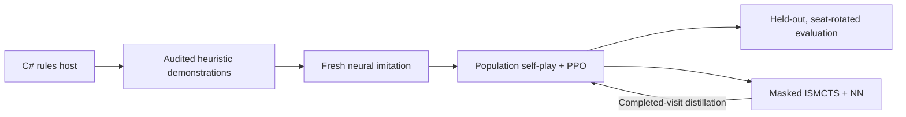

# Brass: Birmingham AI

**Offline game AI, imperfect-information search, and neural self-play for the Steam edition of Brass: Birmingham.**

This project connects a Unity/C# rules engine to a Python/PyTorch training pipeline. It combines hidden-information search, heuristic imitation, population self-play, and evaluation across opponents and player seats. The goal is a stronger local opponent with varied playing styles and difficulty suited to laptop play.

**Current status:** Six heuristic search styles and the local game integration are implemented and verified. Neural self-play training is in progress; learned personalities, calibrated neural difficulty, and laptop neural deployment remain to be qualified.

**Stack:** Python · PyTorch · C# · Unity/Mono · ONNX · PowerShell

## Technical highlights

- **Search with hidden information.** A shared C# implementation of Masked Information Set Monte Carlo Tree Search (Masked ISMCTS) samples plausible hidden worlds from the acting player's permitted view. Opponent policies receive their own masked views, and completed simulations retain all four players' returns.
- **Compact four-player model.** An MLP-ResNet scores variable legal-action sets and predicts four-seat win share, placement, and victory points. The model has **1,840,109 parameters** for imitation and **1,850,129** with the utility head used by PPO and neural search.
- **Resumable training.** Audited heuristic imitation feeds population self-play with Proximal Policy Optimization (PPO) and search-visit distillation. CPU feature preparation, shared CPU/GPU inference, bounded worker admission, checkpoint lineage, and retention support long-running experiments.
- **Evaluation controls.** Frozen opponents, held-out setups, seat rotations, and model selection using confidence intervals separate training progress from measured playing strength. Cancelled, late, or incomplete search work cannot supply teacher labels.
- **Game integration.** Six V4 heuristic styles have independent **2/5/12-second** difficulty allowances. The local patch also adds public-information card tracking, end-game statistics, game history, rules repairs, and save/recovery fixes.

## How it works

Four-player Brass combines hidden cards, shared resources, a changing turn order, and long-term economic planning. The system must evaluate each player's outcome without treating the next player's value as its negative, and it must plan both actions of a turn within one search budget.



The rules host supplies permitted observations and complete legal choices. Dynamic legality, batch padding, and progressive search expansion have separate masks, so a large action set is processed in chunks rather than silently truncated. The shared search implementation serves both the heuristic game opponents and the research pipeline; trained neural models are not yet installed in the game.

The active recipe begins with random weights and audited heuristic data. Compatible completed imitation runs can hand off to self-play, and reviewed runs can resume with their lineage and optimizer state preserved. Older bundled bootstrap checkpoints are archival artifacts, not initializers for the current recipe. See the [current training guide](docs/TRAINING_RECOVERY_LAB.md) for the exact workflow.

## Validation and current status

The linked reports record checks executed against their stated source and runtime versions:

| Area | Recorded evidence |
| --- | --- |
| Rules host and information boundary | Five complete four-player games, 46 restored checkpoints, and 328 counterfactual observation checks; standalone .NET and Unity Mono replay agreement. [Host validation](docs/R1_EXIT_CHECKS.md) |
| Shared search and game opponents | All six V4 styles, legal turn completion, clocks, cancellation, resource lifecycle, and older saved profiles; **1,218 native assertions** in the selected V4 release. [V4 runtime checks](docs/MASKED_V4_1.4.20.md) |
| Neural training pipeline | End-to-end imitation, self-play, resume, evaluation, CPU batching, and completed-visit distillation checks. [Search/training implementation checks](docs/MASKED_ISMCTS_EXIT_CHECKS.md) and [current training revisions](docs/TRAINING_RECOVERY_LAB.md) |
| Statistics and game history | **5,805 Statistics checks** and **3,999 Game History checks**, plus native visual inspection, for patch 1.4.30. [Game UI validation](docs/STATISTICS_GEOGRAPHY_1.4.30.md) |

These results establish tested behavior and compatibility within their documented scope. They do not establish stronger neural play or calibrated difficulty. The V4 bank was selected without a new qualifying strength tournament. The neural parent is still training, and the game's **Gamma** model slots remain unavailable. Local CPU checks also do not establish lab CUDA throughput or cross-platform qualification.

## Getting started

### Explore without game files or a GPU

```sh
git clone https://github.com/riverside234/ai-training.git
cd ai-training
```

In an isolated **Python 3.10+** environment, run the reference and contract checks:

```sh
python -m pip install -r requirements-r0.txt
python scripts/verify-r0.py
python -m unittest discover -s tests/R0 -p "test_*.py" -v
```

These checks need no game installation, GPU, or network access after dependency installation. They validate reference metadata, observation/action contracts, and four-player value semantics. See the [contract guide](docs/R0_CONTRACTS.md) for their scope.

### Train or evaluate against the game engine

Engine-backed collection requires your own compatible Steam game installation and a privately transferred, fingerprint-verified rules/runtime bundle. A clone alone does not supply those dependencies.

Start with the [current conda training guide](docs/TRAINING_RECOVERY_LAB.md) for runtime import, CPU/CUDA preflight, demonstration auditing, fresh imitation, self-play, and evaluation. The [rules-host guide](docs/R1_HOST.md) covers the Windows host build and APIs. Keep the game installation outside a new clone; generated runtime files and experiments belong under ignored `artifacts/`.

### Use the local game patch

Read the [patch build and restoration guide](docs/LOCAL_PATCH.md), [selected V4 opponent notes](docs/MASKED_V4_1.4.20.md), and [latest documented UI release](docs/STATISTICS_GEOGRAPHY_1.4.30.md). The patch is for offline play: online play is disabled while it is installed, and games created with its versioned identifiers require a compatible patch to continue.

## Repository guide

| Location | Contents |
| --- | --- |
| [src/brass_ai/](src/brass_ai/) | Python host client, models, training, search coordination, evaluation, and personality research |
| [src/BrassHost/](src/BrassHost/) and [src/BrassSearchHost/](src/BrassSearchHost/) | C# rules-host and search-runtime adapters |
| [src/BrassMaskedSearch/](src/BrassMaskedSearch/) | Shared Masked ISMCTS implementation |
| [src/BrassLocalAI/](src/BrassLocalAI/) and [src/BrassPatch/](src/BrassPatch/) | Local AI integration, rules/save repairs, and game UI |
| [configs/](configs/) and [training/](training/) | Versioned contracts, experiment presets, frozen opponent banks, and selected reproducibility artifacts |
| [tests/](tests/) and [scripts/](scripts/) | Python/C# regression checks, runtime verification, builders, and experiment entry points |
| [docs/](docs/) | Setup guides, implementation checks, and versioned release notes |
| [ai-research/](ai-research/) and [rules-audit/](rules-audit/) | Design decisions, research reviews, rules audits, and historical probes |

Earlier R2/R3 and R4/R5 recipes remain available as implementation history. Use the current training guide for active commands and compatibility rules.

## Next milestones

- Measure the trained model against frozen opponents on unseen setups and across all four seats.
- Complete learned-style discovery and validate distinct personalities and difficulty levels. The [personality plan](ai-research/PERSONALITIES_AND_DIFFICULTY_PLAN.md) and [implemented research workflows](docs/PERSONALITY_P0_P1_LAB.md) describe this stage.
- Qualify laptop inference and integrate trained neural opponents into the game.

## Attribution and repository boundaries

The project draws on pinned Daiyu AI and OpenSpiel references. See the [reference provenance](docs/R0_REFERENCE_NOTICES.md), [learning-component attribution](src/brass_ai/learning/NOTICE.md), and [learning-component license](src/brass_ai/learning/LICENSE) for scope and licensing.

Game executables, Unity assets, proprietary managed assemblies, decompiled game source, private runtime bundles, bulk replay, and generated experiment checkpoints are excluded from Git. Selected weights and project-authored workers under `training/` have explicit exceptions; their private game dependencies are still required. Some historical audit links point to local files or generated evidence that is not included in a clone.
