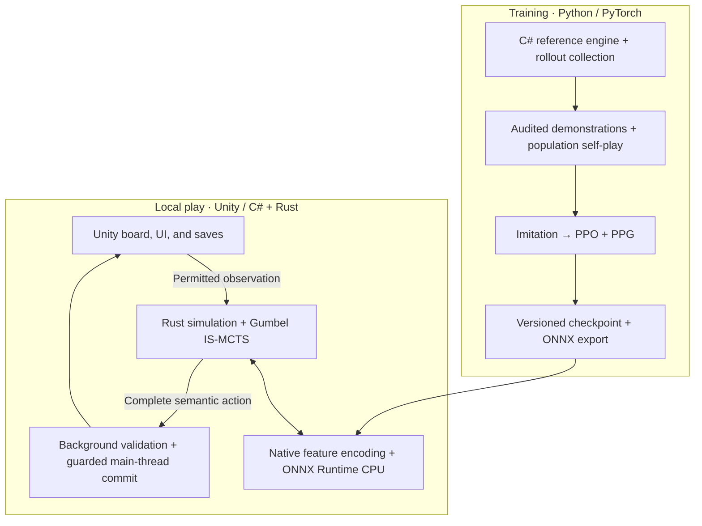

# Brass: Birmingham AI

**Four-player, imperfect-information AI: neural self-play, native Rust search, and integration with the Steam game.**

An independent AI project for *Brass: Birmingham*, an economic strategy game with hidden cards, shared resources, and changing turn order. It connects Python/PyTorch reinforcement learning to a playable CPU opponent through a Rust simulator, Gumbel IS-MCTS search, and Unity/C# integration.

**Stack:** Rust · Python · PyTorch · C# · Unity/Mono · ONNX Runtime

[Architecture](#architecture) · [Training](#training) · [Getting started](#getting-started) · [Validation and benchmarks](docs/VALIDATION_RESULTS.md) · [Repository guide](#repository-guide)

## Current status

- **Local Rust backend released:** version 1.4.37 integrates native simulation, feature encoding, Gumbel IS-MCTS, and ONNX Runtime CPU inference with the Windows game. The [latest hotfix](ai-research/TURN_HISTORY_HOTFIX_1_4_37.md) repairs city cancellation and checkpoints each completed human or AI turn.
- **Neural training continues:** the in-game **Alpha Test** option uses a pinned intermediate checkpoint; the final neural model is still in training.
- **Two opponent families:** six V4 heuristic styles or the neural opponent, with independent **4 / 8 / 10 / 12-second** settings for each AI seat. A table uses one AI family throughout.

Alpha Test uses Gumbel root candidate **K=8 at 4s** and **K=16 at 8s, 10s and 12s**, configured in [`local-gumbel-k.json`](configs/search/local-gumbel-k.json). Each turn keeps its seat's K across both actions; the existing legal-action and simulation-budget limits can reduce the effective candidate count.

Neural play supports standard four-player local tables with a human; V4 also supports two and three players. Training still uses the existing collection backend; extending Rust to collection is a subsequent stage.

## Technical highlights

- **Information-set search in Rust.** Gumbel IS-MCTS samples plausible hidden worlds, explores roots through sequential halving, and backs up all four players' outcomes. Both actions of a turn share one deadline.
- **Native simulation and inference.** Typed staged rules, reusable feature buffers, arena-owned trees, and persistent ONNX sessions keep the simulation loop inside Rust. Two independent search sessions each use one compute thread, including inference.
- **A model for multiplayer decisions.** The v11.2 network combines grouped state projections, a 512-wide residual trunk with eight blocks, local entity features, and a shared scorer for variable legal-action sets. It predicts win share, placement, victory points, and remaining utility for every seat.
- **Policy and critic separation.** Opponent descriptors condition only the critic; deployment uses unknown descriptors. Policies see permitted information, with masks preserving the full legal-action set.
- **Resumable reinforcement learning.** Heuristic imitation feeds population self-play with Proximal Policy Optimization (PPO) and a Phasic Policy Gradient (PPG) value phase. Replay admission, branch continuations, behavior-probability checks, and optimizer rollback support reproducible recovery.
- **Safe game integration.** Detached snapshots undergo full validation through the existing background scheduler. Main-thread commits recheck identity, revision, actor, cancellation, and legality. Save/load, worker failure, and installation rollback have explicit recovery paths.

## Architecture



The C# engine provides the reference for cross-language checks. Rust reuses an attributed upstream rules crate, adapted to the target game's staged actions, chance, debt, and scoring. The existing C# Masked ISMCTS remains available for V4 and reference comparisons.

Policies receive public information, their own hand, and permitted recall. Each simulated actor receives its own view. Versioned state, model, feature, and request identities prevent stale work from becoming a live action.

## Training

The current recipe mixes self-play, frozen historical opponents, and V4 opponents. Actor updates use eligible learner decisions; critic fitting has separate role and whole-game holdout rules. Optional ownership/scoring heads share the critic representation, with future outcomes confined to training targets.

Recent revisions add three-decision opening exploration, fresh opening windows after forks, a decoupled PPO opening objective, and PPG fitting over two iterations of critic data. Exact KL and held-out loss checks govern retained updates. Checkpoints preserve weights, optimizer moments, RNG, replay provenance, population, and progress.

Ordinary training currently uses policy-only collection. Optional search teachers and distillation have separate admission rules.

See the [current recipe and continuation notes](ai-research/TRAINING_G1120_REVISION.md), [critic architecture and data admission](ai-research/OPPONENT_CRITIC_DESCRIPTORS_REPORT.md), and [checkpoint transfer and recovery guide](docs/STEP5_MACHINE_TRANSFER.md).

## Validation summary

Validation covers cross-language rules and neural-output parity, complete games, deadlines, cancellation, save/load, and rollback. Recorded local comparisons show **48.8% lower median worst-frame time** from background validation and **48.4% fewer counted managed validation bytes** in a separate controlled probe. These measurements have different scopes and do not establish neural playing strength or performance on other hardware. See [validation results, benchmarks, and limitations](docs/VALIDATION_RESULTS.md).

## Getting started

### Explore the algorithm without game files or a GPU

The small Gumbel IS-MCTS reference and its tests use only Python's standard library:

```sh
git clone https://github.com/riverside234/brass-birmingham-ai.git
cd brass-birmingham-ai
python scripts/reproduce-gumbel-is-mcts.py --simulations 128 --seed 7
python -m unittest discover -s tests/GumbelISMCTS -p "test_*.py" -v
```

The [algorithm reference](ai-research/GUMBEL_IS_MCTS_REFERENCE.md) explains this small hidden-information game, recorded-draw replay, and the connection to the full Brass implementation.

For observation/action contracts and multiplayer value checks, use an isolated **Python 3.10+** environment:

```sh
python -m pip install -r requirements-r0.txt
python scripts/verify-r0.py
python -m unittest discover -s tests/R0 -p "test_*.py" -v
```

See the [contract guide](docs/R0_CONTRACTS.md) for coverage. These checks run offline after dependency installation.

### Work with the full system

Full collection and Unity integration require a compatible Steam installation and verified runtime dependencies, supplied separately from the source clone. Keep the checkout separate from the game installation; generated builds and experiments belong under ignored `artifacts/`.

- **Native backend:** start with the [Rust workspace](native/Cargo.toml), [pinned toolchain](native/rust-toolchain.toml), and [migration design](ai-research/RUST_AI_BACKEND_MIGRATION_PLAN.md).
- **Training and evaluation:** use the [current training recipe](ai-research/TRAINING_G1120_REVISION.md), versioned presets under [configs/step5/](configs/step5/), and the [reference-host guide](docs/R1_HOST.md).
- **Local game integration:** the [local release report](ai-research/RUST_BACKEND_LOCAL_RELEASE.md) describes the supported package, installation prerequisites, and exact rollback. The patch is for offline play; online play is disabled while installed, and modified saves need a compatible runtime.

## Repository guide

| Location | Purpose |
| --- | --- |
| [native/brass-ai-core/](native/brass-ai-core/) | Rules adapter, permitted observations, world sampling, features, and Gumbel IS-MCTS |
| [native/brass-ai-inference/](native/brass-ai-inference/) | Same-process ONNX evaluation and session-owned buffers |
| [native/brass-ai-worker/](native/brass-ai-worker/) | Two-session coordination, deadlines, cancellation, and local process protocol |
| [src/brass_ai/](src/brass_ai/) | PyTorch models, imitation, PPO/PPG, replay admission, evaluation, and recovery |
| [src/BrassLocalAI/](src/BrassLocalAI/) | AI selection, execution scheduling, native bridge, and action validation |
| [src/BrassHost/](src/BrassHost/) · [src/BrassSearchHost/](src/BrassSearchHost/) · [src/BrassMaskedSearch/](src/BrassMaskedSearch/) | Reference engine adapters and C# Masked ISMCTS |
| [src/BrassPatch/](src/BrassPatch/) | Rules/save repairs, card tracking, statistics, and game history |
| [configs/](configs/) · [training/](training/) | Versioned contracts, experiment recipes, opponent banks, and selected model artifacts |
| [tests/](tests/) · [scripts/](scripts/) | Regression suites, parity tools, benchmark harnesses, builders, and training entry points |
| [docs/](docs/) · [ai-research/](ai-research/) | Guides, architecture decisions, experiment reviews, and release reports |

## Next steps

- Evaluate the final neural model against frozen opponents on unseen setups and across all four seats.
- Extend the qualified Rust simulation backend to training collection, with separate Linux/GPU and replay-equivalence checks.
- Validate learned playing styles and model-specific difficulty calibration.

## Attribution and distribution

Credits and component-specific licenses for Daiyu AI, OpenSpiel, and the Gumbel IS-MCTS references are preserved in the [native rules notice](native/vendor/brass-upstream-rules/NOTICE.md), [learning notice and license](src/brass_ai/learning/NOTICE.md), [search notice](src/BrassMaskedSearch/NOTICE.md), and [algorithm reference](ai-research/GUMBEL_IS_MCTS_REFERENCE.md).

Game binaries/assets, proprietary assemblies, decompiled game source, private runtime bundles, bulk replay, and generated checkpoints are excluded from Git, with explicit exceptions for selected model artifacts. The [results page](docs/VALIDATION_RESULTS.md) explains evidence availability. This project is independent of the game's publisher and developers.
