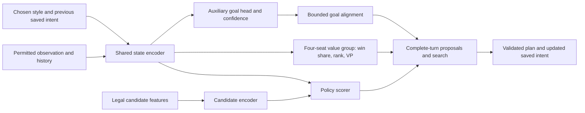

# Personalities and difficulty calibration

**Updated 2 October 2026 for Step 5 recipe `step5-training/2.2.0`.** This plan begins **after the revised fresh Step 5 run finishes**, using a selected self-trained checkpoint from that run. Step 5 starts a 1,840,109-parameter MLP-ResNet from random weights, may perform audited heuristic imitation within that run, and then uses population self-play and separate Masked ISMCTS NN distillation. This later stage adds personalities to the trained result; it does not restart the learner from random weights or resume Step 5 with a changed objective.

The only personality search backend is **Masked ISMCTS + NN**. S1/S2/S3 and the separate R4/OpenSpiel comparison branches are retired implementation dependencies. Heuristic Masked v4 has different evaluation/search settings and remains an occasional opponent. The shared policy/value/goal architecture and **16 visible archetypes × eight hidden variants = 128** remain the product target.

This is the detailed design for [implementation step 7](IMPLEMENTATION_PLAN.md#7-add-personalities-and-calibrate-difficulty). Use the [current training guide](../docs/TRAINING_RECOVERY_LAB.md), [Masked ISMCTS plan](MASKED_ISMCTS_REVISION_PLAN.md) and actual completed-run manifests as the handoff references. The goal head, personality importer, behavior archive, goal-biased search and calibrated roster below are **planned, not implemented or qualified**. This update changes documentation only and does not assert that Step 5 training has finished.

## 1. Decisions and boundaries

Adopt the proposed **single shared policy/value/goal network with bounded soft goal priors**, and add an **AURORA-inspired offline quality-diversity workflow** for discovering further personalities. Preserve the original aim: enjoyable, coherent four-player opponents, several styles at each difficulty, and every shipped Easy style stronger than original Hard.

These additions build on the current system:

| Existing foundation | Planned extension |
| --- | --- |
| Trained MLP-ResNet state encoder, Daiyu-derived candidate scorer and four-seat heads | Add a small auxiliary goal head to the same shared state representation. |
| Four-seat win-share, placement and VP outputs | Retain all three value outputs and their stable seat identities. Do not replace them with a two-player scalar value. |
| Four style features and eight intent features | Define a versioned personality/intent contract; preserve the meaning of existing fields when importing old data. |
| v4's productive-development intent fix and neural industry contexts | Learn coherent, revisable intent without treating useful development toward a target tier as a stall. |
| Selected Masked ISMCTS with CPU batching, dynamic masks and progressive top-K | Add bounded root goal priors while preserving complete legality, pending-request isolation and protected/unpruned alternatives. |
| Completed self-play-first Step 5 training | Warm-start from its selected trained checkpoint; discover and fine-tune styles in a separately identified post-training run. |

Use the residual backbone trained by the revised Step 5 run: the current medium layout has 1,840,109 total parameters, width 304, four residual blocks, a width-128 candidate encoder and width-128 policy/value hidden heads. Its main-model ceiling is 2M. Preserve that trained trunk; do not substitute the earlier dense medium checkpoint. Later goal/context additions may bring the full model up to 2.10M, though the base plus 100,000 extra parameters still fits below 2M. Keep four initial pilot profiles: Industrialist, Networker, Supplier and Investor. The roster remains **16 player-facing archetypes, each backed by eight qualified hidden micro-variants: 128 variants total**. The four pilots can become members of the 16 after qualification, not extra presets. Section 5 defines selection and sampling.

Use three qualifications when implementing the user's proposal:

1. A shared network removes the need for competing high-level and low-level controllers, but does not guarantee convergence. Auxiliary losses, self-play opponents and changing search targets can still interfere.
2. Search can overturn a soft preference only when it explores and evaluates the relevant alternative. Finite-budget MCTS has no guaranteed tactical veto. Candidate coverage and fresh finalist checks remain necessary.
3. Learned behavior coordinates can reveal differences without hand-picking two archive axes. They do not automatically represent useful strategies, human personality, or enjoyment. Representation choices, repeated evaluations and human feedback remain part of the design.

The shared policy/value foundation is inspired by [AlphaZero](https://arxiv.org/abs/1712.01815); style conditioning, the auxiliary goal head and four-player information restrictions below are project-specific extensions. [MAP-Elites](https://arxiv.org/abs/1504.04909) motivates retaining quality across different behaviors. AURORA learns behavior descriptors; the published name is *Autonomous Robots Realising their Abilities*, and its demonstrated domains differ from Brass. We are adapting its method, not claiming a validated Brass implementation. See the [AURORA paper](https://arxiv.org/abs/2106.05648).

### 1.1 Current Step 5 foundation to carry forward

The current main configuration is [lab-24x4.json](../configs/step5/lab-24x4.json). Record the actual completed run's resolved configuration; do not infer its settings from a filename or a later edited default.

| Area | Revised Step 5 behavior | Consequence for the personality stage |
| --- | --- | --- |
| Neural initialization | Fresh `brass-four-seat-mlp-resnet/1.0.0`, ≤2M; optional audited BC on those new weights; previous neural checkpoints are rejected. | Import only the selected result of this lineage through a **new personality importer**. Keep Step 5's fresh-run restriction intact. |
| Active heuristic bank | Selected v4 `bank-3dc65253a610191d66a5`, game patch 1.4.20; six advanced-opening styles. Internal `v3-*` names are compatibility aliases. | Pin the exact bank, profiles and selection receipt from the completed run. The rejected network candidates do not become teachers merely because their source exists locally. |
| Imitation | Searched Masked v4, 1 second/four workers; five admitted training styles; full-legal-choice BC denominator; separate setup partitions. | Optional small rehearsal source, not the definition of the new personalities or the main source of strategic quality. Archived audited heuristic data must retain its own provenance. |
| RL opponents | Legacy tables decline 40% → 20% → 10% → 5% at 2,000/5,000/10,000 collected games. Early v4 is search-free; from 10,000 games it uses 1 second/four workers. | A trained personality run starts with the **mature neural-dominant mixture**, provisionally 70% current self-play / 25% frozen neural history / 5% searched v4. Do not restart the high-legacy bootstrap curriculum. These are table shares, not seat or replay percentages. |
| Ordinary learning | 320 games per iteration; non-forced-choice PPO actor, separately batched four-seat critic; exact stored behavior probabilities. | Style/context changes require new policy/replay identities. Preserve non-forced actor filtering, critic learning and probability verification. |
| NN teachers | Masked ISMCTS, 3-second main lab cap/four private workers; eligible from 640 games, then every 1,600; four teacher games; 10% search wall-time allowance. | Separate search/goal distillation from PPO. For the trained parent, schedule from a new stage counter after P2 readiness rather than repeating the fresh-learner readiness delay. Keep the initial search wall-time allowance. |
| Routine evaluation | Eight-game monitor every 1,600 collected games; 16-game broader screen every 6,400; ordinary scheduled panels use no NN search. | Keep routine checks sparse. Add searched comparisons at phase boundaries/shortlists; final roster qualification is separate. Evaluation games never train the model or descriptor. |
| Retention | Eight recent + four anchor weight-only opponents, two full resume checkpoints, four replay rounds, 24-hour quarantine. | Explicitly preserve the selected parent, evaluation controls, required traces and archive dependencies before cleanup. A history entry is not proof the file still exists. |

Original Hard and economic v3 remain labeled comparison controls. v4's user-directed selection and quick match results do not establish human tournament strength. The post-training entry model needs its own fresh gameplay evidence. The held-out Advanced Pottery Variants opponent stays evaluation-only; **Pottery actions, contexts, goals and self-play trajectories remain available**.

### 1.2 Entry gate: completed Step 5 self-training

Begin packages P0–P6 only after the fresh residual-model Step 5 run finishes. Select a checkpoint produced by that run using validation and compatibility checks; the last iteration is not automatically the best. Do not substitute a checkpoint from an earlier experiment. Record the new-run lineage, model/checkpoint hash, residual architecture and feature versions, total parameter count, training/configuration IDs, rules, split manifests, opponent-pool IDs and evaluation reports.

Keep that checkpoint as the **pre-personality control** for every relevant comparison. Reuse its learned state/candidate encoders, action scorer and four-seat values, plus compatible training-partition trajectories and historical neural opponents. Initialize only the newly introduced goal/context parameters. The fresh R2 bootstrap and local smoke weights are not substitutes for the completed self-trained AI at this stage.

Create a new fine-tuning run with explicit parent-checkpoint provenance and fresh optimizer/scheduler state for the changed objective and parameter set. This is a warm start, not a resume under the old Step 5 run identity. Freeze the imported core for the first auxiliary-head pass, then apply conservative joint fine-tuning if it preserves useful existing skill. If the entry model's strength remains uncertain, report that limitation and measure against the frozen control; do not claim the personality additions have made it strong merely by adding labels.

P0 produces a proposed `personality-handoff/1.0.0` manifest and a protected handoff directory. Include:

- The selected `generation-*.pt` or retained weight-only snapshot, exact file SHA-256, semantic `model_id`, original compatibility record, model configuration, parameter count, parent chain and `fresh_run` provenance. Preserve the completed run's `state.json`, resolved recipe and selected evaluation reports. A weight-only copy is sufficient for the new optimizer, but its new file hash must be recorded while retaining the original model identity.
- A small frozen neural reference pool from the same lineage, including a useful earlier anchor and the selected parent. Pin every referenced weight file; keep their actual generation/model IDs even if retention has moved them into `population/weights-*.pt`.
- Eligible **training-partition** replay shards and their authoritative manifests, optional audited heuristic dataset receipts, action/observation schemas, context records and legal-choice order. Step 5's existing industry context is not a saved multi-turn goal, so new intent fields cannot be reconstructed as if they had been behavior inputs.
- Rules/runtime compatibility and transfer records, bank/selection receipts, neural search and resource profiles, grouped split identities, and the measured baseline on the intended deployment settings. Preserve byte hashes for binaries/checkpoints; use the existing narrowly scoped LF/CRLF metadata verification when reading historical JSON pins. Never repair a mismatch by overwriting the recorded hash.

Use Step 5's existing `pin --run ... --paths ...` before independently evaluating an older checkpoint or copying the handoff. Put the handoff's full dependency paths in a persistent `pins.json` recognized by retention, verify the copies, and inspect cleanup's dry run. Do not rely on an unreferenced completed development report to pin every shard. If cleanup has already removed suitable training trajectories, recollect with the frozen selected model under training/discovery seeds; do not recover missing labels from final evaluation games.

The current `step5.py train --initial/--from-run` path deliberately rejects imported neural weights. P0 must implement a separate personality entry point and explicit compatible importer, with named old/new schemas and a copied/initialized/rejected tensor report. Do not weaken that restriction or mutate the completed Step 5 run to make this stage start.

## 2. Separate personality, current intent and discovered behavior

Use different symbols and contracts for quantities that have different jobs:

| Quantity | Meaning | Available during a real move? |
| --- | --- | --- |
| `o_i, h_i` | Seat i's permitted observation and legitimate remembered history | Yes; never actual opponent hands, unrevealed draws or private simulator seeds. |
| `z_i` | Style control chosen before the game from a tested profile | Yes; stable across the game by default. |
| `m_i` | Saved soft intent, age, confidence and expiry for this seat | Yes; derived only from that seat's permitted history. |
| `G_pred` | Proposed medium-term goal distribution from the shared network | Yes; a prediction/proposal, not a proof of the best strategy. |
| `b = E_psi(T_i)` | Offline descriptor of seat i's completed behavior trajectory | No; the current game's future trajectory does not exist yet. |

**Do not equate `b` with `z_i` automatically.** An encoder can describe how a controller behaved without knowing how to command that behavior. Initially, archive entries retain the exact model/profile/style input that produced them. Selecting an entry selects that tested controller configuration. A later distillation step can learn stable style codes for a shared deployment network.

Do not relabel an old PPO trajectory with its hindsight descriptor and treat it as if that descriptor was the input used to choose those actions. Keep the actual behavior context and probabilities. Completed trajectories may supply supervised auxiliary labels or explicitly separate distillation data.

Each player has independent intent state, random streams, legal observations and private search/cache state. Shared weights are allowed; a shared objective for the three opponents of a human is not.

## 3. Unified network and persistent intent

### 3.1 Architecture



Keep the existing candidate-based policy: Brass has variable, multi-step legal choices, so this is not a new fixed chess-like move vocabulary. The value group retains `win_share_4`, `placement_4` and `vp_4`. Predict all four seats from one observer's permitted inputs and retain the declared tie handling. Search selects that player's utility; it never negates a scalar for all opponents or rewards a three-bot coalition.

Preserve the imported encoder's existing feature layout and context semantics. Add any new style/goal context through an explicitly versioned projection or appended features with zero initial contribution to the copied policy/value path. Before fine-tuning, the new model must reproduce the old policy/value outputs for the same old inputs and neutral new context. Merely copying matching tensor shapes is insufficient if a feature's meaning has changed.

Start the auxiliary branch with a hidden width of 128. Aim for at most 100,000 additional parameters over the trained residual model, including every context projection: with the current base this totals at most 1,940,109. If more extension capacity is needed, the complete model may reach **2,100,000 total parameters**, a 5% allowance above 2M. Count frozen and trainable weights, all heads, biases, normalization and context parameters at construction/load/export; itemize the extension overhead. Keep the base trunk unchanged and retire the old 8M comparison. The current Step 5 loader enforces 2M: any extension beyond that needs the **new personality model contract**, not a silent change to Step 5's limit. Measure batching latency as well as count; these are engineering limits, not strength guarantees.

Use factorized goal outputs rather than a huge enumeration of exact future moves:

| Factor | Initial vocabulary / interpretation |
| --- | --- |
| Goal family | Complete a sale chain; prepare an industry sequence; supply resources; extend a useful network; improve liquidity/income; remain flexible. |
| Industry | All six industries, plus none/mixed. Pottery has equal representational access. |
| Region | Versioned public map regions, plus any/unspecified. Regions express intent, not a compulsory city. |
| Horizon | Next own turn, next 2 own turns, next 3–4 own turns; masked if unresolved at the record boundary. |
| Confidence | Calibrated probability of the defined goal event being realized within its horizon. Low confidence means weak or no goal bias. |

Use a goal-compatibility mask for nonsensical factor combinations, without changing legal game actions. Include flexible/no-commitment outputs so the system need not invent a precise plan for every position. A goal's horizon counts **this player's turns**, using the actual scheduler, not global actions or an assumed fixed round order.

Inputs contain the *previously committed* compact intent. Produce the new goal in one forward pass; do not recursively feed its own new output back into the same pass. Compare the proposal with the saved intent, evaluate credible plans, and save the resulting soft commitment for subsequent decisions. Ordinary second-action continuation keeps the selected turn plan and only the remaining time budget.

### 3.2 Continuity without rigid commitments

Persist goal family, industry/region if relevant, creation turn, remaining horizon, confidence, schema version and revision reason. Reconsider at own-turn boundaries and material observation changes. A starting hysteresis rule can favor keeping a viable plan for 2–3 own turns, but it must permit earlier revision when demand disappears, a route closes, liquidity becomes critical, or an era boundary removes its expected return.

Assess supporting actions as part of the plan. A loan can enable a build; development can unlock a better tile; a connection can enable a sale. Do not score these as off-theme simply because their action names differ from the goal. Measure continuity through useful plan completion and sensible revisions, not through refusing to change direction.

Carry forward accepted v4 lessons as targeted examples: high-tier development, unflipped level-I industries near the end of Canal, unsold industries near game end, group-sale opportunities, merchant beer and its applicable bonus, actual rail/resource costs, and cash/debt recovery. Record progress toward the target tier or funded completion sequence so **productive development resets stall age**; elapsed turns alone do not establish failure. Reset or revise an intent when its real opportunity disappears. Feed viable opening/goal intent into bounded candidate ranking, rather than using it only as UI text.

These are diagnostic opportunities, not compulsory moves or personality rewards. Keep Canal and Rail outcomes separate: consider remaining own turns, carry-over, sale/beer access and working capital. Empty industry slots are never earned VP. Do not copy the rejected Scout or speculative brewery-demand/network candidate logic into the neural personality controller. Any new heuristic proposal would need a separately identified ablation; current legal Scout and network choices remain available through the rules mask.

### 3.3 Goal labels and joint training

Define labels before collecting a new corpus. For example, a sale-chain goal can be realized when the seat completes the relevant sale within the next H own turns, with region/industry derived from the executed chain. Record preparation, completion and abandonment reasons separately. An unsold build is not automatically a completed goal. Future public actions/outcomes can supervise a present prediction, but future observations must not enter the present input.

Use three sources with explicit provenance:

1. Completed, legal learner trajectories with the actual style and saved intent used at collection time, including losing games and failed plans.
2. Qualified search recommendations whose alternatives received adequate coverage and fresh confirmation. Such labels propose a plan; they do not establish that the goal will succeed.
3. A small authored diagnostic set of setup/completion and tactical recovery situations. Keep test fixtures outside gradient data when using them as held-out checks.

Mask ambiguous factors, truncated horizons and missing outcomes. Calibrate confidence against the defined realization label on separate games; a softmax maximum alone is not calibrated confidence. Include counterexamples where the initial goal became infeasible. Avoid teaching the network only its own unverified predictions.

The joint objective is conceptually:

```text
L = L_PPO_actor
    + lambda_v * (L_win + 0.25 * L_rank + 0.10 * L_vp)
    + lambda_g * L_goal
    + lambda_d * L_qualified_search_or_elite_distillation
    - lambda_h * policy_entropy
```

The relative value weights match `recovery/updates.py`; rank is normalized from 1–4 and VP by 100. The current outer value coefficient is 0.5. Retain Step 5's **non-forced-choice actor updates**, separate critic batches, advantage normalization, exact likelihood reconstruction, KL stopping and gradient clipping. Each term uses its appropriate data: fresh on-policy learner samples for PPO, observed outcomes for values, masked goal labels for the auxiliary head, and covered teacher alternatives for distillation. Forced legal choices can still train the critic and well-defined goal labels; they do not inflate the actor's sample count. Search-generated actions and archive demonstrations do not become ordinary PPO samples. Do not assign zero-quality labels to unexamined alternatives.

Warm-start from the selected **completed Step 5 checkpoint**, copying compatible backbone/policy/value tensors into a new model version and training the small goal head with the copied core frozen. Then unfreeze with a modest goal-loss coefficient and monitor value calibration, policy drift and conflicts between loss gradients. An initial sweep such as `lambda_g = 0, 0.05, 0.10` is a pilot, not a settled setting. Keep neutral-context behavior and the original trained checkpoint as regression comparisons. Detach goal-derived search bias from actor gradients in the first implementation.

Start ordinary PPO collection with the style-conditioned policy's existing probability calculation. Use goal-biased search as a separately recorded teacher. If a later actor itself samples from biased priors, store and recompute its **exact composed probability**, including temperature, exploration, goal context and bias coefficient. Otherwise the existing PPO likelihood checks should reject those records. Joint neural losses are differentiable; this does not imply end-to-end gradients through discrete search or archive selection.

Keep personality fine-tuning primarily self-play against current and historical neural opponents, starting with the mature **70/25/5 table mixture** from section 1.1. The legacy portion uses the selected searched v4 at one second/four lab workers; do not restart its early search-free/high-share phase for an already trained parent. A zero-legacy comparison is reasonable only as a small diagnosed ablation. Original Hard remains a labeled benchmark; it is not the expert imitation target. Hold out the designated Pottery legacy policy from ordinary training, while retaining Pottery actions, goal labels, exploratory contexts and self-play trajectories. Holding out an opponent never means holding out an industry.

Use the selected Step 5 run's PPO settings as the reference: LR 3e-5, two epochs, effective actor batch 2,048, microbatch 512, critic batch 2,048, clip 0.2, target KL 0.01, entropy weight 0.005 and gradient clip 5.0. For the first jointly unfrozen personality pilot, start conservatively at LR **1e-5** with the same batching/KL protections; this is a proposed setting to compare, not a change to Step 5. Initialize only new goal/context parameters, retain neutral and all-industry regression slices, and stop a drifting update using measured KL/value/goal losses. Avoid long BC retraining that pulls the trained learner back toward the weaker heuristic teacher.

Existing Step 5 contexts cover neutral play and all six industry focuses; they do not establish trained Networker and Investor personalities. After the auxiliary warm-up, balance new collection across the four profile codes and a neutral control. Generate style-consistent teacher choices from adequately compared near-best complete turns, record the chosen profile, and distill those choices before conservative self-play fine-tuning. Retain quality targets and the frozen parent-policy comparison so style training cannot quietly replace strategic competence with repetitive themed actions. Test whether changing only the style code changes credible decisions; naming codes does not itself create a personality.

## 4. Soft priors that preserve tactical alternatives

### 4.1 Definition and bounded influence

For legal action or complete-turn candidate `a`, construct `g(a)` from goal alignment in `[-1, 1]`. Use permitted root information, supporting-action relationships, the saved intent and calibrated confidence. Fix this root context across all sampled hidden worlds. Do not change it after inspecting a sampled opponent hand.

```text
P0(a)     = masked_softmax(policy_logits(a))
Pgoal(a)  = masked_softmax(policy_logits(a) + alpha * g(a))
Psearch(a)= (1 - epsilon) * Pgoal(a) + epsilon * P0(a)
```

Start with `alpha` in `{0, 0.15, 0.35}`, a provisional maximum of `0.5`, and `epsilon = 0.10`. Confidence can scale `alpha` toward zero. With `g` bounded, the additional pairwise odds factor before mixing is at most `exp(2 * alpha)`. At `alpha = 0`, this reproduces the base prior within numerical tolerance. Illegal actions stay masked. The mixture retains base-policy mass but does not guarantee that finite search visits every critical move.

Bias **priors and proposals**, not the objective or value backups. Keep win/rank/VP estimates unchanged. The policy already receives style and previous intent, so the extra bias may double-count a preference; include a style-conditioned, no-bias ablation. Stronger bias is neither a stronger opponent nor necessarily a better personality.

### 4.2 Integration with Masked ISMCTS + NN

| Current component | Required personality extension |
| --- | --- |
| Direct neural policy used for ordinary self-play | Add versioned style/intent context to the shared network; preserve the exact temperature/exploration/behavior-probability recipe. This fast collection path is not another search algorithm. |
| `search/ismcts.py` and `search/common.py` | Add a root-scoped bounded prior hook. Keep `evaluator_kind: neural`, `q_transform: none`, `leaf_policy: new_root_information_frontier` and supported progressive candidate admission. Do not import heuristic v4 Q normalization or its reply/depth caps. |
| `recovery/parallel.py` private root forest | Give all workers the same root style/committed intent and bias version, with independent RNG, host lanes and private trees. Merge only completed, compatible evidence and supported complete continuations. |
| `recovery/inference.py` shared batching | Batch compatible requests by model/output contract, with each row retaining its own observer/context. Preserve private replies, deadlines, cancellation and cache isolation. The goal head should reuse the same forward pass. |
| Existing completed-visit NN teachers | Emit a new teacher version recording the prior/bias recipe, root context and supported alternatives. Keep search data separate from on-policy PPO records. |

Dynamic legality, batch padding and search expansion are **three different masks**. Only the rules host changes the legal set. Begin with the current NN root/interior top-K of **16/8**, protected action/industry families, completed-support reopening and tail admission. Goal alignment can reorder ordinary candidates, but cannot erase an otherwise legal alternative, treat deferred choices as illegal, or shrink the full policy denominator. Include an unbiased candidate allowance and an unpruned coverage probe for shortlisted settings.

Preserve the NN's current information frontier: finish supported current-turn continuations, evaluate newly reached acting-root observations and expand further only with supported visits and the existing safety/deadline limits. A personality preference must not add the rule-based opponent's fixed heuristic depth cap or rescale the calibrated win-share Q values. Preserve four-seat returns and the observer-specific leaf value contract.

For complete-turn candidates, score the meaning of the whole plan. Avoid summing a bonus per semantic sub-choice: a plan with more beer/resource/payment choices must not gain extra style reward merely because its representation is longer. Use one bounded plan-level alignment, or a normalized aggregation whose behavior is tested on equivalent plans. Restrict the first implementation's goal injection to the permitted current root; sharing a turn's saved goal does not justify silently reinjecting it at every payment/resource node.

Keep the selected current-turn plan consistent across sampled hidden worlds and fixed to the actor's legal information history. A continuation may adapt only to a newly received legitimate observation. Opponent simulation keeps its existing independently masked policy; the root's private goal, hidden micro-variant or hand is not available to another simulated seat. The existing NN rollout contract requires neutral fixed opponents. Supporting styled rollout opponents would need an explicit contract extension and tests, not removal of that check.

Teacher eligibility still requires **completed visits supporting at least two alternatives**; the current continuation-support minimum is two. Preserve the initial 90% completed-visit / 10% full-support base-prior target mix and record both the unbiased prior and the goal-biased search prior. If search cannot finish sufficient evidence within the deadline, skip the teacher and report why. Queue entries, interrupted paths and virtual-loss reservations never count as completed evidence.

### 4.3 Candidate coverage and final selection

Reserve proposal capacity for unbiased candidates and enabling combinations before allocating the rest by style. Preserve relevant loan/build, develop/build, route/sale and industry alternatives, including Pottery, even when their first move looks weak. Log coverage by family and by complete plan. A soft prior cannot rescue an option omitted by enumeration or pruning.

Within one whole-turn deadline, allocate time to candidate coverage, comparison, fresh finalist confirmation and legal execution. Compare finalists on matched fresh hidden-world/opponent samples. Select from a credible near-best set using persistent style and modest independent seeded variation. Define its estimated utility tolerance per difficulty after value calibration; it is an empirical strength tradeoff, not a proof of bounded real-game loss.

Reduce or disable bias when confidence is poor, the goal is stale, the deadline permits little comparison, or a tested tactical risk requires broader coverage. Retain a validated complete incumbent for cancellation/Play Now. Log cases where the chosen action contradicts the goal, including whether new information or tactical value caused the revision.

Bound the extra work: cache goal/alignment features for the permitted root context, reuse existing action encodings and batch all heads together. Do not add an independent unbounded goal rollout or enumerate an extra opening book for every legal card variant. Measure goal/alignment time, completed simulations per second, supported alternatives, p95 decision time and fallback frequency against the **same parent model, states, worker count and clock**. Report any throughput regression; a stylistic benefit does not excuse silently consuming the time previously available for development, sales and search. The early pilot retains the parent settings unless this equal-budget comparison justifies a change.

The required evidence is that relevant alternatives survive and the bounded bias causes no unacceptable tactical or strength regression. **Do not describe this as a guaranteed MCTS veto.** Imperfect values, inaccurate opponent models and unvisited actions remain possible failure modes.

## 5. AURORA-inspired discovery of additional personalities

### 5.0 Product target: 16 visible archetypes and 128 hidden variants

Adopt the proposed two-level repertoire for the completed product. This is an organization of style controls around **one shared decision network**, not a hierarchy of competing decision models.

| Layer | Target | Selection and player experience |
| --- | --- | --- |
| Offline discovery pool | Thousands of candidate controller configurations after the pilot | Search supported style codes and small profile mutations; keep performance, repeatability and behavior evidence. These need not be thousands of separately trained neural models. |
| Player-facing roster | **16 named archetypes** | Each has a distinct, understandable strategic tendency and one tested representative style vector. Select for visible differences among capable candidates; the UI exposes these 16 choices. |
| Internal variety pool | **Eight micro-variants per archetype; 128 total** | The representative plus seven nearby qualified variants. Sample one before each game to vary credible openings and tactical preferences while keeping the named archetype recognizable. |
| Difficulty settings | Easy, Medium and Hard over the same roster | Calibrate each variant under each released tier. This is up to **384 variant/tier configurations**, not 384 separate networks or visible personalities. |

The representative is included among its archetype's eight variants: the package contains 128 style configurations, not 16 plus another 128. Internal IDs such as `industrialist/a1` through `industrialist/a8` are diagnostics; the player sees **Industrialist**. The remaining archetype names should follow observed behavior rather than be invented before discovery.

Sixteen is the user's product target for a recognizable menu, not a scientifically established cognitive limit. A tiny change in loan rate is insufficient evidence of a new archetype. "Top-tier" here means qualified strategic competence within a diverse roster, followed by difficulty calibration; it does not mean selecting only the 16 highest raw win rates and losing the variety. Keep prototypes smaller while gathering evidence. The full 16/128 roster remains incomplete until its distinctness and strength gates pass; do not pad it with duplicates or weak variants to meet the count.

### 5.1 Offline role and descriptor data

Use a separate, small behavior encoder on the lab server. It describes trajectories and organizes candidate controllers; it does not choose game actions and need not ship to the laptop. This preserves one online decision network.

The original [unsupervised-descriptor work](https://arxiv.org/abs/1905.11874) motivates learning behavior coordinates. The [authors' AURORA implementation](https://github.com/adaptive-intelligent-robotics/AURORA) alternates archive search with descriptor learning and supports an unstructured distance-based archive. A fixed two-dimensional MAP-Elites grid is a possible adaptation, not a requirement of AURORA.

Collect one trajectory **per seat** from complete four-player games. Preserve temporal order and both eras. Initially encode public own actions, their public economic effects, industry levels, resource production/consumption, merchant use, geographic expansion and relevant public opportunities. Use masks for variable lengths, interruptions and era boundaries. Include enough context to distinguish an unavailable sale from a deliberately deferred sale.

Exclude controller IDs, chosen style labels, random seeds, absolute seat IDs, actual hidden hands/deck, machine timing and final win/rank totals from the behavior encoder's input. Keep these in separate metadata where appropriate. Outcome quality is assessed separately. Even with those exclusions, board context and cash trajectories can correlate with strength; explicitly test whether the learned space mostly separates lucky deals, opponent behavior, seat order or winning rather than repeatable styles.

Split by whole setup/game groups before fitting preprocessing or the encoder. Fit only on training/discovery data, including legal losing games. Do not fit on held-out Pottery-policy evaluation games or final test trajectories. Validation and test embeddings are transforms under an already frozen encoder.

### 5.2 Small initial encoder and archive

Start with a masked temporal autoencoder and a 2D latent descriptor, compared with PCA and a simple hand-described baseline. Use a small lab-only model rather than a second large game network. Try 3D or a higher-dimensional distance archive only if 2D reconstruction and repeatability are inadequate; a 2D visualization need not be the full behavior representation. Defer VAE/contrastive variants until the simpler representation has a diagnosed limitation.

Evaluate the same controller on repeated rotated setups and opponent mixtures. Store its descriptor centroid and dispersion, not just one spectacular game's coordinate. A useful descriptor should distinguish controllers more reliably than it distinguishes seeds for the same controller. Inspect nearest-neighbor trajectories and era-specific action summaries alongside reconstruction error; low reconstruction loss alone does not prove useful style discovery.

Start with an **unstructured distance archive** with a bounded number of entries and a novelty threshold chosen on discovery data. A fixed-grid MAP-Elites comparison can follow with frozen encoder, scaling and bounds. Neither cell occupancy nor latent distance alone is a release diversity metric.

An archive entry identifies a reproducible controller:

```text
entry = {
  immutable_model_id, style_code, intent_schema, search_profile,
  rules_and_observation_ids, encoder_id, opponent_pool_id,
  behavior_centroid, behavior_dispersion, trace_ids,
  own_quality_estimate, uncertainty, qualification_status,
  candidate_id, parent_candidate_id
}
```

Begin by sampling supported style inputs and small mutations of already trained style/profile parameters while keeping model, difficulty and search budget fixed. Do not start by evolving millions of neural weights or arbitrary out-of-distribution style vectors. Candidate mutation is the proposed Brass search operator; the behavior encoder alone cannot generate new capable policies.

Quality means the evaluated seat's own performance against a frozen, representative four-player pool, with rotations and uncertainty. Use win share as the primary outcome and rank/VP diagnostics to detect regressions; separately report legality and style coherence. Do not use total table score, novelty alone, or victories over weak stock alone as quality. Require repeated evaluation before replacing an incumbent on noisy estimates. A promising but uncertain candidate stays provisional.

Scale discovery in stages: first screen approximately 64–128 candidate configurations to check that descriptor repeatability and style control work, then explore a provisional 1,000–5,000 configurations if those checks succeed. These are search-budget hypotheses, not required counts of fully trained or fully qualified models. Use inexpensive discovery games to narrow the pool and spend repeated rotated evaluations on promising candidates. Archive capacity, the number of proposals tested and the final 128-entry runtime pool are separate settings.

Use the revised persistent actor/host and dynamic inference queue for this scale. Group candidates sharing a frozen model into common inference batches while preserving each row's style/intent; do not spawn a GPU model or independent process pool for every vector. Limit active model generations to the configured cache capacity, and keep archive entries as compact controller records referencing deduplicated weights. Start bulk screening with direct-policy discovery games; use the declared Masked NN search profile for shortlist confirmation and release calibration. Changing search settings creates a new controller identity and requires descriptor/quality rechecks.

Label these reusable traces explicitly as **training/discovery collection**. Ordinary Step 5 evaluation, personality calibration, held-out Pottery-opponent games and final release tests remain outside gradient data and descriptor fitting. Use the same grouped split discipline for both the policy and behavior encoder. Run encoder fitting in a bounded offline phase or share the existing resource allowance; a second discovery workload must not independently assume all 64 cores and the whole GPU are free.

The discovery loop is:

```text
freeze policy generation, descriptor encoder and discovery opponent pool
select archived controller configurations; propose supported style mutations
play matched four-player discovery games; record each seat separately
encode behavior; estimate repeatability and own outcome quality
retain distinct qualified improvements; keep uncertain candidates provisional
at a planned encoder update: refit on training/discovery traces only
re-encode ALL retained candidates and rebuild the archive under a new version
freeze a quality-filtered shortlist and its descriptor geometry
select 16 recognizable archetype representatives and eight members per archetype
calibrate the 128 variants and their sampling mixtures independently
leave final tests untouched
```

Encoder updates can move every coordinate. Recompute descriptors for retained entries and rebuild neighborhoods/cells before comparing them with new candidates; this lifecycle follows the [AURORA reference implementation](https://github.com/adaptive-intelligent-robotics/AURORA). Keep stable profile IDs independent of cell coordinates, preserve old snapshots, and version preprocessing, encoder weights and archive membership together. Changing the quality opponent pool also requires a new qualification version.

### 5.3 Select 16 archetypes from qualified candidates

Select at a common model generation, difficulty/search configuration and time allowance first. Otherwise an apparent personality cluster may simply be a stronger network or a longer search. Freeze the encoder, descriptor normalization, distance metric, opponent panel and selection seed before clustering. Use each controller's repeated-game descriptor centroid and dispersion in the validated descriptor space; a convenient 2D display is not a substitute for that space.

Apply the following sequence:

1. **Filter quality and reliability.** Retain controllers with adequate evidence of legal play, coherent plans, tactical recovery and own-seat performance against the frozen neural/mixed pool. Prespecify the quality floor and uncertainty rule relative to the qualified control for that pool. Winning against original Hard alone cannot establish elite quality. Exclude noisy outliers whose apparent novelty does not repeat across setups.
2. **Construct two small selection alternatives.** Compare K-means with `K = 16`, using multiple recorded initializations, against quality-filtered Farthest Point Sampling (FPS). K-means groups similar descriptor centroids; for each cluster choose a qualified actual controller close to its center. FPS starts from a repeatable qualified controller and repeatedly selects the eligible controller with the largest minimum distance from the selected set. Apply the same quality and repeatability filters before either method.
3. **Choose actual tested representatives.** A K-means center is a coordinate in descriptor space, not necessarily an existing controller, style input or playable policy. Do not average model weights or feed a centroid directly into the policy. K-means seeks compact clusters rather than maximizing distance between representatives; FPS provides the separate spread-oriented comparison. The center/cluster distinction follows the [KMeans interface](https://scikit-learn.org/stable/modules/generated/sklearn.cluster.KMeans.html); the quality filters and representative selection are this project's adaptation.
4. **Check practical distinctness.** Inspect matched-position decisions, multi-turn plans and both eras, then use separate calibration games and blinded human descriptions. Prefer differences such as route timing, liquidity commitments, resource supply or sale preparation that players can recognize. Measure between-archetype separation relative to each controller's variation across games; do not select 16 isolated lucky traces.
5. **Freeze names and membership.** Pick the selection alternative using prespecified quality, coverage and recognition criteria on calibration data. Assign stable archetype IDs and brief descriptions only afterward. Qualified pilot profiles may occupy four of the 16 places when they remain distinct. If two proposed archetypes are indistinguishable, continue discovery or replace a redundant representative rather than inventing different labels for the same play.

Keep selection and final qualification separate: trying thousands of candidates creates selection bias. Freeze the shortlist, evidence rules and sampling policy before collecting the untouched release comparisons. Do not repeatedly select on the final games or choose the most separated points after seeing their final win rates.

### 5.4 Populate eight nearby micro-variants per archetype

For archetype `k`, retain its representative and select seven further configurations from its behavior neighborhood. Prefer already evaluated neighbors; if there are too few, propose small supported mutations around its style control and evaluate them. A nearby numerical `z` is only a proposal: it does not guarantee similar behavior. A nearby descriptor `b` describes observed behavior but is not itself an online style command. Use the explicit `z`/`b` distinction from section 2 throughout.

Calibrate an admissible neighborhood for each archetype using repeat-game dispersion and separation from other archetypes. Members should remain nearer to their own representative in observed behavior, with a prespecified separation margin, while their differences exceed ordinary sampling noise on the relevant tactical measures. Avoid a universal radius chosen from a plot. Check neighborhood membership again under the deployed model and each tier's actual search settings, because fine-tuning and longer search can change the behavior.

Select for subtle, useful differences within the same theme: alternative credible opening plans, build-versus-development timing, route choice, borrowing timing, supplier sequencing or merchant-beer opportunities. Require meaningful differences in plans and public effects; swapping equivalent payment/card IDs or the order of interchangeable sub-choices does not count as variety. No variant receives permission to waste unsold industries, neglect sales, abandon Pottery opportunities or refuse recovery simply to look different.

Measure the added replayability against the same representative using ordinary action randomness across many seeds. Compare canonical opening-plan frequencies, plan switching after disruption and later-era behavior on matched opportunities. Eight near-identical codes that add no measurable variety should be replaced through discovery. Within-archetype variants need not be individually nameable by humans, but players should still recognize the parent archetype and experience less repetition.

Every member must pass the tier's quality/reliability criteria individually. Also evaluate the eight-member sampling mixture, so a high-scoring representative cannot hide a weak member. Keep the roster membership at eight per archetype across Easy/Medium/Hard, with tier-specific qualified settings as needed. The same 128 stable variant IDs are reused across tiers. If a member fails one tier, repair, recalibrate or replace it and recheck the affected group before claiming the full roster is ready.

### 5.5 Runtime sampling, persistence and UI

At game creation, resolve each AI seat's chosen archetype and difficulty against a frozen roster manifest. Sample one of that archetype's eight qualified variants, initially **uniformly at 1/8 each**, using a per-seat random stream. Set its tested style vector and tier/search configuration once. Keep that variant for the entire game; saved soft intent can still adapt to the board. Do not resample the personality every move or change it in response to the human's score.

Persist `roster_id`, archetype ID, micro-variant ID, shared model/profile version, difficulty, sampling-policy version, selected style code and independent RNG/intent state in the save/sidecar. Loading or resuming must restore the exact member instead of drawing again. Two seats choosing the same archetype sample independently; they still use separate permitted observations, goals and search state. Ordinary policy randomness continues within each member, so an eight-member pool does not mean exactly eight scripted openings.

The UI shows the 16 archetypes and a short description for each. It does not expose 128 nearly synonymous menu entries. Keep variant IDs in diagnostics/replays for reproducibility. The behavior encoder and clustering tools stay on the lab server; the laptop needs one shared model, the 16-to-128 mapping, 128 compact style/profile records and existing intent templates.

Calibration games should stratify exposure across all eight members and all four seats, then separately test the actual uniform runtime mixture. Changing membership or sampling weights creates a new roster version and requires renewed mixture/tier checks. A safe fallback must be a previously qualified member of the same archetype/tier and must be logged; do not silently substitute an untested nearby vector. Existing saved games retain their pinned compatible records or require an explicit supported migration.

### 5.6 Bring discovered behavior back into one network

First deployment option: all entries use the same frozen network with different tested style codes. This already satisfies the unified-network goal; no extra distillation is needed.

If useful entries span different checkpoints or short style-specialization runs, distill their qualified decisions into a new shared network conditioned on stable profile codes. Use their actual permitted observations, contexts and covered action targets, then run additional self-play to repair distribution shift. Do not require matching every teacher action when alternatives are equally credible. Re-measure the resulting profiles: shared-network distillation can collapse diversity or reduce strength.

Balance specialization and distillation data across the 16 archetypes and their eight members, with controlled exposure to each tier/search profile; preserve the neutral control and all industry contexts. Re-encode the deployed 128-member repertoire after distillation, then repeat archetype separation, within-archetype variety and quality checks. Historical teacher-cluster membership alone cannot qualify the new shared model. Its release roster pins the actual deployed vectors and evidence, not just the earlier archive coordinates.

Descriptor-conditioned training is a later extension. It requires an explicit learned connection between desired descriptor and achievable behavior, trained without hindsight PPO relabeling. It is not supplied merely by assigning `z = Encoder(T)` after a game. Keep a neutral competitive context and all industry contexts throughout specialization; archive occupancy must not erase Pottery or other less common but sound strategies.

Initially use diversity for offline selection and balanced training-data sampling, not as an extra online reward that can pay the agent to lose stylishly. Fit latent discovery on training games; choose profiles on separate calibration games; report final strength on untouched games. Large distances in a plot do not substitute for understandable, repeatable differences in actual play.

## 6. Named styles and player-facing intent

| Initial profile | Persistent preference | Behavior to reject during calibration |
| --- | --- | --- |
| Industrialist | Prepare productive industry sequences and secure credible sale plans; all selling industries, including Pottery, remain available. | Building unsellable tiles just to display an industrial theme. |
| Networker | Pursue valuable connections, access and timed expansion. | Laying low-value links without a plausible scoring, supply or sale purpose. |
| Supplier | Time coal, iron and beer around observed demand and own returns. | Repeated production without demand, or needless gifts that harm its own outcome. |
| Investor | Maintain useful cash flexibility and use loans/income to support productive commitments. | Hoarding money indefinitely or refusing sound borrowing/development. |

These four are the pilot seeds for the eventual 16-archetype roster, not the final menu limit. They are preferences, not scripts or mutually exclusive industries. All profiles must sell, borrow, develop, connect and recover when the board calls for it. Name the other archetypes only after examining stable behavior across games; an arbitrary latent axis is not automatically a human-readable trait. Each visible name covers eight internal variants with the same broad identity.

The auxiliary goal output can drive deterministic templates such as “Looking for a route to market” or “Preparing a pottery sale if beer remains available.” This is a reported intention with uncertainty, not a faithful causal explanation of every neural calculation. Use confidence thresholds, change hysteresis and at most one meaningful update per turn. Allow players to hide intent text.

**Privacy matters for telegraphing.** A goal derived from the AI's own hand may reveal that hand indirectly even if no card name appears in the text. Default public indicators should use the selected public personality and public actions, or a separately validated public-only projection. Do not expose raw private goal probabilities, exact private targets or search traces by default.

Offer direct goal-head telegraphing only as an explicit “AI intent hints” mode if desired. It deliberately gives the human additional insight into the AI's own plan; describe that behavior and calibrate difficulty with the same hint setting. It must never reveal another player's private cards or future draws. If a public-only projection is added, train/check it against a declared public input boundary rather than assuming a text filter proves privacy.

No language model is required. The laptop ships the decision network, profile records and a small template decoder; the behavior autoencoder and discovery archive remain lab tools.

## 7. Difficulty and enjoyable four-player play

### 7.1 Separate strength, style and waiting time

Calibrate a profile as a tuple of model checkpoint, search variant, search parameters, style/intent settings, near-best selection tolerance and inference backend. Do not use goal-bias magnitude as the difficulty slider. More simulations, a later checkpoint or a larger model are candidate improvements, not proof of higher strength.

| Tier | Starting whole-turn cap | Intended calibration |
| --- | --- | --- |
| Easy | 2 seconds | Reliable legal complete turns and coherent plans, with broader credible alternatives; every shipped style still clears original Hard. |
| Medium | 5 seconds | Better resource timing and supported decision comparisons, with measured aggregate improvement over Easy. |
| Hard | 12 seconds | More useful completed evidence where measurements show a benefit; style remains recognizable. |

These starting defaults preserve the existing **2/5/12-second** game choices; older saves keep their recorded clock, including 10 seconds. The initial laptop profile uses **two private search workers**, with two tensor threads as the current CPU probe reference. Keep the user's waiting-time preference separate from the learned strength/style settings and record the actual combination used for qualification. A clock override cannot inherit an unmeasured strength claim. One deadline includes proposals, simulations, inference, confirmation, validation and both actions. Three bots using 12 seconds may take about 36 seconds before animations. Support early return and Play Now.

Lab training/teacher clocks are not difficulty presets: selected v4 uses **1 second/four workers**, while the main NN distillation preset uses **3 seconds/four workers**. Reference NN probes may use one second. Do not infer laptop equivalence from those stronger lab CPUs or silently change worker counts by tier. Export only measured laptop profiles and preserve the existing [resource lifecycle](../docs/AI_EXECUTION_RESOURCES_1.4.7.md): wait for actual worker/device completion on cancellation, restore presentation settings and release borrowed turn buffers without unloading shared weights each move.

Make Easy weaker through a calibrated, coherent policy/search configuration and selection among credible alternatives. Do not force random illegal moves, deliberate bankruptcy, unsold-industry waste, or hidden information advantages at any level. Use the same declared game rules for every tier. Do not target a human seat because it is human or quietly change difficulty based on their results.

### 7.2 Calibration evidence

Use frozen, versioned opponent pools and grouped held-out setup seeds. Rotate all four seats, record clockwise ordering and split tied first places according to the existing win-share metric. Keep homogeneous-style, mixed-style, neural-checkpoint and legacy-baseline tables visible separately. Four-player matchup results may be nontransitive; one Elo number cannot settle the choice.

| Question | Measurement / gate |
| --- | --- |
| Is every Easy above original Hard? | Test each of the 128 Easy micro-variants as one candidate plus three original Hard seats, across held-out setups/rotations; also check each archetype's runtime mixture. Require a prespecified meaningful gain above 25% win share with grouped uncertainty bounds and rank/score corroboration. Record stock failures separately; clearly label any guarded-stock/rules-repaired variant. An archetype average cannot hide a failing member. |
| Are same-tier styles comparable? | Against the same frozen representative pool, check the 16 archetype mixtures and each of their eight members against the tier target. Start with an equivalence margin such as plus/minus 5 percentage points in win share, then justify it for the pool. A wide interval or a nonsignificant difference does not establish equivalence. |
| Do tiers improve? | Medium exceeds Easy and Hard exceeds Medium on aggregate mixed tables and direct matchups, with uncertainty and exceptions reported. Match algorithms at equal budgets during search ablations; actual calibrated tiers can use different declared caps. |
| Is extra goal bias helpful? | Same model/style/search/time, `alpha = 0` versus bounded bias. Measure tactical misses, plan completion, strength and style consistency. |
| Does learned discovery add useful variety? | Compare the 16 selected archetypes with the four pilot profiles at comparable strength. Check recognition and between-archetype separation. Within each archetype, compare its eight-member pool against its representative plus normal action randomness; measure repeated canonical openings and meaningful plan differences on matched opportunities. |
| Is Pottery viable? | Report access/proposal coverage and context-dependent usage, pottery-focused self-play success, and held-out Pottery-opponent results. Avoid a universal Pottery-use quota when opportunities are poor. |
| Is it enjoyable? | Human feedback on understandable plans, varied openings, resilience after disruption, resource interaction, repetition, excessive interference and waiting. Record which style/tier/hint mode was played. |

Weak legacy bots cannot establish strong new-AI play. Keep original Hard as the requested minimum bar and selected v4 as an occasional diagnostic opponent, while making the frozen Step 5 parent and mixed neural checkpoint pools central to qualification. Economic v3 is an archived comparison, not the main expert. Never copy the held-out Pottery policy or its evaluation traces into ordinary training to improve that test score.

Use independently grouped setup intervals because rotations and reused deals are correlated. Prespecify the final metrics, strength margin and shortlist before testing; avoid repeatedly tuning against the same final games. The planned 128 Easy-baseline claims and up to 384 variant/tier configurations create multiple-comparison and evaluation-cost concerns: use a prespecified simultaneous-interval or multiplicity-adjusted release rule when asserting that every member passes, with separate archetype-mixture reporting. Use smaller discovery screens to avoid fully qualifying thousands of discarded candidates. If same-tier equivalence or a member's baseline gate is unresolved, gather more evidence or keep the roster provisional; a reduced preview must not be described as the qualified 16/128 release.

Begin with small pilots and reuse existing permitted traces. The larger formal acceptance suite in [implementation step 8](IMPLEMENTATION_PLAN.md#8-optimize-the-laptop-package-and-run-acceptance-tests) applies when selecting a release, not to every prototype or this documentation update. A quick game can establish execution, not superiority or human-like play.

### 7.3 Keep development evaluation inexpensive

Continue the revised **collected-game schedule**, with a separate personality-stage counter: an eight-game direct-policy monitor every 1,600 training games, and a 16-game broader direct-policy screen every 6,400. Rotate a prespecified subset of profiles through these panels; do not multiply the complete panel by all 128 variants after every update. Pin the evaluated checkpoint before collection and associate each report with its post-update model ID. Do not advance training counts for evaluation games.

At P1/P2/P4 boundaries, compare the small shortlist with the parent and the no-bias control at identical Masked NN time/worker settings. Add tactical coverage and throughput probes without turning every monitor into a searched tournament. Final 16/128 selection and tier certification use separate, frozen, sufficiently informative grouped panels under section 7.2. An eight-game monitor, a higher training VP or lower auxiliary loss cannot certify the release roster. Unresolved members stay provisional instead of consuming a full new qualification suite after each small change.

## 8. Versioned interfaces and implementation map

Current model and feature source hashes are part of checkpoint compatibility. Do not silently alter the v1 model/features, add a fifth return value to existing callers, or reuse old replay keys with different meanings. Preserve the completed Step 5 run and its reproducibility. Introduce a new versioned model/encoder namespace and an explicit warm-start importer with a report of copied, initialized and rejected tensors.

The following names are proposed, not existing contracts:

| Contract | Required contents |
| --- | --- |
| `personality-handoff/1.0.0` | Completed fresh Step 5 lineage, selected parent and frozen references, checkpoint/model IDs, resolved configuration, dataset/split/evaluation provenance, rules/runtime pins and retention dependency closure. |
| `four-seat-personality/2.0.0` | Existing policy/value semantics, style input semantics, saved intent input, named goal outputs, feature and goal-schema hashes, four-seat identity mapping. |
| `goal-schema/1.0.0` | Goal factors, compatible combinations, public regions, own-turn horizons, realization labels, confidence calibration and revision rules. |
| `personality-profile/1.0.0` | Stable archetype ID, public name/description, representative member ID, exactly eight micro-variant IDs, supported tiers and group-level evidence. |
| `personality-micro-variant/1.0.0` | Stable member/parent IDs, shared model ID, tested online style code, per-tier search/intent/bias settings, hint mode, quality/coherence evidence and qualified same-archetype fallback. |
| `personality-roster/1.0.0` | Versioned mapping of 16 archetypes to 128 unique members, encoder/archive provenance, membership checks, per-tier qualification status, uniform sampling weights/version and save compatibility. |
| `behavior-descriptor/1.0.0` | Trace schema, split provenance, fitted normalization/encoder hash, latent dimension, distance metric and archive rebuild version. |
| New replay/teacher version | Actual style/intent, exact behavior probability recipe, goal labels/masks, goal/bias model versions, candidate coverage, search provenance and observed outcomes. |

Serialize per-seat roster/archetype/member identity, intent and RNG with save/load. Cache keys include model, resolved member/profile version, observer's permitted private history, style, intent, goal schema, rules and relevant search/opponent settings. Archive descriptor versions identify offline artifacts; no future-game descriptor belongs in an online observation or private cache shared across seats.

| Existing location | Planned work |
| --- | --- |
| [learning/model.py](../src/brass_ai/learning/model.py), [learning/features.py](../src/brass_ai/learning/features.py), [learning/contracts.py](../src/brass_ai/learning/contracts.py) | Use as the v1 compatibility boundary. Implement the new namespace alongside them, with explicit dispatch/import; preserve old hashes and readers. |
| [learning/checkpoint.py](../src/brass_ai/learning/checkpoint.py), [recovery/league.py](../src/brass_ai/recovery/league.py) | Read the selected v1 parent with its original strict loader, then use a separate personality importer and run identity. Do not allow old imports into fresh Step 5 or change its resume signature. |
| [step5/policy.py](../src/brass_ai/step5/policy.py), [recovery/updates.py](../src/brass_ai/recovery/updates.py), [learning/replay.py](../src/brass_ai/learning/replay.py) | Add versioned personality collection/update records; preserve full-legal BC, non-forced actor PPO, separate critic batches, exact behavior probabilities and test-partition rejection. |
| [search/ismcts.py](../src/brass_ai/search/ismcts.py), [search/common.py](../src/brass_ai/search/common.py), [recovery/parallel.py](../src/brass_ai/recovery/parallel.py) | Root-only goal priors in Masked ISMCTS, protected/progressive top-K, context-safe private forests, supported complete continuations and versioned completed-visit teachers. Preserve raw NN Q and the information-frontier leaf rule. |
| [recovery/inference.py](../src/brass_ai/recovery/inference.py), [recovery/execution.py](../src/brass_ai/recovery/execution.py), [recovery/resources.py](../src/brass_ai/recovery/resources.py) | Reuse persistent actors, private planner lanes, grouped dynamic inference and whole-turn CPU leases. Add named goal outputs and per-row context without duplicate queues or nested unbudgeted pools. |
| [recovery/encoding.py](../src/brass_ai/recovery/encoding.py), [recovery/replay.py](../src/brass_ai/recovery/replay.py), [recovery/demonstrations.py](../src/brass_ai/recovery/demonstrations.py) | Version new context/goal cache keys and trace fields; reuse compatible base encodings and audited heuristic provenance. Preserve efficient sharding and reject missing/fabricated behavior context. |
| [recovery/evaluation.py](../src/brass_ai/recovery/evaluation.py), [step5/evaluation.py](../src/brass_ai/step5/evaluation.py), [recovery/retention.py](../src/brass_ai/recovery/retention.py) | Sparse development panels, separate roster/tier qualification, explicit handoff/archive pins, bounded replay/checkpoint retention and cleanup previews. |
| Proposed `src/brass_ai/personality/` | New model/contracts, goal labels, persistent intent, bounded priors, trajectory encoder, archive lifecycle, qualified K-means/FPS representative selection, eight-member neighborhood selection, versioned roster/sampler, calibration records and UI projection. Keep offline discovery separate from runtime modules. |
| Proposed `tests/Personality/` | Small focused contract, prior, privacy, archive and restore checks; reuse existing host/search fixtures. |

### 8.1 Lab execution and retention contract

Use the existing conda environment `ai-training` and root `/data/not_backed_up/yxu209/ai-training/`. Begin from the selected run's resource settings: **28 ordinary actors, 24 queued heavy tables, four search workers per decision, 64 CPU slots with four reserved**. The shared 60-slot admission gate acquires a complete worker group before its clock starts; 24 queued tables do not imply 96 simultaneous search cores. Ordinary collection, searched v4, NN teachers and evaluation share that allowance.

Keep one shared model-aware inference service, initially **64 positions / 131,072 candidate cells / 1 ms flush**, with per-worker tensor threads bounded to one and training threads four. Current main NN roots use four pending paths, batch size four and a 0.5 ms local flush; these are distinct from the central queue's settings. Bucket variable candidate counts and reuse feature arrays across epochs. A larger GPU-memory footprint is not an objective: measure completed games, non-forced learning decisions and supported search evidence per wall-clock hour.

Private roots own their trees; virtual loss is a temporary reservation inside a root's pending search, not a cross-worker penalty or a completed visit. Preserve locking around shared queues/caches, immutable frozen-model batches, request/revision/context identity, expiry handling and worker retirement before releasing a turn lease. Include schema, model, style, saved intent and bias settings in cache/provenance identities. Shared weights and batched inference do not permit sharing hidden observations or private intents between players.

Reuse bounded sharded replay, compression/feature caches and asynchronous writes. The initial post-training retention policy keeps eight recent/four anchor weight-only opponents, two resume checkpoints and four replay rounds, plus explicitly pinned parent/control/elite/descriptor-fit/calibration dependencies. Store thousands of discovery proposals as metadata referencing shared weights, not thousands of full optimizer checkpoints. Retire unreferenced scratch outputs through the existing dry-run/quarantine flow after committed stages; keep small summaries, source hashes, seeds and the evidence required to reproduce a promoted roster. Never delete parent or elite evidence while it is referenced by a released profile.

Report CPU admission wait, host RPC, encoding, queue delay, valid/padded cells, inference, replay writes, update time, goal-head overhead, completed simulations/support and p95 decision latency. Compare against the unchanged parent with matching states/resources. Preserve CPU inference as a required path; evaluate Intel graphics only on the laptop and carry forward the measured backend settings.

Proposed artifact directories are:

```text
/data/not_backed_up/yxu209/ai-training/artifacts/personality/goal-pilot/
/data/not_backed_up/yxu209/ai-training/artifacts/personality/handoff/
/data/not_backed_up/yxu209/ai-training/artifacts/personality/discovery/
/data/not_backed_up/yxu209/ai-training/artifacts/personality/calibration/
/data/not_backed_up/yxu209/ai-training/artifacts/personality/export/
```

These are output locations, not commands for an already implemented CLI. Preserve immutable source checkpoint IDs and the selected v4 bank; keep the completed Step 5 model and pool records unchanged. Pin external sources and record licenses before copying implementation code. Reuse the existing PyTorch stack for the pilot instead of importing a robotics framework merely to obtain the archive idea.

Export the chosen shared model with a versioned named-output inference interface. Verify policy, all four-seat values and goal outputs against the training model across dynamic candidate counts. Benchmark CPU first and Intel graphics as a measured alternative while Unity runs, including the extra head and search overhead. Ship only required model/profile/template artifacts with rollback to a qualified profile; archive training tools stay on the lab server.

## 9. Delivery sequence and focused exit checks

These packages refine implementation step 7 and all begin after the completed-Step-5 entry gate. They extend the selected Masked ISMCTS path; they do not revive the retired search comparisons.

| Package | Deliverable | Focused exit check |
| --- | --- | --- |
| P0: trained-model handoff, contracts and traces | Protected completed-Step-5 entry bundle, frozen parent/reference weights, split manifests, versioned style/intent/goal definitions and explicit v1 importer. | Selected checkpoint loads unchanged; fresh-run lineage is verified; cleanup dry-run preserves the dependency closure; base outputs match before fine-tuning with new contributions neutralized; new versions fail clearly in old readers. |
| P1: shared goal head | New model, masked goal-label builder, warm-start and joint-loss pilot, confidence report. | Correct shapes/masks, finite useful gradients, exact permitted input boundary, no broken base heads; one small learning smoke establishes operation, not strength. |
| P2: search integration | Masked NN root prior, persistent goal/progress state, private-forest/batching integration, teacher provenance and bias telemetry. | Zero bias matches the same model's baseline; all three masks remain distinct; supporting/Pottery candidates survive; private-world tests pass; save/load and cancellation preserve ownership; report equal-budget completed-work/latency regression. |
| P3: learned repertoire | Batched discovery on frozen models, temporal encoder/PCA comparison, repeated-controller descriptors, versioned archive and qualified K-means/FPS shortlist. | No train/test leakage or hidden identities in descriptor input; re-encoding rebuilds all entries; shared weights are deduplicated and referenced evidence survives cleanup; noisy single games do not replace qualified elites. |
| P4: unified deployment styles | Progress from the four pilot profiles to 16 archetypes with eight members each, optionally distilled into one model. | Exactly 16 groups and 128 unique members in the full roster; re-evaluate after distillation; between-archetype recognition and within-archetype variety beat their controls; no Pottery exclusion or clear tactical regression. |
| P5: difficulty and intent UI | Per-member and mixture calibration for Easy/Medium/Hard, frozen pools, a 16-choice UI, public/hint modes and human session records. | Every released Easy member clears its adjusted baseline gate; same-tier strength/coherence and tier ordering reported; UI hides internal variant IDs and respects its information boundary. |
| P6: laptop package | One shared export, 16-to-128 roster, once-per-game sampler, restoration, Play Now, CPU/backend timing and rollback. | Sampling stays within the chosen qualified eight-member group; save/load retains the exact member/RNG/intent; independent seats and fixed streams behave correctly; numerical export/timing/install checks pass. |

Use a few focused assertions for delicate boundaries rather than a new sprawling test framework. Reuse existing legality, hidden-information and timing checks where they cover the new path. Add new tests when new context/prior/archive behavior creates a failure mode they do not cover.

Required comparison order is deliberately small:

1. Frozen completed-Step-5 model with its existing style contexts, no new goal head/bias.
2. New auxiliary head with `alpha = 0`, to isolate representation/training effects.
3. Same new model with bounded bias under the same whole-turn cap.
4. Same best validated mechanism with authored versus learned profiles at comparable strength.

Do not sweep model size, all loss weights, all latent dimensions and all difficulties simultaneously. Advance only the small promising shortlist within Masked ISMCTS + NN. This stage follows completed Step 5 training; it does not retroactively change its collection/search recipe. Compare new goal/selection settings at equal budgets before changing a deployment profile, and retain sparse routine evaluation until a candidate reaches a phase or release gate.

## 10. First small experiment when implementation begins

After Step 5 finishes, pin and verify its selected checkpoint, reference weights and required training traces before copying a P0 handoff. Create a new personality experiment through the proposed importer; do not supply `--initial` to the fresh Step 5 command. Reuse training-partition trajectories only where their schema supports the planned labels. If extra context is absent, leave it absent or recollect; do not fabricate a behavior input. Retain the selected model's trained backbone and start with four pilot profiles plus the neutral control.

Implement P0/P1, then demonstrate goal labels, joint forward/backward behavior and save/restore on a tiny shard. Implement P2 with one bounded setting, initially `alpha = 0.15`, against `alpha = 0` on the same model and Masked NN budget. Include productive development toward a high tier, sale/merchant-beer completion, cash recovery and era transitions in the focused positions. Run a quick four-player completion smoke, then a small matched parent/no-bias/bias comparison with throughput reporting before scaling. Separately fit the small descriptor encoder on training/discovery traces and check whether repeated controllers cluster consistently. Review learning signals, runtime cost and visible style differences before starting the 64–128-controller discovery pilot.

This first experiment need not include a large qualification tournament, a new simulator or a new online controller. It builds on the completed self-trained AI and produces an inspectable fine-tuned candidate with measurements that decide the next investment. Release claims wait for the calibration gates above.
