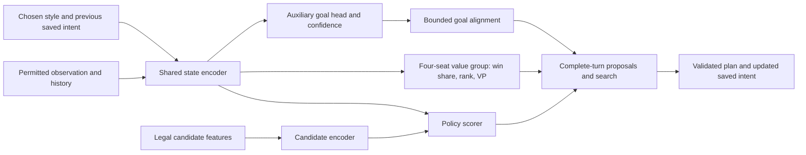

# Personalities and difficulty calibration

Planning update: 29 September 2026. This is the detailed design for [implementation step 7](IMPLEMENTATION_PLAN.md#7-add-personalities-and-calibrate-difficulty), extending [DESIGN.md](DESIGN.md) and [SEARCH_DESIGN.md](SEARCH_DESIGN.md). **Execute this stage after Step 5 self-play training finishes, using its existing self-trained AI as the starting point.** The new goal head, learned behavior archive, persona-aware search changes and calibrated difficulty profiles described here are proposed work, not implemented or qualified features.

## 1. Decisions and boundaries

Adopt the proposed **single shared policy/value/goal network with bounded soft goal priors**, and add an **AURORA-inspired offline quality-diversity workflow** for discovering further personalities. Preserve the original aim: enjoyable, coherent four-player opponents, several styles at each difficulty, and every shipped Easy style stronger than original Hard.

These additions build on the current system:

| Existing foundation | Planned extension |
| --- | --- |
| Daiyu-derived shared state/candidate encoders and action scorer | Add a small auxiliary goal head to the same shared state representation. |
| Four-seat win-share, placement and VP outputs | Retain all three value outputs and their stable seat identities. Do not replace them with a two-player scalar value. |
| Four style features and eight intent features | Define a versioned personality/intent contract; preserve the meaning of existing fields when importing old data. |
| Persistent legacy intent and neural industry contexts | Learn coherent, revisable medium-term intent, including setup actions and competing plans. |
| S2 complete-turn comparisons, R4 OpenSpiel ISMCTS, R5 S3 observation-tree experiment | Integrate bounded priors through each algorithm's actual interface, with separate qualification. |
| Completed self-play-first Step 5 training | Warm-start from its selected trained checkpoint; discover and fine-tune styles in a separately identified post-training run. |

The current medium backbone is approximately 1.9M parameters. If that is the selected Step 5 model, retain it; if Step 5 selects another supported size, preserve that trained backbone rather than replacing it merely to match this plan's default. Personality does not justify a larger base model by itself. Keep four initial named profiles: Industrialist, Networker, Supplier and Investor. Learned archive entries can supply variants or new profiles after validation.

Use three qualifications when implementing the user's proposal:

1. A shared network removes the need for competing high-level and low-level controllers, but does not guarantee convergence. Auxiliary losses, self-play opponents and changing search targets can still interfere.
2. Search can overturn a soft preference only when it explores and evaluates the relevant alternative. Finite-budget MCTS has no guaranteed tactical veto. Candidate coverage and fresh finalist checks remain necessary.
3. Learned behavior coordinates can reveal differences without hand-picking two archive axes. They do not automatically represent useful strategies, human personality, or enjoyment. Representation choices, repeated evaluations and human feedback remain part of the design.

The shared policy/value foundation is inspired by [AlphaZero](https://arxiv.org/abs/1712.01815); style conditioning, the auxiliary goal head and four-player information restrictions below are project-specific extensions. [MAP-Elites](https://arxiv.org/abs/1504.04909) motivates retaining quality across different behaviors. AURORA learns behavior descriptors; the published name is *Autonomous Robots Realising their Abilities*, and its demonstrated domains differ from Brass. We are adapting its method, not claiming a validated Brass implementation. See the [AURORA paper](https://arxiv.org/abs/2106.05648).

### Entry gate: completed Step 5 self-training

Begin implementation/training packages P0–P6 only after the Step 5 run is finished and its artifacts are available. Select a trained checkpoint using Step 5's validation results and compatibility checks; the last iteration is not automatically the best. Record an immutable entry bundle containing the model/checkpoint hash, architecture and feature versions, training implementation/configuration IDs, rules contract, split manifests, opponent-pool IDs and available evaluation reports.

Keep that checkpoint as the **pre-personality control** for every relevant comparison. Reuse its learned state/candidate encoders, action scorer and four-seat values, plus compatible training-partition trajectories and historical neural opponents. Initialize only the newly introduced goal/context parameters. The fresh R2 bootstrap and local smoke weights are not substitutes for the completed self-trained AI at this stage.

Create a new fine-tuning run with explicit parent-checkpoint provenance and fresh optimizer/scheduler state for the changed objective and parameter set. This is a warm start, not a resume under the old Step 5 run identity. Freeze the imported core for the first auxiliary-head pass, then apply conservative joint fine-tuning if it preserves useful existing skill. If the entry model's strength remains uncertain, report that limitation and measure against the frozen control; do not claim the personality additions have made it strong merely by adding labels.

## 2. Separate personality, current intent and discovered behavior

Use different symbols and contracts for quantities that have different jobs:

| Quantity | Meaning | Available during a real move? |
| --- | --- | --- |
| `o_i, h_i` | Seat i's permitted observation and legitimate remembered history | Yes; never actual opponent hands, unrevealed draws or private simulator seeds. |
| `z_i` | Style control chosen before the game from a tested profile | Yes; stable across the game by default. |
| `m_i` | Saved soft intent, age, confidence and expiry for this seat | Yes; derived only from that seat's permitted history. |
| `G_pred` | Proposed medium-term goal distribution from the shared network | Yes; a prediction/proposal, not a proof of the best strategy. |
| `b = E_psi(T_i)` | Offline descriptor of seat i's completed behavior trajectory | No; the current game's future trajectory does not exist yet. |

**Do not equate `b` with `z_i` automatically.** An encoder can describe how a controller behaved without knowing how to command that behavior. Initially, archive entries retain the exact model/profile/style input that produced them. Selecting an entry selects that tested controller configuration. A later distillation step can learn stable style codes for a shared deployment network.

Do not relabel an old PPO trajectory with its hindsight descriptor and treat it as if that descriptor was the input used to choose those actions. Keep the actual behavior context and probabilities. Completed trajectories may supply supervised auxiliary labels or explicitly separate distillation data.

Each player has independent intent state, random streams, legal observations and private search/cache state. Shared weights are allowed; a shared objective for the three opponents of a human is not.

## 3. Unified network and persistent intent

### 3.1 Architecture



Keep the existing candidate-based policy: Brass has variable, multi-step legal choices, so this is not a new fixed chess-like move vocabulary. The value group retains `win_share_4`, `placement_4` and `vp_4`. Predict all four seats from one observer's permitted inputs and retain the declared tie handling. Search selects that player's utility; it never negates a scalar for all opponents or rewards a three-bot coalition.

Preserve the imported encoder's existing feature layout and context semantics. Add any new style/goal context through an explicitly versioned projection or appended features with zero initial contribution to the copied policy/value path. Before fine-tuning, the new model must reproduce the old policy/value outputs for the same old inputs and neutral new context. Merely copying matching tensor shapes is insufficient if a feature's meaning has changed.

Start the auxiliary branch with a hidden width of 128. Aim for fewer than 100,000 additional parameters over the medium backbone, including any added context projections, then measure the actual count and inference overhead. This is an initial engineering budget, not a model-quality guarantee. Keep the existing 0.5M/2M/8M comparisons for later evidence-based sizing.

Use factorized goal outputs rather than a huge enumeration of exact future moves:

| Factor | Initial vocabulary / interpretation |
| --- | --- |
| Goal family | Complete a sale chain; prepare an industry sequence; supply resources; extend a useful network; improve liquidity/income; remain flexible. |
| Industry | All six industries, plus none/mixed. Pottery has equal representational access. |
| Region | Versioned public map regions, plus any/unspecified. Regions express intent, not a compulsory city. |
| Horizon | Next own turn, next 2 own turns, next 3–4 own turns; masked if unresolved at the record boundary. |
| Confidence | Calibrated probability of the defined goal event being realized within its horizon. Low confidence means weak or no goal bias. |

Use a goal-compatibility mask for nonsensical factor combinations, without changing legal game actions. Include flexible/no-commitment outputs so the system need not invent a precise plan for every position. A goal's horizon counts **this player's turns**, using the actual scheduler, not global actions or an assumed fixed round order.

Inputs contain the *previously committed* compact intent. Produce the new goal in one forward pass; do not recursively feed its own new output back into the same pass. Compare the proposal with the saved intent, evaluate credible plans, and save the resulting soft commitment for subsequent decisions. Ordinary second-action continuation keeps the selected turn plan and only the remaining time budget.

### 3.2 Continuity without rigid commitments

Persist goal family, industry/region if relevant, creation turn, remaining horizon, confidence, schema version and revision reason. Reconsider at own-turn boundaries and material observation changes. A starting hysteresis rule can favor keeping a viable plan for 2–3 own turns, but it must permit earlier revision when demand disappears, a route closes, liquidity becomes critical, or an era boundary removes its expected return.

Assess supporting actions as part of the plan. A loan can enable a build; development can unlock a better tile; a connection can enable a sale. Do not score these as off-theme simply because their action names differ from the goal. Measure continuity through useful plan completion and sensible revisions, not through refusing to change direction.

Carry forward the v3 lessons as targeted examples: unflipped level-I industries near the end of Canal, unsold industries near game end, merchant beer and its applicable bonus, brewery demand, and cash/debt recovery. These are conditions for evaluating opportunities, not mandatory moves in every position.

### 3.3 Goal labels and joint training

Define labels before collecting a new corpus. For example, a sale-chain goal can be realized when the seat completes the relevant sale within the next H own turns, with region/industry derived from the executed chain. Record preparation, completion and abandonment reasons separately. An unsold build is not automatically a completed goal. Future public actions/outcomes can supervise a present prediction, but future observations must not enter the present input.

Use three sources with explicit provenance:

1. Completed, legal learner trajectories with the actual style and saved intent used at collection time, including losing games and failed plans.
2. Qualified search recommendations whose alternatives received adequate coverage and fresh confirmation. Such labels propose a plan; they do not establish that the goal will succeed.
3. A small authored diagnostic set of setup/completion and tactical recovery situations. Keep test fixtures outside gradient data when using them as held-out checks.

Mask ambiguous factors, truncated horizons and missing outcomes. Calibrate confidence against the defined realization label on separate games; a softmax maximum alone is not calibrated confidence. Include counterexamples where the initial goal became infeasible. Avoid teaching the network only its own unverified predictions.

The joint objective is conceptually:

```text
L = L_PPO_actor
    + lambda_v * (L_win + 0.25 * L_rank + 0.10 * L_vp)
    + lambda_g * L_goal
    + lambda_d * L_qualified_search_or_elite_distillation
    - lambda_h * policy_entropy
```

The value weights above match the current scaffold; tune only through separately identified comparisons. Each term uses its appropriate data: exact on-policy learner samples for PPO, observed outcomes for values, masked goal labels for the auxiliary head, and covered teacher alternatives for distillation. Search-generated actions and archive demonstrations do not become ordinary PPO samples. Do not assign zero-quality labels to unexamined alternatives.

Warm-start from the selected **completed Step 5 checkpoint**, copying compatible backbone/policy/value tensors into a new model version and training the small goal head with the copied core frozen. Then unfreeze with a modest goal-loss coefficient and monitor value calibration, policy drift and conflicts between loss gradients. An initial sweep such as `lambda_g = 0, 0.05, 0.10` is a pilot, not a settled setting. Keep neutral-context behavior and the original trained checkpoint as regression comparisons. Detach goal-derived search bias from actor gradients in the first implementation.

Start ordinary PPO collection with the style-conditioned policy's existing probability calculation. Use goal-biased search as a separately recorded teacher. If a later actor itself samples from biased priors, store and recompute its **exact composed probability**, including temperature, exploration, goal context and bias coefficient. Otherwise the existing PPO likelihood checks should reject those records. Joint neural losses are differentiable; this does not imply end-to-end gradients through discrete search or archive selection.

Keep training primarily self-play against current and historical neural opponents. Preserve the current default maximum 5% qualified v3 legacy tables. Original Hard remains a labeled benchmark; it is not the expert imitation target. Hold out the designated Pottery legacy policy from ordinary training, while retaining Pottery actions, goal labels, exploratory contexts and self-play trajectories. Holding out an opponent never means holding out an industry.

Existing Step 5 contexts cover neutral play and all six industry focuses; they do not establish trained Networker and Investor personalities. After the auxiliary warm-up, balance new collection across the four profile codes and a neutral control. Generate style-consistent teacher choices from adequately compared near-best complete turns, record the chosen profile, and distill those choices before conservative self-play fine-tuning. Retain quality targets and the frozen parent-policy comparison so style training cannot quietly replace strategic competence with repetitive themed actions. Test whether changing only the style code changes credible decisions; naming codes does not itself create a personality.

## 4. Soft priors that preserve tactical alternatives

### 4.1 Definition and bounded influence

For legal action or complete-turn candidate `a`, construct `g(a)` from goal alignment in `[-1, 1]`. Use permitted root information, supporting-action relationships, the saved intent and calibrated confidence. Fix this root context across all sampled hidden worlds. Do not change it after inspecting a sampled opponent hand.

```text
P0(a)     = masked_softmax(policy_logits(a))
Pgoal(a)  = masked_softmax(policy_logits(a) + alpha * g(a))
Psearch(a)= (1 - epsilon) * Pgoal(a) + epsilon * P0(a)
```

Start with `alpha` in `{0, 0.15, 0.35}`, a provisional maximum of `0.5`, and `epsilon = 0.10`. Confidence can scale `alpha` toward zero. With `g` bounded, the additional pairwise odds factor before mixing is at most `exp(2 * alpha)`. At `alpha = 0`, this reproduces the base prior within numerical tolerance. Illegal actions stay masked. The mixture retains base-policy mass but does not guarantee that finite search visits every critical move.

Bias **priors and proposals**, not the objective or value backups. Keep win/rank/VP estimates unchanged. The policy already receives style and previous intent, so the extra bias may double-count a preference; include a style-conditioned, no-bias ablation. Stronger bias is neither a stronger opponent nor necessarily a better personality.

### 4.2 Integration with the implemented search variants

| Planner | Present behavior | Required personality integration |
| --- | --- | --- |
| S0 fast policy | Legal action probabilities | Style and saved intent condition the shared network. Direct goal-biased sampling, if introduced, needs the exact behavior-probability contract above. |
| S1/S2 | Complete-turn proposals; S2 evaluates sampled opponent replies | Use bounded alignment to allocate proposal coverage and later break credible near-best ties. S2 is not MCTS; it has no PUCT prior slot to modify. |
| R4 OpenSpiel ISMCTS | PUCT through an evaluator prior, with independently masked fixed opponent policies | Supply the bounded prior at the learner's current root. Scope the hook so it does not silently bias every node or hand another seat the root's private intent. |
| R5 S3 | Current implementation selects complete-turn branches with UCT in a future-observation tree | First support goal-aware root proposals. Implement root PUCT as an explicit new variant if testing a numerical search prior; changing network logits alone does not add a prior term to the existing UCT selection rule. |

For complete-turn candidates, score the meaning of the whole plan. Avoid summing a bonus per semantic sub-choice: a plan with more beer/resource/payment choices must not gain extra style reward merely because its representation is longer. Use one bounded plan-level alignment, or a normalized aggregation whose behavior is tested on equivalent plans.

Keep the selected current-turn plan the same across hidden-world samples. New decisions deeper in S3 may condition on newly received legal observations, never on unrevealed state. Initial prior injection is limited to the current decision root; broader descendant bias is a separately evaluated extension. Other seats act using their own styles and allowed observations, with no optimized team response.

### 4.3 Candidate coverage and final selection

Reserve proposal capacity for unbiased candidates and enabling combinations before allocating the rest by style. Preserve relevant loan/build, develop/build, route/sale and industry alternatives, including Pottery, even when their first move looks weak. Log coverage by family and by complete plan. A soft prior cannot rescue an option omitted by enumeration or pruning.

Within one whole-turn deadline, allocate time to candidate coverage, comparison, fresh finalist confirmation and legal execution. Compare finalists on matched fresh hidden-world/opponent samples. Select from a credible near-best set using persistent style and modest independent seeded variation. Define its estimated utility tolerance per difficulty after value calibration; it is an empirical strength tradeoff, not a proof of bounded real-game loss.

Reduce or disable bias when confidence is poor, the goal is stale, the deadline permits little comparison, or a tested tactical risk requires broader coverage. Retain a validated complete incumbent for cancellation/Play Now. Log cases where the chosen action contradicts the goal, including whether new information or tactical value caused the revision.

The required evidence is that relevant alternatives survive and the bounded bias causes no unacceptable tactical or strength regression. **Do not describe this as a guaranteed MCTS veto.** Imperfect values, inaccurate opponent models and unvisited actions remain possible failure modes.

## 5. AURORA-inspired discovery of additional personalities

### 5.1 Offline role and descriptor data

Use a separate, small behavior encoder on the lab server. It describes trajectories and organizes candidate controllers; it does not choose game actions and need not ship to the laptop. This preserves one online decision network.

The original [unsupervised-descriptor work](https://arxiv.org/abs/1905.11874) motivates learning behavior coordinates. The [authors' AURORA implementation](https://github.com/adaptive-intelligent-robotics/AURORA) alternates archive search with descriptor learning and supports an unstructured distance-based archive. A fixed two-dimensional MAP-Elites grid is a possible adaptation, not a requirement of AURORA.

Collect one trajectory **per seat** from complete four-player games. Preserve temporal order and both eras. Initially encode public own actions, their public economic effects, industry levels, resource production/consumption, merchant use, geographic expansion and relevant public opportunities. Use masks for variable lengths, interruptions and era boundaries. Include enough context to distinguish an unavailable sale from a deliberately deferred sale.

Exclude controller IDs, chosen style labels, random seeds, absolute seat IDs, actual hidden hands/deck, machine timing and final win/rank totals from the behavior encoder's input. Keep these in separate metadata where appropriate. Outcome quality is assessed separately. Even with those exclusions, board context and cash trajectories can correlate with strength; explicitly test whether the learned space mostly separates lucky deals, opponent behavior, seat order or winning rather than repeatable styles.

Split by whole setup/game groups before fitting preprocessing or the encoder. Fit only on training/discovery data, including legal losing games. Do not fit on held-out Pottery-policy evaluation games or final test trajectories. Validation and test embeddings are transforms under an already frozen encoder.

### 5.2 Small initial encoder and archive

Start with a masked temporal autoencoder and a 2D latent descriptor, compared with PCA and a simple hand-described baseline. Use a small lab-only model rather than a second large game network. Try 3D or a higher-dimensional distance archive only if 2D reconstruction and repeatability are inadequate; a 2D visualization need not be the full behavior representation. Defer VAE/contrastive variants until the simpler representation has a diagnosed limitation.

Evaluate the same controller on repeated rotated setups and opponent mixtures. Store its descriptor centroid and dispersion, not just one spectacular game's coordinate. A useful descriptor should distinguish controllers more reliably than it distinguishes seeds for the same controller. Inspect nearest-neighbor trajectories and era-specific action summaries alongside reconstruction error; low reconstruction loss alone does not prove useful style discovery.

Start with an **unstructured distance archive** with a bounded number of entries and a novelty threshold chosen on discovery data. A fixed-grid MAP-Elites comparison can follow with frozen encoder, scaling and bounds. Neither cell occupancy nor latent distance alone is a release diversity metric.

An archive entry identifies a reproducible controller:

```text
entry = {
  immutable_model_id, style_code, intent_schema, search_profile,
  rules_and_observation_ids, encoder_id, opponent_pool_id,
  behavior_centroid, behavior_dispersion, trace_ids,
  own_quality_estimate, uncertainty, qualification_status
}
```

Begin by sampling supported style inputs and small mutations of already trained style/profile parameters while keeping model, difficulty and search budget fixed. Do not start by evolving millions of neural weights or arbitrary out-of-distribution style vectors. Candidate mutation is the proposed Brass search operator; the behavior encoder alone cannot generate new capable policies.

Quality means the evaluated seat's own performance against a frozen, representative four-player pool, with rotations and uncertainty. Use win share as the primary outcome and rank/VP diagnostics to detect regressions; separately report legality and style coherence. Do not use total table score, novelty alone, or victories over weak stock alone as quality. Require repeated evaluation before replacing an incumbent on noisy estimates. A promising but uncertain candidate stays provisional.

The discovery loop is:

```text
freeze policy generation, descriptor encoder and discovery opponent pool
select archived controller configurations; propose supported style mutations
play matched four-player discovery games; record each seat separately
encode behavior; estimate repeatability and own outcome quality
retain distinct qualified improvements; keep uncertain candidates provisional
at a planned encoder update: refit on training/discovery traces only
re-encode ALL retained candidates and rebuild the archive under a new version
freeze a shortlist for independent calibration; leave final tests untouched
```

Encoder updates can move every coordinate. Recompute descriptors for retained entries and rebuild neighborhoods/cells before comparing them with new candidates; this lifecycle follows the [AURORA reference implementation](https://github.com/adaptive-intelligent-robotics/AURORA). Keep stable profile IDs independent of cell coordinates, preserve old snapshots, and version preprocessing, encoder weights and archive membership together. Changing the quality opponent pool also requires a new qualification version.

### 5.3 Bring discovered behavior back into one network

First deployment option: all entries use the same frozen network with different tested style codes. This already satisfies the unified-network goal; no extra distillation is needed.

If useful entries span different checkpoints or short style-specialization runs, distill their qualified decisions into a new shared network conditioned on stable profile codes. Use their actual permitted observations, contexts and covered action targets, then run additional self-play to repair distribution shift. Do not require matching every teacher action when alternatives are equally credible. Re-measure the resulting profiles: shared-network distillation can collapse diversity or reduce strength.

Descriptor-conditioned training is a later extension. It requires an explicit learned connection between desired descriptor and achievable behavior, trained without hindsight PPO relabeling. It is not supplied merely by assigning `z = Encoder(T)` after a game. Keep a neutral competitive context and all industry contexts throughout specialization; archive occupancy must not erase Pottery or other less common but sound strategies.

Initially use diversity for offline selection and balanced training-data sampling, not as an extra online reward that can pay the agent to lose stylishly. Fit latent discovery on training games; choose profiles on separate calibration games; report final strength on untouched games. Large distances in a plot do not substitute for understandable, repeatable differences in actual play.

## 6. Named styles and player-facing intent

| Initial profile | Persistent preference | Behavior to reject during calibration |
| --- | --- | --- |
| Industrialist | Prepare productive industry sequences and secure credible sale plans; all selling industries, including Pottery, remain available. | Building unsellable tiles just to display an industrial theme. |
| Networker | Pursue valuable connections, access and timed expansion. | Laying low-value links without a plausible scoring, supply or sale purpose. |
| Supplier | Time coal, iron and beer around observed demand and own returns. | Repeated production without demand, or needless gifts that harm its own outcome. |
| Investor | Maintain useful cash flexibility and use loans/income to support productive commitments. | Hoarding money indefinitely or refusing sound borrowing/development. |

These are preferences, not scripts or mutually exclusive industries. All profiles must sell, borrow, develop, connect and recover when the board calls for it. Name learned variants only after examining stable behavior across games; an arbitrary latent axis is not automatically a human-readable trait. A small set of recognizable profiles is more useful than dozens of untested labels.

The auxiliary goal output can drive deterministic templates such as “Looking for a route to market” or “Preparing a pottery sale if beer remains available.” This is a reported intention with uncertainty, not a faithful causal explanation of every neural calculation. Use confidence thresholds, change hysteresis and at most one meaningful update per turn. Allow players to hide intent text.

**Privacy matters for telegraphing.** A goal derived from the AI's own hand may reveal that hand indirectly even if no card name appears in the text. Default public indicators should use the selected public personality and public actions, or a separately validated public-only projection. Do not expose raw private goal probabilities, exact private targets or search traces by default.

Offer direct goal-head telegraphing only as an explicit “AI intent hints” mode if desired. It deliberately gives the human additional insight into the AI's own plan; describe that behavior and calibrate difficulty with the same hint setting. It must never reveal another player's private cards or future draws. If a public-only projection is added, train/check it against a declared public input boundary rather than assuming a text filter proves privacy.

No language model is required. The laptop ships the decision network, profile records and a small template decoder; the behavior autoencoder and discovery archive remain lab tools.

## 7. Difficulty and enjoyable four-player play

### 7.1 Separate strength, style and waiting time

Calibrate a profile as a tuple of model checkpoint, search variant, search parameters, style/intent settings, near-best selection tolerance and inference backend. Do not use goal-bias magnitude as the difficulty slider. More simulations, a later checkpoint or a larger model are candidate improvements, not proof of higher strength.

| Tier | Starting whole-turn cap | Intended calibration |
| --- | --- | --- |
| Easy | 1–2 seconds | Reliable legal complete turns and coherent plans, with broader credible alternatives; every shipped style still clears original Hard. |
| Medium | 3–5 seconds | Better resource timing and reply assessment, with measured aggregate improvement over Easy. |
| Hard | 8–12 seconds | Better confirmed decisions and deeper planning only where its equal-budget comparison succeeds; style remains recognizable. |

Keep the user's waiting-time preference separate. One deadline includes proposals, simulations, inference, confirmation, validation and both actions. Three Hard bots may consume 24–36 seconds before animations; three 30-second bots may consume 90 seconds. Support early return and Play Now. A shortened cap is a speed override whose strength effect must be reported, not a secretly unchanged guarantee of the same difficulty.

Make Easy weaker through a calibrated, coherent policy/search configuration and selection among credible alternatives. Do not force random illegal moves, deliberate bankruptcy, unsold-industry waste, or hidden information advantages at any level. Use the same declared game rules for every tier. Do not target a human seat because it is human or quietly change difficulty based on their results.

### 7.2 Calibration evidence

Use frozen, versioned opponent pools and grouped held-out setup seeds. Rotate all four seats, record clockwise ordering and split tied first places according to the existing win-share metric. Keep homogeneous-style, mixed-style, neural-checkpoint and legacy-baseline tables visible separately. Four-player matchup results may be nontransitive; one Elo number cannot settle the choice.

| Question | Measurement / gate |
| --- | --- |
| Is every Easy above original Hard? | One candidate Easy plus three original Hard seats, across held-out setups/rotations. Require a prespecified meaningful gain above 25% win share with grouped uncertainty bounds and rank/score corroboration. Record stock failures separately; clearly label any guarded-stock/rules-repaired variant. |
| Are same-tier styles comparable? | Against the same frozen representative pool, compare each style with the tier target. Start with an equivalence margin such as plus/minus 5 percentage points in win share, then justify it for the pool. A wide interval or a nonsignificant difference does not establish equivalence. |
| Do tiers improve? | Medium exceeds Easy and Hard exceeds Medium on aggregate mixed tables and direct matchups, with uncertainty and exceptions reported. Match algorithms at equal budgets during search ablations; actual calibrated tiers can use different declared caps. |
| Is extra goal bias helpful? | Same model/style/search/time, `alpha = 0` versus bounded bias. Measure tactical misses, plan completion, strength and style consistency. |
| Does learned discovery add useful variety? | Compare selected archive profiles with the four authored profiles at comparable strength. Measure repeatable action/plan differences and blinded human recognition, not only latent distances. |
| Is Pottery viable? | Report access/proposal coverage and context-dependent usage, pottery-focused self-play success, and held-out Pottery-opponent results. Avoid a universal Pottery-use quota when opportunities are poor. |
| Is it enjoyable? | Human feedback on understandable plans, varied openings, resilience after disruption, resource interaction, repetition, excessive interference and waiting. Record which style/tier/hint mode was played. |

Weak legacy bots cannot establish strong new-AI play. Keep original Hard as the requested minimum bar and v3 as an occasional diagnostic opponent, while making mixed neural self-play/checkpoint pools central to qualification. Never copy the held-out Pottery policy or its evaluation traces into ordinary training to improve that test score.

Use independently grouped setup intervals because rotations and reused deals are correlated. Prespecify the final metrics, strength margin and shortlist before testing; avoid repeatedly tuning against the same final games. If same-tier equivalence is unresolved, collect more evidence or release fewer profiles instead of asserting equal strength.

Begin with small pilots and reuse existing permitted traces. The larger formal acceptance suite in [implementation step 8](IMPLEMENTATION_PLAN.md#8-optimize-the-laptop-package-and-run-acceptance-tests) applies when selecting a release, not to every prototype or this documentation update. A quick game can establish execution, not superiority or human-like play.

## 8. Versioned interfaces and implementation map

Current model and feature source hashes are part of checkpoint compatibility. Do not silently alter the v1 model/features, add a fifth return value to existing callers, or reuse old replay keys with different meanings. Preserve the completed Step 5 run and its reproducibility. Introduce a new versioned model/encoder namespace and an explicit warm-start importer with a report of copied, initialized and rejected tensors.

The following names are proposed, not existing contracts:

| Contract | Required contents |
| --- | --- |
| `four-seat-personality/2.0.0` | Existing policy/value semantics, style input semantics, saved intent input, named goal outputs, feature and goal-schema hashes, four-seat identity mapping. |
| `goal-schema/1.0.0` | Goal factors, compatible combinations, public regions, own-turn horizons, realization labels, confidence calibration and revision rules. |
| `personality-profile/1.0.0` | Stable profile ID, model ID, tested style code, difficulty/search settings, goal-bias bounds, hint mode, evidence and fallback profile. |
| `behavior-descriptor/1.0.0` | Trace schema, split provenance, fitted normalization/encoder hash, latent dimension, distance metric and archive rebuild version. |
| New replay/teacher version | Actual style/intent, exact behavior probability recipe, goal labels/masks, goal/bias model versions, candidate coverage, search provenance and observed outcomes. |

Serialize per-seat intent and RNG with save/load. Cache keys include model, observer's permitted private history, style, intent, goal schema, rules and relevant search/opponent settings. Archive descriptor versions identify offline artifacts; no future-game descriptor belongs in an online observation or private cache shared across seats.

| Existing location | Planned work |
| --- | --- |
| [learning/model.py](../src/brass_ai/learning/model.py), [learning/features.py](../src/brass_ai/learning/features.py), [learning/contracts.py](../src/brass_ai/learning/contracts.py) | Use as the v1 compatibility boundary. Implement the new namespace alongside them, with explicit dispatch/import; preserve old hashes and readers. |
| [step5/policy.py](../src/brass_ai/step5/policy.py), [step5/updates.py](../src/brass_ai/step5/updates.py), [learning/replay.py](../src/brass_ai/learning/replay.py) | Add separate personality-aware collection/update paths and versioned records; keep on-policy verification and test-partition rejection. |
| [step5/search.py](../src/brass_ai/step5/search.py) | Add an opt-in versioned S2 personality adapter for proposals/near-best selection while keeping the current default unchanged. |
| [searchlab/ismcts.py](../src/brass_ai/searchlab/ismcts.py), [searchlab/s3.py](../src/brass_ai/searchlab/s3.py) | Add root-scoped R4 priors and explicit S3 goal-proposal/root-PUCT variants; propagate style/intent through batching and permitted caches. |
| Proposed `src/brass_ai/personality/` | New model/contracts, goal labels, persistent intent, bounded priors, trajectory encoder, archive lifecycle, calibration records and UI projection. Keep offline discovery separate from runtime modules. |
| Proposed `tests/Personality/` | Small focused contract, prior, privacy, archive and restore checks; reuse existing host/search fixtures. |

For lab artifacts, use the existing conda environment `ai-training` and the configured project root. Proposed directories are:

```text
/data/not_backed_up/yxu209/ai-training/artifacts/personality/goal-pilot/
/data/not_backed_up/yxu209/ai-training/artifacts/personality/discovery/
/data/not_backed_up/yxu209/ai-training/artifacts/personality/calibration/
/data/not_backed_up/yxu209/ai-training/artifacts/personality/export/
```

These are output locations, not commands for an already implemented CLI. Preserve immutable source checkpoint IDs and the v3 bank; keep the completed Step 5 model and pool records unchanged. Pin external sources and record licenses before copying implementation code. Reuse the existing PyTorch stack for the pilot instead of importing a robotics framework merely to obtain the archive idea.

Export the chosen shared model with a versioned named-output inference interface. Verify policy, all four-seat values and goal outputs against the training model across dynamic candidate counts. Benchmark CPU first and Intel graphics as a measured alternative while Unity runs, including the extra head and search overhead. Ship only required model/profile/template artifacts with rollback to a qualified profile; archive training tools stay on the lab server.

## 9. Delivery sequence and focused exit checks

These packages refine implementation step 7 and all begin after the completed-Step-5 entry gate; they do not rename the already implemented R4/R5 search experiments.

| Package | Deliverable | Focused exit check |
| --- | --- | --- |
| P0: trained-model handoff, contracts and traces | Completed Step 5 entry bundle, frozen control checkpoint, versioned style/intent/goal definitions, profile seeds, trace split manifest and v1 importer specification. | Selected trained checkpoint still loads unchanged; import preserves base outputs before fine-tuning with new context contributions neutralized; new versions fail clearly in old readers; four-seat mapping and actual behavior context round-trip. |
| P1: shared goal head | New model, masked goal-label builder, warm-start and joint-loss pilot, confidence report. | Correct shapes/masks, finite useful gradients, exact permitted input boundary, no broken base heads; one small learning smoke establishes operation, not strength. |
| P2: search integration | S2 adapter, root-scoped R4 prior and explicit S3 variant, saved intent and bias telemetry. | Zero bias matches baseline; illegal choices remain masked; supporting plans survive; private-world counterfactual tests pass; save/load preserves decisions under fixed streams; one whole-turn deadline. |
| P3: learned repertoire | Temporal encoder/PCA comparison, repeated-controller descriptors, versioned archive and provisional quality records. | No train/test leakage, no seat/seed identifiers in features, re-encoding rebuilds all entries, noisy single games do not replace qualified elites. |
| P4: unified deployment styles | Four authored profiles plus a small learned shortlist, optionally distilled into one model. | Re-evaluate produced behavior after distillation; no Pottery exclusion, preserved neutral context, measurable coherence/variety without clear tactical regression. |
| P5: difficulty and intent UI | Frozen calibration pools, Easy/Medium/Hard settings, public/hint UI modes and human session records. | Every released Easy clears its baseline gate; tier ordering and same-tier uncertainty reported; UI respects its stated information boundary. |
| P6: laptop package | Versioned export, profiles, restoration, Play Now, CPU/backend timing and rollback. | Numerical export checks, bounded response time, no stale/duplicate actions, acceptable three-opponent waits and reproducible install/restore. |

Use a few focused assertions for delicate boundaries rather than a new sprawling test framework. Reuse existing legality, hidden-information and timing checks where they cover the new path. Add new tests when new context/prior/archive behavior creates a failure mode they do not cover.

Required comparison order is deliberately small:

1. Frozen completed-Step-5 model with its existing style contexts, no new goal head/bias.
2. New auxiliary head with `alpha = 0`, to isolate representation/training effects.
3. Same new model with bounded bias under the same whole-turn cap.
4. Same best validated mechanism with authored versus learned profiles at comparable strength.

Do not sweep model size, all search variants, all loss weights, all latent dimensions and all difficulties simultaneously. Advance only the small promising shortlist. This stage follows completed Step 5 training; it does not retroactively change its collection/search recipe. Using R4 or S3 as the selected personality search still needs its separate correctness and equal-budget evidence.

## 10. First small experiment when implementation begins

After Step 5 finishes, copy its selected trained checkpoint into a new personality experiment and reuse training-partition trajectories where their schema supports the planned labels. If extra context is absent, leave it absent or recollect; do not fabricate a behavior input. Retain the selected model's trained backbone and start with the four authored profiles.

Implement P0/P1, then demonstrate goal labels, joint forward/backward behavior and save/restore on a tiny shard. Use existing tactical positions to compare `alpha = 0` with one bounded setting; run a quick four-player completion smoke for the integrated planner. Separately fit the small descriptor encoder on available discovery traces and inspect whether repeated controllers cluster consistently. Stop there to review learning signals, runtime cost and visible style differences before buying more self-play compute.

This first experiment need not include a large qualification tournament, a new simulator or a new online controller. It builds on the completed self-trained AI and produces an inspectable fine-tuned candidate with measurements that decide the next investment. Release claims wait for the calibration gates above.
