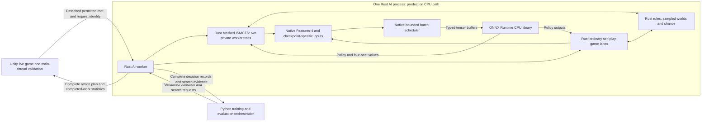

# Rust Simulation and Search Backend Migration Plan

Date: 2026-10-16. Status: implementation plan, revised for Rust design quality and performance. Implementation tasks remain planned until their exit evidence is recorded. Section 3 specifies the native architecture and engineering standards; section 7 defines delivery dependencies; section 9 defines measurable performance targets; section 12 is the release checklist.

## 1. Intended outcome

Run our neural Masked ISMCTS search and all of its simulated game transitions in Rust, using the engine from [brass-birmingham-daiyu-ai](https://github.com/riverside234/brass-birmingham-daiyu-ai) as the starting rules implementation. Keep Unity responsible for the live game, display, saves, input and final validation/application of selected actions.

Build a maintainable native engine with compact state, predictable memory use and efficient search. Reuse the upstream rules where they match our contract, and redesign expensive interfaces where needed. A direct translation of Python objects or repeated calls through the upstream atomic-action API would not meet this objective. Performance is a deliverable throughout implementation, supported by profiles and matched measurements.

Keep the existing neural architecture and compatible weights. The **production CPU backend runs the engine, search tree, Features-4 encoder, batch scheduler and ONNX Runtime in the same Rust AI process**. Unity sends permitted root requests and receives complete plans. An external inference adapter remains available for reference comparisons and GPU training; Python continues to manage learning, checkpoints and frozen banks. Production CPU simulation and inference require no per-move or per-leaf Python/C# RPC.

Ordinary self-play collection is also a deliverable: reuse the Rust rules and encoder to run complete training games, manage staged decisions and produce compatible decision records. Keep proximal policy optimization (PPO), backpropagation, optimizers, reward targets and checkpoint/resume logic in the existing Python/PyTorch trainer.

The initial search performance qualification uses **two search workers and one 12-second allowance for a searched ordinary turn**, including both actions and their staged decisions. It includes complex Canal and Rail positions. Debt roots follow the reference's separate policy path and are correctness/lifecycle cases, not additional 12-second searches. Extra worker counts are outside the initial performance scope.

Success means all of the following:

- The Rust simulator reproduces the selected C# rules contract and permitted observations.
- The Rust search preserves our search algorithm, hidden-information discipline, four-seat values, personality context and complete-plan selection.
- Existing model weights produce equivalent results when given the same permitted position, choices and context. Reuse depends on exact feature compatibility, not matching tensor sizes alone.
- Ordinary self-play produces complete, correctly attributed trajectories through Rust, including intermediate and forced decisions, and passes the existing PPO behavior-probability and replay admission checks.
- Unity can request a plan asynchronously, reject stale work, validate a complete action and apply it once through its existing flow.
- A matched benchmark establishes the actual throughput and latency change. A separate playing-strength evaluation determines whether more completed search work improves decisions.
- The finished core meets the native execution requirements in section 3 and the declared performance criteria in section 9. Its hot paths have measured allocation, copying, synchronization and inference costs, with regression coverage for the expensive cases.

## 2. What exists, and what must change

| Component | Inspected starting point | Migration decision |
| --- | --- | --- |
| Rules simulation | C# host accessed through Python's `BrassSpielGame` / `BrassSpielState`; authored throughput host already reduces some host overhead | Add a Rust implementation behind the simulator boundary; retain C# as the parity oracle and fallback |
| Neural search | Python `MaskedISMCTS`, personality `SearchSession` and training teacher wrappers | Port the common search algorithm and preserve each selected caller's scheduling/session contract |
| Upstream Rust search | Determinized neural PUCT with its own tree, leaf and backup rules | Keep as an explicitly named experimental baseline; do not substitute it for our algorithm |
| Upstream Rust action API | Complete atomic actions assembled from staged choices; native saved states clone an existing runner | Add compatible staged choices and an external snapshot importer; native cloning alone cannot import a Unity position |
| Neural features | Our permitted state/action encoders, model factory, utility/context contracts and checkpoint manifests | Preserve the selected active contract; implement an equivalent Rust encoder |
| CPU neural inference | Existing Python/ONNX inference integrations and benchmark service | Call a pinned ONNX Runtime library from Rust in the AI process; retain the external evaluator for controlled comparisons and GPU training |
| Ordinary self-play collection | Persistent Python actors drive C# hosts, encode decisions and publish complete-game records | Move progression, staged collection and encoding to Rust; use native CPU batching or the admitted GPU evaluator while retaining Python orchestration/replay admission |
| PPO training and persistence | Python/PyTorch losses, utility targets/calibration, Adam state and checkpoint/resume contracts | Keep the existing trainer; admit Rust-collected data through the same checks and preserve learner/opponent attribution |
| Local game integration | `LocalTurnBridge`, asynchronous execution scheduler and guarded live-action validation | Add an execution backend that uses the Rust worker while preserving these lifecycle rules |
| Current shipped local AI | Separately qualified C# strategy implementation | Keep available; neural Rust deployment needs its own qualification |

The two searches can both use PUCT-style selection while still doing different work per simulation. Upstream's search evaluates different leaves in determinized trees and uses different value handling. Our search samples an allowed hidden world for each trajectory, uses staged information-set choices, asks frozen opponents for actions and evaluates at a new future normal root-player information frontier. Later visits may expand farther. There is no fixed future-turn horizon to replace with an arbitrary rollout depth.

### Requested performance improvements

| Improvement | Work removed or reduced | Rust requirement and integration |
| --- | --- | --- |
| Value-network leaf evaluation | Additional simulation beyond a chosen leaf; dependence on long rollout returns | Language independent. Our current neural search already bootstraps from the value network. Preserve that baseline, then evaluate the earlier-leaf variant in section 5.1 as a distinct algorithm experiment. |
| In-process engine and cheap copies | Per-step host RPC, serialized snapshot/restore, repeated boundary/hash work and unnecessary construction of all four views | An in-process C# engine could also remove these costs. The selected implementation co-locates the adapted Rust engine with search and uses compact copies/reusable state. Import and staged-choice compatibility still need implementation. |
| Native Features-4 encoding | Python object traversal, feature construction and intermediate conversions at newly evaluated positions | A compiled encoder in another language could work; this plan requires Rust Features-4 plus the selected checkpoint's context/derived inputs, verified against the Python oracle. |
| Retuned inference batching | Excessive calls, queue waits, padding and idle workers after the producer becomes faster | Language independent. Start from the previous cap-2 evidence, then retest caps, flush delays, pending paths and ORT threads on the final two-worker Rust pipeline. |
| Same-process ONNX inference and native tree | Per-leaf inference IPC, Python dispatch and foreign tree-management work | Implement a Rust adapter to the native ONNX Runtime library, with persistent sessions and typed buffers. This is a production CPU requirement. |

The suggested **about 50 steps per trajectory**, **25 ms per host step** and **3–8 ms per Python feature encoding** are workload estimates supplied with this request. Remeasure them on the pinned reference, distinguishing staged choices from whole actions and cache misses from hits. They are not established constants in this plan, and overlapping costs must not be added into a promised speedup. A long trajectory does not imply that the current search always rolls out to the end of the game.

### Source and evidence baseline

- The Rust clone is at `C:/Users/BobXu/Desktop/brass`. The inspected upstream commit is `f8f0246718d6d3fb3f301742d4154811c90d5813`. Record the actual working-tree patch and source hashes as well; the local tree contains changes beyond that commit.
- Our repository HEAD when drafting this plan is `9f577f64dfa3b8fa99cb138177689fd121d273b7`. This workspace also contains ongoing changes. An implementation baseline must identify the selected source/configuration bytes, not just this commit.
- The existing CPU experiment used upstream search, initialized versions of three NN sizes and a benchmark-only folded feature adapter. It did **not** establish semantic compatibility with our features or measure our game/search speedup. Its 12 seconds applied to one root decision, which is different from our whole-turn allowance.
- Evidence for that experiment is in `C:/Users/BobXu/Desktop/brass/output/cpu-capacity-2workers-20261016-deadline/`. Preserve the report, environment, fixtures and deadline patch as historical evidence. Do not use the interrupted pilot directory as the final result.
- Frozen research runtimes and the installed Unity deployment have distinct contracts and provenance. The compatibility documentation records specific checks; it does not make every deployment observation interchangeable with training data. Select and document the intended rules baseline before implementing parity fixes.
- The later [four-worker batching report](<C:/Program Files (x86)/Steam/steamapps/common/Brass Birmingham/artifacts/feature-engineering/rust-v9-v11-w448x6-4workers-20261016/REPORT.md>) found cap 2 better than cap 4 in 13/13 uncapped paired preliminary comparisons, with a median completion ratio of 1.0602. It used four worker processes, one pending leaf per worker, a 2 ms best-effort flush and a shared CPU service with two intra-op threads. It used upstream PUCT, initialized weights and a folded feature adapter. Treat cap 2 as a starting hypothesis; the required two-worker, exact-feature, same-process backend needs a new batch sweep.

## 3. Target architecture

### 3.1 Process and ownership boundaries

Use an isolated Rust core crate and a long-lived AI process containing two native search worker threads and the CPU inference adapter. Here, **in-process means that engine, search, encoder and inference share the AI process**; Unity can remain a separate process. The core owns rules, sampling, search, ordinary self-play progression and feature encoding. Keep transport, Python bindings, ONNX library calls and Unity integration behind typed adapters so core rules/search do not depend on their APIs.

Each search worker owns its tree, simulation states, pending trajectories and scratch buffers. Share immutable board definitions, model/profile metadata and a local inference dispatcher with persistent sessions. Use bounded in-process queues to submit evaluations and return completed evidence; avoid a shared tree mutex or a lock around individual simulated moves. Preserve the reference's private-tree aggregation semantics and stable root-choice mapping.

Use a framed local protocol only at the Unity/orchestration request boundary and for the external reference/GPU evaluator. JSON is acceptable for infrequent control messages and debugging. The production CPU loop performs zero Python/C# rules callbacks, board-to-JSON round trips or per-leaf process RPC. Pass native feature buffers to the local ONNX adapter with explicit ownership. Measure remaining copies; co-location alone does not prove zero-copy execution.

An optional in-process research binding releases Python's GIL during native CPU work. Keep each mutable native instance with its owner; do not force an upstream unsendable wrapper across threads. Verify actual concurrent execution and total thread usage in the two-worker profile.

### 3.2 Native data layout and hot paths

| Area | Required design | Evidence |
| --- | --- | --- |
| Static and shared data | Immutable indexed topology, card/tile definitions, lookup tables and permitted history prefixes | State copies share these immutable inputs; mutable history deltas remain owned by each world |
| Mutable game state | Compact typed IDs, enums, arrays and bitsets where the domain is bounded; explicit phase/pending-action data | Record state size and bytes copied per sampled world/transition; no nested JSON or string-keyed state dictionaries |
| Legal choices | Generate the current stage directly into reusable worker-owned storage; retain every legal semantic choice in reference order | Dense Rail and multi-sale fixtures do not first enumerate all complete plans; report generated choices and allocations |
| Rules application | Apply an already validated typed choice to owner-local state; keep external validation at ingress and live commit | Repeated fixed-capacity apply operations target zero heap allocations; no repeated parsing or global lock |
| Search tree | Bounded arenas of nodes/edges with stable integer handles; keep frequently read visit/value/prior fields compact | Measure bytes per node/edge, arena growth, traversal cost and cache misses where available |
| In-flight trajectories | Explicit resumable states holding path handles, sampled state and an evaluation ticket | No live tree borrows across inference waits; arena generations prevent expired tickets from accessing reused handles |
| Information/evaluation keys | Typed canonical representations of the existing permitted information and context | No per-visit JSON/digest rebuild; equality resolves hash collisions; hidden state cannot enter information-set keys |
| Feature encoding | Write directly into reusable contiguous tensors with candidate offsets; share only immutable, semantically identical prepared inputs | Report encoding time, allocations and bytes transferred; preserve exact masks, order and declared precision |

Map external semantic strings to compact IDs once, and reconstruct strings at protocol/audit boundaries. Internal ID ordering must preserve the reference's ordering and tie-breaking. Keep observation, recall, context, legal-choice and reward identities complete when optimizing keys. A board hash alone cannot identify an information set or evaluation. Cached legality and features need explicit invalidation rules for each state mutation, seat and model contract.

Start with compact state copies and reusable sampled-world storage. Benchmark copy/restore against a mutation journal only after rule parity passes. Adopt apply/unapply if it improves the full trajectory workload enough to justify its complexity. Its journal must restore phase data, resources, derived caches and relevant RNG state exactly, including exceptional/canceled paths. Compare restored states and incremental caches against independently recomputed results. Preserve a simple reference path for diagnosis.

Keep legal-choice, path, tensor and batch buffers across calls. Grow capacity deliberately and record high-water marks; large legal sets must never be truncated to fit a buffer. Separate temporary scratch from retained nodes, keys and replay records. Arena growth and retained records may allocate; repeated scratch use should not. Rust's `Vec` supports capacity reuse, but the allocation budget must be demonstrated by measurement. [Rust Vec documentation](https://doc.rust-lang.org/std/vec/struct.Vec.html)

Build sampled worlds from a prepared permitted root without replaying the entire game history or serializing checkpoints per trajectory. Preserve fresh sampling and the reference's actual conditioning. Share immutable public facts only where the contract allows it; cache reuse must not collapse distinct hidden worlds, recall, seats or utility budgets.

Build views on demand for the current policy consumer and any required root reward/recall consumer, reusing a common public projection. Preserve all required observation updates without materializing four complete JSON views after every move. Validate contracts and source/model identities at their real boundaries; maintain cheap native freshness, legality and information-set checks within the loop.

### 3.3 Rust engineering and build standards

Prefer safe Rust, explicit ownership and small modules organized around rules, state, observation, belief, features, search and transport. Use typed errors for invalid requests and unsupported states. Avoid unchecked indexing, `unwrap()` on external data, global mutable state and broad `Arc<Mutex<...>>` ownership. Any measured need for `unsafe` requires a narrow implementation, documented invariants and focused verification; it is not a default optimization technique.

Contain failures at the process/binding boundary. A worker panic retires that request through the existing failure lifecycle; an in-process FFI adapter must translate failures without unwinding into foreign code. Document ownership and release rules for every borrowed tensor or external buffer.

Preserve the reference's numeric semantics, including search accumulation precision, normalization and tie-breaking. A faster implementation must not silently narrow values, reorder probability operations or use approximate keys. Keep production checks for protocol validity, finite tensors, legal actions and request identity; expensive whole-state consistency checks belong in debug/differential builds.

Require formatting, lint, native unit/property tests and the relevant cross-language parity suite for each change. Run both debug and optimized tests: unchecked release overflow or build-specific behavior can otherwise escape qualification. Use `cargo fmt --all -- --check` and `cargo clippy --workspace --all-targets -- -D warnings` for the supported feature matrix; lint exceptions must have a local reason. [Clippy usage](https://doc.rust-lang.org/clippy/usage.html)

Maintain a profiling build with release optimization and symbols, plus a portable deployment build with recorded CPU requirements. Compare optimization levels, ThinLTO and codegen-unit settings on representative workloads; compiler flags are experiments, not assumed speedups. Keep machine-specific CPU flags out of the portable artifact. Treat profile-guided optimization as a later experiment using training fixtures distinct from the held-out benchmark. Pin and record the effective profile and toolchain. [Cargo build profiles](https://doc.rust-lang.org/cargo/reference/profiles.html)

Every performance change includes its motivation, affected invariants, before/after raw measurements and relevant regression results. Prefer the simpler design when the speed difference is within noise. Keep verbose per-node tracing disabled in performance builds and measure instrumentation overhead using unprofiled confirmation runs.

### 3.4 Same-process ONNX Runtime

Implement a narrow Rust inference adapter over a pinned binding to ONNX Runtime's C API. Pin the binding, runtime/library hash, execution provider, graph settings and export/opset contract. Create persistent sessions by admitted model/export identity and warm them before timed search. The C API supports native sessions and tensors backed by caller-provided memory; enforce buffer lifetimes through completion and measure output allocation/copy costs. [ONNX Runtime C API](https://onnxruntime.ai/docs/get-started/with-c.html)

Keep the encoder and all policy postprocessing native on this path: candidate masks/order, softmax or log-probabilities, temperature/exploration, seat remapping, personality adjustments and utility outputs must follow the selected contract. Compare Python/PyTorch, Python/ORT and Rust/ORT on the same exact tensors, then compare full policy responses. Require singleton/mixed-batch parity for variable legal counts and every supported output head.

Use one controlled inference dispatcher initially. Record intra-op/inter-op settings and account for all sessions' thread pools alongside the two search threads. Test explicit CPU thread limits and shared-pool arrangements where supported; avoid accidentally multiplying thread pools for frozen opponents. Batch retuning is specified in section 6.1. [ONNX Runtime thread management](https://onnxruntime.ai/docs/performance/tune-performance/threading.html)

The existing external evaluator remains the parity oracle and a supported GPU-training adapter. CPU deployment must pass with that evaluator unavailable. Freeze model versions for each collection round/session, invalidate caches when versions change and keep the existing Python/PyTorch optimizer and checkpoint lifecycle. Do not require a new ONNX export after every PPO minibatch; any CPU-collection export occurs at an explicit frozen snapshot boundary and its cost is reported.

### 3.5 Proposed implementation locations

These are new locations to create during implementation, not files supplied by this plan:

| Proposed path | Responsibility |
| --- | --- |
| `native/brass-ai-core/` | Adapted engine, state/action contracts, belief sampling, Masked ISMCTS, ordinary collection loops and exact feature encoder |
| `native/brass-ai-worker/` | Worker/game-lane lifecycle, cancellation, framed protocol, inference transport and bounded decision buffers |
| `native/brass-ai-inference/` | Same-process ONNX adapter, model sessions, native postprocessing and CPU batch scheduling |
| `src/brass_ai/native/` | Research and ordinary-collection adapters and backend selection, preserving the current public training interfaces |
| `src/BrassLocalAI/Native/` | Unity request/result adapter using the existing execution lifecycle |
| `tests/RustBackend/` | Golden fixtures, differential tests and cross-language search traces |
| `native/brass-ai-core/benches/` | Fixed-work rules, restoration, encoding and scripted-search microbenchmarks |
| `configs/references/rust-engine.lock.json` | Upstream revision, imported source hashes, local patches and attribution references |
| `artifacts/rust-backend/<run-id>/` | Versioned parity, benchmark and deployment evidence |

Keep imported code and our adapters distinguishable. Carry forward applicable notices and record modifications. Preserve historical upstream locks and frozen source inventories; add a new backend identity rather than rewriting old evidence to appear compatible.

## 4. Contracts to freeze before coding

### 4.1 Rules and state import

Define a versioned semantic state DTO and a canonical comparison projection independent of C# object identities and Rust memory layout. Import all information needed to reproduce a position:

- Game configuration, stable seat/color mapping, era, round, turn owner, acting player, actions remaining, first-turn rules and phase.
- Cash, income-track position and derived income, spending, points, industry mats, tile identities/levels, board slots, links, resource quantities, markets, merchants and consumed bonuses.
- Public discard/history, known wildcards, permitted recall and outstanding action/payment/continuation/bonus/debt state.
- For trusted differential fixtures only: complete hidden hands, deck order, setup discards, pending chance and any state needed for deterministic replay. Keep this format separate from production policy requests.

Rebuild Rust connectivity masks, resource indexes and other derived caches after import. Validate card/resource conservation and state invariants. Fail explicitly on an unsupported phase or configuration and use the qualified backend; never manufacture a turn-start approximation for a mid-action state.

**Production search starts from a detached permitted view and allowed recall.** Rust builds sampled hidden worlds from this information. It must not receive the actual opponent hands, deck order or live RNG through a convenient full-state export. Trusted full-state imports are for parity/debugging, not belief construction.

Preserve the current sampler's exact conditioning: `sample_world_setup(view, composition, search_seed)` uses the permitted view; `BrassSpielGame.from_observation` attaches root recall afterward for information-set identity. Carry recall across the Rust interface without silently adding history-conditioned beliefs. Such a sampler change would need separate algorithm qualification.

Initially qualify four-player standard games, matching our neural research contract. Before exposing this backend in Unity, either qualify every selectable configuration it supports or explicitly route unsupported two-/three-player and introductory configurations to the existing backend.

### 4.2 Staged choices and complete live actions

Preserve our semantic choice stages: ordinary action, payment, continuation, bonus, debt and explicit chance. Upstream's enumeration of every complete atomic action is not a drop-in replacement for this interface.

Expose legal staged choices directly from the Rust phase machinery. Maintain stable semantic IDs and ordering for locations, slots, links, card types, industries, resources and merchants. Detect ID collisions and version any internal compact-ID mapping. Preserve the full legal choice set and policy denominator even when search progressively admits only some edges.

Accumulate the selected current-turn trace into complete actions compatible with Unity's validator. Preserve ordered resource payments, multi-sale order, merchant beer/bonus use, development choices, optional second Rail link, Scout card combinations and liquidation ownership. A first action and a supported second action are separate validated commits on the existing presentation schedule.

### 4.3 Request and result identity

Every request carries protocol, rules, observation, feature, search and reward identities; model/export and profile hashes; game instance/generation, revision, actor, turn key, request ID; allowed recall; worker count; and remaining budget. Results echo these identities and identify the backend build.

The coordinator owns the turn deadline. Convert it to the worker's clock through an explicitly verified clock mapping, or send a remaining-duration budget with transport/queue allowance and coordinator cancellation. Receiving or retrying a request must never grant a fresh allowance. The coordinator independently rejects expired results. Inference replies carry generation, batch and model IDs as well.

Return complete action plans, continuation preconditions, completed root/plan evidence, interruption reasons and timing counters. Return errors as explicit states that leave the live game untouched.

Specify tensor dtype, shape, layout, candidate offsets/masks, seat mapping and buffer lifetime in the protocol. Reject malformed, non-finite or mismatched responses before cache insertion or backup. Bound queued batches and retained game/tree memory; memory pressure must reduce pending work or trigger an explicit failure, not truncate the legal choice set.

### 4.4 Neural interface and checkpoint reuse

Freeze the active architecture, feature schema, action schema, context/reward contract, relative-seat mapping, checkpoint hash, model export and preprocessing. Current architecture work is evolving, so the old benchmark's 3,128/327 dimensions must not become migration constants.

Port the existing feature meanings, ordering, normalization, known/applicable flags, candidate masks, entity ordering where applicable, personality context and remaining utility budget. The bridge must accommodate the selected model's actual inputs/outputs and frozen opponents' admitted schemas. A model factory name or equal dimensions is insufficient.

The inspected base schema is **Features-4** (`permitted-features/4.0.0`, `features-4.0.0.json`). Port that exact encoder and all additional grouped/local/context inputs required by each admitted checkpoint. V9/v11 model labels do not by themselves identify a feature schema, input width or parameter count. Production CPU evaluation must use the Rust encoder directly, without falling back to Python at new positions.

During development, compare Rust tensors with the Python encoder on identical permitted fixtures. Require exact equality for discrete IDs/masks/order and declared numerical tolerances for floating-point features and inference outputs. Compare policy ranking/ties as well as values. **No folding, hashing or invented projection between upstream features and our model is acceptable.**

Keep weights and architecture unchanged when these checks pass. If rules or feature semantics intentionally change, create a new contract and explicit checkpoint/data admission decision; re-encode or retrain as needed. Do not silently reinterpret old replay or teacher labels.

A completed, compatible imitation-learning (IL) checkpoint with **zero self-play games** remains a supported starting point. Retain its original checkpoint, completed run metadata, dataset manifest and lineage. Use the existing `completed_imitation` handoff to load its weights into a separate self-play run with a new PPO optimizer; do not repeat IL merely to change simulator language. If the combined utility head is missing or uncalibrated, use the existing extension and fresh ordinary-rollout calibration before enabling search teaching. Preserve optimizer/RNG state when resuming an established self-play run. Source compatibility must pass the existing reviewed admission process with checkpoint/hash/architecture checks intact.

### 4.5 Ordinary self-play collection and trainer boundary

Rust must run complete ordinary games through the qualified rules and exact encoder, with independent game lanes submitting typed inputs through the selected evaluator. CPU collection can use the local ONNX adapter; GPU training retains its existing batched service and separately frozen device settings. Keep progression and decision buffering in Rust. Python schedules jobs, freezes model/opponent assignments, admits completed replay and updates the learner.

- Preserve the current ordinary behavior policy, exploration/temperature, opponent mixture, seat rotations, game splits and collection/update barrier. Ordinary learner actions remain policy-only; introducing search into these rollouts would be a separate algorithm change. Preserve admitted external opponent behavior through explicit adapters; unsupported opponent combinations use the reference collector and remain visible in routing/coverage reports.
- Record every predecision observation and full legal choice set in order, including the second action, payment, continuation, bonus, debt and single-choice forced decisions. Preserve chosen semantic IDs/indices, seat/style/intent context, frozen behavior/model identity and the actual chosen-action probability after exploration and temperature. Forced choices retain probability one and remain eligible for critic training; the existing actor eligibility and critic sampling rules stay unchanged.
- Publish complete games with terminal results, stable game/setup identities, backend/rules/feature provenance and compatible encoded inputs. Keep current Python replay validation and terminal/utility target construction, including future insolvency costs. Canceled or incomplete games cannot enter PPO as completed trajectories. The environment may own hidden state internally, but each policy/encoder receives only its permitted observation.
- Preserve current on-policy likelihood verification, learner-versus-frozen-opponent attribution, reward contracts, optimizer state and resume behavior. Use recorded draws/scripted responses for deterministic collector comparisons; equal numeric seeds alone do not establish trajectory parity across languages.

Publish a complete game once, with a stable job/game identity, content hash and commit acknowledgment. Retries must not duplicate replay or optimizer samples. On worker failure, discard the incomplete game and retry the frozen job or route it through the reference collector. A heuristic fallback action cannot be labeled as a sample from the learner's NN behavior distribution.

The two-worker, 12-second setting qualifies search. Ordinary collection keeps the selected training recipe's game-lane count, inference settings and CPU budget frozen for its own matched comparison; it does not add a 12-second search to each policy-only action. Profile host/protocol, collection, encoding and transport separately before further optimizations. Rewriting PPO or adding a new neural training runtime is outside this migration.

## 5. Port our search, including its less visible behavior

Use `src/brass_ai/search/ismcts.py`, `search/common.py`, `searchlab/spiel.py`, `personality/search/engine.py`, `recovery/parallel.py` and `recovery/teacher_schedule.py` as behavior references. Freeze both the common search configuration and the selected caller. Personality sessions and training teachers share search machinery but have distinct scheduling, work-budget and continuation rules.

1. **Belief and chance.** Port permitted-view sampling, known-card conservation, own-hand recall, setup discards and Canal/Rail discard transitions. Sample a fresh valid world per trajectory. Opponents act from their own masked observations. Represent card draws and deals as explicit lawful chance events.
2. **Information-set identity.** Preserve keys derived from allowed view, legal choices, recall and context, including remaining reward budget when enabled. Keep evaluation-cache identities sensitive to model, policy, feature/search contract, context and relevant reward state.
3. **Selection and expansion.** Preserve PUCT/FPU, personality priors, protected action families, progressive expansion, reopening and tail admission. Top-k expansion parameters must not become permanent legal-action pruning. Preserve replica warmup/diversification behavior.
4. **Opponent policy and leaf evaluation.** Sample frozen opponent assignments according to the existing contract. Use their predictions for actions, not as root leaf values. Bootstrap with the root model at the first new future normal root-player information set; allow later completed visits to expand it. Terminal settlement includes required debt/liquidation before utility comparison.
5. **Four-seat backup.** Preserve all four values in stable seat order, win-share or the selected utility contract, and per-seat reward/cost ledgers. Do not adopt upstream's scalar-to-opponent approximation or a two-player negamax conversion.
6. **Pending work.** Preserve selection-only pending reservations/virtual loss. Pending paths do not count as completed visits. Cancellation, exceptions and late NN responses release reservations exactly once. Only fully completed, timely trajectories contribute visits, returns, frontier support, complete-plan evidence or teacher labels.
7. **Turn session.** Preserve turn keys, profile/context lifetime, recall updates, tree/cache reuse and minimum completed-plan support. Reuse a continuation only when its permitted state and legality preconditions still match. Do not extend search by resetting the clock on action two, payment, continuation or replanning.

For deterministic parity, use recorded sampled worlds, chance draws, policy responses and tie-breaking decisions. Equal Python/Rust numeric seeds do not imply equal PRNG streams. Begin with one deterministic lane; then test the two-worker asynchronous scheduler by its completed-work and privacy invariants. Timing-dependent interleavings need not produce bit-identical visit distributions.

Implement a trajectory as a native state machine that advances until completion, cancellation or an inference request, then resumes from an owned ticket. The scheduler can advance other admitted trajectories while that request waits. Keep node handles stable and prepare a bounded backup transaction before publication. A full-tree copy, global lock or per-edge cross-language call is not an acceptable way to make backups transactional. Preserve completed-only visibility and test deadline crossings during commit.

### 5.1 Value leaves and the earlier-leaf experiment

The matched migration already replaces continuation beyond its defined frontier with a value-network prediction. The current `new_root_information_frontier` rule can still require many staged choices before reaching that frontier. Measure choices/actions per completed trajectory, time before the first leaf, NN evaluations and terminal-leaf frequency to establish where shorter trajectories could help.

After baseline parity, implement a separately identified **first-new-compatible-information-set** leaf experiment. Bootstrap at the first newly expanded nonterminal information set whose observation/phase and reward context are supported by the value model, instead of continuing to the baseline's later frontier. Start with root-player observations covered by the existing value training. Evaluating at arbitrary opponent turns needs explicit evaluator, actor-view, seat-remapping and reward-context qualification; do not substitute a frozen opponent's value output for the root model's value.

Keep exact terminal returns, four-seat backup, hidden-information restrictions and the same turn budget. An earlier leaf can end before a complete live action; partial traces must not acquire complete-plan support or become deployable actions/teacher plans. Preserve a legal completion path and measure its cost. Compare this variant with the faithful native baseline using identical trained checkpoints, two workers, 12-second whole turns, complex roots and seat-balanced strength tests. Retune batching for it only as a separately reported optimization.

Adopt the new leaf contract only if its measured decision quality and latency pass the predeclared criteria. Version its search/teacher provenance separately. Higher visit counts caused by shorter trajectories cannot be reported as a Rust engine speedup or as evidence of stronger play.

## 6. Whole-turn timing, inference and cancellation

- Give a searched ordinary turn one 12-second allowance and both workers the same remaining budget. Preserve the selected reference's preparation/admission boundary, measure excluded preparation separately and report total observed turn latency too.
- Pin the finalization reserve to the reference for the matched comparison. Stop admitting work at its work deadline; plan selection, completion and delivery use the remaining allowance. Tune that reserve only in a separately identified optimization run. Action two, payment, continuation, bonus and replanning do not replenish the ordinary-turn budget.
- Poll cancellation/deadlines inside expensive legal-choice generation, recursive resource/sale exploration, traversal, feature building and transport waits. Upstream's optional benchmark deadline patch is evidence of a problem, not the final production cancellation API.
- Measure polling overhead and the longest interval of unchecked native work. Use bounded chunks with cheap cancellation checks and appropriately spaced clock reads; an expensive recursive operation cannot hide behind one outer-loop check. Preserve the same cutoff contract while tuning check frequency.
- Keep completed-work accounting transactional. A timeout during a simulation or NN wait must not publish a partial backup. Record last completed-work time, work-stop time, response-ready time and live-apply time separately.
- Use a bounded local queue and persistent ONNX sessions for production CPU search, with the external evaluator retained for reference/GPU runs. Count encoding, queueing and inference waits inside search work. Configure NN threads alongside the two search workers and record total CPU use; two workers does not mean only two OS threads exist.
- Maintain separate latency policies for interactive search and ordinary collection. Search batches flush on a small bounded delay or the approaching deadline; collection batches can favor throughput across independent games. Group only compatible model/export/schema requests, preserve candidate offsets and never wait indefinitely to fill a batch. Measure batch size, queue age, padding and worker idle time before tuning pending-path limits or NN thread counts.
- Put a deadline on each batch and ignore results for expired requests/generations. Bound pending work and buffer ownership. Cancellation does not mean an in-flight native/device operation has already stopped; the execution backend remains busy until all its CPU/device work has actually completed.
- On timeout, worker failure or an unsupported state, use the bounded legal fallback only while the same live request is still valid. Cancellation caused by game replacement, history navigation, menu exit or a superseding request retires the job without applying any action. Never start a fresh 12-second fallback search after the allowance has elapsed.

A hard search cutoff and zero wall-clock delivery overhead are different claims. Qualification must state the permitted delivery tolerance and observed worst case; do not describe a 12-second search followed by unbounded draining as a 12-second turn.

**Reference timing details to preserve:** personality `SearchSession` keys sessions by `(turn_key, seat, is_debt)` and disables search at debt roots. The training teacher wrapper also routes debt roots through its policy/completion path. Forced single-choice decisions remain recorded without launching search. Direct-policy calls have their own inference timeout in the research code; they do not establish a 12-second Unity latency guarantee. Give deployment policy/fallback work an explicit bounded lifecycle and qualify it separately.

The 12-second CPU probe is a benchmark configuration. Production teacher recipes may instead use phase-specific time allowances or simulation quotas with a watchdog. Preserve the selected recipe's budget mode, counters and admission behavior; do not convert it to time-based search as part of the port.

### 6.1 Retest batching after the native port

Cap 2 is the initial candidate from the cited four-worker report, not a fixed production setting. Native rules, Features-4 and same-process inference change request arrival rates and queue costs. Repeat tuning after all three are integrated, and repeat it after any adopted leaf-policy change. Keep the search worker count at **two** throughout this qualification.

1. **Latency baseline:** start with one pending trajectory per worker. Compare caps 1 and 2, immediate dispatch and bounded flush delays such as 0.5, 1 and 2 ms. A cap of 4 cannot produce a four-position batch when only two compatible requests can be outstanding; report actual occupancy rather than the configured cap. Root inference may dispatch immediately as a singleton.
2. **Additional concurrency:** compare two, then four pending trajectories per worker if inference waits are material. Test caps 2/4/8 only where the admitted pending capacity and same-model requests can fill them. This increases in-flight trajectories, not search worker threads. Preserve selection-only reservations and completed-only backups; label these scheduler changes separately from the frozen baseline.
3. **Runtime settings:** first keep the reference ORT settings, then test small explicit intra-op limits, initially 1 and 2, with sequential execution/inter-op 1 and recorded spinning behavior. Measure whole-process CPU use and contention. Use a staged sweep, narrowing candidates before testing combinations, rather than an unrestricted Cartesian search.
4. **Representative cases:** use NN-heavy Canal, dense Rail, variable legal-choice counts and mixed frozen-model requests. Report near-terminal/cache-heavy cases separately. Include full-batch tensor microbenchmarks, but choose the deployment setting from complete 12-second searches, not forward latency alone.
5. **Selection:** compare paired repetitions, completed trajectories, supported plans, useful NN positions, queue age, actual batch sizes, padding, worker idle time, deadline misses and memory. Validate singleton/mixed-batch numerical parity for every surviving configuration. Confirm the winner on held-out states; prefer lower latency/resource use when throughput is indistinguishable.

Freeze the selected cap, pending capacity, flush policy, runtime thread settings and model/runtime hashes in the deployment manifest. Keep ordinary self-play/GPU collection tuning separate because its lane count and throughput objective differ. Save the raw sweep and the reason for selection; the earlier cap-2 result remains historical evidence.

## 7. Implementation sequence and exit gates

Phase labels group the deliverables; the dependency table in section 7.1 determines execution order. A phase passes when its evidence exists and unexplained mismatches are resolved. These are validation gates, not repeated permission requests.

| Phase | Work and concrete deliverable | Exit gate |
| --- | --- | --- |
| 0. Freeze references | Snapshot the selected current C#/Python sources, rules/configuration/model manifests and upstream Rust plus patches. Define semantic DTOs, timing boundaries, test corpus and unsupported configuration behavior. | Reproducible source hashes; one declared rules baseline; independent expected results for known edge cases; agreed counter definitions |
| 1. Adapt Rust rules | Extract/isolate the core from upstream web/binding concerns. Implement import/export, staged legal choices, clone/restore and a Python-compatible simulator adapter. Start with copy-based state restoration for correctness. | Exact canonical root reconstruction, legal sets and next-state agreement on a small representative corpus; unsupported roots fail safely |
| 2. Qualify simulation | Expand differential tests to complete games, staged edge cases, chance, hidden-information views and arbitrary checkpoint boundaries. Fix or explicitly classify upstream rule differences. | Zero unexplained legal/state/reward differences in the declared suite; clone isolation and masking checks pass; regression cases retained for every fix |
| 3. Match model inputs and native inference | Implement exact Rust Features-4/context inputs, the typed evaluator interface and same-process ONNX adapter using the admitted checkpoint/export. Retain the reference evaluator for parity. | Tensor, full policy/value response and singleton/mixed-batch parity pass; CPU evaluation works without a Python service; model/session/cache identities remain separated |
| 4. Port Masked ISMCTS | Implement the seven search behaviors above, turn sessions, private worker trees and complete-plan evidence in Rust. Use scripted NN responses and recorded draws first. | Matched deterministic trajectory/backup/plan traces; cancellation leaves no pending reservations or partial teacher records; two-worker invariants pass |
| 5. Integrate collection, research and benchmark | Add explicit backend selection to ordinary and teacher collection. Run complete games in Rust with exact inputs/records and the selected CPU/GPU evaluator, retaining Python/PyTorch training. Run two-worker search, batch retuning and ordinary/full-iteration comparisons. | Complete trajectories pass staged/forced coverage, attribution, feature/target and behavior-probability checks; teacher/replay identify the backend; native inference and batch choices have measured evidence; checkpoint/resume paths remain usable |
| 6. Integrate Unity in shadow mode | Build a native Windows x64 worker; attach an execution backend to the existing scheduler. Capture detached requests, compute plans and validate them in isolation without applying Rust choices. | Native-player tests cover stale work, cancellation, complete-action validation, save/load/history and all supported configurations; scheduler owns outstanding work until completion |
| 7. Enable controlled deployment | Enable explicit backend selection, apply validated actions through the main thread and run full matches plus regression/strength checks. Retain the qualified backend for fallback. | Deployment evidence covers both actions, both eras, debt and final settlement; no invalid live commits; supported configuration matrix passes; measured performance/strength meet declared acceptance criteria |

**First useful milestone:** finish phases 0–2 for four-player standard games, expose Rust through the existing Python simulator boundary and publish its first rules/allocation profile. This establishes rule compatibility and reveals expensive engine operations early. The adapter is an intermediate validation tool; the finished search keeps complete trajectories in Rust.

After phase 4, the production CPU process owns complete trajectories, tree management, encoding and ONNX evaluation. C# remains an oracle/final live validator; Python retains training/orchestration and the optional reference/GPU evaluator.

### 7.1 How to execute the steps

The phase table is the overview; the task IDs below identify deliverables. Execute them in dependency order, not strictly in numeric order. Complete each task's checks before a dependent task uses its output. Retain a regression fixture for every mismatch. A required case cannot be waived by relabeling it unsupported; any support restriction must appear in the declared configuration matrix and fallback tests. Keep unrelated workspace changes and active training runs intact.

All new paths, modules, tests and benchmark drivers below are **proposed deliverables**, not existing tools or completed work. Existing paths are behavior references to inspect before editing. Keep one status entry per step in `artifacts/rust-backend/<run-id>/progress.json`, with `pending`, `in_progress`, `passed` or `blocked`, source/manifest hashes, commands actually run, result locations and unresolved differences. Start every step as pending. Record finite numerical tolerances and performance acceptance criteria before measuring candidate implementations.

Steps 01-09 establish the shared core. Search and ordinary collection then form two routes that join at teacher qualification. In particular, an IL-only checkpoint may need fresh ordinary data and utility calibration before it can produce admitted search-teacher labels.

| Tasks | Required predecessors | Milestone |
| --- | --- | --- |
| 01-09 | Previous task within this group | Qualified rules, exact features and same-process CPU inference |
| 10-12 | 09, then previous task within this group | Native search and two-worker sessions |
| 14-15 | 09, then 14 before 15 | Native ordinary collection, IL-to-PPO handoff and calibration evidence |
| 13 | 12 and the readiness evidence from 15 | Positive teacher admission plus unready-model deferral tests |
| 16 | 13 and 15 | Combined training iteration and resume |
| 17 | 16 | Matched performance and strength evidence |
| 18-19 | 17, then 18 before 19 | Unity qualification and deployment |

Recommended first pass: **01-09 → 14-15 → 10-13 → 16-19**. Teacher adapter scaffolding can start earlier, but step 13's positive admission gate waits for a ready model. This order preserves the zero-prior-self-play IL starting point without requiring repeated IL training.

Performance work runs throughout this sequence. Step 03 creates the measurement harness; steps 07, 09, 12 and 14 publish component profiles and resolve avoidable overhead in their own modules. Step 17 validates the integrated result and remaining bottlenecks. Every optimization keeps the corresponding deterministic/parity tests green. Preserve a simple native baseline so algorithm changes and performance changes can be evaluated independently.

### Step 01 — Freeze the rules, model and completed IL baseline (phase 0)

**Targets:** `configs/references/rust-engine.lock.json` and `artifacts/rust-backend/<run-id>/baseline.json`; existing model/checkpoint manifests and completed IL run metadata.

1. Identify the exact current C#/Python sources, configuration bytes, upstream Rust revision and local patches. Select the four-player rules baseline and record unsupported configurations.
2. Pin the intended existing IL checkpoint and its full completed-run lineage, active model architecture, feature/action/context/reward contracts, inference runtime and frozen opponent bank. Use that checkpoint's admitted contract rather than dimensions from the earlier CPU experiment.
3. Record the reference environment, search counters, timing boundaries, CPU/device/thread settings and ordinary-collection recipe. Measure baseline A and freeze the section 9 performance targets and regression limits before inspecting B/C results. Include a held-out complex-state set for final evaluation.

**Exit:** the manifest resolves every source/model/configuration identity and the selected IL checkpoint passes the existing completion/hash/architecture checks. No weights or training artifacts have been rewritten.

### Step 02 — Build the independent fixture and comparison harness (phase 0)

**Targets:** proposed `tests/RustBackend/fixtures/`, `test_contracts.py`, `test_state_parity.py` and `scripts/qualify-rust-backend.py`; existing authored C# host and runtime contracts.

1. Define versioned permitted-request and trusted-debug state schemas, semantic choices and a canonical state comparison projection. Keep hidden-state fixture imports separate from production policy requests.
2. Capture reference roots, staged transitions, all four masked views, explicit chance outcomes, terminal scores and expected training returns. Include independent expected outcomes for known rule edge cases.
3. Implement fixture loading and a comparison report with the first differing field/choice and its source identities. Add recorded random draws and scripted NN replies for reproducible cross-language traces.

**Exit:** the harness validates its reference fixtures, detects deliberately changed state/legal/view/return data and never exposes trusted hidden fields through the permitted-request serializer. Fixture quantities and coverage follow section 8.

### Step 03 — Isolate and build the Rust core and worker skeleton (phase 1)

**Targets:** proposed `native/Cargo.toml`, `native/brass-ai-core/`, `native/brass-ai-worker/` and `src/brass_ai/native/`.

1. Create the Rust workspace, pin dependencies/toolchain/build identity and isolate imported rule code from upstream web, training and application concerns. Preserve attribution and the local patch inventory.
2. Introduce typed state/choice/error interfaces and a worker handshake reporting supported contracts and build identity. Implement the ownership/layout requirements in section 3, starting with compact state copies and a simple framed local protocol.
3. Add explicit backend selection defaulting to the existing implementation. Establish separate instances for mutable game state; do not switch an active run or Unity deployment during scaffolding.
4. Add optimized microbenchmarks and allocation/copy counters for rules, state restoration, feature preparation and scripted search as each becomes available. Establish debug, profiling and portable release builds plus formatting/lint checks.

**Exit:** core and worker compile on the selected research platform; native tests, lint and handshake/error checks pass. The benchmark skeleton records build identity and raw measurements. Unsupported contracts are rejected explicitly, and the reference path still works.

### Step 04 — Implement complete state import, export and restoration (phase 1)

**Targets:** proposed core `state.rs` and state DTO modules; `tests/RustBackend/test_state_parity.py`.

1. Import the selected semantic state DTO, including actions remaining, phase, pending payments/continuations/bonuses/debt, public history and stable tile/card/seat identities.
2. Rebuild derived connectivity/resource indexes, check conservation/invariants and implement export plus clone/restore without shared mutable state.
3. Compare canonical roots and round-trip exports against fixtures at every supported phase; test malformed inputs and unsupported configurations.

**Exit:** exact discrete state agreement, valid round trips and clone isolation. A mid-action snapshot is reconstructed as that state, not approximated as a new turn.

### Step 05 — Port staged legal choices, transitions and chance (phase 1)

**Targets:** proposed core `choices.rs`, `phases.rs`, `chance.rs` and rule adapters; `tests/RustBackend/test_rules_parity.py`.

1. Implement ordinary action, payment, continuation, bonus and debt choices with the reference semantic IDs, ordering and full legal sets. Generate staged choices without enumerating every complete atomic plan first.
2. Apply staged transitions and explicit chance outcomes; handle turn/era boundaries, forced liquidation, final settlement and the declared target rules' tie-breaking.
3. Replay the same legal choices/chance events through C# and Rust and compare the next actor/phase, resources, public consequences and terminal outcomes. Retain a regression case for each rule fix.

**Exit:** the representative transition suite has zero unexplained legal/state/reward differences; invalid choices are rejected without partial mutation.

### Step 06 — Port permitted observations, recall and world sampling (phase 2)

**Targets:** proposed core `observation.rs` and `belief.rs`; existing `searchlab/spiel.py` and its sampling/recall helpers; proposed `test_privacy.py`.

1. Produce each seat's permitted observation and preserve own-hand recall, public history, wildcards and hidden-card conservation through both eras.
2. Reconstruct sampled worlds from the detached permitted view and carry recall separately into information-set identity, matching the reference's actual conditioning. Test distribution/support and explicit chance semantics; use recorded draws for deterministic fixtures.
3. Test all four seats, sampled opponent observations and counterfactual live hidden hands/deck orders. Keep policy-facing views distinct from the environment's internally complete state.

**Exit:** masking, conservation, recall and sampler checks pass; changing unavailable live hidden information cannot change root policy inputs or recorded-draw search behavior.

### Step 07 — Expose the reference simulator adapter and qualify full games (phase 2)

**Targets:** proposed `src/brass_ai/native/simulation.py`; the `BrassSpielGame` / `BrassSpielState` boundary; rules/privacy fixtures.

1. Expose Rust equivalents for initialization, permitted-root construction, current player, legal choices, apply, chance, terminal returns and clone/restore through an explicit research adapter.
2. Replay complete four-player games and import/restore at arbitrary staged checkpoints. Expand to the section 8 corpus and classify every unsupported case or mismatch.
3. Verify that this adapter can be selected without changing the Python search algorithm. Retain its per-move overhead as an intermediate diagnostic, not the finished native search design.
4. Profile legal generation, sampled-root construction, apply and clone/restore on simple and dense states. Remove repeated parsing/history reconstruction and unnecessary copies. Compare compact copying with a journal only if copying remains a significant cost, and rerun restoration/cancellation parity for the chosen design.

**Exit:** the selected full-game/state/observation/return suite passes with zero unexplained differences, variant B is available and a rules/allocation profile identifies the remaining dominant costs. The native hot path meets the applicable section 3 requirements. This is the first usable simulator milestone.

### Step 08 — Port exact features and verify the existing IL checkpoint (phase 3)

**Targets:** proposed core `features.rs` and `tests/RustBackend/test_features.py`; existing Features-4/derived-context encoders, model factory and checkpoint loader.

1. Implement native Features-4 and the checkpoint's additional inputs, preserving pinned feature meanings, ordering, masks, known/applicable flags, legal candidate encoding, seat mapping, personality context and remaining utility budgets.
2. Compare Rust/Python inputs on roots, simulated future states and all staged/forced decisions. Reuse the same IL checkpoint in the existing inference runtime and compare policy/value outputs.
3. Exercise admitted frozen-opponent schemas and cache identities. Derive dimensions from the chosen manifest; do not add folded features or retrain the model to conceal an encoding mismatch.
4. Encode into reusable typed buffers, prepare common permitted facts once per matching decision and retain candidate offsets. Measure full legal-set encoding, cache hits and misses; avoid an intermediate Rust-object-to-JSON-to-Python encoding path.

**Exit:** exact IDs/masks/order and declared floating-point/output tolerances pass, with evidence that the pinned IL weights remain usable. Any semantic incompatibility is resolved or explicitly versioned before proceeding.

### Step 09 — Qualify same-process ONNX, batching and worker lifecycle (phase 3)

**Targets:** proposed `native/brass-ai-inference/`, worker `protocol.rs` / `server.rs`, `src/brass_ai/native/protocol.py` and `test_inference_protocol.py`; existing inference/export code as the oracle.

1. Define one typed evaluator interface with a reference-service adapter and the required local CPU ONNX adapter. Load pinned sessions in the Rust AI process, preserving model/seat/request/batch/generation identities, input/output schemas and candidate ordering.
2. Implement native policy postprocessing, buffer ownership, bounded local queues, response matching, timeouts, cancellation and explicit worker failure. Keep model loading and warm-up separate from timed work; retain ownership until an in-flight runtime call actually finishes.
3. Verify Python/PyTorch, Python/ORT and Rust/ORT parity, including full policy/value responses, frozen-model routing and singleton/mixed batches. Test CPU operation with the external evaluator unavailable, plus stale replies and binding/buffer lifetime failures.
4. Profile queueing, packing, copying and inference separately. Establish initial bounded flush/backpressure settings, explicit thread counts and the section 6.1 batch-sweep harness. Final tuning waits for native search; preserve the external adapter for matched attribution and GPU collection.

**Exit:** exact native inputs and the admitted ONNX export pass all output tolerances; CPU evaluation executes locally without Python feature encoding or inference RPC. Cancellation/error tests leave no orphaned buffers or accepted stale replies. Both evaluator adapters are ready for native search/collection; complete trajectories are verified in steps 12 and 14.

### Step 10 — Port deterministic single-lane Masked ISMCTS (phase 4)

**Targets:** proposed core `search.rs` and `tests/RustBackend/test_search_trace.py`; existing `search/ismcts.py` and `search/common.py`.

1. Implement information-set keys, evaluation caching, PUCT/FPU, progressive expansion, protected families, reopening, tail admission and frozen opponent action sampling with the typed arenas, compact IDs and resumable trajectories specified in section 3. Preserve semantic equality and collision checks.
2. Preserve the new-future-normal-root-information-frontier leaf rule, terminal evaluation, stable four-seat backups and per-seat utility/cost ledgers. Keep upstream PUCT outside the matched implementation.
3. Feed recorded worlds/chance/ties and scripted policy/value outputs to both implementations; compare chosen edges, frontier decisions, backups and completed counters after each trajectory.
4. Instrument staged choices/actions and time before leaf evaluation so the proposed rollout savings can be measured. Keep the section 5.1 earlier-leaf experiment behind a separate search identity; its adoption waits for the step 17 quality comparison.

**Exit:** deterministic traces agree under declared numerical tolerances. Single-lane execution is a correctness tool; additional worker-count performance comparisons are not required.

### Step 11 — Port whole-turn sessions and complete-plan selection (phase 4)

**Targets:** proposed core `session.rs`; existing `personality/search/engine.py` and its contracts; proposed `test_sessions.py`.

1. Port turn keys, profile/context lifetime, own recall updates, root/tree/cache reuse and minimum completed-plan support.
2. Convert the selected staged trace into validated complete actions and continuation preconditions. Retain separate commits/presentation for the first and second action.
3. Test changed legality, failed continuation, stale revisions and replanning against the same remaining ordinary-turn budget. Test debt as the reference's separate non-search path. Verify context/utility identities survive every sub-choice.

**Exit:** reference and Rust produce compatible supported plans; invalid continuations are discarded, ordinary-turn sub-choices grant no extra search time and debt/forced decisions follow the declared caller contract.

### Step 12 — Add two-worker scheduling, deadlines and transactional completion (phase 4)

**Targets:** native search scheduler and worker cancellation paths; proposed `tests/RustBackend/test_deadlines.py`.

1. Run two private trees with shared immutable definitions and inference queue. Aggregate only completed root/plan evidence using the existing replica semantics.
2. Implement pending reservations, exactly-once release and cooperative checks inside expensive operations. Use the pinned reference finalization reserve for the initial matched 12-second whole-turn comparison. Define the completion point at which an entire backup becomes visible; interrupted backups must never publish partial counters.
3. Inject cancellation, exceptions, queue delays and late NN replies during generation, traversal, encoding and backup. Verify that resource ownership continues until outstanding native/device work actually ends.
4. Profile both active workers with scripted and real inference. Measure allocations per completed trajectory, key construction, tree traversal, synchronization, idle time and peak memory. Remove avoidable per-move allocations, serialization and shared locks before integrated qualification; test the optimized path against the simple native baseline.
5. Exercise the complete same-process engine → Features-4 → ONNX → backup path with two search threads, then run the staged batch sweep in section 6.1. Keep the frozen baseline and tuned scheduler results separately identified for step 17.

**Exit:** adversarial timing tests produce no partial visits/teacher labels, leaked reservations, private-node merging or extra fallback search allowance. Report search cutoff and delivery latency separately.

### Step 13 — Integrate the research backend and teacher collection (phase 5)

**Targets:** proposed `src/brass_ai/native/backend.py`; existing `recovery/execution.py`, `teacher_collection.py` and search/session adapters.

**Dependencies:** step 12 and step 15's matching reward/model calibration readiness. An unready model is used for the deferral test, not to generate admitted teacher labels.

1. Route explicit research search requests to the native session and return existing plan/teacher interfaces with the new backend identity.
2. Preserve current teacher scheduling, phase clocks, qualification, reward/model readiness, completed-only visit labels and source fingerprints. Keep frozen opponent assignments and search settings fixed.
3. Run a bounded complete teacher collection through the existing replay/distillation admission path. Verify timeout/fallback exclusions and uncalibrated-utility deferral. Preserve the recipe's phase clocks or simulation quotas and its wall-time admission policy.

**Exit:** qualified Rust teacher records are accepted through an explicit compatible provenance path; incomplete/stale records are rejected, and reference backend selection remains available.

### Step 14 — Implement Rust ordinary self-play game lanes (phase 5)

**Targets:** proposed core `collection.rs` and `src/brass_ai/native/collection.py`; existing `recovery/execution.py` and `ordinary.py`; proposed `test_collection.py`.

1. Consume the existing frozen collection jobs and run complete ordinary games in Rust, keeping game progression, staged decision buffering and exact encoding in native code.
2. Submit batched inference requests across independent game lanes and reproduce the current exploration/temperature distribution and chosen-action probability. Preserve rotations, splits, learner/opponent identities, context and RNG semantics under recorded-draw tests.
3. Implement admitted external opponent adapters or explicitly route unsupported tables to the reference collector. Keep ordinary learner decisions policy-only; retain all single-choice forced states without unnecessary policy inference.
4. Reuse per-lane game/encoding buffers and batch compatible requests across ready lanes without a global decision barrier. Freeze models for the collection round, apply bounded backpressure to replay publication and measure complete games, memory and inference utilization at the reference lane count.

**Exit:** matched complete-game records cover all stages and seats, with legal sets/indices and behavior probabilities matching the reference contract. Lane/buffer ownership, cancellation and retry tests pass without admitting incomplete or duplicate games.

### Step 15 — Admit native replay and exercise IL-to-PPO handoff (phase 5)

**Targets:** existing `recovery/ingress.py`, `demonstrations.py`, `league.py`, `updates.py`, `utility.py` and learning checkpoint/reward contracts; proposed `test_il_handoff.py`.

1. Adapt Rust records/encoded buffers to the current completed replay interface. Keep full legal denominators, on-policy likelihood checks, learner filtering, actor/critic eligibility and Python terminal/utility targets unchanged.
2. Start a separate qualification self-play run from the pinned completed IL candidate, preserving original weights/lineage and using the existing new PPO optimizer. If source identities changed, establish reviewed compatibility rather than bypassing completion/hash checks or editing the original IL metadata.
3. Collect fresh ordinary games, extend/calibrate the combined utility head as required and perform the existing PPO update. Confirm search teaching stays deferred until current readiness/schedule conditions are satisfied.

**Exit:** an IL-only checkpoint with zero previous self-play initializes the existing learning flow using Rust data; recorded action probabilities and reward targets pass validation. Record utility readiness against the matching reward/model identity. Step 13's positive teacher case waits for readiness; an unsuccessful calibration remains a visible deferral. No repeat IL training or arbitrary checkpoint import is introduced.

### Step 16 — Qualify one training iteration and resume (phase 5)

**Targets:** proposed `tests/RustBackend/test_training_resume.py`; existing training/replay/source-admission and checkpoint paths.

1. Run a bounded isolated iteration covering ordinary collection, replay preparation, calibration, PPO and a separately qualified teacher/distillation case. Use fresh IDs/directories; never overwrite an active run.
2. Save and reload the committed model/optimizer/RNG/progress state, then continue through the supported resume path. Test interruption before commit and rejection of stale or partial collections.
3. Feed the same fixed admitted collection and starting state through the existing updater to verify loss/update/checkpoint compatibility. Treat stochastic end-to-end runs as statistical comparisons, not a requirement for identical cross-language PRNG streams.

**Exit:** committed progress resumes without duplicated training, original IL lineage remains intact, incompatible source data is rejected and the reference fallback remains usable. Qualification smoke settings are recorded separately from production settings.

### Step 17 — Measure matched search, collection and full-iteration performance (phase 5)

**Targets:** proposed `scripts/benchmark-rust-backend.py`; versioned evidence under `artifacts/rust-backend/<run-id>/`; section 9 protocols.

1. Complete the benchmark harness introduced in step 03 with search, ordinary-collection and complete-iteration modes consuming the pinned manifest. Produce raw paired samples, component profiles, allocation/copy statistics, counters and environment details.
2. Run A/B/C fixed-work controls and actual NN search with two workers and one 12-second whole-turn allowance on complex states. Admit exact W352×6, W448×6 and W512×8 exports before model-size comparisons.
3. Measure ordinary collection and complete iterations in both fixed-work and unchanged-production-schedule modes, as defined in section 9. Perform separate seat/seed-balanced playing-strength evaluation; preserve the selected teacher budget mode and report admitted/deferred teacher work.
4. Optimize the largest measured remaining cost one change at a time, rechecking parity and full-workload benefit. Test release-profile candidates and any justified transport/cache changes with ablations. Confirm the chosen implementation on held-out dense states and in unprofiled runs; retain regressions as permanent benchmarks.
5. Isolate the local ONNX change with the `C_ref` control in section 9, and confirm the final batch/pending/flush/thread configuration on two workers. Run the section 5.1 earlier-leaf experiment as a separate algorithm comparison; record a retain/reject decision from latency and strength evidence, not visit counts alone.

**Exit:** the section 9 targets and regression limits pass, with reports identifying the selected design, remaining bottleneck and strength evidence. An unmet target stays an open optimization item with its measured cause and next experiment; do not mark that performance gate passed. Missing representative trained models or target-hardware measurements remain explicit gaps.

### Step 18 — Package the native backend and integrate Unity shadow mode (phase 6)

**Targets:** proposed `src/BrassLocalAI/Native/`; existing `Execution/AiExecutionScheduler.cs`, `Unity/LocalTurnBridge.cs`, native-player tests and build manifests.

1. Build pinned Windows x64 artifacts containing the Rust engine/search/encoder and loading the qualified ONNX Runtime library in the same AI process. Package admitted exports, runtime dependencies, startup/health checks and retirement; verify operation without a Python service. Keep research and deployment artifacts separately identified.
2. Implement an `IAiExecutionBackend` adapter through the existing scheduler with detached permitted requests, full identity checks, cancellation/resource ownership and isolated complete-action validation.
3. Run shadow requests without applying Rust actions. Exercise both actions, staged/debt states, new game, menu/history/save/load transitions, stale replies, worker failures and all supported configurations.

**Exit:** native-player lifecycle and validation tests pass with a distributable runtime; Unity remains responsive and no shadow result mutates live state. Unsupported configurations route to the qualified backend.

### Step 19 — Enable explicit deployment and verify fallback (phase 7)

**Targets:** explicit runtime backend selection, release manifests, Unity regression/strength evidence and the completion checklist.

1. Enable the qualified backend through existing main-thread validation/application. Revalidate second-action continuations, preserve presentation/event/save behavior and spend only the remaining turn allowance.
2. Run full matches through both eras and final debt settlement. Verify bounded failure fallback, disabling Rust for subsequent requests, cache invalidation and old-save/configuration compatibility.
3. Record shipped binary/model/source identities, supported configuration matrix, latency/performance/strength results and unresolved limitations. Mark a step passed only when its recorded exit evidence exists.

**Exit:** all applicable section 12 items pass, no invalid live actions occur, fallback is reproducible and release claims match the measured evidence.

## 8. Required correctness corpus

Use real allowed observations and trusted full-state fixtures from the selected reference. Include the six earlier benchmark positions only as starting examples; they do not cover our rule/phase contract. Start with at least 100 varied roots and 20 complete four-player games across multiple seeds, retaining every discovered regression. Publish coverage by era, phase, action family and configuration so an aggregate count cannot conceal a missing category. These are initial coverage targets, not proof for all possible games.

| Area | Required cases and comparison |
| --- | --- |
| Turn structure | Opening one-action turn, ordinary two-action turns, income/spending/turn order, empty deck, era transition and final settlement |
| Build and network | Own/opponent connectivity, nearest-coal ties, external-market access, coal/iron exhaustion and overbuilding, stable slot/link IDs |
| Multi-stage actions | Ordered two-tile development/payment, ordered multi-sales, merchant beer used once, brewery ownership/distance rules, merchant/free bonuses, optional second Rail link, Scout combinations and Pass |
| Debt and terminal rewards | Loan floor, negative cash/income, forced liquidation by the correct owner, all mandatory final debt completion and tie-breaking |
| Hidden information | All four seats' views, known wildcards, card-pool conservation, own-hand recall, hidden setup discards and Rail reshuffle without double-subtracting old discards |
| Large states | Mid/late Canal and Rail, dense networks, resource ties, many sale orders, low cash and very large legal-action expansions |
| Lifecycle | Import at every supported phase; clone/restore independence; save/reload; malformed/unsupported DTO rejection; cancellation during generation, sampling, encoding, NN wait and backup; canceled requests apply no fallback action |
| Model/search | Exact semantic masks and IDs, input/cache identities, four-seat outputs, reward ledgers, deterministic selection/frontier/backup traces, complete-plan support and two-worker aggregation |
| Ordinary training data | Complete staged/forced decision coverage, legal-choice ordering, learner/opponent attribution, explored action probabilities, feature/return parity, incomplete/duplicate-game exclusion and existing PPO/checkpoint/resume admission |
| Native implementation | Arena-handle lifetime, deliberate key collisions, incremental-cache invalidation, buffer growth/reuse, apply/unapply equivalence if used, numeric overflow and optimized-build behavior |

At each staged transition compare legal semantic choices, actor/phase, permitted views, public consequences and eventual complete-action outcome. At terminal states compare scores, tie-breaking and training rewards, not only board layouts. Normalize representational differences; never normalize away a rule difference.

For information-leak tests, change only actual hidden opponent cards/deck order while keeping the root permitted information and recorded sampling inputs fixed. The search-facing tensors and behavior must remain unchanged. Separately verify that simulated opponents receive their own sampled private information, not the root's view or live hidden information.

## 9. Matched benchmarks: search, collection and training

### Search comparison: two CPU workers, 12 seconds per searched ordinary turn

| Variant | Engine | Search | Inference | Purpose |
| --- | --- | --- | --- | --- |
| A: reference | Current admitted C# host | Our Python Masked ISMCTS | Pinned reference evaluator | Actual baseline |
| B: simulator replacement | Qualified Rust through reference adapter | Same Python Masked ISMCTS | Same evaluator as A | Engine replacement, including adapter costs |
| C_ref: native core control | Qualified Rust | Faithful Rust Masked ISMCTS | Same evaluator as A | Isolates native tree/encoding/trajectory execution before changing inference placement |
| C: production CPU backend | Qualified Rust | Same faithful Rust Masked ISMCTS | ONNX Runtime in the AI process | Intended complete backend, with native Features-4 and local batching |
| D: optional upstream baseline | Upstream Rust | Upstream PUCT | Explicitly recorded | Separate algorithm experiment, excluded from equivalent-search speedup claims |

A→B includes the changed host/adapter boundary. B→C_ref includes native search, encoding and state ownership. C_ref→C measures the inference-path change; A→C is the deployment comparison. If the reference evaluator is PyTorch, add a `C_ref_ORT` run using the same external ONNX export/runtime settings as C to isolate placement/IPC savings from runtime differences. Do not attribute all differences to programming language alone.

Keep the earlier-leaf experiment under a separate identity, `E`, compared with C at the same scheduler settings. Then report any additional retuning separately. A/B/C_ref/C use the same baseline leaf contract, so a reduction in work per trajectory cannot masquerade as a faster implementation.

### Performance targets and regression limits

The following are initial engineering targets, not measured results or promised speedups. Measure A, then freeze the final thresholds and target machine in the baseline manifest before evaluating B/C. Use fixed-trace critical-path timings to check feasibility: if an unaffected component occupies fraction `f` of that path, accelerating everything else has an idealized ceiling of `1/f`. Account for overlapping workers/inference rather than adding overlapping phase times. Any target adjustment must be justified by baseline evidence and recorded before candidate results are inspected.

| Gate | Initial target | Measurement and interpretation |
| --- | --- | --- |
| Native rules and search work | At least **2×** A→C throughput on the fixed-work rules/scripted-search suite | Same sampled worlds, staged transitions and scripted NN results; both engines execute equivalent work. Report rules and tree-management components separately. |
| Real NN search | At least **1.25×** A→C completed trajectories per searched ordinary turn for the primary admitted model | Geometric mean of paired fixture ratios, with a confidence interval supporting a benefit; two workers and the same 12-second session contract. Report plan coverage and strength separately. |
| Ordinary collection | At least **1.25×** complete games/second at the reference lane count | Identical recipe, frozen models, CPU/inference settings and job distribution, including all required records and publication costs. |
| Complex-state regressions | No reproducible median slowdown greater than **5%** in a declared critical era/phase group | Keep dense Rail, resource ties, multi-sale and near-terminal results visible. Expand inconclusive samples; an aggregate gain cannot hide a severe case. |
| Turn latency | No counted search work after the reference work deadline; warm response-ready p95 at most **12.05 s**, maximum observed at most **12.15 s** from the ordinary-turn clock start | Targets for controlled target-hardware qualification, including finalization and transport. Gather enough turns for tail claims; report preparation, inference retirement, Unity dispatch and animation separately. |
| Memory and lifecycle | Stay within the declared tree, pending-path, tensor and replay budgets; no unexplained growth across repeated turns/games | Report peak/high-water and post-retirement memory, allocations per useful unit, canceled-job draining and retained shared model caches. |

The fixed-work gate is the clearest test of native engine/search efficiency. Real NN speedup can still be limited by model computation or by different explored paths under a time budget. Use C_ref/C and the batch sweep to quantify inference placement and scheduling. After co-location, use profiles to decide whether remaining packing, padding, thread contention or model computation dominates. An unmet target remains an unmet objective; do not replace it with a favorable microbenchmark or lower it after seeing the candidate.

Freeze concrete memory budgets from the selected model, node/edge limits, maximum pending paths, legal-choice tensors and game-lane count. Measure the largest supported cases. Arena or buffer exhaustion must take the declared failure/fallback path, preserve full legal sets and appear in coverage statistics.

### Procedure

1. Use one fixed fixture set spanning early/middle/late Canal and Rail, plus payment, continuation, bonus and near-terminal cases. Include dense late-Rail roots and high-branching cases where the earlier benchmark needed native deadline interruption. Debt and forced-choice fixtures check the reference's non-search behavior and are reported separately from search throughput.
2. First run fixed-work microbenchmarks: same legal generation, apply, clone/restore, sampling, encoding and deterministic search trace with scripted NN responses. Measure equivalent units of work, with no NN path variation.
3. Run actual NN-guided search with identical architecture/weights, feature/context/reward contracts, frozen bank, search/leaf parameters, finalization reserve and worker count across A/B/C_ref/C. Hold evaluator/runtime settings fixed for each attribution pair and identify deliberate differences. First use matched batching/pending/flush settings; report the tuned C configuration separately. Validate outputs before interpreting throughput.
4. Use two search workers and **one 12-second whole-turn allowance**, shared by first-action choice, staged completion, second action and replanning. A resumed mid-turn fixture carries its original remaining budget; it does not receive another 12 seconds. If a separate microbenchmark gives a staged root a fresh budget, label it as a per-root diagnostic and exclude it from whole-turn results. Reset session/cache state consistently between paired trials.
5. Reuse recorded worlds/chance/policy responses for deterministic comparisons. Actual NN runs use paired fixture/setup schedules and at least five measured paired repetitions initially. Record setup fingerprints and RNG versions; equal numeric seeds across languages are insufficient. Counterbalance implementation order and run trials sequentially on the same machine.
6. Record warm-up, cold startup/model load, excluded preparation and timed search separately. Keep power mode/AC state, process load, temperatures where available, thread limits and runtime/build versions in the evidence. The earlier battery-powered WSL result is not a Windows deployment qualification.
7. Run the existing W352×6, W448×6 and W512×8 size comparisons only after their exact exports are admitted to the same semantic contract. Pair each size across A/B/C. Initialized weights may measure mechanical cost; trained matching checkpoints are needed for representative search behavior and strength claims.
   The cited v9 / W448×6-with-v11-features / full-v11 report uses different exact architectures and parameter counts. If those are the selected deployment candidates, benchmark their pinned exports too; do not identify models only by trunk width/depth or combine their results with the older folded-feature experiment.
8. Use optimized builds with identical instrumentation, runtime-loaded fixtures and consumed/checksummed results so the compiler cannot eliminate benchmark work. Collect sampled CPU profiles and allocation/copy counts in diagnostic runs; confirm timings without those diagnostics. Tune on the development fixtures, then evaluate the frozen candidate on held-out complex states.

### Reported measurements

- Legal choices generated, applied staged transitions, completed trajectories, frontier evaluations, completed root-edge/complete-plan visits and unique information sets. Define each counter once across implementations.
- Choices/actions per trajectory, time to the first value leaf and terminal versus NN-leaf frequency. These establish whether the reported long-trajectory cost exists and distinguish implementation speed from the earlier-leaf experiment.
- Time in generation, apply/restore, sampling, encoding, inference queue/compute and transport; NN positions/batches, actual batch sizes, cache hits, memory and CPU consumption.
- Allocations and copied/transferred bytes per completed trajectory/decision, state/node/edge sizes, arena high-water marks, key-construction cost, lock/queue contention and worker idle time. Distinguish useful NN candidate cells from padding and compare cold cache, warm cache and invalidation-heavy cases.
- Completed work per whole-turn second, searched plan coverage/depth, valid-plan rate, fallback rate, deadline interruption reasons and late/stale responses.
- Search cutoff, response-ready and live-apply latency; sample counts, median, observed quantiles and maximum latency. Five repetitions per fixture are an initial screen, not a reliable tail-latency estimate. Collect more evidence before making p95 or rare-failure claims.
- Separate equal-time playing-strength evaluation with seat/seed balancing after correctness. More trajectories is not itself evidence of better play.

Apply the frozen targets above and separately declared strength criteria. Report paired per-fixture ratios and uncertainty, keeping complex-state results visible. Include failures, timeouts and fallback routing in the full-fixture report; native-only speed must not conceal poor coverage. If the evidence cannot distinguish a benefit from noise, report the result as inconclusive. Deployment requires semantic parity, bounded behavior, valid actions and a measured benefit meeting the declared criteria.

For each optimization, retain an ablation against the preceding native implementation: compact copy versus journal, uncached versus cached projection, buffer reuse, batch policy and compiler profile as applicable. Change one factor at a time where practical. Retain the faster, simpler design supported by representative results; revert changes whose advantage disappears in the complete workload. Use the benchmark suite as an ongoing regression check after the migration.

Attribute the requested savings explicitly: engine in-process/restore costs through A/B and component traces; native encoding and tree execution through B/C_ref plus fixed-input encoder tests; local inference through C_ref_ORT/C; batch retuning through matched C scheduler variants; earlier value leaves through C/E quality tests. The rollout and batching changes are algorithm/scheduling choices available in other languages as well.

### Ordinary self-play and complete training-iteration qualification

Compare the reference collector with Rust collection using the same frozen learner/opponents, rules, features, reward, exploration, game/setup schedule, lane count and inference/device/thread settings. Include complex Canal/Rail games and all staged decision types. First verify deterministic records with scripted responses/recorded draws; then measure real batched inference with paired, counterbalanced repetitions.

- Run the existing replay admission, behavior-probability verification and target construction on Rust records. Feed a fixed admitted collection through the unchanged trainer to compare losses, updates and checkpoint/resume behavior within declared numerical tolerances.
- Report complete games/second, decisions/second, learner/actor-eligible/forced counts, phase coverage, fallback routing, CPU/memory use, NN positions and actual batch sizes. Separate rules, encoding, buffering/transport, inference queue/compute, replay preparation and persistence costs; overlapping phase totals are not additive wall time.
- Measure complete iterations from matched isolated checkpoint/optimizer/RNG/progress states. Include ordinary collection, preparation, calibration, PPO, admitted teacher/distillation work, scheduled evaluation and cleanup. Never overwrite an active run for benchmark evidence.
- Report ordinary collection improvement separately from full-iteration improvement. At fixed teacher time budgets, faster Rust search can increase completed search work without shortening teacher turns. Preserve time-based or count-based teacher budgets as configured; the initial 12-second probe does not replace the training recipe.

**Account for the scheduler's wall-time coupling.** When `search_wall_fraction = f` is enabled, the current allowance is `max(0, ordinary_seconds * f / (1 - f) - search_seconds)`. Faster ordinary collection can therefore change teacher admission even with identical configuration and game counts. Distinguish these two measurements:

| Mode | What is fixed | What the result establishes |
| --- | --- | --- |
| Fixed-work attribution | A frozen manifest of ordinary jobs, optimizer steps, teacher jobs/budgets and evaluation jobs; identical starting state | Cost of equivalent pipeline work. Any harness override of dynamic admission is recorded and confined to this benchmark. |
| Production recipe | Unmodified scheduler/configuration with each backend's measured costs | Actual iteration behavior and throughput. Report admitted/deferred teacher collections, searches, labels and updates; a shorter iteration with less work is not an equivalent-work speedup. |

For a recipe with wall-time admission disabled, record that explicitly. Preserve calibration/readiness gates in both modes. Evaluate strength using the actual deployment/training recipe, including any resulting change in teacher exposure.

## 10. Unity deployment and rollback

Integrate through the current `IAiExecutionBackend` / scheduler lifecycle rather than adding a second independent turn coordinator. Keep `LocalTurnBridge`'s detached observations, generation/instance/revision/actor/request/profile guards, isolated complete-action validation and single main-thread commit. Revalidate a planned continuation after the first action; a second action retains its later-frame presentation and remaining turn allowance.

Game replacement, history navigation, menu return and destruction must invalidate the request and cancel work. Hiding the panel alone follows the existing lifecycle. The scheduler must not launch another backend while canceled native/inference work is still using resources. Preserve the existing resource/FPS scope and cleanup only after actual completion.

Build and qualify Windows x64 release artifacts for the game; separately build the research platform artifacts. The WSL/PyO3 benchmark binary is not a Unity plugin. Pin ABI/protocol, target CPU requirements, model/runtime dependencies and source/binary hashes in a new manifest. Isolate upstream web/application dependencies from the simulation core and never package private Steam assemblies as part of the Rust engine.

The current shipped game has no installed neural runtime. For phase 6, package the Rust AI executable, compatible ONNX Runtime native library, admitted model exports and manifests. Verify startup, CPU provider selection, model loading, tensor/output parity, health checks and retirement on Windows with the reference Python service unavailable. Keep warm-up separate from timed turns and keep sessions/model buffers resident across turns. The Unity-to-worker process boundary remains; engine/feature/search/inference calls stay inside the AI process.

Backend selection must be explicit and traceable in runtime/training evidence. Preserve existing strategy, difficulty and old-save identities; do not claim the new neural implementation is an unchanged frozen bank. If selection needs persisted metadata, version that addition and validate older saves before release. Existing optimizers, checkpoints and replay remain owned by their current training code.

On an unsupported snapshot, worker failure, incompatible model/contract or invalid plan, discard the result before mutation. Invoke the qualified bounded fallback only if the original game/request is still current. A canceled or superseded job applies nothing. Keep a runtime switch to disable Rust for subsequent requests. Backend changes invalidate incompatible trees/caches and are recorded in teacher provenance; they must not silently blend incompatible labels into an admitted dataset.

## 11. Main risks and mitigations

| Risk | Mitigation / evidence needed |
| --- | --- |
| Upstream implements a subtly different rule or history model | Differential state/choice tests plus independently specified edge-case expectations; resolve differences against the declared target rules |
| Atomic enumeration explodes in a dense state | Preserve staged choice generation; add internal cancellation; optimize allocation/caches only after parity |
| Rust reproduces Python-style allocation and serialization costs | Typed native state, staged generation, reusable buffers, arena-owned search and early allocation/copy profiles |
| Incremental state or cache optimization produces stale results | Explicit invalidation dependencies, full recomputation oracle, collision tests and restore/cancellation regressions |
| Two workers spend time waiting or contend with NN threads | Per-worker state/trees, compatible batched inference, measured queue age and explicit whole-process thread budgeting |
| The previous cap-2 result is treated as universal | Retest actual occupancy, flush delays, pending paths and ORT threads after native encoding and same-process inference; qualify with two search workers |
| Earlier value leaves increase visits but weaken plans | Separate search identity, calibrated actor/phase values, complete-plan checks and equal-time strength tests |
| Native ONNX differs from the reference evaluator | Pin exports/runtime settings, compare full native postprocessing and mixed batches, and retain an external ORT placement control |
| Features or model contracts change during the port | Freeze a manifest for each qualification run; version later changes and rerun affected tensor/search checks |
| Reused full states or cache keys leak hidden information | Separate trusted debug imports from permitted requests; counterfactual masking tests and per-owner private trees |
| NN queues or native loops outlive canceled turns | Deadline-aware admission, stale-reply rejection, bounded buffers and scheduler completion that includes all outstanding work |
| Raw counts exaggerate speed or playing strength | Common counter definitions, fixed-work controls, equal-time matched NN runs and separate strength matches |
| Training records become incompatible | Explicit backend/schema/reward provenance, strict dataset admission and unchanged legacy resume paths |
| Faster collection changes PPO data or opponent composition | Preserve staged/forced records, explored behavior probabilities, attribution and frozen assignments; expose unsupported-table routing and qualify unchanged trainer updates |
| Faster ordinary collection changes teacher admission | Measure fixed work and the unchanged scheduler separately; report wall-time allowance, deferred collections and teacher exposure |
| Integration disrupts old saves or current local AI | Additive backend selection, isolated native-player tests and retained qualified fallback |

Rules/state/feature parity is the largest correctness risk. State representation, legal generation, feature construction and inference coordination are the main performance questions to resolve with early profiles. Keep the native design simple enough to diagnose, and qualify Unity after the research implementation has demonstrated both correctness and useful throughput.

## 12. Completion checklist

- [ ] Source, rules, model, feature, search and reward baselines are pinned, including local patches.
- [ ] Rust imports all supported phases and reproduces staged legal choices, chance, observations and terminal outcomes.
- [ ] Permitted-world sampling and all four seats' masking/recall tests pass.
- [ ] Exact feature and NN-output parity passes with the chosen existing weights.
- [ ] Production CPU search uses exact native Features-4/derived inputs and same-process ONNX, with no Python encoding or per-leaf inference RPC; exported outputs and native postprocessing pass singleton/mixed-batch parity.
- [ ] The pinned completed IL checkpoint with zero prior self-play passes native feature/inference checks and initializes a separate PPO run through the existing handoff and utility-calibration flow.
- [ ] Rust implements our Masked ISMCTS, complete-plan/session behavior and four-seat backups.
- [ ] Core rules/search are independent of Python, Unity and transport; production simulation has no per-move foreign rules callback or board serialization.
- [ ] Typed state, staged generation, arena handles, cache equality/invalidation and reusable buffers meet section 3; allocation/copy profiles cover complex states.
- [ ] Formatting/lint and debug/optimized tests pass; any unsafe code or numeric change has explicit justification and verification.
- [ ] Two-worker cancellation and completed-only accounting pass under adversarial timing; canceled/superseded live requests apply no fallback action.
- [ ] A/B/C benchmarks use the same whole-turn 12-second protocol, complex roots and reproducible evidence.
- [ ] C_ref and, where needed, C_ref_ORT isolate native-core and inference-placement savings; the two-worker batch/pending/flush/thread sweep is rerun after the port and its winner passes held-out checks.
- [ ] Value-leaf behavior is documented accurately; the separate earlier-leaf experiment has a measured retain/reject decision and cannot change the matched migration's counters or contract silently.
- [ ] Predeclared performance, latency, memory and regression gates pass on target hardware; profiles, ablations and unprofiled held-out results support the selected Rust design.
- [ ] Teacher/replay provenance and old checkpoint/resume paths are qualified.
- [ ] Ordinary self-play preserves staged/forced records, attribution, action probabilities and PPO/reward admission; publication retries admit no incomplete or duplicate games.
- [ ] Complete-iteration benchmarks distinguish equivalent work from production scheduling, including changed teacher admission and unchanged Python/PyTorch update costs.
- [ ] Native Windows Unity shadow/live tests pass for every supported configuration and lifecycle.
- [ ] Backend selection, bounded fallback and rollback work; performance and strength claims match the recorded evidence.

## 13. Existing implementation references

Paths below are relative to the repository root. Recheck current manifests at implementation time because the workspace is under active development.

| Reference | What it anchors |
| --- | --- |
| `src/brass_ai/search/ismcts.py`, `src/brass_ai/search/common.py` | Search, frontier, backup, candidate and pending-work semantics |
| `src/brass_ai/searchlab/spiel.py`, `src/brass_ai/beliefs.py` | Simulator boundary, detached reconstruction, permitted-view sampler, recall and explicit chance |
| `src/brass_ai/personality/search/engine.py`, `contracts.py` | Whole-turn session, profile/context, continuation and teacher evidence |
| `src/brass_ai/learning/features.py`, `state_layout.py`, `model_factory.py`, `utility_model.py` | Current feature/model/context/utility contracts |
| `src/brass_ai/recovery/encoding.py`, `inference.py`, `host_runtime.py` | Encoder caches, batching/service interface and runtime fingerprints |
| `src/brass_ai/recovery/execution.py`, `ordinary.py`, `ingress.py` | Persistent ordinary actors/game lanes, full decision records, job/opponent attribution and learner replay admission |
| `src/brass_ai/recovery/teacher_schedule.py`, `teacher_collection.py`, `parallel.py` | Teacher budget modes, phase/continuation/debt behavior, calibration/admission gates and replica aggregation |
| `src/brass_ai/recovery/updates.py`, `utility.py`, `src/brass_ai/learning/reward.py` | Unchanged actor/critic eligibility, behavior verification, utility calibration and complete-game return targets |
| `src/brass_ai/recovery/demonstrations.py`, `league.py`, `src/brass_ai/learning/checkpoint.py` | Completed IL lineage/admission, IL-to-PPO initialization and established checkpoint/optimizer/RNG resume behavior |
| `src/brass_ai/personality/laptop/inference.py` | Existing CPU inference integration |
| `artifacts/feature-engineering/rust-v9-v11-w448x6-4workers-20261016/REPORT.md` | Historical four-worker cap-2 evidence and its model/feature/search limitations; starting point for the required new two-worker sweep |
| `src/BrassTrainingHost/FastHost.cs`, `docs/R1_HOST.md` | Authored host behavior, staged protocol, observations and rules fixtures |
| `src/BrassLocalAI/README.md`, `src/BrassLocalAI/Unity/LocalTurnBridge.cs`, `src/BrassLocalAI/Execution/AiExecutionScheduler.cs` | Current local deployment, scheduler completion and guarded asynchronous live-action integration |
| `docs/AI_EXECUTION_RESOURCES_1.4.7.md` | Scheduler/resource lifetime contracts for a future neural backend |
| `docs/UI_PATCH_RESEARCH_COMPATIBILITY.md` | Separation of frozen research and deployed runtime evidence |
| `docs/R0_REFERENCE_NOTICES.md`, `configs/references/upstream.lock.json` | Existing reference/provenance conventions; preserve their historical identities |

