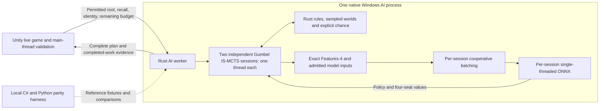
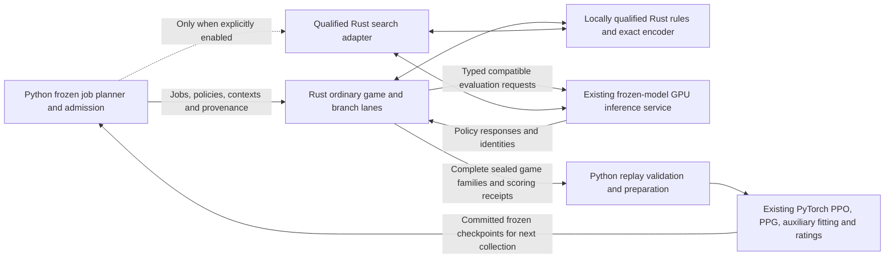

# Rust Simulation and Gumbel IS-MCTS Backend Migration Plan

Updated: **2026-10-25**. Status: **L01 complete for mechanical testing; L02–L12 complete**. L13–L15 and lab qualification remain pending. Local evidence is recorded under `artifacts/rust-backend/20261024-g890-l01-l02/`, `artifacts/rust-backend/20261024-l03-verified/`, `artifacts/rust-backend/20261025-l04-qualified/`, `artifacts/rust-backend/20261025-l05-qualified-v4/`, `artifacts/rust-backend/20261025-l06-qualified-v3/`, `artifacts/rust-backend/20261025-l07-qualified-v4/`, `artifacts/rust-backend/20261025-l08-qualified-v3/`, `artifacts/rust-backend/20261025-l09-qualified-v2/`, `artifacts/rust-backend/20261025-l10-qualified/`, `artifacts/rust-backend/20261025-l11-qualified-v2/` and `artifacts/rust-backend/20261025-l12-qualified-v2/`; see the [L01/L02 results report](RUST_BACKEND_L01_L02_REPORT.md), [L03 results report](RUST_BACKEND_L03_REPORT.md), [L04 results report](RUST_BACKEND_L04_REPORT.md), [L05 results report](RUST_BACKEND_L05_REPORT.md), [L06 results report](RUST_BACKEND_L06_REPORT.md), [L07 results report](RUST_BACKEND_L07_REPORT.md), [L08 results report](RUST_BACKEND_L08_REPORT.md), [L09 results report](RUST_BACKEND_L09_REPORT.md), [L10 results report](RUST_BACKEND_L10_REPORT.md), [L11 results report](RUST_BACKEND_L11_REPORT.md) and [L12 results report](RUST_BACKEND_L12_REPORT.md). Per the user's 2026-10-25 decision, the pinned g890 utility head is accepted for local live-search readiness despite its null calibration receipt; other readiness and qualification gates remain required.

**Search revision, 2026-10-25:** the Rust search uses **Gumbel IS-MCTS**, following Li and Wellman's [paper](https://arxiv.org/abs/2405.00243v1), rather than a behavior-preserving port of the existing Masked ISMCTS. First implemented: the small executable [`reproduce-gumbel-is-mcts.py`](../scripts/reproduce-gumbel-is-mcts.py), its [mathematical contract and conventions](GUMBEL_IS_MCTS_REFERENCE.md), [14 passing tests](../tests/GumbelISMCTS/test_reference.py), [recorded-draw golden trace](../tests/GumbelISMCTS/fixtures/reference-v1.json) and [source lock](../configs/references/gumbel-is-mcts.lock.json). This is a fixed-count toy reference, not production Rust search or a Brass/NN benchmark. L01–L07 retain their historical evidence and unchanged legacy-search comparisons. L08/L09 qualify exact native inputs and same-process CPU inference. L10 qualifies scalar fixed-count Gumbel search against the toy and full Brass comparator. L11 adds qualified scalar whole-turn sessions, balanced-round snapshots and complete-action plans. L12 qualifies two independent one-thread sessions, pooled recommendation, cooperative batching and runtime retirement. Integration and live qualification remain L13–L15. Existing runtime defaults, training and installation are unchanged by this revision.

The migration has two portions, in this order:

| Portion | Deliverable | Required evidence before proceeding |
| --- | --- | --- |
| **Part 1 — Local game** | Rust game engine, Rust Gumbel IS-MCTS, exact native features and same-process CPU ONNX inference, integrated with Unity here | Paper/reference parity, explicit Brass adaptation tests, local rules/model parity, shadow testing, complete live games, failure/rollback checks and measured two-session performance |
| **Part 2 — Lab server training** | Reuse the locally qualified core for ordinary self-play, branches and explicitly enabled search consumers; retain the existing Python/PyTorch trainer | The Part 1 release receipt first; then Linux/GPU, replay, PPO/PPG and resume qualification before a bounded lab canary |

**Execution order: local backend → local debugging and live testing → recorded local acceptance → lab backend → isolated lab validation → controlled training rollout.** A Python test adapter used locally is diagnostic infrastructure; it does not require migrating or running lab training first. Local defects get a reproducible regression fixture and a local fix before promotion. Linux/GPU-only defects receive server tests as well, and changes to the shared core rerun the affected local gates.

The requested local timing target is **four settings: 4s / 8s / 10s / 12s**, all with **two independent search sessions (one thread each)**. The matched complex-state comparison now uses **one 4-second whole-turn allowance**, as requested on 24 October. Installed patch **1.4.34** includes the four-setting catalog. This document records backend work and its evidence, not a completed Rust release or lab deployment.

**Local deployment table rule:** every table uses one AI family, **V4 or NN**, for all AI seats; human seats are allowed with either. The UI must offer no combination containing both V4 and NN. This applies to setup, resumed games and L15 acceptance. It is a game-deployment restriction; Part 2's existing mixed-opponent training recipe remains unchanged.

The selected migration test model is `test_nn/joint7-v11-2-grouped-lr-critic-1b96e228-g890-ecad3b932a8d-6bd7b0105b58/checkpoint.pt`: generation **890**, model ID `1145fecba3289511df1c518bb71fbfb5b2f6df351777151a5eb999b89cba0761`, checkpoint SHA-256 `ecad3b932a8dd9d3b5d0cc49b5e9bb94a9e98b4536ffdc86a44179d003995cb8`. This is the user's **temporary test/benchmark NN**, not the final model, which remains in training. The transferred source-state snapshot is generation 920; it does not change this checkpoint's generation. Strict loading, source compatibility and all bundle hashes pass. The checkpoint has **5,928,616 parameters** and the g850 capped reward. `utility_calibration` remains null and the existing receipt-based readiness check returns false. Under the local acceptance below, this checkpoint may satisfy the utility-head prerequisite for live-search readiness and local quality evaluation. Other qualification gates and lab teacher admission remain pending. Never alter weights or fabricate calibration to pass a gate. A later final model requires its own pin and relevant parity/readiness checks.

**Local test-model readiness decision (2026-10-25):** the user accepts the current g890 utility head as usable now despite `utility_calibration = null`. This exact pinned checkpoint may satisfy the utility-head readiness prerequisite for Part 1 live search, local play and equal-time quality evaluation without a calibration receipt. Record this as explicit model-specific acceptance, not measured calibration or a passing legacy readiness result. All other parity, actor/phase coverage, search correctness, latency, quality, packaging and full-game gates remain required. The model remains temporary; this decision neither proves strength nor admits it as a lab teacher.

The L01–L09 reports and sealed artifacts retain their historical mechanical-only flags and readiness results. This plan revision changes the intended admission policy, not those results or the current runtime. Before local live-search integration, implement and test an explicit acceptance record bound to the checkpoint/model/reward identities above and the qualified L09 export, scoped to Part 1. Require this record wherever a local loader or readiness gate would otherwise reject the null receipt; retain normal rejection for a different identity or absent record. Keep the calibration field null, expose the acceptance reason separately, and issue new qualification receipts rather than editing sealed evidence. L13 must verify this path before shadow/live use. Part 2 training and teacher requirements are unchanged.

This revision incorporates the inspected self-play implementation through repository HEAD `5b49722d7bc328bbad7866c08671967fa505d4ad`, including the 24 October g850 recipe. It also preserves the earlier native-design, same-process inference, profiling, batching and performance requirements. Pin actual source/configuration/checkpoint hashes again at implementation time; current uncommitted work and a lab run's adopted recipe can differ from HEAD or a template config.

## Part 1 — Local game: Rust search and simulation first

### A1. Outcome and starting points

Run **Gumbel IS-MCTS and every simulated transition in Rust**, using the already adapted rules from [brass-birmingham-daiyu-ai](https://github.com/riverside234/brass-birmingham-daiyu-ai). Unity keeps the live game, display, saves, input, final validation and application of complete actions.

The production CPU worker contains the rules, tree, belief sampling, exact Features-4/derived inputs, bounded batch scheduler and ONNX Runtime. It performs no per-move or per-leaf Python/C# RPC. Reuse admitted neural architectures/weights after exact input/output checks. Python/C# remain local parity oracles; the existing qualified C# V4 AI remains available for V4 tables and whole-table rollback under A9.

The algorithm oracle is now the paper plus the executable reference in A4. The existing Python Masked ISMCTS remains a legacy comparison/control and an integration-lifecycle reference. Gumbel root halving, non-root selection at every actor's information set and first-new-information-set evaluation deliberately replace its PUCT/FPU, frozen-opponent rollout and later root-player frontier. Upstream Brass PUCT is another separate algorithm. Neither legacy search is a parity oracle for the new selections or trajectory counts; A8 separates algorithm effects from implementation speed.

| Inspected component | Decision for this migration |
| --- | --- |
| C# host and Python `BrassSpielGame` / `BrassSpielState` | Keep as parity oracle; implement compatible import, staged choices, observations, chance and returns in Rust |
| Executable Gumbel reference, paper Algorithms 1/3 and Appendix B | New selection, expansion, completed-Q and backup oracle; test explicit Brass adaptations separately |
| Python `MaskedISMCTS`, `SearchSession`, newer deadline admission | Preserve the legacy control and lifecycle/privacy/complete-plan/clock requirements; replace algorithm semantics under a new identity |
| Upstream atomic-action enumeration and native saved states | Add direct staged choice generation and external import; avoid constructing every complete action at each stage |
| v11.2 Features-4 model and critic descriptors | Preserve the selected model's exact interface; unknown descriptors for deployment/search by default |
| `LocalTurnBridge` and `IAiExecutionBackend` | Integrate with the existing scheduler, freshness guards, isolated validation and single main-thread commit |
| Installed patch 1.4.34, V4 4/8/10/12-second settings | L01 freezes the actual installed binaries, release receipt and original saves; preserve versioned save handling |
| Ordinary collection, branch scheduler, replay, PPO/PPG and ratings | Part 2 deliverables; these are not prerequisites for local integration |

#### Source and historical evidence

- Rust clone: `C:/Users/BobXu/Desktop/brass`. Last inspected upstream revision: `f8f0246718d6d3fb3f301742d4154811c90d5813`. Recheck its current revision and local patches rather than treating the earlier inspection as a new source audit.
- Our inspected source HEAD is recorded above. Existing uncommitted personality documentation and four-setting game/installer changes are separate work. Pin selected bytes, runtime receipts and configuration; preserve historical upstream locks and notices.
- The earlier experiment under `C:/Users/BobXu/Desktop/brass/output/cpu-capacity-2workers-20261016-deadline/` used upstream PUCT, initialized networks and a folded feature adapter. It established neither exact model compatibility nor our engine/search speedup. Its clock was per root, not per whole turn.
- The [historical four-worker batching report](../artifacts/feature-engineering/rust-v9-v11-w448x6-4workers-20261016/REPORT.md) favored cap 2 over cap 4 in 13/13 preliminary uncapped pairs (median completion ratio 1.0602). It used four worker processes, a shared CPU service and folded inputs. Retest with two independent one-thread sessions, exact features and same-process inference.
- L01 inspected source HEAD `df41b07625ed190e3332326f3c3118c404e026f7` and installed patch **1.4.34**. `artifacts/patch-installation.json` and the frozen release archive are the current deployment baseline; `docs/V4_FOUR_SEARCH_TIMES_1.4.33.md` records the four-setting/save contract retained in 1.4.34. The 1.4.32 timing report and older local README remain historical references.
- Latest self-play behavior comes from executable configuration/collector/trainer code and the admitted run signature. `configs/step5/joint7-latest.json` contains older explicit values; `latest_model_config()` applies subsequent migrations including g850. Do not infer the current recipe from the filename “latest.”
- Frozen research and installed Unity observations have separate contracts. Resolve any rules difference explicitly; do not label a deployment observation as admitted training data automatically.

#### Performance work retained

Use compact state, direct staged choices, arena-owned trees, reusable tensors, measured copies/allocations and native encoding. Co-locate inference with CPU search, then retune batching. The earlier estimates of roughly 50 steps per trajectory, 25 ms per host step and 3–8 ms per Python encoding are hypotheses to remeasure, not constants or additive speedup promises. Gumbel's earlier actor-information-set leaves change work per trajectory; measure that algorithm effect separately from language/engine efficiency.

### A2. Native architecture and engineering standards

#### A2.1 Process and ownership boundaries

Use an isolated Rust core crate and a long-lived Windows AI process containing **two independent search sessions, each executed by one dedicated thread**. Each session owns its private tree, sampled states, pending trajectories, scratch buffers and single-threaded inference path. Both receive the same detached permitted root and remaining whole-turn budget. Merge only qualified completed-round root/plan snapshots through the versioned coordinator rule in A5.2; do not share mutable trees or inherit the old visit-count winner rule.

The local CPU execution contract is **2 sessions × 1 thread**. Search, encoding, batch preparation, ONNX execution and backup run on that session's thread. Set ORT intra-op threads to 1, inter-op threads to 1 and sequential execution; create no extra inference worker pool or shared cross-session inference dispatcher. Persistent model handles run serially on their owning session thread. The initial Gumbel contract uses the admitted root model on each simulated actor's permitted view; legacy frozen-opponent routing remains a control, and heterogeneous-model Gumbel variants need separate admission. Record cached model/session counts and memory separately from the two computational threads; model caching must not add parallel execution. Transport/UI coordination is outside this compute count and performs no simulations or NN forwards.

A session may advance several bounded pending trajectories cooperatively and form a local batch before a synchronous inference call. This is concurrency in the session's state machine, not more threads. The other session can continue independently. Batch caps/flush/pending limits may be tuned within this fixed execution layout; increasing thread count or pooling batches across sessions is outside the requested configuration.

Here, **in-process means engine, search, encoder and CPU inference share the Rust AI process**; Unity remains a separate process. In Part 1 the core owns rules, sampling, search and feature encoding. Part 2 adds ordinary game lanes to the same qualified core. Keep transport, Python bindings, runtime calls and Unity integration behind typed adapters.

Use a framed protocol only at the Unity/diagnostic orchestration boundary and for the Part 2 GPU evaluator. JSON is acceptable for infrequent controls/debugging. Production CPU trajectories perform zero Python/C# rules callbacks, board-to-JSON round trips or per-leaf process RPC. Share immutable board definitions and metadata; measure state/tensor copies and duplicated model memory.

An optional local diagnostic Python binding releases the GIL during native CPU work. Keep mutable instances with their owner; do not force an upstream unsendable wrapper across threads. Verify both sessions run concurrently while each stays single-threaded.

#### A2.2 Native data layout and hot paths

| Area | Required design | Evidence |
| --- | --- | --- |
| Static and shared data | Immutable indexed topology, card/tile definitions, lookup tables and permitted history prefixes | State copies share these immutable inputs; mutable history deltas remain owned by each world |
| Mutable game state | Compact typed IDs, enums, arrays and bitsets where the domain is bounded; explicit phase/pending-action data | Record state size and bytes copied per sampled world/transition; no nested JSON or string-keyed state dictionaries |
| Legal choices | Generate the current stage directly into reusable worker-owned storage; retain every legal semantic choice in reference order | Dense Rail and multi-sale fixtures do not first enumerate all complete plans; report generated choices and allocations |
| Rules application | Apply an already validated typed choice to owner-local state; keep external validation at ingress and live commit | Repeated fixed-capacity apply operations target zero heap allocations; no repeated parsing or global lock |
| Search tree | Bounded arenas of nodes/edges with stable integer handles; keep frequently read visit/value/prior fields compact | Measure bytes per node/edge, arena growth, traversal cost and cache misses where available |
| In-flight trajectories | Explicit resumable states holding path handles, sampled state and an evaluation ticket | No live tree borrows across inference waits; arena generations prevent expired tickets from accessing reused handles |
| Information/evaluation keys | Typed canonical representations of the existing permitted information and context | No per-visit JSON/digest rebuild; equality resolves hash collisions; hidden state cannot enter information-set keys |
| Feature encoding | Write directly into reusable contiguous tensors with candidate offsets; share only immutable, semantically identical prepared inputs | Report encoding time, allocations and bytes transferred; preserve exact masks, order and declared precision |

Map external semantic strings to compact IDs once, and reconstruct strings at protocol/audit boundaries. Internal ID ordering must preserve the reference's ordering and tie-breaking. Keep observation, recall, context, legal-choice and reward identities complete when optimizing keys. A board hash alone cannot identify an information set or evaluation. Cached legality and features need explicit invalidation rules for each state mutation, seat and model contract.

Start with compact state copies and reusable sampled-world storage. Benchmark copy/restore against a mutation journal only after rule parity passes. Adopt apply/unapply if it improves the full trajectory workload enough to justify its complexity. Its journal must restore phase data, resources, derived caches and relevant RNG state exactly, including exceptional/canceled paths. Compare restored states and incremental caches against independently recomputed results. Preserve a simple reference path for diagnosis.

Keep legal-choice, path, tensor and batch buffers across calls. Grow capacity deliberately and record high-water marks; large legal sets must never be truncated to fit a buffer. Separate temporary scratch from retained nodes, keys and replay records. Arena growth and retained records may allocate; repeated scratch use should not. Rust's `Vec` supports capacity reuse, but the allocation budget must be demonstrated by measurement. [Rust Vec documentation](https://doc.rust-lang.org/std/vec/struct.Vec.html)

Build sampled worlds from a prepared permitted root without replaying the entire game history or serializing checkpoints per trajectory. Preserve fresh sampling and the reference's actual conditioning. Share immutable public facts only where the contract allows it; cache reuse must not collapse distinct hidden worlds, recall, seats or utility budgets.

Build views on demand for the current policy consumer and any required root reward/recall consumer, reusing a common public projection. Preserve all required observation updates without materializing four complete JSON views after every move. Validate contracts and source/model identities at their real boundaries; maintain cheap native freshness, legality and information-set checks within the loop.

#### A2.3 Rust engineering and build standards

**Reuse established crates by default.** Import the pinned upstream rules as a small local crate, then build the migration adapters around it. Use existing libraries for serialization, errors, collections, channels, random primitives, inference and measurement. Custom code should implement Brass rules/phase translation, permitted-information boundaries, exact feature semantics and the versioned Gumbel IS-MCTS contract. A custom replacement for general infrastructure needs a concrete compatibility or measured performance reason. Adding dependencies with no current consumer is not required.

| Responsibility | Reuse decision | Admission / milestone |
| --- | --- | --- |
| Existing game rules | Extract `brass-upstream-rules` from the L01 source archive; retain board, cards, resources, validation and runner code with provenance and license | L03 compiles and smoke-tests the upstream core; C# staged parity remains L04–L07 |
| Wire types and JSON | `serde` / `serde_json`, strict unknown-field handling; reuse the L02 schemas with an offline `jsonschema` validator when importing those DTOs | L03 control messages; L04/L06 state and permitted-root imports |
| Typed errors and build identities | `thiserror` and RustCrypto `sha2`; standard Cargo metadata and lockfile checksums | L03; no custom error framework or hash algorithm |
| Two owner threads and bounded control queues | `crossbeam-channel` with `std::thread`; each session owns its mutable state | L03 skeleton; no Rayon pool or multi-thread Tokio runtime inside search/inference |
| Bitsets and small scratch buffers | Retain upstream `fixedbitset`; consider `smallvec` for measured short-list hot paths | L04–L08, preserving full legal sets |
| Stable tree handles and maps | L10 pins `slotmap = 1.1.1` plus standard maps, typed equality and an arena-owner identity; evaluate `hashbrown` only if profiling justifies it | Qualified node/edge bounds, stale/foreign handles and hash-collision behavior; L12 addresses measured key/observation copying |
| Randomness | Retain the upstream pinned `rand` version for its diagnostics; use explicit recorded draws and an identified `rand_chacha` stream for future reproducible native sampling | L06/L10; equal seeds never substitute for cross-language outcome parity |
| CPU neural inference | L09 pins `ort = 2.0.0-rc.10` with ONNX Runtime 1.22.1; borrowed tensor bindings reuse the existing encoder arrays | Qualified with one intra-op/inter-op thread and sequential execution per owning session; hashes/settings in the model manifest |
| Measurements and tests | `criterion`, `proptest`, and `stats_alloc` for benchmark-only allocation instrumentation | L03 onward; instrumented allocation runs are separate from timing |
| Python bindings | Prefer `pyo3` if an in-process diagnostic adapter becomes useful; use the framed worker adapter initially | L07 / Part 2; release the GIL during native computation |

Pin direct versions and commit `Cargo.lock`; retain registry checksums, dependency/features inventory, upstream patches and attribution in the build receipt. Turn off unnecessary default features and keep web servers, databases, embedded UI assets and training dependencies out of the worker. Crate upgrades get focused compatibility tests and new build identities. These choices use the documented [Serde](https://serde.rs/), [Crossbeam channels](https://docs.rs/crossbeam-channel/latest/crossbeam_channel/), [SlotMap](https://docs.rs/slotmap/latest/slotmap/), [ORT](https://docs.rs/ort/latest/ort/), [Criterion](https://criterion-rs.github.io/book/) and [allocation instrumentation](https://docs.rs/stats_alloc/latest/stats_alloc/) interfaces.

Generic MCTS crates are not a drop-in substitute for four-seat, masked-information, staged-action Gumbel search. Reuse their infrastructure only if it preserves A4's pinned semantics. The supplied [Gumbel MCTS code reference](https://github.com/olivkoch/gumbel-mcts/tree/f7cc656af7a037f1283b08b454982edba4d86e21) is Python/Numba, not a Rust crate: reuse its relevant design ideas, while retaining its MIT notice if code is adapted. Its two-player negamax, Q normalization and scheduler variants are not the paper's IS-MCTS contract; see [the reference comparison](GUMBEL_IS_MCTS_REFERENCE.md#sources-and-precedence). A fast RNG or serializer does not establish rules, NN or search parity.

Prefer safe Rust, explicit ownership and small modules organized around rules, state, observation, belief, features, search and transport. Use typed errors for invalid requests and unsupported states. Avoid unchecked indexing, `unwrap()` on external data, global mutable state and broad `Arc<Mutex<...>>` ownership. Any measured need for `unsafe` requires a narrow implementation, documented invariants and focused verification; it is not a default optimization technique.

Contain failures at the process/binding boundary. A worker panic retires that request through the existing failure lifecycle; an in-process FFI adapter must translate failures without unwinding into foreign code. Document ownership and release rules for every borrowed tensor or external buffer.

Preserve the reference's numeric semantics, including search accumulation precision, normalization and tie-breaking. A faster implementation must not silently narrow values, reorder probability operations or use approximate keys. Keep production checks for protocol validity, finite tensors, legal actions and request identity; expensive whole-state consistency checks belong in debug/differential builds.

Require formatting, lint, native unit/property tests and the relevant cross-language parity suite for each change. Run both debug and optimized tests: unchecked release overflow or build-specific behavior can otherwise escape qualification. Use `cargo fmt --all -- --check` and `cargo clippy --workspace --all-targets -- -D warnings` for the supported feature matrix; lint exceptions must have a local reason. [Clippy usage](https://doc.rust-lang.org/clippy/usage.html)

Maintain a profiling build with release optimization and symbols, plus a portable deployment build with recorded CPU requirements. Compare optimization levels, ThinLTO and codegen-unit settings on representative workloads; compiler flags are experiments, not assumed speedups. Keep machine-specific CPU flags out of the portable artifact. Treat profile-guided optimization as a later experiment using training fixtures distinct from the held-out benchmark. Pin and record the effective profile and toolchain. [Cargo build profiles](https://doc.rust-lang.org/cargo/reference/profiles.html)

Every performance change includes its motivation, affected invariants, before/after raw measurements and relevant regression results. Prefer the simpler design when the speed difference is within noise. Keep verbose per-node tracing disabled in performance builds and measure instrumentation overhead using unprofiled confirmation runs.

#### A2.4 Same-process ONNX Runtime

Implement a narrow Rust inference adapter over a pinned binding to ONNX Runtime's C API. Pin the binding, runtime/library hash, execution provider, graph settings and export/opset contract. Create persistent sessions by admitted model/export identity and warm them before timed search. The C API supports native sessions and tensors backed by caller-provided memory; enforce buffer lifetimes through completion and measure output allocation/copy costs. [ONNX Runtime C API](https://onnxruntime.ai/docs/get-started/with-c.html)

Keep the encoder and all policy postprocessing native on this path: candidate masks/order, softmax or log-probabilities, temperature/exploration, seat remapping, personality adjustments and utility outputs must follow the selected contract. Compare Python/PyTorch, Python/ORT and Rust/ORT on the same exact tensors, then compare full policy responses. Require singleton/mixed-batch parity for variable legal counts and every supported output head.

Use the two session-owned inference paths specified in A2.1. Pin intra-op/inter-op to 1 and sequential execution; verify runtime settings and observed concurrency rather than relying on defaults. Preserve the two-session/one-thread configuration during batch retuning in A5.1. [ONNX Runtime thread management](https://onnxruntime.ai/docs/performance/tune-performance/threading.html)

The existing external evaluator remains the parity oracle; its GPU-training adapter is qualified in Part 2. CPU deployment must pass with that evaluator unavailable. Freeze model versions for each local session and, in Part 2, each collection round, invalidate caches when versions change and keep the existing Python/PyTorch optimizer and checkpoint lifecycle. Do not require a new ONNX export after every PPO minibatch; any CPU-collection export occurs at an explicit frozen snapshot boundary and its cost is reported.

#### A2.5 Proposed implementation locations

L03 created the native workspace, isolated upstream crate, core/worker skeleton and explicit Python diagnostic selector. L04–L10 add the adapted simulation, beliefs, exact features, same-process inference and scalar Gumbel search. Remaining responsibilities below are planned milestones: whole-turn search scheduling/plans and Unity integration in Part 1; add collection and lab orchestration adapters only in Part 2:

| Proposed path | Responsibility |
| --- | --- |
| `native/vendor/brass-upstream-rules/` | Pinned existing rules crate, original source hashes, local patch and attribution; isolated in L03 |
| `native/brass-ai-core/` | Adapted engine, state/action contracts, belief sampling, Gumbel IS-MCTS, ordinary collection loops and exact feature encoder |
| `native/brass-ai-worker/` | Worker/game-lane lifecycle, cancellation, framed protocol, inference transport and bounded decision buffers |
| `native/brass-ai-inference/` | Implemented in L09: same-process ONNX adapter, model sessions, native postprocessing, bounded CPU batching and typed reference evaluator |
| `src/brass_ai/native/` | Research and ordinary-collection adapters and backend selection, preserving the current public training interfaces |
| `src/BrassLocalAI/Native/` | Unity request/result adapter using the existing execution lifecycle |
| `tests/RustBackend/` | Golden fixtures, differential tests and cross-language search traces |
| `tests/RustBackendNative/` | L03 process, ownership, failure and explicit-selection checks, separate from the frozen reference suite |
| `native/brass-ai-core/benches/` | Fixed-work rules, restoration, encoding and scripted-search microbenchmarks |
| `configs/references/rust-engine.lock.json` | Upstream revision, imported source hashes, local patches and attribution references |
| `scripts/reproduce-gumbel-is-mcts.py`, `tests/GumbelISMCTS/` | Implemented fixed-count mathematical oracle, independent equation tests and recorded-draw golden trace; not the future full Brass adapter |
| `configs/references/gumbel-is-mcts.lock.json`, `ai-research/GUMBEL_IS_MCTS_REFERENCE.md` | Pinned paper/code sources, executable identity, equations and explicit reference conventions |
| `artifacts/rust-backend/<run-id>/` | Versioned parity, benchmark and deployment evidence |

Keep imported code and our adapters distinguishable. Carry forward applicable notices and record modifications. Preserve historical upstream locks and frozen source inventories; add a new backend identity rather than rewriting old evidence to appear compatible.

### A3. Rules, request and neural contracts

#### A3.1 Rules and state import

Define a versioned semantic state DTO and a canonical comparison projection independent of C# object identities and Rust memory layout. Import all information needed to reproduce a position:

- Game configuration, stable seat/color mapping, era, round, turn owner, acting player, actions remaining, first-turn rules and phase.
- Cash, income-track position and derived income, spending, points, industry mats, tile identities/levels, board slots, links, resource quantities, markets, merchants and consumed bonuses.
- Public discard/history, known wildcards, permitted recall and outstanding action/payment/continuation/bonus/debt state.
- For trusted differential fixtures only: complete hidden hands, deck order, setup discards, pending chance and any state needed for deterministic replay. Keep this format separate from production policy requests.

Rebuild Rust connectivity masks, resource indexes and other derived caches after import. Validate card/resource conservation and state invariants. Fail explicitly on an unsupported phase or configuration and use the qualified backend; never manufacture a turn-start approximation for a mid-action state.

L04 implements the trusted [`brass-native-state/1.0.0` contract](../configs/contracts/rust-backend/semantic-state-v1.md). It preserves the independent engine flow cursor, public debt and residual settlement debts, ordered partial chance draws, Rail discard aliases, and separate removed/retired tile identities. Its typed native state reuses upstream connectivity and income helpers plus `fixedbitset`. This diagnostic import is separate from permitted-root construction in L06.

**Production search starts from a detached permitted view and allowed recall.** Rust builds sampled hidden worlds from this information. It must not receive the actual opponent hands, deck order or live RNG through a convenient full-state export. Trusted full-state imports are for parity/debugging, not belief construction.

Preserve the current sampler's exact conditioning: `sample_world_setup(view, composition, search_seed)` uses the permitted view; `BrassSpielGame.from_observation` attaches root recall afterward for information-set identity. The paper samples `Pr(h | s, p)` using history/policy-conditioned beliefs; L06's current-view sampler is an explicit **Brass belief approximation**, not that exact posterior. Carry recall across the Rust interface without silently adding history-conditioned likelihoods. Any later belief upgrade needs a separate identity, likelihood/privacy tests and quality comparison.

Initially qualify four-player standard games, matching our neural research contract. Before exposing this backend in Unity, either qualify every selectable configuration it supports or offer only V4 for unsupported two-/three-player and introductory configurations. Apply this support decision to the whole table.

#### A3.2 Staged choices and complete live actions

Preserve our semantic choice stages: ordinary action, payment, continuation, bonus, debt and explicit chance. Upstream's enumeration of every complete atomic action is not a drop-in replacement for this interface.

Expose legal staged choices directly from the Rust phase machinery. Maintain stable semantic IDs and ordering for locations, slots, links, card types, industries, resources and merchants. Detect ID collisions and version any internal compact-ID mapping. Preserve the full legal choice set and policy denominator. Gumbel's finite-budget root top-K is an explicit sampled candidate set, not a truncated legal mask; all legal actions remain in priors, completed-Q/improved-policy calculations and later decisions. Non-root selection considers every legal action.

Accumulate the selected current-turn trace into complete actions compatible with Unity's validator. Preserve ordered resource payments, multi-sale order, merchant beer/bonus use, development choices, optional second Rail link, Scout card combinations and liquidation ownership. A first action and a supported second action are separate validated commits on the existing presentation schedule.

#### A3.3 Request and result identity

Every request carries protocol, rules, observation, feature, search and reward identities; model/export and profile hashes; game instance/generation, revision, actor, turn key, request ID; allowed recall; worker count; and remaining budget. Results echo these identities and identify the backend build.

The coordinator owns the turn deadline. Convert it to the worker's clock through an explicitly verified clock mapping, or send a remaining-duration budget with transport/queue allowance and coordinator cancellation. Receiving or retrying a request must never grant a fresh allowance. The coordinator independently rejects expired results. Inference replies carry generation, batch and model IDs as well.

Return complete action plans, continuation preconditions, completed root/plan evidence, interruption reasons and timing counters. Include the algorithm/adaptation version, belief identity, count/deadline mode, requested/effective K, c1/c2, root epoch/draw identity, admitted simulation quota, last completed round, partial-round/pending counts, aggregation rule and fallback/completion provenance. A completed tree visit is not automatically a complete plan or completed halving round. Return errors as explicit states that leave the live game untouched.

Specify tensor dtype, shape, layout, candidate offsets/masks, seat mapping and buffer lifetime in the protocol. Reject malformed, non-finite or mismatched responses before cache insertion or backup. Bound queued batches and retained game/tree memory; memory pressure must reduce pending work or trigger an explicit failure, not truncate the legal choice set.

#### A3.4 Neural interface and checkpoint reuse

Freeze the active architecture, feature schema, action schema, context/reward contract, relative-seat mapping, checkpoint hash, model export and preprocessing. The inspected v11.2 model still uses Features-4 state/action widths 3,128/327, but also needs derived/local inputs and critic descriptors. Read dimensions from the admitted export; the earlier width/depth benchmark is not an input manifest.

Port the existing feature meanings, ordering, normalization, known/applicable flags, candidate masks, entity ordering where applicable, personality context and remaining utility budget. The bridge must accommodate the selected model's actual inputs/outputs and frozen opponents' admitted schemas. A model factory name or equal dimensions is insufficient.

The inspected base schema is **Features-4** (`permitted-features/4.0.0`, `features-4.0.0.json`). Port that exact encoder and all additional grouped/local/context inputs required by each admitted checkpoint. V9/v11 model labels do not by themselves identify a feature schema, input width or parameter count. Production CPU evaluation must use the Rust encoder directly, without falling back to Python at new positions.

During development, compare Rust tensors with the Python encoder on identical permitted fixtures. Require exact equality for discrete IDs/masks/order and declared numerical tolerances for floating-point features and inference outputs. Compare policy ranking/ties as well as values. **No folding, hashing or invented projection between upstream features and our model is acceptable.**

Keep weights and architecture unchanged when these checks pass. If rules or feature semantics intentionally change, create a new contract and explicit checkpoint/data admission decision; re-encode or retrain as needed. Do not silently reinterpret old replay or teacher labels.

Gumbel evaluates the first new information set of **any acting seat**, including permitted staged phases. L08/L09 must establish actor-view feature support, relative-to-absolute four-seat value mapping and causal reward/remaining-budget meaning at those leaves. The root's admitted model supplies these values; frozen opponents' value heads are not interchangeable. If an actor/phase lacks supported values accepted under the applicable readiness policy (including the g890 local acceptance above), fail that search admission or explicitly qualify a separately named extension; do not silently restore the legacy root-only frontier and call it paper parity.

The inspected current architecture is `brass-four-seat-mlp-resnet/11.2.0`: 5,910,916 base parameters and 5,928,616 with the utility head. It retains the v11.1 actor and adds `seat-descriptors/1.0.0`, a `[B,4,34]` critic-only input with a 34 → 32 → 32 encoder. Verify relative-seat mapping, the all-unknown default, explicit known/unknown inputs, dynamic legal counts and policy independence from descriptor values. Search and deployment use **unknown descriptors by default**, matching the current contract. Do not import privileged training table roles into live search or choose an own-copy descriptor experiment silently.

For this migration use the supplied g890 test checkpoint pinned above. Its model, reward and eventual export hashes govern mechanical tests and benchmarks. Its null utility-calibration receipt does not block Part 1 live-search readiness or quality evaluation under the model-specific acceptance above. This acceptance does not establish measured calibration or strength; assess the final checkpoint separately. **Part 1 does not require a new self-play run or a repeated IL run.**

Keep the completed v11.1 IL source and its explicit v11.2 upgrade receipt intact. The supported zero-prior-self-play handoff, fresh optimizer and utility calibration are tested in Part 2. Resuming an established v11.2 self-play checkpoint preserves its architecture, weights, optimizers and progress; changing the simulator language is not another architecture migration.

### A4. Gumbel IS-MCTS: executable algorithm contract

Use [`scripts/reproduce-gumbel-is-mcts.py`](../scripts/reproduce-gumbel-is-mcts.py) as the small fixed-count oracle, with [its mathematical specification](GUMBEL_IS_MCTS_REFERENCE.md), [tests](../tests/GumbelISMCTS/test_reference.py) and [golden draw/trace fixture](../tests/GumbelISMCTS/fixtures/reference-v1.json). Sources are the paper's §6/Algorithm 1, Appendix B.1/B.2, Algorithm 3 and Table 7. The locked code reference supplies implementation ideas, not authority to change those equations. This revision supersedes the former faithful-Masked-ISMCTS L10 and optional earlier-leaf experiment.

1. **Belief, information sets and chance.** Draw a fresh valid world for every trajectory. Reuse L06's permitted-view sampler, card conservation, recall, setup/era transitions and explicit lawful chance. Declare its current-view conditioning as a Brass approximation to the paper's `Pr(h | s, p)`. Key nodes by acting seat, that seat's permitted information/recall, legal semantics, context and relevant reward budget; never by the determinized full board. Counterfactual hidden worlds with identical permitted root/draws must leave root behavior unchanged.
2. **Root preparation and sampling.** Expand the root and cache full legal logits and four-seat values. Draw one Gumbel per legal action, fixed for that root tournament. Select initial top K by Gumbel plus logit. Apply sequential halving with the reference's equal per-round quotas and eliminate only after the last required backup completes. Do not refresh Gumbels at a phase boundary or convert the sampled candidate set into a smaller legal mask.
3. **Completed Q and improved policy.** Visited Q is that acting seat's accumulated return divided by completed count. Unvisited Q uses Appendix B's cached-value/visited-prior mixture; see the executable equation for its denominator. Scale by `c2 * (c1 + max completed edge count)`, with no Q min/max normalization or hidden prior floor. Use `softmax(logit + scaled Q)` for the improved policy. Keep values in absolute seat order; select using the node actor's component.
4. **Non-root selection.** At every previously expanded actor information set choose `argmax(improved_policy[a] - n[a]/(1+sum(n)))`, the algebraic equivalent of Equation (3). Replace legacy PUCT/FPU, protected families, progressive admission/reopening and frozen-opponent action sampling. All legal edges participate. Begin with the root model's admitted policy/value on each actor's view; model mixtures, personality transformations and heterogeneous opponent models require pinned, separately tested policy contracts.
5. **Leaf evaluation and backup.** Stop at the first newly encountered actor information set, cache its policy/value, and back up that value along the completed path. Its outgoing counts remain zero until later traversals. Exact terminal returns include all required debt/liquidation settlement. Preserve four-seat utility/cost ledgers; qualify actor/phase leaf support in L08/L09. No two-player sign flip and no hidden substitution of the old future-normal-root-player frontier.
6. **Budget conventions and provenance.** The script starts with Table 7's N=200, K=16, c1=50, c2=0.1; these are reproduction settings, not tuned Brass settings. Its explicit conventions cover root pre-expansion, power-of-two effective K, inadequate budgets, zero/one-action cases, stable ties and floor remainders. At N=200/K=16 the rounds use 194 trajectories and the remaining six visit the survivor. Record requested/effective K and every convention; revise identities before changing them.
7. **Plans and lifecycle.** Keep turn keys, context/utility lifetimes, own recall, stale-request guards and complete-action validation. Gumbel leaves can stop during an action: successful backup grants tree evidence only, never invented complete-plan support. Reuse a continuation only when its permitted state and legality preconditions match. Ordinary-turn sub-choices and action two never reset the clock.

Use `search/ismcts.py`, `search/common.py`, `searchlab/spiel.py`, `personality/search/engine.py`, `recovery/parallel.py` and `recovery/teacher_schedule.py` for the existing adapters, privacy, plan and caller lifecycle, and as legacy comparison arms. They are no longer selection/leaf parity oracles. Part 1 targets the local whole-turn caller; count-primary teachers and lab scheduling remain Part 2.

L10 must match recorded uniform draws, sampled worlds, chance, evaluator replies, expansions, selected edges, per-seat backups, round boundaries and final survivors. Equal numeric seeds are insufficient across languages. Start with the script's deterministic lane and independent equation tests, then add full Brass traces. A toy replay alone does not certify the staged game. Floating accumulation uses explicit tolerances; near-tie behavior needs tests and a declared policy rather than an accidental compiler-dependent change.

#### A4.1 Production extensions and implementation quality

The paper does not specify four-second deadlines, independent-session aggregation, cooperative NN batching or complete Brass actions. Keep a named `brass-gumbel-is-mcts` adaptation identity distinct from the fixed-count oracle. A5.2 defines the initial budget/aggregation rules. L11 adds the [executable session reference](../scripts/reproduce-gumbel-sessions.py) and [recorded interruption fixtures](../tests/GumbelISMCTS/fixtures/session-v1.json) for frozen quotas and balanced-round snapshots. L12 adds the [merger/pending reference](../scripts/reproduce-gumbel-coordinator.py), [recorded fixtures](../tests/GumbelISMCTS/fixtures/coordinator-v1.json) and [coordinator contract](../configs/contracts/rust-backend/gumbel-coordinator-v1.md). These extensions need their own correctness and equal-time quality evidence; do not inherit the paper's theoretical guarantees for approximate Brass beliefs/values.

Use pure Rust units for completed Q, improved policy, Equation (3), Gumbel draws and halving, then typed arena-owned information nodes/edges and resumable trajectories. Reuse the pinned crates in A2.3. Keep canonical IDs/equality, stable generational handles, scratch/tensor capacity reuse, numerical checks and per-component measurements. A simple scalar path remains the differential oracle for the optimized scheduler. Profile full trajectories and complex states; neither a language change nor a flat layout establishes a speedup without evidence.

Publish backups as bounded transactions only after a valid timely leaf response. Pending reservations occupy scheduling slots but never alter completed R/C, v_mix, elimination scores or reported support. Batch expansion needs an owner for each new node: followers wait or use an explicit tested reservation rule, and canceled/failed expansion cannot leave a fabricated zero-value node. Release reservations/tickets exactly once on every exit. No live tree borrow may cross an inference wait, and no full-tree copy or global lock is acceptable for transactional backup.

Initially create fresh search statistics and a new tournament at each changed decision root, with only semantically identical NN-cache reuse. Do not inherit old counts into Algorithm 3's fresh quotas. Root/subtree reuse is a later separately tested optimization with explicit count/epoch rules. A forced single-choice step needs no tournament; choice application, completion and delivery still consume the existing turn allowance.

Preserve the launch-stop safeguard from `search/deadline.py`: estimate trajectory cost from the last eight completed local samples, requiring four before using its lower-quartile estimate, and stop admitting paths when remaining time is too short. A5.2 separately freezes a tournament quota before its first round. These safeguards cannot invent partial returns or reallocate an unfinished round after seeing its rewards. Count-primary teachers consume their configured quota with an exceptional watchdog; Part 2 preserves that distinction.

### A5. Whole-turn timing, inference and cancellation

- Give a searched ordinary turn one 4-second matched-benchmark allowance and both sessions the same remaining budget. Preserve the selected reference's preparation/admission boundary, measure excluded preparation separately and report total observed turn latency too. Local production still exposes all four settings.
- Pin the finalization reserve to the reference for the matched comparison. Stop admitting work at its work deadline; plan selection, completion and delivery use the remaining allowance. Tune that reserve only in a separately identified optimization run. Action two, payment, continuation, bonus and replanning do not replenish the ordinary-turn budget.
- Poll cancellation/deadlines inside expensive legal-choice generation, recursive resource/sale exploration, traversal, feature building and transport waits. Upstream's optional benchmark deadline patch is evidence of a problem, not the final production cancellation API.
- Measure polling overhead and the longest interval of unchecked native work. Use bounded chunks with cheap cancellation checks and appropriately spaced clock reads; an expensive recursive operation cannot hide behind one outer-loop check. Preserve the same cutoff contract while tuning check frequency.
- Keep completed-work accounting transactional. A timeout during a simulation or NN wait must not publish a partial backup. Record last completed-work time, work-stop time, response-ready time and live-apply time separately.
- Use session-owned pending queues and persistent single-threaded ONNX handles. Count encoding, queueing and inference inside search work. The two independent sessions each run search and inference on their one thread; there is no extra inference pool. Record actual computation/transport threads and CPU use separately.
- Maintain separate latency policies for interactive search and ordinary collection. Search batches flush on a small bounded delay or the approaching deadline; collection batches can favor throughput across independent games. Group only compatible model/export/schema requests, preserve candidate offsets and never wait indefinitely to fill a batch. Measure batch size, queue age, padding and worker idle time before tuning pending-path limits or NN thread counts.
- Put a deadline on each batch and ignore results for expired requests/generations. Bound pending work and buffer ownership. Cancellation does not mean an in-flight native/device operation has already stopped; the execution backend remains busy until all its CPU/device work has actually completed.
- On timeout, worker failure or an unsupported state, use the bounded legal fallback only while the same live request is still valid. Cancellation caused by game replacement, history navigation, menu exit or a superseding request retires the job without applying any action. Never start a fresh 4-second fallback search after the allowance has elapsed.

A hard search cutoff and zero wall-clock delivery overhead are different claims. Qualification must state the permitted delivery tolerance and observed worst case; do not describe a 4-second search followed by unbounded draining as a 4-second turn.

**Reference timing details to preserve:** personality `SearchSession` keys sessions by `(turn_key, seat, is_debt)` and disables search at debt roots. The training teacher wrapper also routes debt roots through its policy/completion path. Forced single-choice decisions remain recorded without launching search. Direct-policy calls have their own inference timeout in the research code; they do not establish a 4-second Unity latency guarantee. Give deployment policy/fallback work an explicit bounded lifecycle and qualify it separately.

The target local menu has exactly four search allowances: **4s / 8s / 10s / 12s**, each using two independent search sessions (one thread each) and one shared ordinary-turn budget. Keep the four-setting catalog's existing default (Hard, 10s) and use **4s for the matched benchmark**; verify deadlines and lifecycle at all four settings. Installed 1.4.34 already has this catalog. The earlier 1.4.32 6/10/15-second catalog remains a legacy-save compatibility input; section A9 defines its explicit mapping. Production teacher recipes may instead use phase-specific time allowances or simulation quotas with a watchdog. Preserve the selected recipe's budget mode, counters and admission behavior; do not convert it to time-based search as part of the port.

#### A5.1 Retest batching within two single-threaded sessions

The historical shared-service cap-2 result is only a hypothesis. The required local layout is **two independent sessions, one thread each**, with separate inference execution and no shared batch dispatcher. Both sessions keep ORT intra-op/inter-op at 1 with sequential execution throughout qualification.

1. Start with one pending trajectory per session and immediate singleton inference. Establish latency, completed support and CPU/memory use.
2. Compare two, then four cooperative pending trajectories per session if useful. Test local caps 1/2/4 only where compatible pending requests can fill them; batching never combines the two sessions or creates an inference thread. Root-round reservations must cap launches at the quota and allow elimination only after all required completions.
3. Compare immediate flush with short bounded policies such as 0.5/1/2 ms where the session can advance other trajectories. Do not block waiting for requests only that same thread could produce. Near the deadline, flush ready work or retire it under the pinned completion rules.
4. Use NN-heavy Canal, dense Rail, variable legal counts and all acting-seat/staged leaf contexts. Measure actual batch size, padding, time to leaf, idle/queue time, allocation, completed rounds/plans and deadline misses. Test singleton/mixed-batch output parity. Mixed-model routing remains a separately identified control or admitted extension.
5. Select using paired whole-turn results and held-out cases; keep the session/thread configuration fixed. Record cap, pending capacity, flush policy, per-session ORT settings and binary/model hashes.

The single deterministic session used for trace parity is a correctness fixture, not a request for another performance configuration. Part 2 retains the lab recipe's separate ordinary-lane/GPU batching settings; the local two-session limit is not a new cap on all training actors.

#### A5.2 Gumbel count budgets, deadlines and two-session recommendation

The following is an explicit Brass adaptation. The original short script remains the fixed-count foundation. L11 implements the scalar quota/snapshot/plan portions with [session reference fixtures](../tests/GumbelISMCTS/fixtures/session-v1.json) and [its contract](../configs/contracts/rust-backend/gumbel-session-v1.md). L12 implements two-session aggregation and cooperative pending-work rules with their [independent reference](../scripts/reproduce-gumbel-coordinator.py), [fixtures](../tests/GumbelISMCTS/fixtures/coordinator-v1.json) and [contract](../configs/contracts/rust-backend/gumbel-coordinator-v1.md).

1. **Frozen tournament budget.** Count-mode tests use exact N/K from the trace. In timed mode, each session freezes `N = max(0, floor(available_work_time / estimated_trajectory_cost))` before its first round, then applies the reference's effective-K rule. Available work time excludes the pinned finalization reserve and includes all remaining search overhead. Use identity-matched completed local costs when available; before four samples, use a separately measured startup estimate from L09/L10 by phase/model, or a separately receipted L12 cap-one calibration of the same native path, model/export/reward and phase. L12 uses 64 completed trajectories per owner on each calibration root and records the conservative estimate and its exact source; this is new measured evidence, not relabeled historical timing. Record the estimate, its source and N. A missing positive finite estimate causes a declared bounded fallback, not an unbounded search. Never increase N or alter an active phase's quota after seeing returns. Initial implementation runs one tournament per decision root; report unused time if it finishes early. Retuning the estimate or adding restarts is a separately measured/versioned change.
2. **Phase completion.** A round's quota counts completed trajectories; pending paths reserve its remaining launch slots only. Halve after every candidate receives its quota and required backups commit. Take a small root-statistics/survivor snapshot with a plan-support watermark after each balanced round. At an interrupted round, use the last completed-round snapshot for recommendation; partial-round completions remain visible only as diagnostic completed work. An unfinished round is never reported as completed or allowed to eliminate candidates. K=1 snapshots evidence after at least one completed trajectory, without a halving barrier. At normal fixed-count completion include the survivor's floor-remainder evidence.
3. **Two private sessions.** Share immutable root logits, canonical actions and one recorded root Gumbel vector so recommendations use a common perturbation; give each session independent sampled-world/chance streams, private tree, inference handle, pending work and cost estimate. They do not synchronize their trees or combine NN batches. This shared immutable root draw is part of the adaptation, not a claim of independent Gumbel tournaments.
4. **Coordinator rule.** From each eligible session take only its latest completed-round (or completed K=1) snapshot. Sum those root return vectors and counts by semantic action; recompute completed Q and `G` using the pooled completed counts, the common root prior/value and common Gumbels. Rank the union of those snapshots' surviving candidates by `g + logit + G(q)` with canonical ties. Do not select by largest visit count: halving itself assigns those counts. Keep the session snapshots and pooled calculation in the receipt; use a single eligible snapshot if the other session completed no round. This merger is a Brass ensemble rule, not Algorithm 3 or a paper guarantee.
5. **Complete-plan evidence.** Among ranked candidates, use only plans meeting the existing completed-support and live-legality requirements within the eligible snapshots' support watermarks. Keep tree visits, qualifying-round evidence and complete-plan support in separate ledgers. If none qualifies, bounded policy completion/fallback may finish a legal current action within the finalization reserve, labeled as completion/fallback rather than search-supported evidence. If no session completed a round, use the common Gumbel/prior proposal only through that bounded fallback path. The NN-table fallback never substitutes a V4 seat. If completion cannot finish in the remaining allowance, return the declared failure to the existing lifecycle.

Preserve exact count-mode traces with one pending path. Additional pending paths may change non-root selection order; freeze their scheduling rule, test same recorded interleavings and measure that effect separately. At deadline, release all reservations and reject late replies without altering the recommendation snapshot. Record admitted/completed/pending counts per phase, partial-round discard for recommendation, pooled evidence, final support, fallback and unused budget. Equal-time strength, valid-plan coverage and latency must admit this adaptation before L15.

### A6. Local implementation sequence and exit gates

L01–L12 are implemented with the evidence below, including the Gumbel toy, full Brass comparator, native fixed-count search, whole-turn sessions/plans and two-session coordination. The pinned g890 utility head is accepted for local readiness as recorded above. Integration from L13 onward remains proposed work. Keep step status, source/model/runtime hashes, commands actually run, result paths and unresolved differences in each run's `progress.json` (L01/L02 use its `local/` directory). Start new gates as pending; a gate passes only when its evidence exists. These are technical gates, not repeated permission requests.

| Steps | Dependency | Result |
| --- | --- | --- |
| L01–L07 | Prior local step | Pinned reference, Windows Rust core and qualified simulation |
| L08–L09 | L07, then L08 | Exact current model inputs and same-process CPU inference |
| L10–L12 | L09, then prior step | Rust Gumbel IS-MCTS reference parity, qualified whole-turn adaptations and two-session completion |
| L13 | L12 | Unity shadow integration and four-setting/save compatibility checks |
| L14 | L13 | Matched local performance, batching and quality evidence |
| L15 | L14 | Opt-in local live games, reproducible bug fixes and rollback; **Local acceptance gate** |

Recommended order: **L01 → … → L15 → local acceptance receipt → Part 2**. No self-play collection, PPO update or positive teacher-admission test is a predecessor of L13/L15. Use the supplied temporary g890 checkpoint for mechanical work, timing and subsequent local live-search/quality gates. Its utility head is accepted for those local prerequisites under the model-specific decision above; missing calibration alone is no longer a blocker. Actual search, integration and quality results remain pending.

Performance work starts with the harness and continues at rules, features, inference and search milestones. A Python simulator adapter is useful for local differential testing and benchmark variant B; final trajectories remain native. Preserve a simple implementation for optimization ablations and keep unrelated workspace changes and active training runs intact.

#### L01 — Freeze the local rules, model and installed-game baseline

**Status: complete for the authorized mechanical tests and timing.** Run `20261024-g890-l01-l02` freezes 462 reference files, the patched upstream revision, g890 model/bundle, installed 1.4.34 fallback and 98 original save/history files. Variant A ran eight roots × five repetitions at **4 seconds, two sessions × one thread**, completing 85 of 163 attempted trajectories. Response-ready latency was 4.321 s median, 4.735 s observed p95 and 5.141 s maximum, including the harness's C# staged validation/application. The reference misses the latency targets; those targets remain unchanged. At that run, its test checkpoint was not admitted for live play or strength; the subsequent local utility-head acceptance above changes this prerequisite without rewriting the historical run. Detailed timing, memory and provenance limits are in the [results report](RUST_BACKEND_L01_L02_REPORT.md).

**Targets:** `configs/references/rust-engine.lock.json` and `artifacts/rust-backend/<run-id>/baseline.json`; supplied `test_nn/` manifests/checkpoint, installed 1.4.34 receipt and transferred completed IL lineage receipts.

1. Identify the exact current C#/Python sources, configuration bytes, upstream Rust revision and local patches. Select the four-player rules baseline and record unsupported configurations.
2. Pin the supplied temporary g890 checkpoint and its lineage, architecture, descriptor/feature/action/context/reward contracts, actual value-readiness result, inference runtime and frozen opponent policies. Use the same supplied frozen checkpoint for the mechanical reference's neutral opponent policy; do not substitute absent lab population files. ONNX export/parity is L08/L09. Preserve IL lineage receipts where applicable. Freeze the four target allowances (4/8/10/12 seconds), **4-second matched benchmark**, two single-threaded sessions and the legacy-save mapping in A9.
3. Record the reference environment, search counters, timing boundaries, CPU/device/thread settings and local deployment policy. Measure baseline A and freeze the section A8 performance targets and regression limits before inspecting B/C results. Include a held-out complex-state set for final evaluation.

**Exit for L01 mechanical testing:** the manifest resolves the selected source/model/configuration identities, existing hash/architecture/source checks pass, and the actual readiness result is recorded. The installed fallback and original saves have a recoverable baseline. Variant A and predeclared comparison targets are recorded. No weights or training artifacts are rewritten. **The pinned g890 model satisfies the local utility-head readiness prerequisite through the acceptance above despite its null calibration receipt**; mechanical L01 completion and this acceptance do not waive L08–L15.

#### L02 — Build the independent fixture and comparison harness

**Status: complete.** The versioned boundary/comparison harness passed 24 focused tests, restored all 546 roots, replayed 20 complete games / 8,344 transitions plus five authored edge transitions, and checked 14 independent expectations. It also froze and verified 28 NN replies and 56 sampled worlds. Four held-out games supply 104 roots reserved from timing/tuning. Full native search selection/backup traces are delivered in L10 below. Evidence: `local/fixtures/qualification.json`, `local/fixtures/trace-qualification.json` and `local/negative-tests.json` in the run directory.

**Targets:** implemented `tests/RustBackend/fixtures/`, `test_contracts.py`, `test_state_parity.py` and `scripts/qualify-rust-backend.py`; existing authored C# host and runtime contracts.

1. Define versioned permitted-request and trusted-debug state schemas, semantic choices and a canonical state comparison projection. Keep hidden-state fixture imports separate from production policy requests.
2. Capture reference roots, staged transitions, all four masked views, explicit chance outcomes, terminal scores and the selected utility/reward returns. Include independent expected outcomes for known rule edge cases.
3. Implement fixture loading and a comparison report with the first differing field/choice and its source identities. Add recorded random draws and scripted NN replies for reproducible cross-language traces.

**Exit:** the harness validates its reference fixtures, detects deliberately changed state/legal/view/return data and never exposes trusted hidden fields through the permitted-request serializer. Fixture quantities and coverage follow section A7.

#### L03 — Isolate and build the Rust core and worker skeleton

**Status: complete, 2026-10-24.** The [L03 report](RUST_BACKEND_L03_REPORT.md) and `artifacts/rust-backend/20261024-l03-verified/qualification.json` record native Windows x64 debug/release/profiling builds, strict workspace lint/format checks, 10 new Rust tests in debug and release, 31 preserved upstream tests in debug and release, and 11 cross-process Python checks against each build. The optional upstream deadline feature also compiles and passes its 31 tests. L03's diagnostic capabilities explicitly reject C# state import and neural search; deployment readiness remains false.

**Targets:** `native/Cargo.toml`, `native/vendor/brass-upstream-rules/`, `native/brass-ai-core/`, `native/brass-ai-worker/` and `src/brass_ai/native/`.

1. Create the Rust workspace, pin dependencies/toolchain/build identity and isolate imported rule code from upstream web, training and application concerns. Preserve attribution and the local patch inventory. Reuse upstream `fixedbitset`, `rand`, `once_cell` and `num_enum`; use `serde`/`serde_json`, `thiserror`, `crossbeam-channel` and `sha2` for the new boundary and worker infrastructure.
2. Introduce typed state/choice/error interfaces and a worker handshake reporting supported contracts and build identity. Implement the ownership/layout requirements in section A2, starting with independent native state clones and a bounded, length-framed local protocol. Strictly reject unavailable rules/search operations and incompatible contracts.
3. Add explicit backend selection defaulting to the existing implementation. Establish separate instances for mutable game state; do not switch an active run or Unity deployment during scaffolding.
4. Use Criterion for optimized microbenchmarks and `stats_alloc` for separate allocation runs; record clone/copy operations explicitly. Add rules, state restoration, feature preparation and scripted-search workloads as each becomes available. Use property tests for protocol/state ownership invariants. Establish debug, profiling and portable release builds plus formatting/lint checks.

**Exit:** core and worker compile natively for Windows x64 on this machine; native tests, lint and handshake/error checks pass. The benchmark skeleton records build identity and raw measurements. Unsupported contracts are rejected explicitly, and the reference path still works.

**Recorded result:** 40 upstream modules remain byte-identical to the frozen archive. The two owner threads keep independent mutable states, and backend selection defaults to the existing C#/Python implementation. Criterion's initial-state clone/drop estimate is 4.56 µs; a separate allocation probe records 87 allocations and 9,993 allocated bytes per warm clone, all released in that probe. These scaffold measurements are not matched search results. The 4-second complex-state NN/search comparison remains a later gate. The installed game, 98 original save files, frozen reference source and g890 test-model bytes were preserved. See `native/README.md` and `scripts/qualify-rust-scaffold.py` for reproduction.

#### L04 — Implement complete state import, export and restoration

**Status: complete.** The strict semantic DTO imports into owned Rust state and exports exactly, including every staged phase, pending settlement debt, partial chance and Rail discard aliases. Derived indexes reuse the upstream DSU and `fixedbitset`; clone/save/restore is private to each of two one-thread sessions. Qualification passed 16 native tests in debug/release and 17 process tests on debug/release/profiling builds. It covered **540 unchanged frozen roots, six corrected C# authored variants and three additional partial-chance states** with zero unexplained differences. The six inconsistent original authored roots remain immutable and are explicitly rejected for link/merchant conservation or turn-owner errors. A discovered owner-exit race has a deterministic regression and fix. See the [L04 report](RUST_BACKEND_L04_REPORT.md) for correction provenance, profiles and preservation receipts. Staged transitions and legal choices remain L05; this is not yet the usable simulator milestone.

**Targets:** `native/brass-ai-core/src/state/`, native worker state capabilities, `src/brass_ai/native/protocol.py`, and `tests/RustBackendNative/test_state_parity.py`. The original L02 oracle tests remain separate.

1. Import the selected semantic state DTO, including actions remaining, phase, pending payments/continuations/bonuses/debt, public history and stable tile/card/seat identities.
2. Rebuild derived connectivity/resource indexes, check conservation/invariants and implement export plus clone/restore without shared mutable state.
3. Compare canonical roots and round-trip exports against fixtures at every supported phase; test malformed inputs and unsupported configurations.

**Exit:** exact discrete state agreement, valid round trips and clone isolation. A mid-action snapshot is reconstructed as that state, not approximated as a new turn.

#### L05 — Port staged legal choices, transitions and chance

**Status: complete, 2026-10-25.** Direct staged legal generation, transactional application and explicit chance now execute in Rust, including payments/bonuses, debt, both era boundaries and terminal scoring. The adapter reuses upstream connectivity, income and market pricing while preserving the target C# flow. Qualification passed **21 native tests in debug and release**, and **21 process tests on each of debug/release/profiling**, with exact agreement on **546 accepted roots, 20 full games / 8,344 transitions, and 1,406 alternative moves**. All 20 terminal utilities and insolvency costs match the frozen reference. Rejected operations preserve current/saved states and the other session. See the [L05 report](RUST_BACKEND_L05_REPORT.md), [staged rules contract](../configs/contracts/rust-backend/staged-rules-v1.md), and `artifacts/rust-backend/20261025-l05-qualified-v4/qualification.json` for coverage, measurements and receipts. Qualification executes an isolated hash-verified L01 reference plus the pinned L02 harness, preserving concurrent g950 training edits. `target_rules_qualified` remains false pending L06/L07; this is still a trusted diagnostic boundary, not the usable simulator milestone.

**Targets:** implemented `native/brass-ai-core/src/state/{choices,phases,chance}.rs`, native worker rules operations, `src/brass_ai/native/protocol.py`, `tests/RustBackendNative/test_rules_parity.py` and `scripts/qualify-rust-rules.py`. The frozen L02 oracle suite remains separate.

1. Implement ordinary action, payment, continuation, bonus and debt choices with the reference semantic IDs, ordering and full legal sets. Generate staged choices without enumerating every complete atomic plan first.
2. Apply staged transitions and explicit chance outcomes; handle turn/era boundaries, forced liquidation, final settlement and the declared target rules' tie-breaking.
3. Replay the same legal choices/chance events through C# and Rust and compare the next actor/phase, resources, public consequences and terminal outcomes. Retain a regression case for each rule fix.

**Exit:** the representative transition suite has zero unexplained legal/state/reward differences; invalid choices are rejected without partial mutation.

#### L06 — Port permitted observations, recall and world sampling

**Status: complete, 2026-10-25.** Rust now produces permitted views for all four seats, preserves own-hand recall and chance-reveal timing, and samples detached worlds with exact recorded-draw parity. Recall is attached after sampling, matching the reference's current-view conditioning. The implementation reuses the locked Serde, SHA-256, `rand` and `rand_chacha` crates. Qualification passed **29 native tests in debug and release** and **27 process tests on each of debug/release/profiling**: **546 roots, 1,704 sampled worlds plus eight optional-merchant cases, and 20 original full games / 8,344 transitions**, with zero unexplained differences. Sampled continuations cover 440 steps; the merchant cases add 456 steps including another complete 372-transition two-era game. Tests also verify counterfactual hidden-state independence, all seats' recall, sampler support/conservation, failed-operation atomicity and two-session isolation. Optional empty merchant fields retain their exact wire representation. See the [L06 report](RUST_BACKEND_L06_REPORT.md), [permitted-observation contract](../configs/contracts/rust-backend/permitted-observation-v1.md) and `artifacts/rust-backend/20261025-l06-qualified-v3/qualification.json`. The frozen reference, installed fallback, saves, upstream source and temporary g890 model remain preserved. `target_rules_qualified` remains false pending L07; no NN/search benchmark or installed-backend change is included in this milestone.

**Targets:** implemented `native/brass-ai-core/src/state/{observation,belief}.rs`, native worker observation/belief operations, `src/brass_ai/native/protocol.py`, `native/brass-ai-core/tests/privacy.rs`, `tests/RustBackendNative/test_privacy.py`, both privacy capture scripts and `scripts/qualify-rust-privacy.py`. The frozen `beliefs.py` and `searchlab/spiel.py` remain independent reference oracles.

1. Produce each seat's permitted observation and preserve own-hand recall, public history, wildcards and hidden-card conservation through both eras.
2. Reconstruct sampled worlds from the detached permitted view and carry recall separately into information-set identity, matching the reference's actual conditioning. Test distribution/support and explicit chance semantics; use recorded draws for deterministic fixtures.
3. Test all four seats, sampled opponent observations and counterfactual live hidden hands/deck orders. Keep policy-facing views distinct from the environment's internally complete state.

**Exit:** masking, conservation, recall and sampler checks pass; changing unavailable live hidden information cannot change root policy inputs or recorded-draw search behavior.

#### L07 — Expose the reference simulator adapter and qualify full games

**Status: complete, 2026-10-25.** Explicit `backend="rust-simulator"` selection now exposes native initialization, permitted sampling, staged rules/chance, observations/recall, terminal returns and clone/restore through the existing OpenSpiel-facing state API. Variant B runs the unchanged Python `MaskedISMCTS`; a scripted comparison agrees on three Canal/Rail roots, including cancellation cleanup. Each of the two independent one-thread owners has bounded, non-reused handles. Clone/restore share immutable native worlds without history replay or board transfer, and trusted portable checkpoints preserve partial chance reveals and recall.

Qualification passed **31 native tests in debug and release**, **five adapter tests in each of release/debug/profiling**, and **27 existing release process regressions verified on the identical candidate**. Coverage includes **20 games / 8,344 transitions, 546 staged roots, 1,704 sampled worlds, 86 in-game restore checkpoints** and exact setup probabilities at **1,540 boundaries**, with zero unexplained differences. The [L07 report](RUST_BACKEND_L07_REPORT.md), [simulator contract](../configs/contracts/rust-backend/simulation-v1.md) and `artifacts/rust-backend/20261025-l07-qualified-v4/qualification.json` record reference isolation, regression reuse, the repaired allocation-log collector and preserved failed-attempt records. `target_rules_qualified` is now true for the four-player standard simulator; NN/search deployment and training retain their later gates.

The native handle clone/restore/release cycle measured **0.464/0.494 µs** on initial/dense fixtures, with zero warm-probe allocations. Owned state copying accounts for about **1.4%/5.5%** of application with recall, so L07 retains owned transitions and shared handles without a mutation journal. The diagnostic Python clone/restore cycle still costs **13.38/18.77 ms**. Legal-choice construction, observation materialization and boundary copies remain measured optimization work for L08/L10–L12; production zero-allocation targets are not claimed for this intermediate interface. The g890 test model, installed backend and lab training remain unchanged.

**Targets:** implemented `native/brass-ai-core/src/state/{initial,simulation}.rs`, checkpoint restoration in `observation.rs`, worker simulation commands, `src/brass_ai/native/simulation.py` and explicit selection, native/adapter tests, Criterion/allocation probes and `scripts/qualify-rust-simulation.py`. Frozen Python search and C# remain the independent oracles.

1. Expose Rust equivalents for initialization, permitted-root construction, current player, legal choices, apply, chance, terminal returns and clone/restore through an explicit local diagnostic adapter.
2. Replay complete four-player games and import/restore at arbitrary staged checkpoints. Expand to the section A7 corpus and classify every unsupported case or mismatch.
3. Verify that this adapter can be selected without changing the Python search algorithm. Retain its per-move overhead as an intermediate diagnostic, not the finished native search design.
4. Profile legal generation, sampled-root construction, apply and clone/restore on simple and dense states. Remove repeated parsing/history reconstruction and unnecessary copies. Compare compact copying with a journal only if copying remains a significant cost, and rerun restoration/cancellation parity for the chosen design.

**Exit:** the selected full-game/state/observation/return suite passes with zero unexplained differences, variant B is available and a rules/allocation profile identifies the remaining dominant costs. The native hot path meets the applicable section A2 requirements. This is the first usable simulator milestone.

#### L08 — Port exact features and verify the admitted v11.2 checkpoint

**Status: complete, 2026-10-25; mechanical model qualification only.** Native Features-4 now produces the exact 3,128 state values, 327 values per complete legal candidate, masks/seat mapping, personality, stable-order remaining budgets and relative `[4,34]` critic descriptors. Common public facts and card-equivalent effects are prepared once per encode into reusable typed buffers. The native simulator-handle path obtains the acting observer and full legal set inside Rust; paged diagnostic transport preserves every candidate without Python feature construction. Each of the two independent one-thread sessions owns its encoder and immutable, revision-tagged diagnostic snapshot.

Qualification passed **37 native tests in debug and release**, **seven feature-process tests and 11 worker regressions in each of debug/release/profiling**, and exact input parity for **2,244 positions / 127,702 candidate rows** in debug and release (profiling: 100-position smoke check). The unchanged g890 model produced **zero output difference in 956 paired evaluations**, covering every root and representative future states with unknown/explicit critic descriptors. A supplemental check preserves actual causal budgets at **412 roots across 20 games**, verifies absolute values, and adds **40 cyclic-seat tests covering both eras, all five decision phases and all four actors**. These tests establish input/output support, not Gumbel search calibration or strength.

Warm full-set encoding measured **0.385 ms for 388 initial actions**, **0.411 ms for 413 dense actions**, and **0.034 ms for complex Rail payment** with one forced choice. All three warm probes had **zero encoder allocations/reallocations**. Native observation/choice materialization still allocates and raises the combined means to 0.724 / 0.924 / 0.130 ms; it remains visible optimization work. These are microbenchmarks, not the later matched four-second search comparison. The [L08 report](RUST_BACKEND_L08_REPORT.md), [feature contract](../configs/contracts/rust-backend/features-v1.md), [qualification receipt](../artifacts/rust-backend/20261025-l08-qualified-v3/qualification.json) and [final verification](../artifacts/rust-backend/20261025-l08-qualified-v3/final-verification.json) pin sources, layouts, model and binaries. This historical qualification did not establish live/strength/teacher admission. The subsequent g890 acceptance above removes the missing-calibration blocker for local readiness and quality evaluation; teacher admission remains separate. Installed gameplay, model weights and lab training are unchanged; L09's subsequent inference qualification is recorded below.

**Targets:** implemented `native/brass-ai-core/src/features/`, generated `native/brass-ai-core/data/feature-layout.json`, worker feature commands, `src/brass_ai/native/features.py`, native/process tests, Criterion/allocation probes and `scripts/{prepare-rust-feature-layout,verify-rust-features,qualify-rust-features}.py`. The immutable L01 Features-4/derived-context encoders and checkpoint loader remain the oracles.

1. Implement native Features-4 and the checkpoint's additional inputs, preserving pinned feature meanings, ordering, masks, known/applicable flags, legal candidate encoding, seat mapping, personality context and remaining utility budgets.
2. Compare Rust/Python inputs on roots, simulated future states and all staged/forced decisions. Reuse the same admitted checkpoint in the existing inference runtime and compare policy/value outputs.
3. Include the v11.2 [B,4,34] critic descriptors: unknown deployment defaults, relative-seat mapping, policy independence and explicit known/unknown output parity. Exercise admitted frozen-opponent schemas and cache identities. Derive dimensions from the chosen manifest; do not add folded features or retrain the model to conceal an encoding mismatch.
4. Encode into reusable typed buffers, prepare common permitted facts once per matching decision and retain candidate offsets. Measure full legal-set encoding, cache hits and misses; avoid an intermediate Rust-object-to-JSON-to-Python encoding path. Use L07's separate native/diagnostic profiles to track semantic-choice and observation allocations; retain the diagnostic adapter for parity while consuming typed native data directly.
5. Add Gumbel's newly expanded actor/phase leaves to the coverage matrix: all four permitted seat views, payment/continuation/bonus/debt where searchable, relative-to-absolute values and causal reward/utility context. Establish input/output support and separately record calibration/readiness. Missing coverage cannot be hidden by substituting the legacy root-only frontier.

**Exit:** exact IDs/masks/order and declared floating-point/output tolerances pass, with evidence that the pinned checkpoint remains usable. Any semantic incompatibility is resolved or explicitly versioned before proceeding.

#### L09 — Qualify same-process ONNX, batching and worker lifecycle

**Status: complete, 2026-10-25; mechanical model qualification only.** The pinned `ort`/ONNX Runtime CPU adapter executes inside the Rust worker, with two independent model-owning sessions and one compute thread each. Singleton tensors borrow native encoder buffers; mixed batches use reusable padding/packing storage. Typed identities, complete legal logits, stable four-seat outputs, native log-softmax/visited-prior math, cooperative backpressure and busy-until-drained cancellation are implemented. CPU inference needs no Python encoder or external inference service. The typed reference adapter remains available for parity and later transport integration.

Qualification passed **44 native tests plus one ownership doctest** in debug/release, a separately enabled actual-runtime golden test with **11 positions**, and **9 inference / 7 feature / 11 transport tests in each of debug, release and profiling**. PyTorch, Python ORT and Rust ORT agree within the frozen export tolerance (`atol = rtol = 2e-4`) on **2,244 positions / 127,702 candidate rows** in both full builds; profiling adds a 100-position smoke check. Each full run includes 57 singleton/mixed pairs and 1,122 unknown / 1,122 explicit critic cases. Supplemental checks establish policy independence in 35 critic pairs and correct seat mapping in 40 authored era/phase/actor rotations. Exact input parity remains the L08 contract.

The two-owner sweep completed **48 configurations / 5,760 positions**, with all **720 paired jobs overlapping** and no increase in OS thread count on model loading. Two captured Rail-action sweeps add **3,840 positions**; their modest board occupancy is recorded rather than presented as a packed late-Rail worst case. Separate probes record Rust allocations and input/output copies; singleton input binding copies zero tensor bytes, while owned responses still allocate. The initial policy stays **cap 1 / pending 1 / flush 0**, and final trajectory batching remains L14. These are inference microbenchmarks, not the matched four-second search comparison.

The [L09 report](RUST_BACKEND_L09_REPORT.md), [evaluation contract](../configs/contracts/rust-backend/inference-v1.md), [qualification receipt](../artifacts/rust-backend/20261025-l09-qualified-v2/qualification.json), [supplement](../artifacts/rust-backend/20261025-l09-qualified-v2/supplement.json) and [final verification](../artifacts/rust-backend/20261025-l09-qualified-v2/final-verification.json) pin the implementation, temporary g890 export and runtime. Utility calibration remains null. The subsequent model-specific acceptance above permits this checkpoint to satisfy local utility-head readiness; L09's mechanical-only manifest and sealed results remain historical. Full local search/integration/quality qualification and lab teacher admission remain pending. Installed gameplay, model weights and lab training are unchanged. L10's subsequent fixed-count search qualification is recorded below.

**Targets:** implemented `native/brass-ai-inference/`, `native/brass-ai-core/src/evaluation.rs`, `native/brass-ai-worker/src/inference.rs`, Python native protocol/inference adapters, `tests/RustBackendInference/`, native contract/runtime/allocation tests and `scripts/{prepare-rust-onnx,prepare-rust-inference-fixtures,verify-rust-inference,benchmark-rust-inference,qualify-rust-inference}.py`. The frozen existing inference/export code remains the oracle.

1. Define one typed evaluator interface with a reference-service adapter and the required local CPU ONNX adapter. Load pinned sessions in the Rust AI process, preserving model/seat/request/batch/generation identities, input/output schemas and candidate ordering.
2. Implement native policy postprocessing on each session's one thread, buffer ownership, bounded session-local queues, response matching, timeouts, cancellation and explicit worker failure. Keep model loading and warm-up separate from timed work; retain ownership until an in-flight runtime call actually finishes.
3. Verify Python/PyTorch, Python/ORT and Rust/ORT parity, including full policy/value responses, frozen-model routing and singleton/mixed batches. Test CPU operation with the external evaluator unavailable, plus stale replies and binding/buffer lifetime failures.
4. Profile queueing, packing, copying and inference separately. Establish initial bounded flush/backpressure settings, fixed one-thread-per-session settings and the section A5.1 batch-sweep harness. Final tuning waits for native search; preserve the external adapter for matched attribution and GPU collection.
5. Preserve full finite legal logits for Gumbel scoring and stable log-softmax/visited-prior normalization. Test extreme logits, ties and singleton actions without inventing probability floors. Pin model routing to the admitted root model on every actor's permitted view for the initial Gumbel contract; verify seat remapping before backup.

**Exit:** exact native inputs and the admitted ONNX export pass all output tolerances; CPU evaluation executes locally without Python feature encoding or inference RPC. Cancellation/error tests leave no orphaned buffers or accepted stale replies. The local evaluator is ready for native search, and the reference adapter supports parity; complete trajectories are verified in L12 and Part 2 B02.

#### L10 — Implement deterministic Gumbel IS-MCTS in Rust

**Status: complete, 2026-10-25.** The native scalar search implements the fixed-count Gumbel equations, canonical full-legal priors, actor-specific selection, first-new all-actor/staged leaves, per-seat cost-adjusted backups and post-backup halving. It uses pinned `slotmap 1.1.1`, typed semantic equality, owner-tagged generational handles and consuming pending-leaf completion with preflighted backup publication. The native encoder/CPU ONNX adapter runs on the same owning thread, with the root model and unknown critic descriptors on every actor's own permitted view.

Debug and release each pass **53 native tests plus one ownership doctest**, the separately enabled **11-position runtime golden test**, and **44 full Brass searches / 1,664 trajectories in both recorded-reply and native-NN modes**. All 40 era/phase/actor combinations are covered by 35 captured cases and five labeled seat rotations, plus four late Rail cases. The traces include **1,414 information sets / 84,216 legal candidate rows**, **294 terminal leaves**, **1,241 opponent edges**, **168 cost-adjusted backups** and paths up to **68 steps**. Every selected edge, new leaf, count, halving round and final action matches. All three builds pass 17 toy traces and 39 process tests each; profiling additionally checks four Brass cases. The original Python oracle's 14 tests still pass.

Two independent one-thread sessions complete the fixed-count component probes with overlapping work and separate persistent ORT sessions. Mean 32-trajectory core-search times are **201.30 / 171.31 / 152.69 ms** on dense Canal, wide Rail and staged-era-transition fixtures. These are diagnostic measurements, not the four-second matched comparison. The scalar baseline still allocates about **22,567–25,886 Rust objects per trajectory** through permitted information, choice and key copying; hash/equality lookup and the warm encoder allocate zero. L12 must address those measured copies/ownership costs and preserve this scalar parity baseline before integrated performance qualification.

See the [L10 report](RUST_BACKEND_L10_REPORT.md), [count-mode contract](../configs/contracts/rust-backend/gumbel-search-v1.md), [qualification receipt](../artifacts/rust-backend/20261025-l10-qualified/qualification.json) and [final audit](../artifacts/rust-backend/20261025-l10-qualified/final-verification.json). The g890 utility-head acceptance remains valid; weights, historical calibration receipts, installed gameplay and lab training are unchanged. L11 and L12 completion are recorded below; **L13 is next.**

**Targets:** implemented core `search/{math,halving,tree,trajectory,brass,reward,toy}.rs`, native inference `search.rs`, `gumbel-trace` diagnostic binary, `tests/RustBackend/test_search_trace.py`, diagnostic `tests/RustBackend/gumbel_brass_reference.py`, native search tests/probes and `scripts/{verify,qualify}-rust-search.py`; the unchanged [`reproduce-gumbel-is-mcts.py`](../scripts/reproduce-gumbel-is-mcts.py), [`tests/GumbelISMCTS/`](../tests/GumbelISMCTS/) and [reference specification](GUMBEL_IS_MCTS_REFERENCE.md) remain the math oracle.

1. Implement small pure Rust units for completed Q/v_mix, improved policy, Equation (3), Gumbel sampling and post-backup sequential halving. Match the independent equation tests and recorded toy trace, including N=0, K=1, odd legal counts, inadequate budgets, floor remainders, ties and underflow. Use f64 statistics initially; any narrowing requires measured error and new parity evidence.
2. Add typed information-set nodes, legal edges, generational arena handles, semantic equality/collision checks and owned resumable trajectories. Reuse established crates from A2.3 and existing typed native rules/features; do not translate Python dictionaries/JSON into the production loop. Keep one scalar reference path before optimization.
3. Add the diagnostic Python **full Brass Gumbel** adapter `G_py` over the qualified simulator/evaluator. It must use this reference's equations and conventions, not legacy Masked selection. Feed recorded permitted sampled worlds/chance and all-actor NN replies to it and Rust; compare candidate sets, every selected edge, first-new leaf, value-seat mapping, backups, completed counts, elimination and final action.
4. Test terminal settlement, four-seat general-sum backups and per-seat utility/cost ledgers; preserve all information/privacy boundaries. Prove opponents use their own simulated private observations and Equation (3), without frozen-policy rollouts or root-only leaf substitution. Cover real dense/multi-stage fixtures as well as the toy.
5. Instrument nodes/edges, key/feature allocation, choices/actions per trajectory, first-leaf latency, round work and NN/terminal-leaf frequency. Profile without changing semantics; pin the search identity and reference/source hashes in each receipt. The script's defaults are not a claim of tuned Brass hyperparameters.

**Exit:** debug and optimized native tests plus deterministic toy and full Brass traces agree under declared tolerances, with no privacy or four-seat mismatch. This does not yet qualify deadlines, staged plans or the two-session merger. One deterministic lane is a correctness tool; performance work still uses two independent one-thread sessions.

#### L11 — Port whole-turn sessions and complete-plan selection

**Completed 2026-10-25.** `brass-gumbel-is-mcts/session-v1` now owns one ordinary-turn clock, request/turn/context/recall lifetimes, fresh root statistics, exact NN-cache reuse, frozen quotas, completed-round snapshots and a separate complete-plan support ledger. Validated first/second actions retain separate semantic-ID lists; changed continuations replan without more time. Whole-action acknowledgments preserve intermediate own-hand recall. Forced roots and debt use their declared non-search paths; fallback completion has zero search support and a bounded lifecycle.

The [small session reference](../scripts/reproduce-gumbel-sessions.py) and [golden cases](../tests/GumbelISMCTS/fixtures/session-v1.json) precede integration. Debug and release each pass **68 native tests** (including **14 L11 regressions**), actual ORT goldens, **44 plan cases** covering **40 era/phase/actor cells**, and the retained L10 trace suite. The plan corpus produces **55 complete actions** from **22 searched, 12 forced and 10 debt decisions**, with **768 search trajectories per evaluation mode**. Both builds replay **101 choices across 39 original C# checkpoints**; five labeled cyclic-seat fixtures retain their L10 comparator evidence. **18 Python oracle tests** pass, plus **32 process checks per debug/release/profiling build**. The fixed-count plan diagnostics use a 60-second watchdog; they are not the future four-second whole-turn benchmark.

See the [L11 report](RUST_BACKEND_L11_REPORT.md), [session contract](../configs/contracts/rust-backend/gumbel-session-v1.md), [qualification](../artifacts/rust-backend/20261025-l11-qualified-v2/qualification.json) and [final audit](../artifacts/rust-backend/20261025-l11-qualified-v2/final-verification.json). Model/calibration, installed gameplay and training artifacts are unchanged. **The L12 follow-on is completed below:** two independent one-thread sessions, pooled recommendation, cooperative batching/deadline publication, runtime retirement and allocation work. L11 does not qualify production delivery latency, Unity integration or playing strength.

**Implemented targets:** `native/brass-ai-core/src/search/session/`, `native/brass-ai-worker/src/bin/gumbel-session.rs`, `native/brass-ai-core/tests/sessions.rs`, `tests/RustBackend/test_sessions.py` and `tests/GumbelISMCTS/test_sessions.py`; the existing personality session remains the lifecycle reference.

1. Port turn keys, profile/context lifetime, own recall updates and minimum completed-plan support. Initially reset tree/tournament statistics at changed roots and reuse only identically keyed NN evaluations. Give each root its own fixed Gumbels/candidate schedule; a root change does not create a fresh turn allowance. Defer subtree-statistics reuse until explicit quota/epoch semantics and differential tests exist.
2. Convert supported staged traces into validated complete actions and continuation preconditions. Keep partial NN-leaf evidence out of the complete-plan ledger; implement bounded completion/fallback and its separate provenance under A5.2. Retain separate commits/presentation for the first and second action.
3. Add executable reference fixtures for A5.2's frozen quota, completed-round snapshots and incomplete-round recommendation before native integration. Exercise a timeout before the first round, between rounds, after the last backup and during remainder work; never compare unbalanced partial-round candidates as a completed tournament.
4. Test changed legality, failed continuation, stale revisions and replanning against the same remaining ordinary-turn budget. Test debt as the reference's separate non-search path. Verify context/utility identities survive every sub-choice and the reserve bounds completion work.

**Exit:** staged Gumbel proposals produce compatible validated plans, with search support distinguished from bounded completion/fallback. Tournament snapshots and invalidation pass reference tests; invalid continuations are discarded, sub-choices grant no extra search time and debt/forced decisions follow the declared caller contract.

#### L12 — Add two-session scheduling, deadlines and transactional completion

**Completed 2026-10-25.** `brass-gumbel-is-mcts/coordinator-v1` runs **two private sessions × one compute thread**, with a common immutable root/Gumbel vector, separate sampling/chance streams and owner-local single-threaded ONNX inference. Eligible balanced-round snapshots pool R/C and recompute scores; plan support remains individually qualified within a contributing session's watermark. Cooperative reservations, duplicate-leaf ownership, transactional rollback, deep polling and runtime retirement are implemented. Both owners adopt the selected continuation without a new clock.

Debug and release each pass **82 native tests**, actual ONNX goldens and the retained full count/plan corpus; **22 Python oracle tests** pass. Debug/release/profiling each pass **59 process checks**. The paired corpus covers **44 cases / 40 era-phase-actor cells**, **1,536 trajectories**, **55 complete actions**, and C# replay on 39 original checkpoints. Cap-one results preserve sealed L11 counts, returns and plans.

The **four-second, nine-policy, 90-turn** development sweep and held-out checks pass. The development screen selected cap 2 / pending 2 / flush 1 ms, but its held-out geometric completed-work ratio was **0.979** (-2.1%). The gain was not confirmed. Retain **cap 1 / pending 1 / immediate flush** for L13; larger batches remain experimental. See the [performance assessment](../artifacts/rust-backend/20261025-l12-qualified-v2/performance-assessment.json). All measured decisions were ready inside their hard allowance; the maximum development ready time was **3.660s**. Additional 8/10/12-second checks pass. Shared-key/action clones eliminate their measured allocations. Owned state copying remains a small measured fraction of complete trajectories, so L07's owned-copy transaction is retained. Streamed diagnostics avoid accumulating prior turns in memory. Larger batches remain separately identified scheduling variants requiring L14 quality evidence.

See the [L12 report](RUST_BACKEND_L12_REPORT.md), [coordinator contract](../configs/contracts/rust-backend/gumbel-coordinator-v1.md), [qualification](../artifacts/rust-backend/20261025-l12-qualified-v2/qualification.json), [final audit](../artifacts/rust-backend/20261025-l12-qualified-v2/final-verification.json) and [benchmark receipt](../artifacts/rust-backend/20261025-l12-qualified-v2/benchmark/benchmark.json). **L13 is next.** Installed gameplay, pinned g890/calibration artifacts and training are unchanged. These internal decision timings do not qualify Unity delivery or playing strength.

**Implemented targets:** `native/brass-ai-core/src/search/session/cooperative.rs`, `merge.rs`, `native/brass-ai-core/src/work.rs`, `native/brass-ai-worker/src/pair.rs`, the `gumbel-pair` / `gumbel-pair-alloc` diagnostic executables, `tests/RustBackend/test_deadlines.py` and [`qualify-rust-coordinator.py`](../scripts/qualify-rust-coordinator.py).

1. Run two independent one-thread sessions with private trees, shared immutable definitions/root Gumbels and separate session-owned inference paths. Implement and test A5.2's completed-round snapshot merger, including one/no eligible sessions and conflicting survivors. Pool only eligible root evidence; recompute Gumbel scores rather than importing the legacy visit-count winner rule. Add recorded reference merger fixtures before optimized code.
2. Implement pending reservations, exactly-once release and cooperative checks inside expensive operations. Reservations affect launch slots, not completed Q or halving scores; the phase barrier waits for the exact completed quota. Use the pinned finalization reserve for the initial matched 4-second whole-turn comparison. Define atomic backup publication; interrupted backups never publish partial counters. Handle concurrent arrivals at a new information set without duplicate node ownership or fabricated leaf values.
3. Inject cancellation, exceptions, queue delays and late NN replies during generation, traversal, encoding, expansion and backup, including the last completion that would trigger elimination. Test every phase with pending inference, stale arena handles and partial-round snapshots. Verify ownership continues until outstanding native/device work actually ends.
4. Profile both active workers with scripted and real inference. Measure allocations per completed trajectory, key construction, tree traversal, synchronization, idle time and peak memory. Remove avoidable per-move allocations, serialization and shared locks before integrated qualification; test the optimized path against the simple native baseline. Revisit the L07 owned-copy decision after the diagnostic boundary is removed, including dense payment stages where copying is a larger share of bare rules cost; compare a journal only if it materially affects complete native trajectories.
5. Exercise the complete same-process engine → Features-4 → ONNX → backup path with two independent sessions, one thread each, then run the staged batch sweep in section A5.1. Keep the frozen baseline and tuned scheduler results separately identified for L14.

**Exit:** recorded extension fixtures and adversarial timing tests produce no partial visits/teacher labels, quota overshoot, premature elimination, leaked reservations, private-node merging or extra fallback allowance. The complete native path and scalar/batched differential checks pass. Report search cutoff, tournament completion, complete-plan coverage and delivery latency separately.

#### L13 — Package the native backend and integrate Unity shadow mode

**Targets:** proposed `src/BrassLocalAI/Native/`; existing `Execution/AiExecutionScheduler.cs`, `Unity/LocalTurnBridge.cs`, native-player tests and build manifests.

1. Build pinned Windows x64 artifacts containing the Rust engine/search/encoder and loading the qualified ONNX Runtime library in the same AI process. Package admitted exports, runtime dependencies, startup/health checks and retirement; verify operation without a Python service. Implement and test the explicit Part 1 g890 utility-head acceptance described above, including exact identity matching, rejection of unaccepted models and preservation of the null calibration field. Record acceptance separately from measured readiness in new manifests/receipts before shadow or live use. Keep research and deployment artifacts separately identified.
2. Implement an `IAiExecutionBackend` adapter through the existing scheduler with detached permitted requests, full identity checks, cancellation/resource ownership and isolated complete-action validation.
   Add the table-wide V4/NN selector and filter seat options under A9; validate table consistency before starting or resuming play.
3. Run shadow requests without applying Rust actions. Exercise both actions, staged/debt states, new game, menu/history/save/load transitions, stale replies, worker failures and all supported configurations. Exercise 4/8/10/12-second settings and the versioned old-save mappings in A9.

**Exit:** native-player lifecycle and validation tests pass with a distributable runtime; Unity remains responsive and no shadow result mutates live state. The UI cannot configure mixed V4/NN seats. Unsupported configurations offer V4 for the whole table.

#### L14 — Qualify local search performance and decision quality

**Targets:** proposed `scripts/benchmark-rust-backend.py`; versioned evidence under `artifacts/rust-backend/<run-id>/local/`; section A8.

1. Run A/B legacy controls and G_py/G_ref/G Gumbel controls under A8 on this Windows machine, with two single-threaded sessions and one 4-second ordinary-turn allowance. Match algorithm semantics for implementation-speed claims; A→G is the combined deployment change. Use the primary admitted v11.2 export; retain width/depth comparisons only for exact compatible exports.
2. Retune K/c1/c2 and timed-quota estimation only as separately identified algorithm settings; retune per-session batch caps, pending paths and flush delays with ORT threads fixed at one using A5.1. Freeze the simple matched baseline and tune on development fixtures only; isolate inference runtime/placement with G_ref_ORT when needed.
3. Collect component profiles, state/node sizes, allocation/copy statistics, latency distributions, supported-plan/fallback rates and held-out complex-state results. Improve measured bottlenecks one at a time and confirm without diagnostic instrumentation.
4. Run seat/setup-balanced equal-time quality matches against the legacy search and qualified V4 controls with a value-ready trained checkpoint. Specifically test first-new actor/staged leaves, approximate beliefs, interrupted halving and the two-session ensemble. Predeclare strength/plan-coverage criteria; more or shorter trajectories cannot pass this gate by themselves. The pinned g890 test model is eligible for these local matches under the utility-head acceptance above; its null calibration receipt alone does not block this gate. Record measured quality independently of that acceptance.
5. Verify all four local time settings for timing, complete actions and cancellation. The 4-second matched study remains the performance comparison; another worker-count sweep is not required.

**Exit:** the predeclared local parity/performance/latency/memory/quality gates pass with raw evidence and no unresolved supported-state failure. An unmet target remains open with its cause and next measurement; do not lower it after inspecting candidate results. Missing trained checkpoints or representative Windows evidence keep this gate pending.

#### L15 — Test complete local games, fix failures and freeze the release candidate

**Targets:** opt-in table-wide V4/NN selection, native Unity integration, local failure bundles and section A11.

1. Apply plans through existing complete-action validation and single main-thread commits. Revalidate action two, preserve presentation/events/saves and use only the remaining turn budget.
2. Run complete local matches through Canal, Rail, debt and final settlement, including human-versus-AI play and reproducible AI games. Test V4-only and NN-only AI tables separately, the declared supported configurations, all four allowances, old saves and fallback. Verify that setup/seat editing offers no mixed V4/NN combination, save/load preserves the table's AI family, and a malformed mixed configuration is rejected before play. Include whole-table rollback checks; a failure must not substitute V4 for one NN seat while other seats remain NN.
3. For every rules mismatch, invalid plan, hang, late action or crash, retain the request identity, permitted root/recall, semantic trace, independent search draws, model/build manifest, error/timing data and expected outcome. Keep any trusted full-state debug fixture separate from policy inputs. Reproduce in the local harness, fix, rerun affected checks and add a regression before promoting a new candidate.
4. Exercise worker failure, model mismatch, history navigation, game replacement, save/load and disabling Rust. A canceled/superseded request commits nothing; a current failed request follows the bounded fallback and whole-table consistency rules in A9.
5. Freeze a local acceptance receipt tying together the exact source/config/model/runtime hashes, Windows binaries, support matrix, parity reports, performance/quality evidence, full-game results, issue status and tested rollback.

**Exit — Local acceptance gate:** all applicable A11 checks pass, no unexplained supported-state correctness failure remains and the locally tested candidate is reproducible. Only this candidate may enter Part 2. A subsequent shared-core rules/features/search fix invalidates affected evidence and must be verified locally before the lab consumes it.

### A7. Local correctness corpus

Use real allowed observations and trusted full-state fixtures from the selected reference. Include the six earlier benchmark positions only as starting examples; they do not cover our rule/phase contract. Start with at least 100 varied roots and 20 complete four-player games across multiple seeds, retaining every discovered regression. Publish coverage by era, phase, action family and configuration so an aggregate count cannot conceal a missing category. These are initial coverage targets, not proof for all possible games.

| Area | Required cases and comparison |
| --- | --- |
| Turn structure | Opening one-action turn, ordinary two-action turns, income/spending/turn order, empty deck, era transition and final settlement |
| Build and network | Own/opponent connectivity, nearest-coal ties, external-market access, coal/iron exhaustion and overbuilding, stable slot/link IDs |
| Multi-stage actions | Ordered two-tile development/payment, ordered multi-sales, merchant beer used once, brewery ownership/distance rules, merchant/free bonuses, optional second Rail link, Scout combinations and Pass |
| Debt and terminal rewards | Loan floor, negative cash/income, forced liquidation by the correct owner, all mandatory final debt completion and tie-breaking |
| Hidden information | All four seats' views, known wildcards, card-pool conservation, own-hand recall, hidden setup discards and Rail reshuffle without double-subtracting old discards |
| Large states | Mid/late Canal and Rail, dense networks, resource ties, many sale orders, low cash and very large legal-action expansions |
| Lifecycle | Import at every supported phase; clone/restore independence; save/reload; malformed/unsupported DTO rejection; cancellation during generation, sampling, encoding, NN wait and backup; canceled requests apply no fallback action |
| Model/search | Exact semantic masks and IDs, input/cache identities, all-actor/staged values, four-seat outputs, reward ledgers, first-new-leaf and backup traces, complete-plan support and two-session aggregation |
| Gumbel mathematics/scheduling | Independent completed-Q/Eq. (3) checks; fixed draws; N=0/K=1/odd legal counts; positive quotas/floor remainders; post-backup elimination; extreme logits/ties; completed-round snapshots; pending-slot saturation; incomplete/one/no-session recommendation and fresh-root epochs |
| Local timing/settings | Four selectable allowances (4/8/10/12 seconds), two independent one-thread sessions, shared turn clock, versioned old-save mapping and no extra inference threads |
| Local table composition | V4-only or NN-only AI seats, with optional humans; opposite-family seat choices absent; save/load and rollback preserve one family; mixed configurations rejected before play |
| Native implementation | Arena-handle lifetime, deliberate key collisions, incremental-cache invalidation, buffer growth/reuse, apply/unapply equivalence if used, numeric overflow and optimized-build behavior |

At each staged transition compare legal semantic choices, actor/phase, permitted views, public consequences and eventual complete-action outcome. At terminal states compare scores, tie-breaking and training rewards, not only board layouts. Normalize representational differences; never normalize away a rule difference.

For information-leak tests, change only actual hidden opponent cards/deck order while keeping the root permitted information and recorded sampling inputs fixed. The search-facing tensors and behavior must remain unchanged. Separately verify that simulated opponents receive their own sampled private information, not the root's view or live hidden information.

Training-only critic eligibility, branch families and optimizer checks are added in B3–B4 after local acceptance. Local reward-ledger tests already cover the admitted model's causal insolvency budget, including partial final charges and exhausted caps.

### A8. Matched local benchmarks

#### Search comparison: two one-thread CPU sessions, 4 seconds per searched ordinary turn

| Variant | Engine | Search | Inference | Purpose |
| --- | --- | --- | --- | --- |
| A: legacy reference | Current admitted C# host | Existing Python Masked ISMCTS | Pinned reference evaluator | Historical L01 baseline and deployment/quality control |
| B: legacy simulator replacement | Qualified Rust through reference adapter | Same Python Masked ISMCTS | Same evaluator as A | Engine replacement, including adapter costs; L07 keeps this behavior |
| G_py: algorithm control | Same qualified Rust adapter as B | Diagnostic Python Gumbel IS-MCTS plus the same declared Brass extensions as G_ref | Same evaluator as A | Measures the algorithm change from B and supplies the full-game implementation comparator; added in L10, not the toy alone |
| G_ref: native core control | Qualified Rust | Rust Gumbel IS-MCTS with matching extensions | Same evaluator as G_py | Native tree/encoding/trajectory execution with the same search semantics |
| G: production CPU backend | Qualified Rust | Same Rust Gumbel IS-MCTS | ONNX Runtime in the AI process | Intended backend, exact features and per-session local batching |
| D: optional upstream baseline | Upstream Rust | Upstream PUCT | Explicitly recorded | Separate algorithm experiment, excluded from equivalent-search speedup claims |

A→B isolates the changed host/adapter boundary under legacy search. B→G_py changes the algorithm, including root selection, opponent-node decisions and leaf placement. G_py→G_ref compares implementations of the same Gumbel contract. G_ref→G changes the inference path; if the reference evaluator is PyTorch, add `G_ref_ORT` with the same external ONNX export/runtime settings as G to isolate placement/IPC from runtime differences. A→G is the combined deployment change, not a language-only speedup. Exact fixed-work rules traces can compare C# and Rust independently of either search.

The former C_ref/C faithful-Masked and E earlier-leaf proposals are superseded by these pending Gumbel arms; do not rename historical artifacts or rerun old receipts under new labels. G_py/G_ref/G must match leaf, value routing, belief approximation, K/scaling, quota/remainder, aggregation, completion and deadline semantics for each attribution pair. Additional tuning gets its own identity and ablation. Higher Gumbel trajectory counts relative to A/B do not establish faster execution of the same work.

#### Performance targets and regression limits

The following remain engineering targets, not measured results or promised speedups. The 25 October algorithm revision retains the numerical thresholds while assigning equivalent-work search targets to G_py/G_ref/G; the old A→C simulation ratio would mix algorithms. Pin that change and the new control manifests before measuring Gumbel candidates. A remains the historical deployment baseline. Use fixed-trace critical-path timings to check feasibility: if an unaffected component occupies fraction `f` of that path, accelerating everything else has an idealized ceiling of `1/f`. Account for overlapping workers/inference rather than adding overlapping phase times. Any later target adjustment requires baseline evidence recorded before candidate results are inspected.

| Gate | Initial target | Measurement and interpretation |
| --- | --- | --- |
| Native rules and search work | At least **2×** equivalent-work throughput, separately for C#→Rust rules and G_py→G_ref scripted search | Same sampled worlds, staged transitions and scripted NN results within each control; report rules, tree/encoding and adapter costs separately. No cross-algorithm visit ratio. |
| Real NN search | At least **1.25×** G_py→G completed trajectories per searched ordinary turn for the primary admitted model | Geometric mean of paired fixture ratios, with a confidence interval supporting a benefit; identical Gumbel contract, two single-threaded sessions, same 4-second whole-turn allowance. Report completed-round/plan coverage and strength separately. |
| Complex-state regressions | No reproducible median slowdown greater than **5%** in a declared critical era/phase group | Keep dense Rail, resource ties, multi-sale and near-terminal results visible. Expand inconclusive samples; an aggregate gain cannot hide a severe case. |
| Turn latency | No counted search work after the reference work deadline; warm response-ready p95 at most **4.05 s**, maximum observed at most **4.15 s** from the ordinary-turn clock start | Targets for controlled target-hardware qualification, including finalization and transport. Gather enough turns for tail claims; report preparation, inference retirement, Unity dispatch and animation separately. |
| Memory and lifecycle | Stay within the declared tree, pending-path, tensor and replay budgets; no unexplained growth across repeated turns/games | Report peak/high-water and post-retirement memory, allocations per useful unit, canceled-job draining and retained shared model caches. |

The fixed-work gate is the clearest test of native engine/search efficiency. Real NN speedup can still be limited by model computation or different explored paths under a time budget. Use G_ref/G and the batch sweep to quantify inference placement and scheduling. A→G additionally needs equal-time decision-quality and valid-plan/latency evidence; its simulation counts are not equivalent units. After co-location, profile packing, padding, contention and model computation. An unmet target remains open; do not replace it with a favorable microbenchmark or lower it after seeing the candidate.

Freeze concrete memory budgets from the selected model, node/edge limits, maximum pending paths, legal-choice tensors and game-lane count. Measure the largest supported cases. Arena or buffer exhaustion must take the declared failure/fallback path, preserve full legal sets and appear in coverage statistics.

#### Procedure

1. Use one fixed fixture set spanning early/middle/late Canal and Rail, plus payment, continuation, bonus and near-terminal cases. Include dense late-Rail roots and high-branching cases where the earlier benchmark needed native deadline interruption. Debt and forced-choice fixtures check the reference's non-search behavior and are reported separately from search throughput.
2. First run fixed-work microbenchmarks: same legal generation, apply, clone/restore, sampling, encoding and deterministic search trace with scripted NN responses. Measure equivalent units of work, with no NN path variation.
3. Pin architecture/weights and feature/context/reward inputs across the study. Match A/B's legacy routing and parameters; separately match G_py/G_ref/G's all-actor model routing, Gumbel/leaf/belief/aggregation parameters, reserve and worker count. Fixed-work runs use identical N/K and draws; timed runs use the same declared cost-estimation method with measured implementation costs and report the resulting quotas. Hold evaluator/runtime settings fixed within each attribution pair. Begin with matched singleton/pending/flush settings; report tuned G separately. Validate outputs before interpreting throughput.
4. Use two independent sessions, one thread each, and **one 4-second whole-turn allowance**, shared by first-action choice, staged completion, second action and replanning. A resumed mid-turn fixture carries its original remaining budget; it does not receive another 4 seconds. If a separate microbenchmark gives a staged root a fresh budget, label it as a per-root diagnostic and exclude it from whole-turn results. Reset session/cache state consistently between paired trials.
5. Reuse recorded worlds/chance/policy responses for deterministic comparisons. Actual NN runs use paired fixture/setup schedules and at least five measured paired repetitions initially. Record setup fingerprints and RNG versions; equal numeric seeds across languages are insufficient. Counterbalance implementation order and run trials sequentially on the same machine.
6. Record warm-up, cold startup/model load, excluded preparation and timed search separately. Keep power mode/AC state, process load, temperatures where available, fixed one-thread-per-session settings, actual ORT/compute-thread counts and runtime/build versions in the evidence. The earlier battery-powered WSL result is not a Windows deployment qualification.
7. Use the admitted v11.2 checkpoint as the current model baseline (5,928,616 parameters for the medium utility model), recording its exact export and descriptors. Retain the requested W352×6, W448×6 and W512×8 size comparisons only after their exact exports are admitted to the same semantic contract. Pair each size across the applicable legacy and Gumbel controls; never substitute shape-compatible random models for the supplied g890 test identity. Initialized weights may measure separately labeled mechanical cost; trained, value-ready matching checkpoints are needed for strength claims.
   The cited v9 / W448×6-with-v11-features / full-v11 report uses different exact architectures and parameter counts. If those are the selected deployment candidates, benchmark their pinned exports too; do not identify models only by trunk width/depth or combine their results with the older folded-feature experiment.
8. Use optimized builds with identical instrumentation, runtime-loaded fixtures and consumed/checksummed results so the compiler cannot eliminate benchmark work. Collect sampled CPU profiles and allocation/copy counts in diagnostic runs; confirm timings without those diagnostics. Tune on the development fixtures, then evaluate the frozen candidate on held-out complex states.

#### Reported measurements

- Legal choices generated, applied staged transitions, completed trajectories, frontier evaluations, completed root-edge/complete-plan visits and unique information sets. Define each counter once across implementations.
- Choices/actions per trajectory, time to first value leaf, actor/phase leaf mix and terminal versus NN-leaf frequency. These distinguish Gumbel's changed workload from implementation speed.
- Requested/effective K, c1/c2, quota estimate/source, completed rounds, per-candidate round completions/reservations, partial-round work excluded from recommendation, floor remainder, pooled root evidence, unused allowance and fallback reason. Report the cost of root preparation and complete-plan construction separately.
- Time in generation, apply/restore, sampling, encoding, inference queue/compute and transport; NN positions/batches, actual batch sizes, cache hits, memory and CPU consumption.
- Allocations and copied/transferred bytes per completed trajectory/decision, state/node/edge sizes, arena high-water marks, key-construction cost, lock/queue contention and worker idle time. Distinguish useful NN candidate cells from padding and compare cold cache, warm cache and invalidation-heavy cases.
- Completed work per whole-turn second, searched plan coverage/depth, valid-plan rate, fallback rate, deadline interruption reasons and late/stale responses.
- Search cutoff, response-ready and live-apply latency; sample counts, median, observed quantiles and maximum latency. Five repetitions per fixture are an initial screen, not a reliable tail-latency estimate. Collect more evidence before making p95 or rare-failure claims.
- Separate equal-time playing-strength evaluation with seat/seed balancing after correctness. More trajectories is not itself evidence of better play.

Apply the frozen targets above and separately declared strength criteria. Report paired per-fixture ratios and uncertainty, keeping complex-state results visible. Include failures, timeouts and fallback routing in the full-fixture report; native-only speed must not conceal poor coverage. If the evidence cannot distinguish a benefit from noise, report the result as inconclusive. Deployment requires semantic parity, bounded behavior, valid actions and a measured benefit meeting the declared criteria.

For each optimization, retain an ablation against the preceding native implementation: compact copy versus journal, uncached versus cached projection, buffer reuse, batch policy and compiler profile as applicable. Change one factor at a time where practical. Retain the faster, simpler design supported by representative results; revert changes whose advantage disappears in the complete workload. Use the benchmark suite as an ongoing regression check after the migration.

Attribute savings explicitly: engine/restore costs through A/B and fixed rule traces; algorithm effects through B/G_py; native encoding and tree execution through G_py/G_ref plus fixed-input encoder tests; local inference through G_ref_ORT/G; batching through matched G variants. Compare equal-time quality separately for legacy versus Gumbel. Root halving and earlier actor leaves are algorithm choices available in other languages as well.

Use the same **2 sessions × 1 thread** constraint for the native CPU arms. Record reference evaluator placement, thread settings and any unavoidable external service overhead; an unfair extra inference pool must not enter the claimed matched result. Measure the existing C# V4 gameplay backend separately as a deployment/quality control because its heuristic policy is not our Python neural-search baseline.

Local production timing checks cover all four 4/8/10/12-second choices, while the A/B and Gumbel matched studies remain at **4 seconds**. Use the same 50 ms p95 / 150 ms maximum response-ready engineering tolerances relative to each setting, subject to declared sample counts and target hardware; animation/preparation are reported separately. Do not omit zero-completion or zero-completed-round roots: report absolute work, fallback and valid-plan rates, and freeze the treatment of undefined ratios in the protocol.

### A9. Unity deployment, four timing settings and rollback

Integrate through the current `IAiExecutionBackend` / scheduler lifecycle rather than adding a second independent turn coordinator. Keep `LocalTurnBridge`'s detached observations, generation/instance/revision/actor/request/profile guards, isolated complete-action validation and single main-thread commit. Revalidate a planned continuation after the first action; a second action retains its later-frame presentation and remaining turn allowance.

Game replacement, history navigation, menu return and destruction must invalidate the request and cancel work. Hiding the panel alone follows the existing lifecycle. The scheduler must not launch another backend while canceled native/inference work is still using resources. Preserve the existing resource/FPS scope and cleanup only after actual completion.

Build and qualify Windows x64 release artifacts for the game; build the lab platform artifacts only in Part 2. The WSL/PyO3 benchmark binary is not a Unity plugin. Pin ABI/protocol, target CPU requirements, model/runtime dependencies and source/binary hashes in a new manifest. Isolate upstream web/application dependencies from the simulation core and never package private Steam assemblies as part of the Rust engine.

The current shipped game has no installed neural runtime. For L13, package the Rust AI executable, compatible ONNX Runtime native library, admitted model exports and manifests. Verify startup, CPU provider selection, model loading, tensor/output parity, health checks and retirement on Windows with the reference Python service unavailable. Keep warm-up separate from timed turns and keep sessions/model buffers resident across turns. The Unity-to-worker process boundary remains; engine/feature/search/inference calls stay inside the AI process.

Backend selection must be explicit and traceable. Preserve strategy/profile/source identity; the new neural implementation gets its own backend identity. Integrate the admitted four-setting catalog/schema for exactly four options labeled **4s / 8s / 10s / 12s**, as Easy/Mid/Hard/Max respectively, retaining the current Hard (10s) default and two independent one-thread sessions at every setting. Every menu/description/player summary reads the same catalog.

Select **V4 or NN once for the whole table**. Each seat offers Human or an AI from that selected family; omit the other family's options entirely. Difficulty remains selectable within the family. Persist the table choice in new saves, retain V4 for existing V4 saves, and validate all seat assignments on start/load. Reject an inconsistent mixed configuration without changing its saved payload. Hide NN for unsupported table configurations.

For compatibility, preserve original signed save payloads and use a versioned execution adapter: legacy named Easy/Mid/Hard map to **4s/8s/10s**; an unnamed legacy 10-second record stays **10s**. The new Max option selects 12s. The installed catalog uses `local-ai-execution/1.2.0`; verify the admitted source/receipt at implementation time. Validate old 1.0.0/1.1.0 difficulty records, source/profile identities and new saves; never rewrite historical signatures in place or keep a hidden 15s execution path behind a 12s label. Test old-save load, save again and reload at all mapped settings. Existing optimizers, checkpoints and replay remain owned by their current training code.

On an unsupported snapshot, worker failure, incompatible model/contract or invalid plan, discard the result before mutation. Invoke a qualified bounded fallback only if the original game/request is still current and it preserves the table's AI family. A canceled or superseded job applies nothing. If recovery requires V4, retire all NN work and perform an explicit whole-table rollback before further AI actions, or stop play for recovery; never switch only one seat to V4. The runtime disable switch follows the same table-wide rule. Backend changes invalidate incompatible trees/caches and are recorded in teacher provenance; they must not silently blend incompatible labels into an admitted dataset.

Keep the two sessions under **one** existing Unity execution-backend task/turn lease. Both threads and all their runtime calls must retire before scheduler resources are released or another turn starts. The Part 1 package must work with Python unavailable, and remain switchable to the retained qualified backend. A fallback inherits the current request's remaining allowance; timing migration must not grant a new clock.

### A10. Local risks and mitigation

| Risk | Mitigation / evidence needed |
| --- | --- |
| Upstream implements a subtly different rule or history model | Differential state/choice tests plus independently specified edge-case expectations; resolve differences against the declared target rules |
| Atomic enumeration explodes in a dense state | Preserve staged choice generation; add internal cancellation; optimize allocation/caches only after parity |
| Rust reproduces Python-style allocation and serialization costs | Typed native state, staged generation, reusable buffers, arena-owned search and early allocation/copy profiles |
| Incremental state or cache optimization produces stale results | Explicit invalidation dependencies, full recomputation oracle, collision tests and restore/cancellation regressions |
| Two single-threaded sessions wait or duplicate model memory | Session-owned trees/inference, cooperative local batches, thread-count verification and measured model/cache memory; no extra inference pool |
| The previous cap-2 result is treated as universal | Retest actual occupancy, flush delays and pending paths within fixed one-thread sessions after native encoding and same-process inference; qualify with two independent search sessions (one thread each) |
| Gumbel's first-new actor/staged leaves increase visits but weaken plans | Actor/phase value admission, separate partial/completed-plan evidence and equal-time strength gates against legacy controls |
| Partial halving rounds or pending visits distort selection | Frozen quotas, completed-only R/C, phase barriers, last balanced snapshots and adversarial cancellation tests |
| Legacy replica voting silently changes Gumbel behavior | Explicit A5.2 shared-draw/snapshot merger, independent trees, deterministic reference fixtures and separate ensemble quality evidence |
| Exact-posterior claims conceal the Brass belief approximation | Version current-view L06 sampling explicitly; qualify any history/policy-likelihood change separately |
| Copying the code reference imports two-player or normalized-Q semantics | Paper/executable equation parity, four-seat actor-specific checks and pinned source differences |
| Native ONNX differs from the reference evaluator | Pin exports/runtime settings, compare full native postprocessing and mixed batches, and retain an external ORT placement control |
| Features or model contracts change during the port | Freeze a manifest for each qualification run; version later changes and rerun affected tensor/search checks |
| Reused full states or cache keys leak hidden information | Separate trusted debug imports from permitted requests; counterfactual masking tests and per-owner private trees |
| NN queues or native loops outlive canceled turns | Deadline-aware admission, stale-reply rejection, bounded buffers and scheduler completion that includes all outstanding work |
| Raw counts exaggerate speed or playing strength | Common counter definitions, fixed-work controls, equal-time matched NN runs and separate strength matches |
| Integration disrupts old saves or current local AI | Additive backend selection, isolated native-player tests and retained qualified fallback |

Rules/state/feature parity is the largest correctness risk. State representation, legal generation, feature construction and inference coordination are the main performance questions to resolve with early profiles. Keep the native design simple enough to diagnose, and qualify the integrated Unity backend locally before migrating training. Local acceptance is necessary for the lab rollout, while Linux/GPU and training-data correctness still need their own Part 2 evidence.

### A11. Local acceptance checklist — prerequisite for Part 2

- [ ] Source, rules, model, feature, descriptor, search and reward baselines are pinned, including upstream patches and the installed fallback.
- [ ] Rust imports every supported phase and reproduces legal staged choices, chance, observations and terminal outcomes; every discovered mismatch has a regression.
- [ ] Permitted sampling, all-seat masking and recall pass; trusted debug state never enters production policy requests.
- [ ] Current v11.2 input/output parity passes, including critic-only descriptors, unknown deployment defaults, full masks/order and unchanged policy logits.
- [ ] Both independent search sessions run on one thread each, including native features and single-threaded same-process ONNX; no shared inference dispatcher, additional compute pool or per-leaf Python RPC is present.
- [ ] Rust Gumbel IS-MCTS matches the executable math/toy trace and full Brass G_py traces; first-new all-actor leaves, full legal priors, four-seat backups and the explicit belief approximation pass.
- [ ] Frozen quotas, completed-round snapshots, fixed Gumbels, root reset/cache rules, two-session aggregation, pending reservations and bounded plan completion pass deterministic extension and asynchronous tests.
- [ ] Native layout, arenas, buffer ownership, cache equality/invalidation and allocation/copy profiles meet A2; formatting/lint and debug/optimized checks pass.
- [ ] Adversarial cancellation and deadline tests show only completed timely work; scheduler ownership lasts until both sessions retire, and stale/canceled requests apply no action.
- [ ] Exact **4s / 8s / 10s / 12s** choices, the current Hard/10s default, shared ordinary-turn clocks and versioned legacy-save mappings pass menu/runtime/save tests.
- [ ] The UI offers only V4-only or NN-only AI tables, with optional human seats. Setup, seat edits, save/load, unsupported configurations and failure/rollback cannot create mixed V4/NN seats; L15 covers both valid families and rejection of mixed configurations.
- [ ] A/B legacy controls and G_py/G_ref/G comparisons use 4-second whole turns, two one-thread sessions and complex/held-out roots. Same-algorithm pairs establish implementation speed; inference placement, batching and algorithm changes have separate evidence.
- [ ] Predeclared throughput, latency, memory, plan-coverage and equal-time strength criteria pass with an admitted value-ready model; the pinned g890 utility head is accepted for this local model prerequisite despite its null calibration receipt, but that acceptance and toy/microbenchmark measurements do not waive the remaining live-search and quality checks.
- [ ] Native Windows package passes shadow testing and complete live games across both eras, both actions, debt/final settlement and the declared support matrix.
- [ ] Validated fallback, backend disable/rollback, old-save load and resource/FPS restoration are reproducible.
- [ ] A release receipt records all tested identities, commands, results and issue disposition. No unresolved supported-state correctness issue remains. **Part 2 is still pending until this receipt exists.**

The first server build must reference this receipt and the same shared-core source. Reproducing a bug locally is the preferred diagnosis path; server-specific behavior additionally needs Linux/GPU evidence. A shared-core fix reopens the affected local acceptance checks before another training canary.

## Part 2 — Lab server: migrate training after local acceptance

### B1. Entry gate and current self-play contract

**Do not start this migration before the Part 1 local acceptance receipt exists.** Reuse its exact shared-core source, rules, feature encoder and admitted Gumbel IS-MCTS/adaptation contracts. Build a separate Linux artifact and qualify its platform-specific behavior. Local CPU results do not certify Linux/Mono/CUDA behavior or training-data compatibility. The Gumbel revision does not alter ordinary policy-only collection, enable teachers or automatically relabel old search data.

At entry, inspect the actual lab run's committed checkpoint, saved config/signature, generation, pending collections and source receipts. This plan reviewed local code and exported reports; it does **not** establish that the live server has adopted g850. Use `latest_model_config()`, `training_revision_g850.configure()`, the generated run config and the saved signature as appropriate. Older static templates and archived guide sections are not authority for a resumed run.

Freeze backend replacement separately from a recipe change. For an already-g850 run, preserve its exact settings/state. For an older run, either qualify Rust against that admitted recipe or finish the separately reviewed recipe adoption first; do not combine two unexplained changes in a performance comparison.

| Current code/recipe area | Contract to preserve or qualify |
| --- | --- |
| Model | v11.2 architecture, Features-4/derived inputs, critic-only `seat-descriptors/1.0.0`, utility/reward identity and any separately checkpointed auxiliary heads |
| Ordinary policy | Policy-only learner actions. Under g850, temperature 1.5 for each neural seat's first two action decisions, then 1; fresh counters after a branch fork; epsilon 0.05 through the existing family/industry/context distribution |
| Behavior evidence | Actual temperature-plus-epsilon chosen-action probability, raw policy evidence, per-seat action-decision count and versioned opening/branch contracts. Old T2/epsilon-zero records cannot be relabeled |
| Opening PPO objective | `opening-ppo-objective/2.0.0`: retain the raw-T1 target surrogate with the actual detached behavior denominator; Rust supplies correct collection evidence, Python applies the objective |
| Branches | `selfplay-branching/3.0.0`: 0.010 per eligible decision, at most one child per eligible self-play parent, existing early/final-round exclusions, excluded fork action and deck-only reshuffle |
| Entropy | Fixed coefficient 0.005 for all four groups, adaptive controller off. Preserve historical controller/baseline/rollout evidence and report `effective_alpha`; migration does not reset it |
| Rewards | g850 insolvency 0.02/event capped at 0.075/seat/game; fourth charge 0.015, then zero. Keep causal remaining budgets, the selected combined-return/VP-cap contract, and search/learner agreement; frozen opponents retain their own reward identities |
| Critic rows and descriptors | Current fresh generator uses fixed snapshot weight 1.0 (`critic-rows/3.0.0`); a resumed run retains its signed mode/state. Learner/snapshot attribution is by policy identity, not equal model weights; IL/v4 rows remain excluded from critic fitting |
| PPO/GAE | Preserve current learner nonforced actor/GAE eligibility, full legal denominators, strict behavior reconstruction, DCPG preservation, LR/IL-KL controls and the exact 2,048-row categorical KL control. Sampled KL stays diagnostic |
| PPG | `ppg-value-phase/15.0.0`: every iteration, current plus previous committed critic age, uniform row weights, shuffle each epoch, maximum two epochs |
| PPG acceptance | Both ages' complete held-out game/branch families are excluded from fresh critic fitting; accept strictly non-increasing pooled row-mean held-out loss, with no SE allowance. Cloning/KL and GAE/snapshot evidence remain current-only |
| PPG LR/guards/state | Peak 0.65 × last actually applied PPO LR; attempted-step cosine warmup from 0.1× at step 1 to peak at 16, then decay to 0.3× at the full cap. Loss and KL checks every 16 attempted steps plus tails/final verification; hard KL 0.002; beta/trips preserved with bounds 0.5–32; matching weight/Adam rollback |
| Auxiliary labels | Preserve enabled `local-scoring-targets/1.0.0` current-era ownership/scoring records, topology/order and causal fork origin. These are targets, not permitted actor features; companion head/optimizer remain in Python |
| Search enablement | Current generated recipe explicitly sets `teacher_enabled=False`, `v4_search_enabled=False` and `search_wall_fraction=None`. Preserve these switches and disabled Monitor/Broader Evaluation settings; porting search does not enable it |
| Job/population schedule | Python retains frozen model/policy assignments, quality/PFSP pool, learner seats (4 in self-play, 2 in mixed tables), rotations, profile cycle, table-share/anchor state, setup splits and collection/update barrier |
| Inference/preparation | Preserve streaming frozen-model queues, candidate-cell/padding limits, urgent/aged-request fairness, reply envelopes, shared-slot ownership and per-collection telemetry. Preserve bounded Python input caches/prefetch and recompute predictions after optimizer changes |
| Ratings | Python retains the statistical PL contract, slots, priors, seed/bootstrap draws and promotions. g850 compute uses warm starts and 200 refits, four single-threaded CPU processes by default (4–8 within the CPU-reader budget), with failure/convergence safeguards |

These are compatibility requirements, not requests to rewrite PPO, PPG or ratings in Rust. Consult the current code again at B01; any newer accepted recipe needs its own manifest and tests.

### B2. Lab ownership and transport

Python keeps training orchestration, population/recipe decisions, GPU inference ownership, dataset admission, reward/advantage targets, backpropagation, optimizer state, checkpoints, ratings and recovery. Rust takes environment progression, staged legal generation, observation/encoding and branch-state execution; the same search core serves enabled search consumers.

Use the existing GPU evaluator first. Do not add a Rust training runtime, require ONNX after every PPO step, or copy the CPU-local inference layout onto CUDA. Retain batch grouping by model/schema, observer mapping, exact candidate order, bounded backpressure, cancellation/late-result rules and frozen-model boundaries. Shared memory or packed tensor transport is an optimization after correctness; no per-transition C# rules RPC in native collection lanes.

The local **two sessions × one thread** contract stays fixed for local gameplay/search qualification. Ordinary lab game lanes, GPU service and Python preparation/rating pools retain the actual signed lab resource recipe; they are not all limited to two threads. Existing lab search worker/budget settings, if explicitly enabled, are a separate qualified profile. Do not silently change them or start a scaling study as part of this plan.

Keep immutable source/model hashes identical across platforms where applicable, while recording Windows/Linux binaries, toolchains, CPU features, runtime providers and platform-specific patches separately. Windows acceptance cannot be replaced by a Linux-only fix.

### B3. Collection, branch, replay and optimizer boundaries

#### Complete ordinary records and exact behavior

Run complete games in independent Rust lanes from Python's frozen jobs. Preserve every predecision view and ordered full legal set, including action two, payment, continuation, bonus, debt and forced choices. Record semantic ID/index, style/intent, observer/seat mapping, behavior policy/model IDs, opening count, temperature, exploration, actual sampled probability, descriptor metadata, rule/backend/feature/source identities and auxiliary receipts when enabled.

A forced choice has probability one and does not need a policy forward. It stays available to the critic under the current admission rules; it does not become an actor/GAE row. Learner classification uses policy identity even when a frozen snapshot has the same weights. Keep actor, learner critic, snapshot critic, IL/rule-bot exclusions and complete-game holdout selection unchanged.

The ordinary environment owns true hidden state, but every policy and feature encoder receives only its permitted view. Training seat descriptors come from sealed frozen job metadata and feed critic heads only. Root search/deployment continues to use unknown descriptors. Training-only future local-scoring outcomes must never appear in Features-4, policies, belief inputs or search keys.

Use scripted responses/recorded draws for cross-language collector parity. Equal numeric seeds alone do not imply identical Python/Rust random streams. Existing replay validators reconstruct specific branch seed/draw choices; implement compatible RNG/selection for those receipts or retain that discrete decision in an explicit trusted adapter. A merely statistically similar fork choice must not bypass deterministic admission.

Support the current search-free V4 and frozen historical opponents through exact admitted policy adapters, keeping profiles/behavior unchanged. If a table is unsupported, route the whole frozen job through the reference collector and report that coverage/cost. Do not change opponent sampling to increase the native percentage. A claim of complete native coverage requires every job type in the selected recipe to be qualified.

Publish a complete admitted game/family once with stable job/game identity, content hash and commit acknowledgment. Reuse a previously validated complete result on retry; reject stale, partial and duplicate publication. A fallback heuristic action is not an NN learner sample.

#### Fork continuations and whole-family publication

1. Capture the exact trusted environment checkpoint at an eligible branch point, including pending stage, hands, deck, public history, contexts, per-seat opening counters and prior insolvency events. Keep this internal checkpoint out of replay and policy inputs.
2. Preserve the excluded alternative-action mixture (0.70 T1, 0.25 T2, 0.05 exploration-q), per-component exclusion/renormalization, zero-support handling, chosen component and marginal probability. This mixture stays unchanged under g850's T1.5 ordinary opening.
3. Continue the parent while scheduling the ready child on an available ordinary lane. Preserve deck-only reshuffle and the child's new per-seat opening counters after the excluded fork move. Payment/bonus/continuation choices do not consume action-decision counters; no recursive extra branch is introduced.
4. Keep the fork move in authoritative causal replay but exclude it from **both actor and critic**. Preserve prior cost consumption and reset any local-scoring recorder at the exact continuation origin.
5. Preserve current ready-work scheduling: branches first, longer remaining branches first, branch-producing parents early, stable tie-breaking and optional model cohorts without consuming game RNG or redrawing opponents.
6. Join the family asynchronously; neither a free game lane nor a replay writer waits on its sibling. Publish only after parent and child complete and existing family validation passes. Bound queued checkpoints, feature buffers and unfinished families.
7. Use whole-game/branch-family grouping for critic holdouts and caches. Restart reuses complete validated families and recollects unpublished ones through the original frozen job; it must not join a new child to a stale parent or count either twice.

#### Targets, critic inputs and trainer reuse

Keep Python terminal/utility target construction, GAE, strict behavior verification, descriptor normalization/relative ordering, critic-only dropout, fixed snapshot weight or signed legacy gate, and cached source admission intact. Add explicit Rust producer provenance to replay and local-scoring receipts; do not impersonate an old C# `host_sha256` or weaken its validator to accept arbitrary producers. A versioned compatible producer route must prove equivalent labels, topology, seat ordering, era boundaries and branch origin.

Preserve the current state-only critic optimization without removing full candidate checks from policy/BC batches. Caches may reuse admitted immutable inputs; they must not retain stale network predictions across PPO updates. Retain exact per-step categorical KL, bounded packed/probe caches, ordered CPU preparation and cleanup after cancellation.

The g850 PPG held-out acceptance pool contains two ages, while progress/gate evidence remains current-only. Repeated validation of an older age must not count as another healthy iteration. Preserve the row-derived full step cap, attempted-step LR curve, beta/trip history, matching core/auxiliary weights and Adam state on rejection, and both-age cache ownership/expiry after commit.

A completed IL checkpoint with zero self-play remains supported: use its admitted v11.2 handoff or explicit completed-v11.1 upgrade, preserve original IL files/lineage, create a separate self-play run/new PPO optimizer and calibrate utility from fresh admitted ordinary data as required. Do not repeat IL or re-upgrade an established v11.2 PPO run. A normal backend migration resumes existing weights, all optimizer states and progress through an exact reviewed source/backend compatibility route.

### B4. Lab implementation sequence and exit gates

Keep lab statuses and evidence in `artifacts/rust-backend/<run-id>/lab/`, linked to the immutable local acceptance receipt. The first five steps use isolated validation runs. Production adoption is B07.

| Step | Prerequisite | Deliverable and exit evidence |
| --- | --- | --- |
| B01 | Local acceptance | Reproduce the shared core on Linux; pin the actual lab recipe/checkpoint/runtime; cross-platform fixture parity and GPU adapter smoke |
| B02 | B01 | Rust ordinary collection and branch continuations; complete family and behavior/feature/target parity |
| B03 | B02 | Strict replay/critic/auxiliary admission, checkpoint handoff and source identity compatibility |
| B04 | B03 | Disabled search stays disabled; enabled teacher profiles pass separate search/admission tests where in scope |
| B05 | B03–B04 | Bounded PPO/PPG iterations, two-age acceptance, exact resume/rollback and failure recovery |
| B06 | B05 | Matched collection and full-iteration evidence on actual lab hardware |
| B07 | B06 | Bounded isolated server canary, explicit production adoption and rollback qualification |

#### B01 — Pin lab state and qualify Linux/GPU adapters

1. Verify the local receipt, shared-core hash and unresolved-issue list. Build a Linux release from that source; record compiler/runtime/provider identities and any platform patch.
2. Snapshot the actual committed config/checkpoint, generation, source reviews, model/optimizer/RNG hashes, population, runtime manifests, pending-work status and device/CPU budgets. Resolve an old pending collection through its existing recovery path before testing a new backend.
3. Run the portable Part 1 rules/observations/features/search fixtures on Linux. Add GPU inference tensor/output checks, mixed frozen models, variable candidates, explicit/unknown descriptors, canceled/expired replies and device/service failure.
4. Keep the current streaming GPU batching/fairness and shared-slot ownership. Verify every response reaches its original model/observer/request and that stopped frames can retire before encoding.

**Exit:** Linux core agrees with the accepted local contract, GPU tolerance checks pass and the signed reference recipe is frozen. A platform failure blocks lab rollout; shared-core fixes return to local regression first.

#### B02 — Implement ordinary lanes and branch continuations

1. Consume frozen jobs without changing table mix, profile cycle, rotations, context, learner assignments or random scheduling.
2. Move staged progression, exact encoding and complete decision buffering to Rust; preserve the g850 behavior metadata and all forced/intermediate states.
3. Implement the branch contract and scheduling/publication rules in B3, including portable trusted fork import, deterministic alternative receipts, post-fork counters, causal costs and bounded asynchronous family joins.
4. Produce enabled current-era local-scoring targets/receipts from native rule events and compare them with the authored recorder at every scoring/era boundary.
5. Exercise neural, snapshot/IL and search-free V4 tables. Track any explicitly unsupported reference-routed tables. Measure component cost and memory before tuning transport.

**Exit:** complete main-game and branch-family records agree on legal order, features, probabilities, attribution, rewards and scoring targets. No lost/duplicate family, incomplete replay, checkpoint leak or mislabeled fallback is admitted.

#### B03 — Admit replay, critic data and both checkpoint entry paths

1. Add a strict backend/producer schema and reviewed source compatibility path. Keep original provenance immutable and reject changed source/config/feature/reward identities.
2. Compare Python preparation of fixed native/reference records: actor/GAE eligibility; forced learner rows; fixed-weight snapshot critic rows; IL/v4 exclusions; same-weight/different-policy attribution; descriptors; whole-family holdouts; utility and auxiliary targets.
3. Qualify an established v11.2 self-play checkpoint with all optimizer/gate/history state preserved. Separately test the optional zero-self-play completed-IL handoff, without making it a requirement to restart the existing run.
4. Verify owned replay/cache reconstruction, source seals, duplicate/stale rejection and exact checkpoint loading. Preserve the Python input/probe/preparation optimizations.

**Exit:** native records pass the existing strict training checks under explicit provenance. Both supported entry paths work; model equality cannot misclassify snapshot rows as learner actions.

#### B04 — Keep disabled search inert; qualify enabled consumers separately

1. With the current generated recipe, prove `teacher_enabled=False` and `v4_search_enabled=False` produce no Rust search requests, teacher labels or distillation updates. Ordinary NN actions remain policy-only; the retained V4 opponent uses its admitted search-free behavior.
2. For an explicitly enabled profile, admit the locally qualified Gumbel core under a **new search/teacher identity**; never relabel legacy Masked targets as Gumbel. Preserve that caller's count-primary quota/watchdog or declared phase-clock boundary, replica allocation, minimum plan support, readiness and completed-only labels. Requalify deadline/ensemble adaptations for that caller rather than assuming local settings are the lab recipe.
3. Test unready/incompatible utility deferral before any positive teacher case. Run a positive bounded teacher case only with an admitted ready model; do not turn teachers on in the production recipe to satisfy the migration.
4. If a historical enabled recipe uses wall-time admission, retain and measure its allowance. The current generated recipe's null wall fraction stays null.
5. Define teacher target semantics explicitly: improved policy, allocated visits, selected survivor and actual sampled behavior are different quantities. Retain full legal masks/denominators and declared label provenance. Gumbel sequential-halving visits are quota allocations, and `Imp(p)` is not automatically the chosen action's sampling probability; neither may silently replace PPO's actual behavior denominator. Add target/admission tests before allowing any changed teacher objective.

**Exit:** the selected production switches remain exact. Enabled profiles are either separately qualified with evidence or explicitly unsupported/routed; they do not block the current disabled-teacher ordinary migration. Local search remains available regardless of training teacher enablement.

#### B05 — Qualify PPO/PPG, interruption and resume

1. Feed a fixed admitted dataset and identical incoming checkpoint/optimizer/RNG state through the existing updater. Compare behavior checks, losses, parameters, all Adam states, categorical KL, GAE/snapshot/entropy/LR state and checkpoint receipts.
2. Run at least three bounded isolated iterations so current-only startup, two-age data, both-age held-out acceptance, cache expiration and continuation are exercised. Preserve production semantics; small smoke batches are labeled diagnostic.
3. Add targeted fixtures long enough to cross step 16 and a later interval, plus rejection and retained-state checks. A two-step smoke cannot validate the g850 cosine peak, two-epoch cap, KL rollback or pooled acceptance.
4. Interrupt during collection/fork join, replay publication, preparation, PPO/PPG and commit boundaries. Resume after a committed iteration and compare the next fixed-data update with uninterrupted execution. Retire only owned caches after commit; partial old-source work is never adopted as new.
5. Verify auxiliary head/optimizer persistence, current-only gate evidence, beta/trips, population/rating slots, game/seed counters, IL lineage and original input checkpoint hashes.

**Exit:** fixed-data update/resume agrees within declared device tolerances, committed progress is not duplicated, incomplete work is rejected and source artifacts remain intact. This proves compatibility, not improved playing strength.

#### B06 — Measure the actual training workload

Run section B5's protocol on actual Linux/GPU hardware with the frozen reference and candidate. Report ordinary main-game/branch-family collection separately from replay preparation, PPO, PPG, auxiliary fitting, ratings and persistence. Tune only a measured bottleneck after baseline parity; retain production job/lane/model schedules and CPU limits for the matched comparison.

**Exit:** predeclared lab throughput/resource/regression criteria pass, with full-workload evidence and unchanged admitted work/recipe. A fast rules microbenchmark or local CPU result cannot stand in for this gate.

#### B07 — Bounded server canary, then explicit adoption

1. Start from a verified copy/fork of a committed lab state in a new isolated canary directory. Pin the accepted local/Linux candidate and current recipe; preserve source run/checkpoints.
2. Choose and record a finite iteration/game limit before starting. Compare collection/replay/optimizer health, rows/probabilities, native/reference routing, branch completion, memory, GPU queues and checkpoint/resume. Ordinary ratings follow the existing recipe; migration does not launch an extra evaluation campaign.
3. Abort and preserve evidence for any rules/encoding/probability mismatch, lost/duplicate family, unexpected optimizer/gate reset, non-finite output, invalid provenance or unrecoverable cancellation. Debug locally where reproducible, then rerun affected local and lab gates.
4. Promote only after the canary passes, at a clean committed boundary through the existing run lock and reviewed source/backend transition. Record the reference checkpoint/source/config and rollback method before adoption.
5. Verify a subsequent commit/resume and bounded rollback/reselection to the qualified reference. Do not merge canary sample histories into production or edit source signatures manually.

**Exit:** the lab uses the locally accepted Rust core under a tested training adapter, with reproducible adoption and rollback. Repeated upstream/core changes use the same local-first gates.

### B5. Matched lab benchmarks and acceptance

Compare the reference collector with Rust using identical frozen learner/opponent policies, source/rules/features/reward, opening/branch settings, game/setup schedule, table mix, lane count and inference/device/thread settings. Include all current staged decisions, dense Canal/Rail games, scored snapshots, search-free V4 tables and branch continuations. First verify deterministic records; then measure paired counterbalanced real-inference collections.

The most recently documented collection baseline is 24 actor processes × 2 lanes, GPU batch cap 64, 1 ms flush, 131072 candidate cells, padding ratio 2.0, model cohorts off and a 72-model cache. **Read the actual adopted execution config at B01**; these historical values are not instructions to overwrite it. Include Python preparation, native worker threads, GPU service, Mono fallback and PL bootstrap processes in the resource inventory.

| Measurement | Evidence to retain |
| --- | --- |
| Fixed work | Identical frozen main-game jobs, eligible/selected branches, admitted rows, optimizer work and rating jobs; timed setup excluded/reported consistently |
| Ordinary throughput | Main games/s, completed families/s, branch continuations/s, decisions/s and stage/table coverage; learner/actor/forced/snapshot counts and native/reference routing |
| Data path | Rules, encoding, branch capture/restore, queue wait, feature packing/transfer, GPU forward, publication, replay validation and preparation; bytes/copies, padding, queue age and memory |
| Update path | Behavior reconstruction, utility calibration, GAE, PPO compute and exact KL probes, PPG two-age preparation/fitting/acceptance/KL, auxiliary fitting and cache/persistence cost |
| Whole iteration | Wall time from identical isolated committed state to next commit, including scheduled fingerprints/ratings/cleanup and enabled teacher work; overlapping sub-times are not additive |
| Correctness and recovery | Row/probability/target parity, no stale/duplicate family, reproducible fixed-data update and resume, bounded failures and unchanged source checkpoint hashes |
| Scheduling effects | Actual game/branch/job/row/update counts, any teacher admission, rating refits and fallback routing; a shorter iteration that performs less work is not an equivalent-work speedup |

Initial lab engineering target: at least **1.25× complete ordinary-game throughput**, including branch-family completion/publication, at the actual reference lane/device recipe; no reproducible median regression above 5% in a declared critical table/phase/branch group. Pin numerical thresholds, memory budgets and measurement protocol after measuring the reference and before seeing candidate results. Report uncertainty and expand inconclusive samples. Whole-iteration benefit needs its own paired evidence; unchanged PPO/PPG/ratings may dominate and no multiplicative end-to-end promise follows from engine speed.

Use the following two modes where scheduling depends on measured time:

| Mode | Fixed inputs | Interpretation |
| --- | --- | --- |
| Fixed-work attribution | Manifest of ordinary/branch jobs, exact admitted training rows, optimizer work, any teacher/evaluation/rating jobs and identical incoming state | Cost of equivalent work; any harness-only scheduling override is recorded |
| Unchanged production recipe | Actual signed scheduler/config with each backend's measured costs | Operational iteration time and work produced; report every admitted/deferred job and update |

For a separately enabled teacher recipe with wall fraction `f`, preserve `max(0, ordinary_seconds * f / (1 - f) - search_seconds)`; faster ordinary collection may admit less teacher work. The current generated recipe uses no such allowance and disables teacher search, so report zero teacher work explicitly. Do not enable it to create a benchmark.

Use separate evidence directories for local CPU and lab GPU measurements. The g850 PL-only timing improvement is historical non-Rust work; keep its warm-start/parallel fitter fixed in both arms and never attribute that speedup to the backend migration. Likewise, preserve current CPU preparation/input caches rather than comparing Rust against an obsolete Python path.

Keep a permanent dense-state/branch/mixed-model regression suite. Changing job/row sampling, branch frequency, PPG cadence, reward, teacher enablement or worker recipe is a separate experiment with its own identity.

### B6. Source admission, cache handling and rollback

A language/backend change needs new immutable producer/source/build identities plus an exact compatible admission route. Preserve historical source approvals, frozen banks, runtime inventories, dataset manifests, IL upgrades and completed reports. No generic “compatible” override, edited saved signature or copied C# hash is sufficient.

For an already-g850 run, preserve weights, PPO/value/auxiliary Adam moments, RNG, generation/game/seed counters, population, ratings/anchors, economic baseline, LR/entropy controllers, GAE/snapshot state, beta/trip history and cache origin. **Do not rerun the g850 adoption or reset beta/cache origin merely because Rust is selected.** A backend-only equivalent target path may rebuild source-bound tensor caches through existing ownership rules, but cannot invent a reward transition.

If a separate reviewed reward change is still required, follow its existing locked adoption path: commit the reviewed signature, retire only identified owned stale reward caches, retain unknown files and reconstruct the appropriate new critic ages. The g851-one-age/g852-two-age schedule in the g850 report describes that original reward adoption; it is not a schedule to restart at an arbitrary later backend cutover.

On failure, preserve evidence and stop admission. Discard incomplete/unpublished native jobs; do not repair their probabilities or mix their partial shards with reference output. Resume/recollect from the last committed state through a validated source transition. The saved reference executable/config/checkpoint gives a reproducible rollback point. Any return to the reference collector must itself satisfy source/replay compatibility; switching a flag does not authorize relabeling native data.

Keep canary directories, reference artifacts and production state separate. Cleanup is limited to owned caches after actual writer/device completion and the relevant commit. A hard kill or lost device is a recovery case, not a reason to delete unknown files.

### B7. Lab risks and completion checklist

| Risk | Required protection |
| --- | --- |
| Local tests miss Linux/GPU behavior | Cross-platform fixtures, real GPU batch/descriptor checks and a bounded isolated server canary |
| Branching changes behavior or doubles samples | Exact alternative receipts, fresh per-seat counters, causal costs and exactly-once whole-family admission |
| Equal weights conceal different policy roles | Sealed policy identities and explicit learner/snapshot/IL/rule-bot admission checks |
| Critic targets become actor inputs | Separate native scoring receipts/training metadata from permitted features and live search descriptors |
| Old PPG behavior survives in the plan or cache | Freeze effective g850/saved recipe, two-age acceptance, current-only gate evidence and exact reward/cache identity |
| Rust adoption resets training or replays a migration | Committed-state transition, all optimizer/RNG/gate preservation, no repeated g850/IL upgrade |
| Higher collection throughput masks changed work | Fixed-job and unchanged-scheduler measurements with branch/row/update/teacher/rating counts |
| A lab fix regresses the accepted local game | Link shared-core changes to a local regression and renew affected local acceptance evidence before promotion |

- [ ] Part 1 acceptance receipt exists and identifies the shared source used on the server.
- [ ] Linux rules/features/search and actual GPU inference agree with the admitted contracts; local two-session settings and lab resource settings are separately recorded.
- [ ] Ordinary policy-only collection preserves all staged/forced records, identities, actual probabilities, opening counters and strict likelihood checks.
- [ ] Branch checkpoint/reshuffle/alternative distribution, post-fork counters, causal budgets, ready-work scheduling and complete-family publication/retry pass.
- [ ] v11.2 descriptors, critic roles, whole-family holdouts, fixed snapshot mode or signed legacy state, and enabled local-scoring receipts pass exact admission.
- [ ] Current teacher/V4-search switches remain disabled where configured; any enabled profile has its own readiness, budget, completed-label and provenance evidence.
- [ ] g850 rewards, raw-T1 opening objective, fixed entropy, PPO KL controls and two-age PPG acceptance/LR/beta/rollback behavior remain exact.
- [ ] Fixed-data updates and multi-iteration resume preserve every optimizer/RNG/gate/counter/population state; partial work and duplicate families are rejected.
- [ ] Completed IL remains unchanged; optional fresh handoff and established checkpoint continuation are separately qualified.
- [ ] Lab collection and whole-iteration comparisons use the actual recipe and hardware, with branch/row/work counts, memory and regression evidence.
- [ ] Isolated server canary passes before production adoption; clean-boundary source transition, failure recovery and rollback are demonstrated.

### B8. Implementation references and existing regression anchors

All paths below are relative to this repository. They are behavior references, not claims that the proposed Rust modules exist. Recheck effective manifests at implementation time.

| Reference | Contract/evidence |
| --- | --- |
| `scripts/reproduce-gumbel-is-mcts.py`, `tests/GumbelISMCTS/test_reference.py`, `tests/GumbelISMCTS/fixtures/reference-v1.json` | Implemented Gumbel math/selection/leaf/backup oracle, independent equation tests and recorded draws; full Brass adapter and native scalar port are qualified in L10; L11 adds scalar sessions/plans and L12 retains two-session scheduling |
| `scripts/reproduce-gumbel-sessions.py`, `tests/GumbelISMCTS/fixtures/session-v1.json`, `configs/contracts/rust-backend/gumbel-session-v1.md` | Qualified L11 frozen-quota/snapshot/plan contract and deterministic interruption fixtures; no two-session merger or production latency claim |
| `ai-research/GUMBEL_IS_MCTS_REFERENCE.md`, `configs/references/gumbel-is-mcts.lock.json` | Paper/code provenance, explicit pseudocode conventions and executable/golden identity |
| `src/brass_ai/search/ismcts.py`, `src/brass_ai/search/common.py`, `src/brass_ai/search/deadline.py` | Legacy comparison and lifecycle/pending-work/launch-admission references; not the new Gumbel selection/leaf oracle |
| `src/brass_ai/searchlab/spiel.py`, `src/brass_ai/beliefs.py`, `src/brass_ai/personality/search/engine.py`, `src/brass_ai/personality/search/contracts.py` | Rules adapter, permitted sampling/recall, whole-turn sessions and plans |
| `src/brass_ai/learning/features.py`, `src/brass_ai/learning/state_layout.py`, `src/brass_ai/learning/model.py`, `src/brass_ai/learning/utility_model.py`, `src/brass_ai/learning/seat_descriptors.py` | Features-4, v11.2 inputs, critic-only descriptors and model identities |
| `src/brass_ai/learning/export.py`, `src/brass_ai/learning/onnx_tools.py`, `src/brass_ai/personality/laptop/inference.py` | Export and inference parity |
| `src/BrassTrainingHost/FastHost.cs`, `docs/R1_HOST.md`, `src/brass_ai/recovery/host_runtime.py` | Authored rules host and runtime provenance |
| `src/BrassLocalAI/Unity/LocalTurnBridge.cs`, `src/BrassLocalAI/Execution/AiExecutionScheduler.cs`, `src/BrassLocalAI/Policy/DifficultyCatalog.cs` | Live validation, resource lifetime and timing/save schemas |
| `docs/AI_EXECUTION_RESOURCES_1.4.7.md`, `docs/V4_FOUR_SEARCH_TIMES_1.4.33.md`, `artifacts/patch-installation.json` | Local lifecycle, four-setting/save contract and installed 1.4.34 baseline; the 1.4.32 timing report remains historical |
| `src/brass_ai/recovery/config.py`, `src/brass_ai/recovery/training_revision_g850.py`, `scripts/configure-training-g850.py`, `ai-research/TRAINING_G850_REVISION.md` | Effective generator/reviewed continuation and g850 changes |
| `src/brass_ai/recovery/ordinary.py`, `src/brass_ai/recovery/execution.py`, `src/brass_ai/recovery/exploration.py`, `src/brass_ai/recovery/opening_objective.py` | Frozen jobs, current behavior and objective attribution |
| `src/brass_ai/recovery/branching.py`, `src/brass_ai/recovery/branch_scheduler.py`, `ai-research/SELFPLAY_G210_REVIEW.md` | Trusted forks, fresh counters, asynchronous continuations and family validation |
| `src/brass_ai/recovery/encoding.py`, `src/brass_ai/recovery/inference.py`, `src/brass_ai/recovery/inference_batches.py`, `src/brass_ai/recovery/batch_cache.py`, `src/brass_ai/recovery/ppo_preparation.py` | Native encoder oracle, streaming GPU queues and retained Python performance work |
| `src/brass_ai/recovery/critic_data.py`, `src/brass_ai/recovery/ingress.py`, `src/brass_ai/recovery/replay.py`, `src/brass_ai/learning/reward.py` | Row admission, descriptors, forced/branch exclusions and causal returns |
| `src/brass_ai/recovery/local_scoring_targets.py`, `src/brass_ai/recovery/local_scoring_auxiliary.py` | Authoritative current-era scoring receipts, auxiliary weights and optimizer |
| `src/brass_ai/recovery/updates.py`, `src/brass_ai/recovery/ppo_kl_control.py`, `src/brass_ai/recovery/gae.py`, `src/brass_ai/recovery/value_phase.py`, `src/brass_ai/recovery/ppg_g210.py`, `src/brass_ai/recovery/ppg_replay.py` | PPO/DCPG, exact categorical control, PPG 15, heldouts, schedule, state and cache retirement |
| `src/brass_ai/recovery/plackett_luce.py`, `src/brass_ai/recovery/ratings.py`, `src/brass_ai/recovery/policy_anchor.py`, `src/brass_ai/recovery/v4_share.py` | Unchanged statistical rating/population gates and g850 compute settings |
| `src/brass_ai/recovery/teacher_schedule.py`, `src/brass_ai/recovery/teacher_collection.py`, `src/brass_ai/recovery/parallel.py` | Enabled-only teacher budgets, work admission and replica semantics |
| `src/brass_ai/recovery/resume.py`, `src/brass_ai/recovery/demonstrations.py`, `src/brass_ai/learning/checkpoint.py`, `configs/learning/selfplay-resume-sources.json` | Exact continuation, IL handoff and historical source preservation |
| `docs/MLP_V11_LAB.md`, `docs/TRAINING_RECOVERY_LAB.md`, `ai-research/OPPONENT_CRITIC_DESCRIPTORS_REPORT.md` | Current guide entry points and historical descriptor evidence; later recipes supersede earlier settings |
| `ai-research/SELFPLAY_INPUT_CACHE_REVIEW.md`, `ai-research/SELFPLAY_G412_PPO_REVIEW.md`, `ai-research/SELFPLAY_G470_THROUGHPUT.md` | Existing batching/input/preparation optimizations to retain and measure |
| `docs/UI_PATCH_RESEARCH_COMPATIBILITY.md`, `docs/R0_REFERENCE_NOTICES.md`, `configs/references/upstream.lock.json` | Separate deployed/research contracts and preserved reference provenance |

Extend the relevant current regressions with native backend variants, rather than replacing their assertions: `tests/Recovery/test_training_g850.py`, `test_branch_scheduler.py`, `test_critic_export.py`, `test_opening_ppo.py`, `test_categorical_kl_guard.py`, `test_ppg_g210.py`, `test_selfplay_input_cache_resume.py`, `test_inference_deadline_race.py`, `test_pl_parallel.py` and the existing local Unity/rules suites. Run only relevant suites for each implementation change, then the declared combined release qualification. This revision executes the new small Gumbel reference tests and replay checks only; it does not rerun or claim completion of native migration, live-game or lab-training gates.

