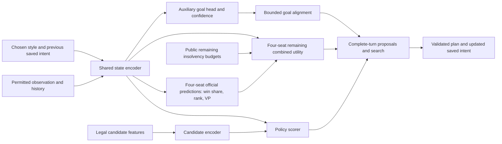

# Personality design and stage contracts

[Documentation index and required follow-up](README.md) | [Design](DESIGN.md#design) | [Audit history](AUDIT_HISTORY.md)

Consolidated from the existing design. Dated settings and verification claims retain their original scope; see the index for pending work and historical-reading notes.

**Current workflow decision (18 October 2026):** [Skip the already implemented goal-head stage](README.md#goal-head-skipped). The real-model goal-head workflow has not been run. Retain its code, but skip goal-head training, its auxiliary loss, goal-generated short-term commitments and goal-alignment search bias in the upcoming workflow. The goal architecture, labels, losses and experiments below describe the retained optional branch, not current implementation instructions. Existing style inputs and the separate 16-style discovery objective remain in scope; a compatible goal-free downstream path still needs adaptation and validation.

**Current deployment performance record:** [Implemented runtime improvements and measured limits](DEPLOYMENT_PERFORMANCE.md) supersede earlier statements that personality cross-worker encoder sharing was still pending. Shared feature caches, fused native transport and snapshot-local public-view reuse are implemented. Historical architecture sizes and resource settings below remain dated design context; the W352 comparison did not change the main model, qualified profiles or training contracts.

**Discovery direction (18 October 2026):** [Prefer the frozen-network experiment first](README.md#frozen-network-discovery). Reuse implemented discovery/quality screening with the selected Step 5 model's supported contexts after completing the pending goal-free integration. The old five-profile personality inputs are not interchangeable with Step 5's neutral/six-industry inputs. Additional policy training, PGA-MAP-Elites and multi-model distillation remain deferred; 16 archetypes are a qualification target, not an assumed result of generating many parameter recipes. This decision supersedes conflicting upcoming-work instructions in the historical design below without changing current code or training.

<a id="design"></a>

## Personalities and difficulty calibration

**Updated 13 October 2026: P0–P6 tooling implemented; real-model qualification and game release pending.** Real personality experiments begin **after the revised Step 5 run finishes**, using its accepted self-trained incumbent as the proposed parent. Tool/interface development and explicitly unqualified fixtures may precede that handoff. The recommended Step 5 restart hands a completed fresh imitation run's 1,840,109-parameter MLP-ResNet into a new self-play run, extends it to **1,850,129 parameters** with the four-seat combined-utility head, and continues PPO plus separate Masked ISMCTS NN distillation. Step 5 distinguishes the continuing learner from the accepted best opponent. This later stage adds personalities to the trained result; it does not restart from random weights or silently change the game-return objective.

The [13 October P0–P6 audit](AUDIT_HISTORY.md#audit-2026-10-13-p0-p6) tightens handoff, calibration, fixture qualification and export provenance, preserves compatible P1 continuation through exact receipts, and reports the unresolved P2 teacher accounting discrepancy in §4.4. Local fixture verification does not qualify a trained roster or release.

The only personality search backend is **Masked ISMCTS + NN**. S1/S2/S3 and the separate R4/OpenSpiel comparison branches are retired implementation dependencies. Heuristic Masked v4 has different evaluation/search settings and remains an occasional opponent. The shared policy/value/goal architecture and **16 visible archetypes × eight hidden variants = 128** remain the product target.

This is the detailed design for [implementation step 7](../../ai-research/IMPLEMENTATION_PLAN.md#7-add-personalities-and-calibrate-difficulty). Use the [current training guide](../TRAINING_RECOVERY_LAB.md), [Masked ISMCTS plan](../../ai-research/MASKED_ISMCTS_REVISION_PLAN.md) and actual completed-run manifests as the handoff references. **P0–P6 code is implemented** through separate entry points: [P0/P1 handoff and goal pilot](TRAINING_P0_P3.md#p0-p1), [P2 search/P3 repertoire workflow](TRAINING_P0_P3.md#p2-p3), [P4 shared-network rosters](QUALIFICATION_P4_P6.md#p4), [P5 difficulty calibration and intent interfaces](QUALIFICATION_P4_P6.md#p5), and [P6 laptop deployment](QUALIFICATION_P4_P6.md#p6). P2 adds bounded root priors, persistent per-seat intent, shared inference/private forests, reserved teachers and policy distillation. P3 adds direct-policy discovery, a temporal encoder/PCA comparison, elite mutations, immutable archive rebuilds and tested-controller shortlists. P4 adds exact 16-by-8 membership, fresh matched member/mixture calibration, re-encoding, blind review and pinned shared-weight manifests. P5 adds versioned tier recipes, immutable grouped panels, original-Hard/member/mixture/order/equivalence gates, human session records and public-only 16-choice/intent interfaces. P6 adds named shared-model exports, once-per-game seat sampling, save/intent/RNG restoration, a staged game bridge, CPU/Intel backend probes and guarded installation/rollback. The real parent is still training and no qualified P4 roster or P5 tier report is available: actual calibration, human review and release qualification remain pending. The installed game AI and training code/settings are unchanged by P6. Local fixture checks never qualify a trained model or a difficulty level.

<a id="design-1-decisions-and-boundaries"></a>

### 1. Decisions and boundaries

**11 October 2026 correctness review:** [P0–P4 findings, fixes and verification](AUDIT_HISTORY.md#audit-2026-10-11-p0-p4). Corrections cover PPO behavior attribution, exact teacher/pilot lineage, action-root intent proposals, causal public behavior traces, bounded large-proposal collection, archive evidence integrity and P4 diversity/review sampling. P3's trace schema is now 32×95. Regenerate personality-stage artifacts under the revised contracts; the Step 5 parent/checkpoint format and installed game are unchanged. All 59 focused checks and one native fixture game passed; learned strength and style qualification remain pending lab evidence.

Adopt the proposed **single shared policy/value/goal network with bounded soft goal priors**, and add an **AURORA-inspired offline quality-diversity workflow** for discovering further personalities. Preserve the original aim: enjoyable, coherent four-player opponents, several styles at each difficulty, and every shipped Easy style stronger than original Hard.

These additions build on the current system:

| Existing foundation | Planned extension |
| --- | --- |
| Trained MLP-ResNet state encoder, Daiyu-derived candidate scorer and four-seat heads | Add a small auxiliary goal head to the same shared state representation. |
| Four-seat win-share, placement, VP and remaining combined-utility outputs | Retain all four outputs and their stable seat identities. PPO and search use remaining utility; official outcome predictions remain separate. |
| Four style features and eight intent features | Define a versioned personality/intent contract; preserve the meaning of existing fields when importing old data. |
| v4's productive-development intent fix and neural industry contexts | Learn coherent, revisable intent without treating useful development toward a target tier as a stall. |
| Selected Masked ISMCTS with CPU batching, dynamic masks and progressive top-K | Add bounded root goal priors while preserving complete legality, pending-request isolation and protected/unpruned alternatives. |
| Completed Step 5 training with a frozen accepted incumbent | Warm-start from its verified accepted-best snapshot; retain the latest learner separately as a diagnostic reference where useful. Discover and fine-tune styles in a new run. |

Use the residual backbone trained by the revised Step 5 run: width 304, four residual blocks, a width-128 candidate encoder and width-128 policy/value hidden heads. The IL layout has 1,840,109 parameters; the current PPO layout has **1,850,129**, including the trained utility extension. Its main-model ceiling is 2M. Preserve the trunk and utility head; do not substitute the earlier dense model or reset the utility head when adding goals. Later goal/context additions may bring the full model up to 2.10M, though 100,000 extra parameters over the PPO model still fits below 2M. Keep four initial pilot profiles: Industrialist, Networker, Supplier and Investor. The roster remains **16 player-facing archetypes, each backed by eight qualified hidden micro-variants: 128 variants total**. The four pilots can become members of the 16 after qualification, not extra presets. Section 5 defines selection and sampling.

Use three qualifications when implementing the user's proposal:

1. A shared network removes the need for competing high-level and low-level controllers, but does not guarantee convergence. Auxiliary losses, self-play opponents and changing search targets can still interfere.
2. Search can overturn a soft preference only when it explores and evaluates the relevant alternative. Finite-budget MCTS has no guaranteed tactical veto. Candidate coverage and fresh finalist checks remain necessary.
3. Learned behavior coordinates can reveal differences without hand-picking two archive axes. They do not automatically represent useful strategies, human personality, or enjoyment. Representation choices, repeated evaluations and human feedback remain part of the design.

The shared policy/value foundation is inspired by [AlphaZero](https://arxiv.org/abs/1712.01815); style conditioning, the auxiliary goal head and four-player information restrictions below are project-specific extensions. [MAP-Elites](https://arxiv.org/abs/1504.04909) motivates retaining quality across different behaviors. AURORA learns behavior descriptors; the published name is *Autonomous Robots Realising their Abilities*, and its demonstrated domains differ from Brass. We are adapting its method, not claiming a validated Brass implementation. See the [AURORA paper](https://arxiv.org/abs/2106.05648).

<a id="design-11-current-step-5-foundation-to-carry-forward"></a>

#### 1.1 Current Step 5 foundation to carry forward

The current main configuration is [lab-24x4.json](../../configs/step5/lab-24x4.json). Record the actual completed run's resolved configuration; do not infer its settings from a filename or a later edited default.

| Area | Revised Step 5 behavior | Consequence for the personality stage |
| --- | --- | --- |
| Neural initialization and continuation | Fresh `brass-four-seat-mlp-resnet/1.0.0`, ≤2M; audited IL may hand off through `--imitation-run`. The current PPO checkpoint is `four-seat-checkpoint/2.0.0` with the utility extension. Only explicitly reviewed source migrations are accepted. | Import the completed run's selected result through a **new personality importer**. Preserve existing IL/resume compatibility; do not admit arbitrary old neural weights or relabel an old reward checkpoint. |
| Active heuristic bank | Selected v4 `bank-3dc65253a610191d66a5`; six advanced-opening styles. Internal `v3-*` names are compatibility aliases; the bank identity is separate from installed UI/game package versions. | Pin the exact bank, profiles and selection receipt from the completed run. The rejected network candidates do not become teachers merely because their source exists locally. |
| Imitation | Searched Masked v4, 1 second/four workers; five admitted training styles; full-legal-choice BC denominator; separate setup partitions. | Optional small rehearsal source, not the definition of the new personalities or the main source of strategic quality. Archived audited heuristic data must retain its own provenance. |
| RL opponent shares | Active recovery window: **60% searched v4 / 25% historical / 15% selfplay for 20,000 ordinary games**, then **30/25/45 for 10,000**; mature mixture afterward is **5/25/70**. Window counters persist across resumes; searched v4 uses 1 second/four workers throughout the window. | For a qualified trained parent, explicitly configure the new personality run to start at the mature **70% selfplay / 25% history / 5% searched-v4** mixture. Do not accidentally restart the Step 5 recovery window. Shares describe tables, not seats or PPO samples. |
| Learner and accepted incumbent | `selfplay` tables contain **one continuing learner and three frozen incumbent opponents**. Only the learner supplies PPO samples; the learner retains optimizer state after a rejected challenge. `best.pt`/`best.json` describe the accepted incumbent; the latest generation remains the resume checkpoint. | Carry this separation into personality fine-tuning. Freeze opponent model/profile identities for each collection; incumbent or historical actions never become on-policy learner data. Count learner decisions, not four trajectories per game. |
| Ordinary learning and reward | 320 games per main iteration; PPO LR **1e-5**, non-forced actor and separate four-seat critic batches. Return is **`W + 0.10*P + 0.001*VP - min(0.005*N, 0.025)`**, undiscounted. | Preserve reward, causal cost accounting and official prediction heads (section 1.3). Add style through conditioning, auxiliary supervision and bounded priors, not action bonuses or a different utility per personality. |
| NN teachers | Masked ISMCTS, **12 seconds per whole turn/four private workers**, 640-game warm-up, due every **160 ordinary games**, four teacher games, at most two collections per iteration and eight distillation updates per collection; **50%** accounted search wall-time ceiling. Four seat-specific phase turns are reserved. | Keep these as the initial lab reference, with separate counters and P2 readiness for the new stage. Teachers use the calibrated current learner; the frozen incumbent is included in their bounded opponent ensemble. See section 4.4 for reservations, quality and budget limits. |
| Accepted-best gate | Every **6,400 ordinary games**, eight validation setups × six candidate seat pairs = **48 policy-only games**, two independent seats per model. Accept at ≥55% candidate family win share and a setup-clustered 95% lower endpoint above 50%. | Use the accepted incumbent as the proposed handoff parent. This neutral training-selection gate does not qualify personalities, search strength, difficulty tiers or a game release. Never train on its evaluation games. |
| Routine evaluation | **Four-game** policy monitor against the fixed IL/initial anchor every **6,400** games; **eight-game** broader screen every **25,600** with mixed-neural and searched-v4 opponents. NN candidates use policy play in these panels. | Preserve sparse monitoring independently of incumbent selection. Add equal-budget searched comparisons at stage boundaries; final roster qualification uses untouched setups. |
| Historical population | Up to **16 recent + 48 older slots**, with the initial anchor occupying one older slot and up to 47 priority-reservoir entries. Historical opponent sampling targets 25% IL/initial anchor, 25% recent and 50% older, with fallback for unavailable strata. | Freeze and pin a diverse retained subset for calibration/discovery; do not collapse it to the latest or incumbent alone. This is a bounded reservoir, not an archive of every past checkpoint. |
| Retention | Two full resume checkpoints, two replay/report rounds, zero-hour quarantine, and **128 compact history summaries**. The incumbent and accepted gate evidence are protected separately from the population. | Pin and copy the handoff and required traces before cleanup. Compact summaries and `state.json` lineage are not substitutes for checkpoint bytes, per-seat trajectories or evaluation evidence. |

Original Hard and economic v3 remain labeled comparison controls. v4's user-directed selection and quick match results do not establish human tournament strength. The post-training entry model needs its own fresh gameplay evidence. The held-out Advanced Pottery Variants opponent stays evaluation-only; **Pottery actions, contexts, goals and self-play trajectories remain available**.

<a id="design-12-entry-gate-completed-step-5-self-training"></a>

#### 1.2 Entry gate: completed Step 5 self-training

Begin packages P0–P6 only after the revised residual-model Step 5 run finishes. Resolve **`best.json` → its immutable checkpoint entry**, cross-check it with `state.json`'s `champion` and the bytes of `best.pt`, and copy that accepted snapshot into the handoff. The convenience file `best.pt` can change during training; its path alone is not a reproducible parent identity. The latest `generation-*.pt` is the continuing learner, not an automatic replacement for the accepted parent. Record lineage, hashes, model/features/reward versions, total parameters, configuration, rules, split manifests, opponent-pool IDs and evaluation reports.

The initial incumbent may still be the unextended IL/initial anchor if no candidate has passed. **Do not call that a completed self-trained parent.** Require a selected post-IL PPO checkpoint with the matching trained utility head and calibration receipt. If none was accepted, leave P0 pending and report the failed/unresolved Step 5 selection; do not silently fall back to the last generation. Pin the latest learner as an optional diagnostic control, not as an alternative selected after inspecting final personality tests. The accepted-best gate remains preliminary evidence: use fresh validation to establish the parent baseline before tuning personalities.

Keep that checkpoint as the **pre-personality control** for every relevant comparison. Reuse its learned state/candidate encoders, action scorer, official four-seat values and trained combined-utility head, plus compatible training-partition trajectories and retained neural opponents. Initialize only new goal/context parameters. The fresh R2 bootstrap and local smoke weights are not substitutes for the completed self-trained AI at this stage.

Create a new fine-tuning run with explicit parent provenance and fresh optimizer/scheduler state for the added auxiliary loss and parameter set. **Keep the game-return objective unchanged.** This is a warm start, not a resume under the Step 5 identity. Freeze the imported core and utility head for the first auxiliary-head pass, then apply conservative joint fine-tuning if it preserves useful skill. Report uncertain entry strength and measure against the frozen control; personality labels are not evidence of strength.

P0 now produces a `personality-handoff/1.0.0` manifest and a protected handoff directory. Include:

- The accepted immutable snapshot, exact SHA-256, semantic `model_id`, original compatibility record, model configuration, parameter count, parent chain and `fresh_run`/IL-handoff provenance. Preserve `best.json`, the champion and gate state, resolved recipe, and accepted-gate specification/report with hashes. Include the reward specification/fingerprint and utility calibration receipt. A weight-only snapshot suffices for the new optimizer; retain its identity and the hash of every copy.
- A small frozen neural reference pool from the same lineage, including a useful earlier anchor and the selected parent. Pin every referenced weight file; keep their actual generation/model IDs even if retention has moved them into `population/weights-*.pt`.
- Eligible **training-partition** replay shards and their authoritative manifests, optional audited heuristic dataset receipts, action/observation schemas, context records and legal-choice order. Step 5's existing industry context is not a saved multi-turn goal, so new intent fields cannot be reconstructed as if they had been behavior inputs.
- Rules/runtime compatibility and transfer records, bank/selection receipts, neural search and resource profiles, grouped split identities, and the measured baseline on the intended deployment settings. Preserve byte hashes for binaries/checkpoints; use the existing narrowly scoped LF/CRLF metadata verification when reading historical JSON pins. Never repair a mismatch by overwriting the recorded hash.

Use Step 5's existing `pin --run ... --paths ...` before independently evaluating an older checkpoint or copying the handoff. Put the handoff's full dependency paths in a persistent `pins.json` recognized by retention, verify the copies, and inspect cleanup's dry run. Do not rely on an unreferenced completed development report to pin every shard. If cleanup has already removed suitable training trajectories, recollect with the frozen selected model under training/discovery seeds; do not recover missing labels from final evaluation games.

The current `step5.py train --initial/--from-run` path rejects arbitrary imported neural weights; `--imitation-run` is the specific supported IL handoff, not a personality importer. The separate `scripts/personality.py` entry point supplies explicit source checkpoint/model/reward schemas and a copied/initialized/rejected tensor report. It preserves those Step 5 admission checks and the completed run.

<a id="design-13-shared-return-and-utility-contract"></a>

#### 1.3 Shared return and utility contract

Carry `brass-combined-return/1.0.0` and the **full coefficient/cost fingerprint** into the personality model, search, replay and handoff. The version name alone does not identify the objective because earlier coefficients used the same mathematical schema. Current defaults are:

```text
R_i = W_i + 0.10 * P_i + 0.001 * VP_i - min(0.005 * N_i, 0.025)
```

`W_i` is official win share after VP, income and cash tiebreakers, including shared wins. `P_i` is the fraction of the other three seats beaten, with half credit for exact ties after those tiebreakers. `VP_i` is actual final scored VP; `N_i` counts distinct insolvency events, not liquidation choices or removed tiles. The coefficients remain configurable, but a changed specification is a new experiment requiring new targets and an explicit migration. All personalities and difficulty levels initially share this reward.

- Use **undiscounted remaining returns (`gamma = 1`)**. At decision `t`, train `U_i(t)` on terminal win/placement/VP utility minus only costs incurred after that observation. Charge each insolvency event once to preceding decisions; already-incurred costs are sunk. Preserve the public event ledger and remaining per-seat penalty budget, including correct mapping when the observer changes.
- PPO's baseline and search leaves predict that same `U_i(t)`. Search backs up terminal or leaf utility minus insolvency costs along the simulated path from the node being evaluated; it does not subtract past/root costs again. Preserve the existing event and final-Rail accounting checks.
- VP contributes the same **0.001 per additional scored point** at low and high scores. No target, ceiling, score saturation, relative-VP normalization or running score normalization is added. Advantage normalization and scaling the separate auxiliary VP loss by 100 are training mechanics, not changes to this reward.
- Combined utility is **not a probability** and can exceed one or be negative. Preserve raw utility backups and `q_transform: none`; the current fixed `utility_scale: 1.2` sets exploration scale, not a clipping ceiling or running Q normalization. There is no finite upper reward bound obtained by pretending VP is capped. Recalibrate any near-best utility tolerance in these units.
- Add no Pass penalty, action-frequency/industry bonus, goal-completion reward, losing-position switch or coalition objective. Style preferences act through context, goal supervision, proposals and bounded priors. Difficulty changes decision quality/time, not the official rules or reward coefficients.
- Log raw and weighted reward components, causal cost, utility MSE/MAE and phase coverage separately from official win share, mean place and scored VP. Qualification continues to use official results and style evidence; a higher combined reward or lower utility loss alone cannot promote a roster.

Reuse compatible training traces for well-defined auxiliary labels, but collect **fresh on-policy PPO rollouts** after style/model changes. Old search distributions remain tied to their producing model, reward, source and prior recipe: matching replay shape is insufficient. Do not reuse old-win-only or different-coefficient teachers, and do not relabel their action probabilities under the new objective. A transferred utility calibration receipt establishes the parent's recorded readiness; check the new neutral interface numerically and recheck utility error on fresh style-conditioned games before P2 teaching. Any required recalibration is bounded and uses fresh training data, never qualification games.

<a id="design-2-separate-personality-current-intent-and-discovered-behavior"></a>

### 2. Separate personality, current intent and discovered behavior

Use different symbols and contracts for quantities that have different jobs:

| Quantity | Meaning | Available during a real move? |
| --- | --- | --- |
| `o_i, h_i` | Seat i's permitted observation and legitimate remembered history | Yes; never actual opponent hands, unrevealed draws or private simulator seeds. |
| `z_i` | Style control chosen before the game from a tested profile | Yes; stable across the game by default. |
| `m_i` | Saved soft intent, age, confidence and expiry for this seat | Yes; derived only from that seat's permitted history. |
| `G_pred` | Proposed medium-term goal distribution from the shared network | Yes; a prediction/proposal, not a proof of the best strategy. |
| `b = E_psi(T_i)` | Offline descriptor of seat i's completed behavior trajectory | No; the current game's future trajectory does not exist yet. |

**Do not equate `b` with `z_i` automatically.** An encoder can describe how a controller behaved without knowing how to command that behavior. Initially, archive entries retain the exact model/profile/style input that produced them. Selecting an entry selects that tested controller configuration. A later distillation step can learn stable style codes for a shared deployment network.

Do not relabel an old PPO trajectory with its hindsight descriptor and treat it as if that descriptor was the input used to choose those actions. Keep the actual behavior context and probabilities. Completed trajectories may supply supervised auxiliary labels or explicitly separate distillation data.

Each player has independent intent state, random streams, legal observations and private search/cache state. Shared weights are allowed; a shared objective for the three opponents of a human is not.

<a id="design-3-unified-network-and-persistent-intent"></a>

### 3. Unified network and persistent intent

<a id="design-31-architecture"></a>

#### 3.1 Architecture



Keep the existing candidate-based policy: Brass has variable, multi-step legal choices, so this is not a new fixed chess-like move vocabulary. The implemented Python personality interface retains `win_share_4`, `placement_4`, `vp_4` and **`remaining_utility_4`**, adding policy logits, goal-factor logits and event-confidence logits. Export and search dispatch are later work. The importer copies the utility extension's trained correction and its dependence on the permitted state and remaining four-seat cost budgets; it does not reconstruct search values using only the three official heads. Predict all seats from the observer's permitted inputs and preserve tiebreakers and stable seat mappings. Search selects the acting seat's utility; it never negates one scalar for opponents or rewards a three-bot coalition.

Preserve the imported encoder's existing feature layout and context semantics. Add any new style/goal context through an explicitly versioned projection or appended features with zero initial contribution to the copied policy/value path. Before fine-tuning, the new model must reproduce the old policy/value outputs for the same old inputs and neutral new context. Merely copying matching tensor shapes is insufficient if a feature's meaning has changed.

Start the auxiliary branch with a hidden width of 128. Aim for at most 100,000 additional parameters over the **1,850,129-parameter PPO model**, including every context projection: this totals at most **1,950,129**. The existing utility head is already included. If more extension capacity is needed, the complete model may reach **2,100,000 total parameters**, a 5% allowance above 2M. Count frozen and trainable weights, all heads, biases, normalization and context parameters at construction/load/export; itemize extension overhead. Keep the trunk unchanged and retire the old 8M comparison. The current Step 5 loader enforces 2M: any extension beyond that needs the **new personality model contract**, not a silent change to Step 5's limit. Measure batching latency as well as count; these are engineering limits, not strength guarantees.

The implemented medium layout totals **1,915,962 parameters**: 1,850,129 copied parameters and 65,833 new parameters. Its context projection initially contributes zero to policy and values; the 128-wide auxiliary branch emits the factors below plus a six-family-by-three-horizon confidence tensor. Context and goal schemas are separate from Step 5's byte-pinned feature/model contracts.

Use factorized goal outputs rather than a huge enumeration of exact future moves:

| Factor | Initial vocabulary / interpretation |
| --- | --- |
| Goal family | Complete a sale chain; prepare an industry sequence; supply resources; extend a useful network; improve liquidity/income; remain flexible. |
| Industry | All six industries, plus none/mixed. Pottery has equal representational access. |
| Region | Versioned public map regions, plus any/unspecified. Regions express intent, not a compulsory city. |
| Horizon | Next own turn, next 2 own turns, next 3–4 own turns; masked if unresolved at the record boundary. |
| Confidence | Calibrated probability of the defined goal event being realized within its horizon. Low confidence means weak or no goal bias. |

Use a goal-compatibility mask for nonsensical factor combinations, without changing legal game actions. Include flexible/no-commitment outputs so the system need not invent a precise plan for every position. A goal's horizon counts **this player's turns**, using the actual scheduler, not global actions or an assumed fixed round order.

Inputs contain the *previously committed* compact intent. Produce the new goal in one forward pass; do not recursively feed its own new output back into the same pass. Compare the proposal with the saved intent, evaluate credible plans, and save the resulting soft commitment for subsequent decisions. Ordinary second-action continuation keeps the selected turn plan and only the remaining time budget.

<a id="design-32-continuity-without-rigid-commitments"></a>

#### 3.2 Continuity without rigid commitments

Persist goal family, industry/region if relevant, creation turn, remaining horizon, confidence, schema version and revision reason. Reconsider at own-turn boundaries and material observation changes. A starting hysteresis rule can favor keeping a viable plan for 2–3 own turns, but it must permit earlier revision when demand disappears, a route closes, liquidity becomes critical, or an era boundary removes its expected return.

Assess supporting actions as part of the plan. A loan can enable a build; development can unlock a better tile; a connection can enable a sale. Do not score these as off-theme simply because their action names differ from the goal. Measure continuity through useful plan completion and sensible revisions, not through refusing to change direction.

Carry forward accepted v4 lessons as targeted examples: high-tier development, unflipped level-I industries near the end of Canal, unsold industries near game end, group-sale opportunities, merchant beer and its applicable bonus, actual rail/resource costs, and cash/debt recovery. Record progress toward the target tier or funded completion sequence so **productive development resets stall age**; elapsed turns alone do not establish failure. Reset or revise an intent when its real opportunity disappears. Feed viable opening/goal intent into bounded candidate ranking, rather than using it only as UI text.

These are diagnostic opportunities, not compulsory moves or personality rewards. Keep Canal and Rail outcomes separate: consider remaining own turns, carry-over, sale/beer access and working capital. Empty industry slots are never earned VP. Do not copy the rejected Scout or speculative brewery-demand/network candidate logic into the neural personality controller. Any new heuristic proposal would need a separately identified ablation; current legal Scout and network choices remain available through the rules mask.

<a id="design-33-goal-labels-and-joint-training"></a>

#### 3.3 Goal labels and joint training

Define labels before collecting a new corpus. For example, a sale-chain goal can be realized when the seat completes the relevant sale within the next H own turns, with region/industry derived from the executed chain. Record preparation, completion and abandonment reasons separately. An unsold build is not automatically a completed goal. Future public actions/outcomes can supervise a present prediction, but future observations must not enter the present input.

Use three sources with explicit provenance:

1. Completed, legal learner trajectories with the actual style and saved intent used at collection time, including losing games and failed plans.
2. Qualified search recommendations whose alternatives received adequate coverage and fresh confirmation. Such labels propose a plan; they do not establish that the goal will succeed.
3. A small authored diagnostic set of setup/completion and tactical recovery situations. Keep test fixtures outside gradient data when using them as held-out checks.

Mask ambiguous factors, truncated horizons and missing outcomes. Calibrate confidence against the defined realization label on separate games; a softmax maximum alone is not calibrated confidence. Include counterexamples where the initial goal became infeasible. Avoid teaching the network only its own unverified predictions.

The joint objective is conceptually:

```text
L = L_PPO_actor
    + lambda_v * (L_utility + L_win + 0.25 * L_rank + 0.10 * L_vp)
    + lambda_g * L_goal
    + lambda_d * L_qualified_search_or_elite_distillation
    - lambda_h * policy_entropy
```

The relative value weights match `recovery/updates.py`: `L_utility` is four-seat mean squared error for the remaining return in section 1.3; auxiliary rank is normalized from 1–4 and auxiliary VP by 100. The outer value coefficient is 0.5. These loss scales do not normalize the linear VP reward. Retain **non-forced-choice actor updates**, separate critic batches, advantage normalization, exact likelihood reconstruction, KL stopping and gradient clipping. Each term uses its appropriate data: fresh on-policy learner decisions for PPO, observed outcomes and causal costs for values, masked goal labels for the new head, and covered teacher alternatives for policy-only distillation. Search visit distributions do not supply fabricated search-value targets. Forced choices may train the critic and valid goal labels; they do not inflate actor counts. Incumbent/search actions and archive demonstrations do not become ordinary PPO samples. Do not assign zero-quality labels to unexamined alternatives.

Warm-start from the **accepted completed-Step-5 checkpoint**, copying compatible backbone/policy/official-value/utility tensors and training the small goal head with those copied parameters frozen. Then unfreeze with a modest goal-loss coefficient and monitor utility calibration, official predictions, policy drift and conflicting gradients. An initial sweep such as `lambda_g = 0, 0.05, 0.10` is a pilot, not a settled setting. Keep neutral-context behavior and the frozen accepted parent as regression comparisons. Detach goal-derived search bias from actor gradients in the first implementation.

Start ordinary PPO collection with the style-conditioned policy's existing probability calculation. Use goal-biased search as a separately recorded teacher. If a later actor itself samples from biased priors, store and recompute its **exact composed probability**, including temperature, exploration, goal context and bias coefficient. Otherwise the existing PPO likelihood checks should reject those records. Joint neural losses are differentiable; this does not imply end-to-end gradients through discrete search or archive selection.

Keep personality fine-tuning primarily neural, using the mature **70/25/5 table mixture** in section 1.1: the 70% portion is **one continuing learner against three accepted-incumbent opponents**, not four copies of the latest learner. Freeze model/profile assignments per collection, rotate the learner seat, and exclude all frozen-opponent decisions from PPO actor targets. Start with the parent as incumbent; reject a challenger without resetting the advancing learner. The 25% portion samples retained neural history; the 5% portion uses searched v4 at one second/four workers. Explicitly disable restarting the Step 5 60%/30% recovery window in this new stage. Original Hard remains a benchmark, not an expert target. Hold out the designated Pottery opponent while retaining Pottery actions, labels, exploratory contexts and self-play trajectories.

Use a stage-local incumbent manager with immutable model/profile snapshots and resumable gate receipts. The new stage's fixed initial anchor is the accepted Step 5 parent; an earlier IL checkpoint may remain a separately identified historical/diagnostic reference. Keep neutral policy selection separate from roster qualification (section 7.3). Once styles enter the opponent pool, record the actual stable style assignments; sharing network weights does not make all profiles interchangeable. Freeze the discovery opponent pool within an archive generation and requalify affected entries if it changes. Promotion of a neutral model must not silently overwrite a previously qualified style or released roster.

Use the selected Step 5 run's resolved PPO settings as the reference. Current main defaults are **LR 1e-5**, two epochs, effective actor batch 2,048, microbatch 512, critic batch 2,048, clip 0.2, target KL 0.01, entropy weight 0.005 and gradient clip 5.0. Begin the jointly unfrozen personality pilot at the same LR and safeguards; reduce it only for a measured regression. Initialize only goal/context parameters, retain neutral and all-industry checks, and stop drifting updates using KL/utility/official-value/goal losses. Record decisions per learner seat because incumbent opponents no longer supply PPO trajectories. Avoid long BC retraining toward the weaker heuristic teacher.

Existing Step 5 contexts cover neutral play and all six industry focuses; they do not establish trained Networker and Investor personalities. After the auxiliary warm-up, balance new collection across the four profile codes and a neutral control. Generate style-consistent teacher choices from adequately compared near-best complete turns, record the chosen profile, and distill those choices before conservative self-play fine-tuning. Retain quality targets and the frozen parent-policy comparison so style training cannot quietly replace strategic competence with repetitive themed actions. Test whether changing only the style code changes credible decisions; naming codes does not itself create a personality.

<a id="design-4-soft-priors-that-preserve-tactical-alternatives"></a>

### 4. Soft priors that preserve tactical alternatives

<a id="design-41-definition-and-bounded-influence"></a>

#### 4.1 Definition and bounded influence

For legal action or complete-turn candidate `a`, construct `g(a)` from goal alignment in `[-1, 1]`. Use permitted root information, supporting-action relationships, the saved intent and calibrated confidence. Fix this root context across all sampled hidden worlds. Do not change it after inspecting a sampled opponent hand.

```text
P0(a)     = masked_softmax(policy_logits(a))
Pgoal(a)  = masked_softmax(policy_logits(a) + alpha * g(a))
Psearch(a)= (1 - epsilon) * Pgoal(a) + epsilon * P0(a)
```

Start with `alpha` in `{0, 0.15, 0.35}`, a provisional maximum of `0.5`, and `epsilon = 0.10`. Confidence can scale `alpha` toward zero. With `g` bounded, the additional pairwise odds factor before mixing is at most `exp(2 * alpha)`. At `alpha = 0`, this reproduces the base prior within numerical tolerance. Illegal actions stay masked. The mixture retains base-policy mass but does not guarantee that finite search visits every critical move.

Bias **priors and proposals**, not reward or value backups. Do not add goal bonuses to either the official predictions or remaining utility; all heads retain their target meanings while learning from fresh data. The policy already receives style and previous intent, so the extra bias may double-count a preference; include a style-conditioned, no-bias ablation. Stronger bias is neither a stronger opponent nor necessarily a better personality.

<a id="design-42-integration-with-masked-ismcts--nn"></a>

#### 4.2 Integration with Masked ISMCTS + NN

| Current component | Required personality extension |
| --- | --- |
| Direct neural policy used for ordinary self-play | Add versioned style/intent context to the shared network; preserve the exact temperature/exploration/behavior-probability recipe. This fast collection path is not another search algorithm. |
| `search/ismcts.py` and `search/common.py` | Add a root-scoped bounded prior hook. Keep `evaluator_kind: neural`, `q_transform: none`, `leaf_policy: new_root_information_frontier` and supported progressive candidate admission. Do not import heuristic v4 Q normalization or its reply/depth caps. |
| `recovery/parallel.py` private root forest | Give all workers the same root style/committed intent and bias version, with independent RNG, host lanes and private trees. Merge only completed, compatible evidence and supported complete continuations. |
| `recovery/inference.py` shared batching | Batch compatible requests by model/output contract, with each row retaining its own observer/context. Preserve private replies, deadlines, cancellation and cache isolation. The goal head should reuse the same forward pass. |
| Current combined-return teachers (`ismcts-root-visits/1.2.0`) | Emit a new personality teacher version recording reward fingerprint, producing model/source, prior/bias recipe, root context, remaining cost budgets and supported alternatives. Keep search data separate from on-policy PPO; do not reuse an older objective's distributions. |

Dynamic legality, batch padding and search expansion are **three different masks**. Only the rules host changes the legal set. Begin with the current NN root/interior top-K of **16/8**, protected action/industry families, completed-support reopening and tail admission. Goal alignment can reorder ordinary candidates, but cannot erase an otherwise legal alternative, treat deferred choices as illegal, or shrink the full policy denominator. Include an unbiased candidate allowance and an unpruned coverage probe for shortlisted settings.

Preserve the NN's current information frontier: finish supported current-turn continuations, evaluate newly reached acting-root observations and expand further only with supported visits and existing safety/deadline limits. A personality preference must not add the heuristic opponent's fixed depth cap, normalize raw utility Q values, or replace them with win-share probabilities. Preserve four-seat **remaining-return** leaves, the fixed exploration scale and node-local simulated insolvency accounting from section 1.3.

For complete-turn candidates, score the meaning of the whole plan. Avoid summing a bonus per semantic sub-choice: a plan with more beer/resource/payment choices must not gain extra style reward merely because its representation is longer. Use one bounded plan-level alignment, or a normalized aggregation whose behavior is tested on equivalent plans. Restrict the first implementation's goal injection to the permitted current root; sharing a turn's saved goal does not justify silently reinjecting it at every payment/resource node.

Keep the selected current-turn plan consistent across sampled hidden worlds and fixed to the actor's legal information history. A continuation may adapt only to a newly received legitimate observation. Opponent simulation keeps its existing independently masked policy; the root's private goal, hidden micro-variant or hand is not available to another simulated seat. The existing NN rollout contract requires neutral fixed opponents. Supporting styled rollout opponents would need an explicit contract extension and tests, not removal of that check.

Teacher eligibility still requires **completed visits supporting at least two alternatives**; the current continuation-support minimum is two. Preserve the initial 90% completed-visit / 10% full-support base-prior target mix and record both the unbiased prior and the goal-biased search prior. If search cannot finish sufficient evidence within the deadline, skip the teacher and report why. Queue entries, interrupted paths and virtual-loss reservations never count as completed evidence.

<a id="design-43-candidate-coverage-and-final-selection"></a>

#### 4.3 Candidate coverage and final selection

Reserve proposal capacity for unbiased candidates and enabling combinations before allocating the rest by style. Preserve relevant loan/build, develop/build, route/sale and industry alternatives, including Pottery, even when their first move looks weak. Log coverage by family and by complete plan. A soft prior cannot rescue an option omitted by enumeration or pruning.

Within one whole-turn deadline, allocate time to candidate coverage, comparison, fresh finalist confirmation and legal execution. Compare finalists on matched fresh hidden-world/opponent samples. Select from a credible near-best set using persistent style and modest independent seeded variation. Define its estimated utility tolerance per difficulty after value calibration; it is an empirical strength tradeoff, not a proof of bounded real-game loss.

Reduce or disable bias when confidence is poor, the goal is stale, the deadline permits little comparison, or a tested tactical risk requires broader coverage. Retain a validated complete incumbent for cancellation/Play Now. Log cases where the chosen action contradicts the goal, including whether new information or tactical value caused the revision.

Bound the extra work: cache goal/alignment features for the permitted root context, reuse existing action encodings and batch all heads together. Do not add an independent unbounded goal rollout or enumerate an extra opening book for every legal card variant. Measure goal/alignment time, completed simulations per second, supported alternatives, p95 decision time and fallback frequency against the **same parent model, states, worker count and clock**. Report any throughput regression; a stylistic benefit does not excuse silently consuming the time previously available for development, sales and search. The early pilot retains the parent settings unless this equal-budget comparison justifies a change.

The required evidence is that relevant alternatives survive and the bounded bias causes no unacceptable tactical or strength regression. **Do not describe this as a guaranteed MCTS veto.** Imperfect values, inaccurate opponent models and unvisited actions remain possible failure modes.

<a id="design-44-teacher-reservations-readiness-and-time-accounting"></a>

#### 4.4 Teacher reservations, readiness and time accounting

Carry the current training-only `four-phase-teacher-turns/1.0.0` scheduler into the personality teacher contract. Each NN seat independently reserves one reproducibly sampled own turn in **Canal rounds 1–4**, one in **Canal 5–8**, one in **Rail 1–6**, and one in **Rail 7–8**. Seeds include setup, sampling seed, seat and phase. Earlier work, failed searches and worker completion order cannot redraw or consume a later reservation. Ordinary PPO games and final game play do not use this four-turn teaching scheduler.

Use the main lab reference of **12 seconds shared across both actions, all subchoices and four private workers**, starting after complete CPU admission. Keep the existing bounded training finalization reserve inside that deadline; queue wait is measured separately. Goal inference, candidate bias and final legal validation spend the same turn allowance. Do not multiply time by workers/actions or change the installed game's finishing behavior as part of this stage.

Stage-local readiness requires a verified matching utility head, valid new goal/context inputs and the P2 zero-bias/legality checks. Do not blindly copy a Step 5 game count as proof of readiness. After readiness, retain the **160-ordinary-game cadence**, four teacher games, at most two collections per iteration and eight maximum policy-only distillation steps per collection. Phase reservations apply to all NN seats in those teacher games; they do not create separate four-game collections for each of the 128 variants. Rotate a bounded style shortlist within the existing allocation.

Retain current qualification minima: **16 usable samples from at least two setups, at least two samples in each phase, and at most two presentations per sample**. Preserve completed-alternative/support checks. Log reservations, reached turns, actual searches, qualified samples, forced choices, timeouts, fallbacks, insufficient coverage and elapsed/overrun time by phase and sampled style. Failure consumes its allocated collection; no extra games or unbounded retries manufacture passing labels. Uncovered goal factors remain masked.

The **50% accounted search wall-time ceiling** allows at most one search second per accounted ordinary second; it is not a GPU utilization target or a requirement to spend that time. Preserve conservative whole-collection admission and deferral, including failed work in accounting. Do not restart clocks or inflate the allowance for every style. A calibrated teacher uses the current learner; its neutral rollout ensemble includes the accepted incumbent plus bounded IL/recent/older references. Styled simulated opponents remain a separately versioned extension, as required in section 4.2.

**Audit discrepancy, 13 October:** the active P2 implementation (`search/teachers.py`, `WALL_FRACTION=.9`) and P2 lab guide retain a 90% allowance. This differs from the 50% design statement above and current Step 5. The audit changed neither policy; resolve and explicitly version the intended P2 accounting policy before a real teacher campaign.

<a id="design-5-aurora-inspired-discovery-of-additional-personalities"></a>

### 5. AURORA-inspired discovery of additional personalities

<a id="design-50-product-target-16-visible-archetypes-and-128-hidden-variants"></a>

#### 5.0 Product target: 16 visible archetypes and 128 hidden variants

Adopt the proposed two-level repertoire for the completed product. This is an organization of style controls around **one shared decision network**, not a hierarchy of competing decision models.

| Layer | Target | Selection and player experience |
| --- | --- | --- |
| Offline discovery pool | Thousands of candidate controller configurations after the pilot | Search supported style codes and small profile mutations; keep performance, repeatability and behavior evidence. These need not be thousands of separately trained neural models. |
| Player-facing roster | **16 named archetypes** | Each has a distinct, understandable strategic tendency and one tested representative style vector. Select for visible differences among capable candidates; the UI exposes these 16 choices. |
| Internal variety pool | **Eight micro-variants per archetype; 128 total** | The representative plus seven nearby qualified variants. Sample one before each game to vary credible openings and tactical preferences while keeping the named archetype recognizable. |
| Difficulty settings | Easy, Medium and Hard over the same roster | Calibrate each variant under each released tier. This is up to **384 variant/tier configurations**, not 384 separate networks or visible personalities. |

The representative is included among its archetype's eight variants: the package contains 128 style configurations, not 16 plus another 128. Internal IDs such as `industrialist/a1` through `industrialist/a8` are diagnostics; the player sees **Industrialist**. The remaining archetype names should follow observed behavior rather than be invented before discovery.

Sixteen is the user's product target for a recognizable menu, not a scientifically established cognitive limit. A tiny change in loan rate is insufficient evidence of a new archetype. "Top-tier" here means qualified strategic competence within a diverse roster, followed by difficulty calibration; it does not mean selecting only the 16 highest raw win rates and losing the variety. Keep prototypes smaller while gathering evidence. The full 16/128 roster remains incomplete until its distinctness and strength gates pass; do not pad it with duplicates or weak variants to meet the count.

<a id="design-51-offline-role-and-descriptor-data"></a>

#### 5.1 Offline role and descriptor data

Use a separate, small behavior encoder on the lab server. It describes trajectories and organizes candidate controllers; it does not choose game actions and need not ship to the laptop. This preserves one online decision network.

The original [unsupervised-descriptor work](https://arxiv.org/abs/1905.11874) motivates learning behavior coordinates. The [authors' AURORA implementation](https://github.com/adaptive-intelligent-robotics/AURORA) alternates archive search with descriptor learning and supports an unstructured distance-based archive. A fixed two-dimensional MAP-Elites grid is a possible adaptation, not a requirement of AURORA.

Collect one trajectory **per seat** from complete four-player games. Preserve temporal order and both eras. Initially encode public own actions, their public economic effects, industry levels, resource production/consumption, merchant use, geographic expansion and relevant public opportunities. Use masks for variable lengths, interruptions and era boundaries. Include enough context to distinguish an unavailable sale from a deliberately deferred sale.

Exclude controller IDs, chosen style labels, random seeds, absolute seat IDs, actual hidden hands/deck, machine timing and final win/rank totals from the behavior encoder's input. Keep these in separate metadata where appropriate. Outcome quality is assessed separately. Even with those exclusions, board context and cash trajectories can correlate with strength; explicitly test whether the learned space mostly separates lucky deals, opponent behavior, seat order or winning rather than repeatable styles.

Split by whole setup/game groups before fitting preprocessing or the encoder. Fit only on training/discovery data, including legal losing games. Do not fit on held-out Pottery-policy evaluation games or final test trajectories. Validation and test embeddings are transforms under an already frozen encoder.

<a id="design-52-small-initial-encoder-and-archive"></a>

#### 5.2 Small initial encoder and archive

Start with a masked temporal autoencoder and a 2D latent descriptor, compared with PCA and a simple hand-described baseline. Use a small lab-only model rather than a second large game network. Try 3D or a higher-dimensional distance archive only if 2D reconstruction and repeatability are inadequate; a 2D visualization need not be the full behavior representation. Defer VAE/contrastive variants until the simpler representation has a diagnosed limitation.

Evaluate the same controller on repeated rotated setups and opponent mixtures. Store its descriptor centroid and dispersion, not just one spectacular game's coordinate. A useful descriptor should distinguish controllers more reliably than it distinguishes seeds for the same controller. Inspect nearest-neighbor trajectories and era-specific action summaries alongside reconstruction error; low reconstruction loss alone does not prove useful style discovery.

Start with an **unstructured distance archive** with a bounded number of entries and a novelty threshold chosen on discovery data. A fixed-grid MAP-Elites comparison can follow with frozen encoder, scaling and bounds. Neither cell occupancy nor latent distance alone is a release diversity metric.

An archive entry identifies a reproducible controller:

```text
entry = {
  immutable_model_id, parent_incumbent_id, style_code, intent_schema, search_profile,
  reward_id, utility_contract, teacher_version, prior_recipe_id,
  rules_and_observation_ids, encoder_id, opponent_pool_id,
  behavior_centroid, behavior_dispersion, trace_ids,
  own_quality_estimate, uncertainty, qualification_status,
  candidate_id, parent_candidate_id
}
```

Begin by sampling supported style inputs and small mutations of already trained style/profile parameters while keeping model, difficulty and search budget fixed. Do not start by evolving millions of neural weights or arbitrary out-of-distribution style vectors. Candidate mutation is the proposed Brass search operator; the behavior encoder alone cannot generate new capable policies.

Quality means the evaluated seat's own performance against a frozen, representative four-player pool, with rotations and uncertainty. Use win share as the primary outcome and rank/VP diagnostics to detect regressions; separately report legality and style coherence. Do not use total table score, novelty alone, or victories over weak stock alone as quality. Require repeated evaluation before replacing an incumbent on noisy estimates. A promising but uncertain candidate stays provisional.

Scale discovery in stages: first screen approximately 64–128 candidate configurations to check that descriptor repeatability and style control work, then explore a provisional 1,000–5,000 configurations if those checks succeed. These are search-budget hypotheses, not required counts of fully trained or fully qualified models. Use inexpensive discovery games to narrow the pool and spend repeated rotated evaluations on promising candidates. Archive capacity, the number of proposals tested and the final 128-entry runtime pool are separate settings.

Use the revised persistent actor/host and dynamic inference queue for this scale. Group candidates sharing a frozen model into common inference batches while preserving each row's style/intent; do not spawn a GPU model or independent process pool for every vector. Limit active model generations to the configured cache capacity, and keep archive entries as compact controller records referencing deduplicated weights. Start bulk screening with direct-policy discovery games; use the declared Masked NN search profile for shortlist confirmation and release calibration. Changing search settings creates a new controller identity and requires descriptor/quality rechecks.

Label these reusable traces explicitly as **training/discovery collection**. Ordinary Step 5 evaluation, personality calibration, held-out Pottery-opponent games and final release tests remain outside gradient data and descriptor fitting. Use the same grouped split discipline for both the policy and behavior encoder. Run encoder fitting in a bounded offline phase or share the existing resource allowance; a second discovery workload must not independently assume all 64 cores and the whole GPU are free.

The discovery loop is:

```text
freeze policy generation, descriptor encoder and discovery opponent pool
select archived controller configurations; propose supported style mutations
play matched four-player discovery games; record each seat separately
encode behavior; estimate repeatability and own outcome quality
retain distinct qualified improvements; keep uncertain candidates provisional
at a planned encoder update: refit on training/discovery traces only
re-encode ALL retained candidates and rebuild the archive under a new version
freeze a quality-filtered shortlist and its descriptor geometry
select 16 recognizable archetype representatives and eight members per archetype
calibrate the 128 variants and their sampling mixtures independently
leave final tests untouched
```

Encoder updates can move every coordinate. Recompute descriptors for retained entries and rebuild neighborhoods/cells before comparing them with new candidates; this lifecycle follows the [AURORA reference implementation](https://github.com/adaptive-intelligent-robotics/AURORA). Keep stable profile IDs independent of cell coordinates, preserve old snapshots, and version preprocessing, encoder weights and archive membership together. Changing the quality opponent pool also requires a new qualification version.

<a id="design-53-select-16-archetypes-from-qualified-candidates"></a>

#### 5.3 Select 16 archetypes from qualified candidates

Select at a common model generation, difficulty/search configuration and time allowance first. Otherwise an apparent personality cluster may simply be a stronger network or a longer search. Freeze the encoder, descriptor normalization, distance metric, opponent panel and selection seed before clustering. Use each controller's repeated-game descriptor centroid and dispersion in the validated descriptor space; a convenient 2D display is not a substitute for that space.

Apply the following sequence:

1. **Filter quality and reliability.** Retain controllers with adequate evidence of legal play, coherent plans, tactical recovery and own-seat performance against the frozen neural/mixed pool. Prespecify the quality floor and uncertainty rule relative to the qualified control for that pool. Winning against original Hard alone cannot establish elite quality. Exclude noisy outliers whose apparent novelty does not repeat across setups.
2. **Construct two small selection alternatives.** Compare K-means with `K = 16`, using multiple recorded initializations, against quality-filtered Farthest Point Sampling (FPS). K-means groups similar descriptor centroids; for each cluster choose a qualified actual controller close to its center. FPS starts from a repeatable qualified controller and repeatedly selects the eligible controller with the largest minimum distance from the selected set. Apply the same quality and repeatability filters before either method.
3. **Choose actual tested representatives.** A K-means center is a coordinate in descriptor space, not necessarily an existing controller, style input or playable policy. Do not average model weights or feed a centroid directly into the policy. K-means seeks compact clusters rather than maximizing distance between representatives; FPS provides the separate spread-oriented comparison. The center/cluster distinction follows the [KMeans interface](https://scikit-learn.org/stable/modules/generated/sklearn.cluster.KMeans.html); the quality filters and representative selection are this project's adaptation.
4. **Check practical distinctness.** Inspect matched-position decisions, multi-turn plans and both eras, then use separate calibration games and blinded human descriptions. Prefer differences such as route timing, liquidity commitments, resource supply or sale preparation that players can recognize. Measure between-archetype separation relative to each controller's variation across games; do not select 16 isolated lucky traces.
5. **Freeze names and membership.** Pick the selection alternative using prespecified quality, coverage and recognition criteria on calibration data. Assign stable archetype IDs and brief descriptions only afterward. Qualified pilot profiles may occupy four of the 16 places when they remain distinct. If two proposed archetypes are indistinguishable, continue discovery or replace a redundant representative rather than inventing different labels for the same play.

Keep selection and final qualification separate: trying thousands of candidates creates selection bias. Freeze the shortlist, evidence rules and sampling policy before collecting the untouched release comparisons. Do not repeatedly select on the final games or choose the most separated points after seeing their final win rates.

<a id="design-54-populate-eight-nearby-micro-variants-per-archetype"></a>

#### 5.4 Populate eight nearby micro-variants per archetype

For archetype `k`, retain its representative and select seven further configurations from its behavior neighborhood. Prefer already evaluated neighbors; if there are too few, propose small supported mutations around its style control and evaluate them. A nearby numerical `z` is only a proposal: it does not guarantee similar behavior. A nearby descriptor `b` describes observed behavior but is not itself an online style command. Use the explicit `z`/`b` distinction from section 2 throughout.

Calibrate an admissible neighborhood for each archetype using repeat-game dispersion and separation from other archetypes. Members should remain nearer to their own representative in observed behavior, with a prespecified separation margin, while their differences exceed ordinary sampling noise on the relevant tactical measures. Avoid a universal radius chosen from a plot. Check neighborhood membership again under the deployed model and each tier's actual search settings, because fine-tuning and longer search can change the behavior.

Select for subtle, useful differences within the same theme: alternative credible opening plans, build-versus-development timing, route choice, borrowing timing, supplier sequencing or merchant-beer opportunities. Require meaningful differences in plans and public effects; swapping equivalent payment/card IDs or the order of interchangeable sub-choices does not count as variety. No variant receives permission to waste unsold industries, neglect sales, abandon Pottery opportunities or refuse recovery simply to look different.

Measure the added replayability against the same representative using ordinary action randomness across many seeds. Compare canonical opening-plan frequencies, plan switching after disruption and later-era behavior on matched opportunities. Eight near-identical codes that add no measurable variety should be replaced through discovery. Within-archetype variants need not be individually nameable by humans, but players should still recognize the parent archetype and experience less repetition.

Every member must pass the tier's quality/reliability criteria individually. Also evaluate the eight-member sampling mixture, so a high-scoring representative cannot hide a weak member. Keep the roster membership at eight per archetype across Easy/Medium/Hard, with tier-specific qualified settings as needed. The same 128 stable variant IDs are reused across tiers. If a member fails one tier, repair, recalibrate or replace it and recheck the affected group before claiming the full roster is ready.

<a id="design-55-runtime-sampling-persistence-and-ui"></a>

#### 5.5 Runtime sampling, persistence and UI

At game creation, resolve each AI seat's chosen archetype and difficulty against a frozen roster manifest. Sample one of that archetype's eight qualified variants, initially **uniformly at 1/8 each**, using a per-seat random stream. Set its tested style vector and tier/search configuration once. Keep that variant for the entire game; saved soft intent can still adapt to the board. Do not resample the personality every move or change it in response to the human's score.

Persist `roster_id`, archetype ID, micro-variant ID, shared model/profile version, difficulty, sampling-policy version, selected style code and independent RNG/intent state in the save/sidecar. Loading or resuming must restore the exact member instead of drawing again. Two seats choosing the same archetype sample independently; they still use separate permitted observations, goals and search state. Ordinary policy randomness continues within each member, so an eight-member pool does not mean exactly eight scripted openings.

The UI shows the 16 archetypes and a short description for each. It does not expose 128 nearly synonymous menu entries. Keep variant IDs in diagnostics/replays for reproducibility. The behavior encoder and clustering tools stay on the lab server; the laptop needs one shared model, the 16-to-128 mapping, 128 compact style/profile records and existing intent templates.

Calibration games should stratify exposure across all eight members and all four seats, then separately test the actual uniform runtime mixture. Changing membership or sampling weights creates a new roster version and requires renewed mixture/tier checks. A safe fallback must be a previously qualified member of the same archetype/tier and must be logged; do not silently substitute an untested nearby vector. Existing saved games retain their pinned compatible records or require an explicit supported migration.

<a id="design-56-bring-discovered-behavior-back-into-one-network"></a>

#### 5.6 Bring discovered behavior back into one network

First deployment option: all entries use the same frozen network with different tested style codes. This already satisfies the unified-network goal; no extra distillation is needed.

**Implemented P4 path:** `scripts/personality_deployment.py` selects actual tested P3 controllers sharing one model, reward, pool and search recipe. It compares FPS/K-means representatives, requires eight distinct qualified neighbors per group, freezes names from public discovery cards, and plans fresh member/control/representative/mixture games. A frozen encoder re-encodes all deployed members; quality, both-era variety, neighborhood coherence, pilot separation, Pottery coverage and blind recognition/tactical review gate P4 qualification. A full roster requires searched-controller confirmation. Smaller previews cannot qualify the 16/128 target. Shared weights and compact recipes are retained once; the existing model architecture and all Step 5/P0–P3 source identities stay unchanged.

If useful entries span different checkpoints or short style-specialization runs, distill their qualified decisions into a new shared network conditioned on stable profile codes. Use their actual permitted observations, contexts and covered action targets, then run additional self-play to repair distribution shift. Do not require matching every teacher action when alternatives are equally credible. Re-measure the resulting profiles: shared-network distillation can collapse diversity or reduce strength.

Cross-checkpoint consolidation remains an optional later training extension. Current P4 rejects mixed-generation archives. A changed/distilled P2 network must pass new readiness, P3 discovery/quality collection and P4 calibration; old archive geometry or prior membership cannot qualify changed weights. P4 calibration data is never repurposed as PPO or descriptor-fit data. P5/P6 own tier certification, runtime sampling/restoration and the laptop export.

Balance specialization and distillation data across the 16 archetypes and their eight members, with controlled exposure to each tier/search profile; preserve the neutral control and all industry contexts. Re-encode the deployed 128-member repertoire after distillation, then repeat archetype separation, within-archetype variety and quality checks. Historical teacher-cluster membership alone cannot qualify the new shared model. Its release roster pins the actual deployed vectors and evidence, not just the earlier archive coordinates.

Descriptor-conditioned training is a later extension. It requires an explicit learned connection between desired descriptor and achievable behavior, trained without hindsight PPO relabeling. It is not supplied merely by assigning `z = Encoder(T)` after a game. Keep a neutral competitive context and all industry contexts throughout specialization; archive occupancy must not erase Pottery or other less common but sound strategies.

Initially use diversity for offline selection and balanced training-data sampling, not as an extra online reward that can pay the agent to lose stylishly. Fit latent discovery on training games; choose profiles on separate calibration games; report final strength on untouched games. Large distances in a plot do not substitute for understandable, repeatable differences in actual play.

<a id="design-6-named-styles-and-player-facing-intent"></a>

### 6. Named styles and player-facing intent

| Initial profile | Persistent preference | Behavior to reject during calibration |
| --- | --- | --- |
| Industrialist | Prepare productive industry sequences and secure credible sale plans; all selling industries, including Pottery, remain available. | Building unsellable tiles just to display an industrial theme. |
| Networker | Pursue valuable connections, access and timed expansion. | Laying low-value links without a plausible scoring, supply or sale purpose. |
| Supplier | Time coal, iron and beer around observed demand and own returns. | Repeated production without demand, or needless gifts that harm its own outcome. |
| Investor | Maintain useful cash flexibility and use loans/income to support productive commitments. | Hoarding money indefinitely or refusing sound borrowing/development. |

These four are the pilot seeds for the eventual 16-archetype roster, not the final menu limit. They are preferences, not scripts or mutually exclusive industries. All profiles must sell, borrow, develop, connect and recover when the board calls for it. Name the other archetypes only after examining stable behavior across games; an arbitrary latent axis is not automatically a human-readable trait. Each visible name covers eight internal variants with the same broad identity.

The auxiliary goal output can drive deterministic templates such as “Looking for a route to market” or “Preparing a pottery sale if beer remains available.” This is a reported intention with uncertainty, not a faithful causal explanation of every neural calculation. Use confidence thresholds, change hysteresis and at most one meaningful update per turn. Allow players to hide intent text.

**Privacy matters for telegraphing.** A goal derived from the AI's own hand may reveal that hand indirectly even if no card name appears in the text. Default public indicators should use the selected public personality and public actions, or a separately validated public-only projection. Do not expose raw private goal probabilities, exact private targets or search traces by default.

Offer direct goal-head telegraphing only as an explicit “AI intent hints” mode if desired. It deliberately gives the human additional insight into the AI's own plan; describe that behavior and calibrate difficulty with the same hint setting. It must never reveal another player's private cards or future draws. If a public-only projection is added, train/check it against a declared public input boundary rather than assuming a text filter proves privacy.

No language model is required. The laptop ships the decision network, profile records and a small template decoder; the behavior autoencoder and discovery archive remain lab tools.

<a id="design-7-difficulty-and-enjoyable-four-player-play"></a>

### 7. Difficulty and enjoyable four-player play

<a id="design-71-separate-strength-style-and-waiting-time"></a>

#### 7.1 Separate strength, style and waiting time

Calibrate a profile as a tuple of model checkpoint, search variant, search parameters, style/intent settings, near-best selection tolerance and inference backend. Do not use goal-bias magnitude as the difficulty slider. More simulations, a later checkpoint or a larger model are candidate improvements, not proof of higher strength.

| Tier | Starting whole-turn cap | Intended calibration |
| --- | --- | --- |
| Easy | 2 seconds | Reliable legal complete turns and coherent plans, with broader credible alternatives; every shipped style still clears original Hard. |
| Medium | 5 seconds | Better resource timing and supported decision comparisons, with measured aggregate improvement over Easy. |
| Hard | 12 seconds | More useful completed evidence where measurements show a benefit; style remains recognizable. |

These starting defaults preserve the existing **2/5/12-second** game choices; older saves keep their recorded clock, including 10 seconds. The initial laptop profile uses **two private search workers**, with two tensor threads as the current CPU probe reference. Keep the user's waiting-time preference separate from the learned strength/style settings and record the actual combination used for qualification. A clock override cannot inherit an unmeasured strength claim. One deadline includes proposals, simulations, inference, confirmation, validation and both actions. Three bots using 12 seconds may take about 36 seconds before animations. Support early return and Play Now.

Lab training/teacher clocks are not difficulty presets: selected v4 uses **1 second/four workers**, while the main NN distillation preset uses **12 seconds/four workers** with the training-only phase reservations in section 4.4. Smaller smoke/reference configurations do not define deployment strength. Do not infer laptop equivalence from lab CPUs or silently change worker counts by tier. Export only measured laptop profiles and preserve the existing [resource lifecycle](../AI_EXECUTION_RESOURCES_1.4.7.md): wait for actual worker/device completion on cancellation, restore presentation settings and release borrowed turn buffers without unloading shared weights each move.

Make Easy weaker through a calibrated, coherent policy/search configuration and selection among credible alternatives. Do not force random illegal moves, deliberate bankruptcy, unsold-industry waste, or hidden information advantages at any level. Use the same declared game rules for every tier. Do not target a human seat because it is human or quietly change difficulty based on their results.

<a id="design-72-calibration-evidence"></a>

#### 7.2 Calibration evidence

Use frozen, versioned opponent pools and grouped held-out setup seeds. Rotate all four seats, record clockwise ordering and split tied first places according to the existing win-share metric. Keep homogeneous-style, mixed-style, neural-checkpoint and legacy-baseline tables visible separately. Four-player matchup results may be nontransitive; one Elo number cannot settle the choice.

| Question | Measurement / gate |
| --- | --- |
| Is every Easy above original Hard? | Test each of the 128 Easy micro-variants as one candidate plus three original Hard seats, across held-out setups/rotations; also check each archetype's runtime mixture. Require a prespecified meaningful gain above 25% win share with grouped uncertainty bounds and rank/score corroboration. Record stock failures separately; clearly label any guarded-stock/rules-repaired variant. An archetype average cannot hide a failing member. |
| Are same-tier styles comparable? | Against the same frozen representative pool, check the 16 archetype mixtures and each of their eight members against the tier target. Start with an equivalence margin such as plus/minus 5 percentage points in win share, then justify it for the pool. A wide interval or a nonsignificant difference does not establish equivalence. |
| Do tiers improve? | Medium exceeds Easy and Hard exceeds Medium on aggregate mixed tables and direct matchups, with uncertainty and exceptions reported. Match algorithms at equal budgets during search ablations; actual calibrated tiers can use different declared caps. |
| Is extra goal bias helpful? | Same model/style/search/time, `alpha = 0` versus bounded bias. Measure tactical misses, plan completion, strength and style consistency. |
| Does learned discovery add useful variety? | Compare the 16 selected archetypes with the four pilot profiles at comparable strength. Check recognition and between-archetype separation. Within each archetype, compare its eight-member pool against its representative plus normal action randomness; measure repeated canonical openings and meaningful plan differences on matched opportunities. |
| Is Pottery viable? | Report access/proposal coverage and context-dependent usage, pottery-focused self-play success, and held-out Pottery-opponent results. Avoid a universal Pottery-use quota when opportunities are poor. |
| Is it enjoyable? | Human feedback on understandable plans, varied openings, resilience after disruption, resource interaction, repetition, excessive interference and waiting. Record which style/tier/hint mode was played. |

Weak legacy bots cannot establish strong new-AI play. Keep original Hard as the requested minimum bar and selected v4 as an occasional diagnostic opponent, while making the frozen Step 5 parent and mixed neural checkpoint pools central to qualification. Economic v3 is an archived comparison, not the main expert. Never copy the held-out Pottery policy or its evaluation traces into ordinary training to improve that test score.

Use independently grouped setup intervals because rotations and reused deals are correlated. Prespecify the final metrics, strength margin and shortlist before testing; avoid repeatedly tuning against the same final games. The planned 128 Easy-baseline claims and up to 384 variant/tier configurations create multiple-comparison and evaluation-cost concerns: use a prespecified simultaneous-interval or multiplicity-adjusted release rule when asserting that every member passes, with separate archetype-mixture reporting. Use smaller discovery screens to avoid fully qualifying thousands of discarded candidates. If same-tier equivalence or a member's baseline gate is unresolved, gather more evidence or keep the roster provisional; a reduced preview must not be described as the qualified 16/128 release.

Begin with small pilots and reuse existing permitted traces. The larger formal acceptance suite in [implementation step 8](../../ai-research/IMPLEMENTATION_PLAN.md#8-optimize-the-laptop-package-and-run-acceptance-tests) applies when selecting a release, not to every prototype or this documentation update. A quick game can establish execution, not superiority or human-like play.

**P5 implementation status, 12 October 2026:** the [P5 lab guide](QUALIFICATION_P4_P6.md#p5) documents the separate planner, bounded collection, analysis, human-review records and public-interface export. The default release study prespecifies simultaneous intervals for all 144 Easy/member-mixture claims, 432 tier-equivalence claims and four ordering claims; wide intervals remain unresolved. Twenty-three focused tests, two direct native fixture games and short/long searched-turn probes passed their execution checks. The short probe used a legal fallback, so it is not search-strength evidence. Real Step 5 handoff, qualified 16/128 P4 roster, actual calibration, human sessions and final untouched qualification remain pending. No fixture result enables a supported tier, and P6 installation/export remains separate.

<a id="design-73-keep-development-evaluation-inexpensive"></a>

#### 7.3 Keep development evaluation inexpensive

Use separate personality-stage counters and retain inexpensive routine panels: a **four-game policy monitor every 6,400 ordinary games** against the fixed parent, and an **eight-game broader screen every 25,600** against frozen mixed-neural and searched-v4 lineups. These carry Step 5's sizes/cadences forward; the fixed parent replaces IL as the primary post-training regression control, with IL still available as a labeled diagnostic. Rotate a prespecified subset of styles without multiplying the panels by 128. Pin the evaluated snapshot and record model/profile IDs; evaluation never advances ordinary-game counts or supplies gradients/descriptor-fit traces.

Keep **incumbent selection separate**. The proposed personality manager begins with Step 5's 6,400-game/48-game neutral policy gate: eight fresh validation setups, all six two-candidate/two-incumbent seat pairs, ≥55% candidate family win share and a setup-clustered 95% lower endpoint above 50%. The family metric has a 50% baseline because two independent seats use each model; it is not the 25% single-seat roster gate. Preserve complete coverage, cached evidence on resume and no favorable retries. A neutral pass permits updating the training incumbent, not replacing all deployed personalities. Before using a changed shared network with styled incumbents, add a bounded, prespecified pilot-style regression screen on separate calibration setups; unresolved profiles stay pinned to their earlier qualified model. P4/P5 requalification, not repeated neutral wins, authorizes a new common-model roster.

At P1/P2/P4 boundaries, compare the shortlist with the parent and no-bias control at identical Masked NN time/worker settings and matching reward. Add tactical coverage, utility calibration and throughput probes without making every monitor a searched tournament. Final 16/128 selection and tier certification use separate frozen grouped panels under section 7.2. A four/eight-game monitor, a 48-game neutral selection pass, higher training utility or lower auxiliary loss cannot certify the release roster. Keep final release setups untouched by both repeated incumbent selection and style calibration; unresolved members remain provisional.

<a id="design-8-versioned-interfaces-and-implementation-map"></a>

### 8. Versioned interfaces and implementation map

Current model and feature source hashes are part of checkpoint compatibility. Preserve the byte-pinned IL backbone and the existing **utility extension/checkpoint v2**: it already returns a fifth positional output for remaining utility. Do not change old callers' return arity or repurpose that output as a goal. Introduce a versioned personality namespace and named-output adapter, with an explicit importer reporting copied, initialized and rejected tensors. Preserve the completed Step 5 run, its reward fingerprint and reproducibility.

The following contracts define the interfaces. Handoff/model/goal/descriptor, P4 roster/profile/member, P5 difficulty/public-interface and P6 packaging/runtime contracts are implemented. The later personality incumbent manager remains planned; real qualification and P6 release evidence remain pending:

| Contract | Required contents |
| --- | --- |
| `personality-handoff/1.0.0` | Completed Step 5/IL lineage, immutable accepted parent, `best.json` and accepted-gate evidence, optional latest-learner control, checkpoint/model IDs, reward fingerprint and utility calibration, resolved configuration, dataset/split provenance and retention dependency closure. |
| `four-seat-personality/2.0.0` | Existing policy and all four value-group semantics, remaining insolvency-budget input, reward fingerprint, style/intent inputs, named goal outputs, feature/goal hashes and four-seat identity mapping. |
| `personality-incumbent/1.0.0` | Continuing learner, frozen training incumbent, immutable model/profile identities, stage counters, neutral gate and style-regression evidence; distinct from release/roster acceptance. |
| `goal-schema/1.0.0` | Goal factors, compatible combinations, public regions, own-turn horizons, realization labels, confidence calibration and revision rules. |
| `personality-profile/1.0.0` | Stable archetype ID, public name/description, representative member ID, exactly eight micro-variant IDs, supported tiers and group-level evidence. |
| `personality-micro-variant/1.0.0` | Stable member/parent IDs, shared model ID, tested online style code, per-tier search/intent/bias settings, hint mode, quality/coherence evidence and qualified same-archetype fallback. |
| `personality-roster/1.1.0` | Versioned mapping of 16 archetypes to 128 unique members, encoder/archive and explicit fixture provenance, membership checks, per-tier qualification status, uniform sampling weights/version and save compatibility. |
| `behavior-descriptor/1.0.0` | Trace schema, split provenance, fitted normalization/encoder hash, latent dimension, distance metric and archive rebuild version. |
| `personality-tier-profiles/1.0.0` | Prespecified Easy/Medium/Hard clocks, worker/tensor settings, selection recipe and hint mode. Resolves against the unchanged P4 model/member/search contracts; initial labels are unqualified candidates. |
| `personality-difficulty-panel/1.0.0` and `personality-difficulty-report/1.0.0` | Immutable member/mixture/stock/direct jobs, reserved fresh setup groups, source/runtime pins, simultaneous grouped intervals, equivalence/order gates, human session evidence and measured hardware. Fixtures and partial panels cannot qualify. |
| `personality-public-ui/1.0.0` | Sixteen public names/descriptions, measured tier availability, opt-in hint disclosure and bounded template text. No micro-variant IDs, private targets or model/search internals. P6 consumes this interface in its staged game UI. |
| `personality-laptop-package/1.0.0` and `personality-named-onnx/1.0.0` | Immutable shared actor plus qualified controller's frozen rollout references; named-output numerical parity, P4/P5 pins, 16×8 roster, private native runtime, exact search/reward and two-worker profiles. Fixtures cannot qualify a release. |
| `personality-runtime-save/1.0.0` and `brass-personality-game-save/1.0.0` | Independent once-per-game seat selection, RNG/intent/own recall, pending actions and remaining deadline; revision/history journal wrapping unchanged legacy saves. Foreign packages fail explicitly, without rerolling. |
| `personality-game-rpc/1.0.0` and `personality-laptop-release/1.0.0` | Permitted observations and legal paths, serialized persistent service with cancellation/Play Now, measured backend and separate real laptop/Unity release certificate. Installer dry runs and hash-guarded rollback preserve existing game/rules files. |
| New replay/teacher version | Actual style/intent and learner/opponent role, exact behavior probabilities, goal labels/masks, model/source/reward/prior versions, remaining cost budgets, phase reservations/coverage, search provenance and observed outcomes. |

Serialize per-seat roster/archetype/member identity, intent and RNG with save/load. Cache keys include model, resolved member/profile version, observer's permitted private history, style, intent, goal schema, rules and relevant search/opponent settings. Archive descriptor versions identify offline artifacts; no future-game descriptor belongs in an online observation or private cache shared across seats.

| Existing location | Planned work |
| --- | --- |
| [learning/model.py](../../src/brass_ai/learning/model.py), [learning/utility_model.py](../../src/brass_ai/learning/utility_model.py), [learning/features.py](../../src/brass_ai/learning/features.py), [learning/contracts.py](../../src/brass_ai/learning/contracts.py) | Keep the IL and utility-extension compatibility boundaries. Add the personality namespace and named-output dispatch alongside them; copy the trained utility correction and preserve old readers. |
| [learning/checkpoint.py](../../src/brass_ai/learning/checkpoint.py), [recovery/champion.py](../../src/brass_ai/recovery/champion.py), [recovery/league.py](../../src/brass_ai/recovery/league.py) | Resolve the immutable accepted parent through its strict loader, then use a separate personality importer/run. Adapt learner/incumbent roles and resumable selection without changing Step 5 admission or resume signatures. |
| [learning/reward.py](../../src/brass_ai/learning/reward.py), [recovery/insolvency.py](../../src/brass_ai/recovery/insolvency.py), [recovery/utility.py](../../src/brass_ai/recovery/utility.py) | Preserve the configurable shared return, causal public ledger, remaining budget and bounded calibration. Check PPO/leaf/terminal agreement under each imported reward identity. |
| [step5/policy.py](../../src/brass_ai/step5/policy.py), [recovery/updates.py](../../src/brass_ai/recovery/updates.py), [learning/replay.py](../../src/brass_ai/learning/replay.py) | Add versioned personality collection/update records; preserve full-legal BC, non-forced actor PPO, separate critic batches, exact behavior probabilities and test-partition rejection. |
| [search/ismcts.py](../../src/brass_ai/search/ismcts.py), [search/common.py](../../src/brass_ai/search/common.py), [recovery/parallel.py](../../src/brass_ai/recovery/parallel.py) | Root-only goal priors, protected/progressive top-K, context-safe forests and supported continuations. Preserve raw remaining-utility Q, fixed exploration scale, path costs and information-frontier leaves. |
| [recovery/teacher_schedule.py](../../src/brass_ai/recovery/teacher_schedule.py), [recovery/teacher_collection.py](../../src/brass_ai/recovery/teacher_collection.py) | Extend teacher identity for goals/styles while retaining four reserved phase turns, shared deadlines, phase quality gates, current-learner labels, incumbent rollout reference and bounded 50% accounting. |
| [recovery/inference.py](../../src/brass_ai/recovery/inference.py), [recovery/execution.py](../../src/brass_ai/recovery/execution.py), [recovery/resources.py](../../src/brass_ai/recovery/resources.py) | Reuse persistent actors, private planner lanes, grouped dynamic inference and whole-turn CPU leases. Add named goal outputs and per-row context without duplicate queues or nested unbudgeted pools. |
| [recovery/encoding.py](../../src/brass_ai/recovery/encoding.py), [recovery/replay.py](../../src/brass_ai/recovery/replay.py), [recovery/demonstrations.py](../../src/brass_ai/recovery/demonstrations.py) | Version new context/goal cache keys and trace fields; reuse compatible base encodings and audited heuristic provenance. Preserve efficient sharding and reject missing/fabricated behavior context. |
| [recovery/evaluation.py](../../src/brass_ai/recovery/evaluation.py), [step5/evaluation.py](../../src/brass_ai/step5/evaluation.py), [recovery/retention.py](../../src/brass_ai/recovery/retention.py), [recovery/history.py](../../src/brass_ai/recovery/history.py) | Sparse monitoring and separate roster qualification; protect accepted parent/gate, style and archive dependencies; retain bounded checkpoints/replays and at most 128 compact history summaries. |
| [src/brass_ai/personality/](../../src/brass_ai/personality) | P0/P1 handoff, model/contracts, labels and joint pilot; independent `search/` adds P2 intent/priors, shared queues, teacher gates/distillation and PPO continuation; independent `repertoire/` adds P3 public trajectories, temporal AE/PCA, proposals, archive rebuilds and actual-member FPS/K-means. Existing Step 5 and P0/P1 fingerprints remain unchanged. |
| [src/brass_ai/personality/deployment/](../../src/brass_ai/personality/deployment) and [scripts/personality_deployment.py](../../scripts/personality_deployment.py) | P4 shared-generation selection, neighborhood/noise checks, reference cards, frozen matched panels, bounded collection chunks, independent member/mixture quality, fresh descriptor geometry, canonical public-plan variety, blind review and pinned roster manifests. No generated-data migration or game patch. |
| [src/brass_ai/personality/difficulty/](../../src/brass_ai/personality/difficulty) and [scripts/personality_difficulty.py](../../scripts/personality_difficulty.py) | P5 independent versioned panels, 2/5/12-second tier candidates, reused P2 shared search, original-Hard bridge built only under artifacts, per-member/mixture/equivalence/order analysis, human session records, and public selection/intent DTOs. Real qualification remains pending. See the [P5 lab guide](QUALIFICATION_P4_P6.md#p5). |
| [src/brass_ai/personality/laptop/](../../src/brass_ai/personality/laptop), [src/BrassPersonalityGame/](../../src/BrassPersonalityGame) and [scripts/personality_laptop.py](../../scripts/personality_laptop.py) | P6 shared ONNX export/parity, permitted-observation persistent service, uniform seat sampling, versioned save journal, staged 16-style game selection/Play Now/legality bridge, CPU/optional Intel timing, separate certification, dry-run installer and exact rollback. Accepted archive staging only; no installed game or training changes. |
| [tests/Personality/](../../tests/Personality) | Focused handoff/context/privacy/gradient/restore checks, P2 prior/deadline/teacher/continuation checks, P3 descriptor/archive checks, and small native fixture smokes. Trained-parent and release comparisons remain lab work. |

<a id="design-81-lab-execution-and-retention-contract"></a>

#### 8.1 Lab execution and retention contract

Use conda `ai-training` and root `/data/not_backed_up/yxu209/ai-training/`. Begin from the selected run's resolved resource settings; current main defaults are **48 ordinary actor processes, one host each, 24 queued heavy tables, four search workers per decision, 64 CPU slots with four reserved**, and 16 parallel replay/audit readers. The shared 60-slot admission gate acquires a complete worker group before its clock starts; 24 queued tables do not imply 96 simultaneous search cores. Ordinary collection, searched v4, NN teachers and evaluation share that allowance. Bound overlapping reader/encoder work instead of assuming every configured pool can independently consume all CPUs.

Keep one shared model-aware inference service, initially **64 positions / 131,072 candidate cells / 1 ms flush**, with per-worker tensor threads bounded to one and training threads four. Current main NN roots use **two pending paths, batch size two and a 0.5 ms local flush**; these differ from the central queue. Bucket variable candidate counts, reuse feature arrays and preserve CPU staging/CUDA overlap. A larger GPU-memory footprint is not an objective: measure games, on-policy non-forced learner decisions and supported search evidence per hour. The learner/incumbent setup supplies fewer learner-seat trajectories than four-latest self-play; do not attribute that expected change solely to inference performance.

Private roots own their trees; virtual loss is a temporary reservation inside a root's pending search, not a cross-worker penalty or a completed visit. Preserve locking around shared queues/caches, immutable frozen-model batches, request/revision/context identity, expiry handling and worker retirement before releasing a turn lease. Include schema, model, style, saved intent and bias settings in cache/provenance identities. Shared weights and batched inference do not permit sharing hidden observations or private intents between players.

Reuse bounded sharded replay, compression/feature caches and asynchronous writes. The initial post-training retention policy carries **16 recent + 48 older weight slots** (initial anchor plus up to 47 priority-reservoir entries), **two full resume checkpoints, two replay/report rounds, and at most 128 compact retention summaries**. Preserve the initial anchor, current accepted incumbent and gate evidence independently of pool pruning, plus explicit parent/control/elite/descriptor-fit/calibration pins. Current main cleanup has **zero-hour quarantine** and deletes eligible retired files in the same applied cleanup; pin dependencies and inspect the dry run before it runs. Do not rely on a 24-hour recovery window.

Snapshot `best.pt`/`best.json` into an immutable handoff; protect referenced source weights, reward/calibration records and qualification receipts. Compact history is diagnostic metadata and may discard older summaries; it cannot train the behavior encoder, reproduce an exact search teacher or prove a release gate. Maintain a separate small pinned evidence manifest for the selected parent and each retained archive/roster generation. Preserve only the required balanced discovery/fit traces, deduplicate shared weights, and retire unreferenced candidate shards after a committed archive update. Thousands of proposals should reference shared checkpoints rather than copy optimizer state or full telemetry trees into every entry.

Report CPU admission wait, host RPC, encoding, queue delay, valid/padded cells, inference, replay writes, update time, goal-head overhead, completed simulations/support and p95 decision latency. Compare against the unchanged parent with matching states/resources. Preserve CPU inference as a required path; evaluate Intel graphics only on the laptop and carry forward the measured backend settings.

Proposed artifact directories are:

```text
/data/not_backed_up/yxu209/ai-training/artifacts/personality/goal-pilot/
/data/not_backed_up/yxu209/ai-training/artifacts/personality/handoff/
/data/not_backed_up/yxu209/ai-training/artifacts/personality/discovery/
/data/not_backed_up/yxu209/ai-training/artifacts/personality/calibration/
/data/not_backed_up/yxu209/ai-training/artifacts/personality/export/
```

The handoff and goal-pilot locations are supported by the [P0/P1 CLI](TRAINING_P0_P3.md#p0-p1). The [P2/P3 CLI](TRAINING_P0_P3.md#p2-p3) supports readiness, searched teachers, policy-only distillation, compatible PPO successor pilots, batched discovery, descriptors and archive snapshots. P1 retains its bounded policy collector; P2/P3 use the resource-managed shared inference queue and up to 24 tables, with four workers per searched decision. Direct discovery creates no search hosts. The full 70/25/5 personality league and deployment export remain later work. Preserve immutable source checkpoint IDs and the selected v4 bank; keep the completed Step 5 model and pool records unchanged. Pin external sources and record licenses before copying implementation code. The implementation reuses the existing PyTorch stack without importing a robotics framework.

Export the chosen shared model with a versioned named-output inference interface. Verify policy, all four-seat values and goal outputs against the training model across dynamic candidate counts. Benchmark CPU first and Intel graphics as a measured alternative while Unity runs, including the extra head and search overhead. Ship only required model/profile/template artifacts with rollback to a qualified profile; archive training tools stay on the lab server.

<a id="design-9-delivery-sequence-and-focused-exit-checks"></a>

### 9. Delivery sequence and focused exit checks

These packages refine implementation step 7 and all begin after the completed-Step-5 entry gate. They extend the selected Masked ISMCTS path; they do not revive the retired search comparisons.

| Package | Deliverable | Focused exit check |
| --- | --- | --- |
| P0: trained-model handoff, contracts and traces | Code implemented: immutable accepted parent, best/gate receipts, reference weights, reward/calibration records, splits, style/intent/goal contracts and explicit utility-v2 importer. Real lab handoff awaits the completed eligible run. | Reject an IL-only incumbent or reward mismatch; verify all model/copy hashes and lineage; cleanup preserves pinned dependencies; neutral policy, official heads and remaining utility reproduce the parent; old readers reject new versions clearly. |
| P1: shared goal head - skipped | Code already implemented; real-model workflow not run. Retain the implementation and skip this stage in the upcoming workflow. | No goal-head training or goal-bias qualification is required for the current scope. Existing goal-dependent downstream contracts must be adapted and validated before a goal-free workflow can use them. |
| P2: search integration | Code implemented: root-only bounded prior, saved per-seat intent, private forests/shared batching, four-phase teachers, readiness checks, policy-only distillation and compatible PPO successor pilots. Real-parent calibration and equal-budget skill preservation remain pending. | Focused zero-bias/mask/privacy/restore/deadline/teacher checks and native fixture search. Raw utility and node-local costs reuse the existing engine. Report measured throughput separately from playing strength. |
| P3: learned repertoire | Code implemented: frozen direct/search controller proposals, batched rotated discovery, masked temporal AE/PCA comparison, repeated-controller descriptors, elite mutations, immutable re-encoded archives and tested-member FPS/K-means. Actual trained repertoire remains pending. | Focused split/privacy, noisy-candidate, dependency/weight deduplication, all-entry refit and shortlist checks. Real-parent repeatability, quality and recognizable 16/128 membership require later lab evidence. |
| P4: unified deployment styles | Code implemented through the common frozen-network path: exact 16 archetypes/eight members, small previews, reference cards, fresh matched panels and shared-weight qualification manifests. Mixed-checkpoint consolidation is not required for this path. Actual trained membership/qualification awaits lab evidence. | Reject duplicates, missing/noisy neighbors, changed weights and reused/incomplete evidence. Re-encode deployed members; compare individual/mixture quality, pilot separation and representative-randomness variety in both eras; require Pottery coverage and blind tactical/recognition review. Full P4 qualification does not certify P5 tiers or a P6 release. |
| P5: difficulty and intent UI | Code implemented in an independent `personality/difficulty/` package: versioned 2/5/12-second profiles, per-member/mixture and mixed/direct panels, isolated original-Hard bridge, multiplicity-adjusted grouped analysis, 16-choice public DTOs, bounded public/opt-in hint templates and human session records. Real model/qualified roster/calibration/human review remain pending. | Every released Easy member **and mixture** must clear the measured baseline gate; all member/tier equivalence and aggregate/direct tier-order gates must pass on complete untouched evidence. Fixtures, partial panels and stock failures cannot qualify. Public DTOs hide micro-variant IDs/private data. P5 never sets a P6 release/install certificate. |
| P6: laptop package | Code implemented: one shared actor and preserved rollout reference pool, 16-to-128 roster, per-seat once-per-game sampler, pending-action/intent/RNG restoration, staged game bridge, Play Now, CPU/optional Intel benchmarks, certification and guarded installation/rollback. Real model, qualified P4/P5 and interactive release acceptance remain pending. | Focused export/mask/seat/parity, sampling, save/rewind, native legality/history and cancellation checks; private isolated install/rollback smoke. Core Ultra 5 135U fixture CPU timings are recorded separately from strength. Both-era real-model timings, Intel validation and human Unity/strength review must pass before release; fixtures never qualify. |

Use a few focused assertions for delicate boundaries rather than a new sprawling test framework. Reuse existing legality, hidden-information and timing checks where they cover the new path. Add new tests when new context/prior/archive behavior creates a failure mode they do not cover.

The retained goal-enabled branch has the following comparison order, only if explicitly re-enabled:

1. Frozen completed-Step-5 model with its existing style contexts, no new goal head/bias.
2. New auxiliary head with `alpha = 0`, to isolate representation/training effects.
3. Same new model with bounded bias under the same whole-turn cap.
4. Same best validated mechanism with authored versus learned profiles at comparable strength.

Do not sweep model size, all loss weights, all latent dimensions and all difficulties simultaneously. Advance only the small promising shortlist within Masked ISMCTS + NN. This stage follows completed Step 5 training; it does not retroactively change its collection/search recipe. Compare new goal/selection settings at equal budgets before changing a deployment profile, and retain sparse routine evaluation until a candidate reaches a phase or release gate.

<a id="design-10-first-lab-experiment-after-step-5-finishes"></a>

### 10. First lab experiment after Step 5 finishes

**Workflow override:** The goal-enabled sequence below is historical reference. Under the [18 October decision](README.md#goal-head-skipped), skip `warmup`, `validate-goals`, the existing goal-loss `joint-pilot`, and goal-bias experiments. Do not execute the downstream sequence by assuming that its P1/model/readiness dependencies have already been bypassed. Updating those dependencies is separate implementation work; existing code and artifacts are retained.

After Step 5 finishes, run `scripts/personality.py inspect` and `handoff` as described in the [lab guide](TRAINING_P0_P3.md#p0-p1). These resolve the accepted parent from `best.json` and its immutable checkpoint entry, confirm a matching-reward calibrated post-IL PPO model, and pin gate evidence, reference weights and needed traces before cleanup. Create a separate personality experiment; do not supply `--initial` to the Step 5 command or replace the parent with the latest learner. Reuse training traces only for labels their schema supports. If extra context is absent, leave it absent or recollect. Retain all trained heads and use four pilot codes plus a neutral control. The bounded P1 operation uses one learner against three frozen parent seats; adopt the mature 70/25/5 mixture when the later full personality league is implemented, without restarting the v4 recovery window.

P0/P1 has local fixture checks for labels, joint forward/backward behavior, utility preservation, causal costs, learner-only PPO attribution and checkpoint/optimizer restore, plus a small native four-player smoke. Follow with `warmup`, `validate-goals`, a bounded `joint-pilot`, and another held-out diagnostic on the real lab parent. Warm-up preserves the copied core exactly; joint training clears inherited utility readiness until rechecked before P2 teaching. None of these commands promotes a new incumbent or release style. P2 now provides `prepare`, equal-budget `probe`, quota-controlled `teach`, policy-only `distill` and `continue-pilot`. Start with `alpha = 0.15` against `alpha = 0`; utility/goal health gates can keep bias disabled. P3 provides `propose`, matched `collect`, train-only `fit`, and immutable `archive`, including refits and elite mutations. Inspect repeatability in the 64–128-controller pilot before expanding discovery, then recollect under the searched-controller identities for shortlist confirmation. The code is available; real-parent fitting, matched skill comparisons and later release qualification remain pending. No long training or qualification campaign has been launched locally.

P4 adds `select`, `cards`, `plan`, `collect` and `check`. Preserve the preview/full distinction, name archetypes from discovery evidence before collecting their frozen calibration panel, and complete blind review before claiming the P4 gate. Focused tests exercise exact membership, shared weights, seeded seat-specific mixture selection, source/data splits, public plan canonicalization, changed-model rejection and incomplete-panel handling. The local native smoke runs one real four-player direct-preview game with authored model/descriptor fixtures; it must remain unqualified. See the [P4 lab guide](QUALIFICATION_P4_P6.md#p4) for commands, panel costs and remaining P5/P6 boundaries.

P6 supplies `export`, `validate`, `stage-game`, `benchmark`, `certify`, `install`, `rollback` and the local `serve` protocol. It reuses P0–P5 identities and preserves the installed 2/5/12-second/two-worker game configuration. The staged helper consumes the existing public menu/intent contract; internal variant IDs stay out of the UI. Real export requires qualified P4/P5 inputs, and actual installation additionally requires measured target-laptop/backend and human integration evidence. An explicitly marked isolated review copy permits fixture/real-candidate UI checks without claiming release readiness. See the [deployment guide](QUALIFICATION_P4_P6.md#p6) for commands, fixtures, measured timing and the outstanding real-artifact gates.

P5/P6 review: the P5 verifier and P6 package advance to **1.1.0**. Release claims now require complete named gates and pinned calibration dependencies, with recomputed results when loading P5 reports. P6 retains portable P4 provenance, rejects nonfinite export parity and incompatible named/seat/reward contracts, explicitly rejects unknown neural save versions, probes the actual deployment interpreter/backend before installation, and restores the current installation if rollback encounters an ordinary I/O failure. Package hashing avoids a duplicate full-file pass. Focused authored fixtures and isolated native/RPC/install/rollback checks pass; real model/roster/difficulty, interactive Unity review and Intel GPU qualification remain pending. P0–P4, training data/checkpoints/settings and the installed game are unchanged. Earlier P5 evidence must not be relabeled; older P6 saves retain their original pinned package/runtime. The guides document these boundaries.

This first experiment need not include a large qualification tournament, a new simulator or a new online controller. It builds on the completed self-trained AI and produces an inspectable fine-tuned candidate with measurements that decide the next investment. Release claims wait for the calibration gates above.
